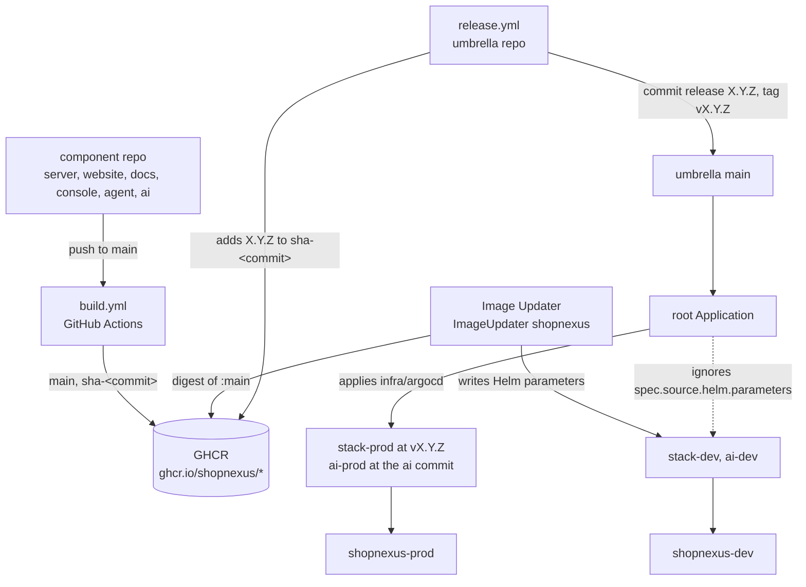
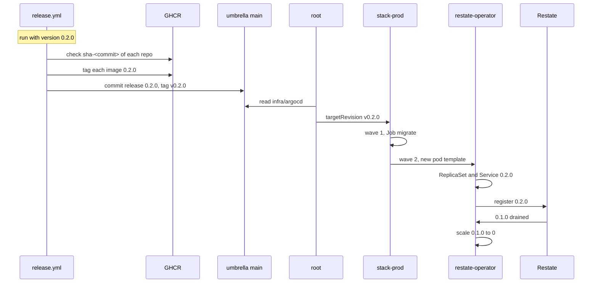

Six component repos build images: `server`, `website`, `docs`, `console` and `agent` for the stack chart, and `ai` for `ai-models`. A push to `main` in a component repo reaches dev: Argo CD Image Updater sees the new digest of `:main` and writes it on `stack-dev` or `ai-dev`. Prod runs one release of the umbrella repo. The Release workflow (`.github/workflows/release.yml` in `shopnexus/shopnexus`) takes the commits the umbrella's submodules point at on `main`, tags their images `X.Y.Z`, writes the release into `infra/`, and tags the umbrella `vX.Y.Z`. Every image in a prod release has the same version.



## Image tags

Each component repo has the same `.github/workflows/build.yml`. It runs on a push to `main` and by hand (`workflow_dispatch`), builds the repo's `Dockerfile` once, and pushes `ghcr.io/shopnexus/<repo>` with two tags. A version tag comes only from the umbrella's Release workflow, which adds it to an image CI already built, without a rebuild.

| Who | When | Tags |
|---|---|---|
| `build.yml` in the component repo | push to `main` | `main` and `sha-<full commit sha>` |
| `release.yml` in the umbrella | a run of the Release workflow | `X.Y.Z`, on the `sha-<commit>` image of the commit the umbrella points at |

A tag `vX.Y.Z` in a component repo builds nothing and does not reach prod. Builds of the same ref share a concurrency group, and a newer push cancels the build in progress. The cluster pulls without credentials, so the GHCR packages must stay public.

## Image retention

`build.yml` has a `cleanup` job that runs after `build`, with `dataaxiom/ghcr-cleanup-action` v1.2.2. It keeps `main` and every `X.Y.Z` tag, keeps the 10 newest other tagged images (the `sha-<commit>` builds), and deletes untagged and partial images.

Every image prod has run carries an `X.Y.Z` tag, so cleanup does not remove it. A release has to name, for each repo, a commit among its 10 newest builds; for an older commit the `sha-<commit>` image is gone and the Release workflow stops.

## Image Updater

`infra/argocd/stacks.yaml` holds one `ImageUpdater` resource, `shopnexus` in namespace `argocd`. It has entries for `stack-dev` and `ai-dev` only; prod has none. The Image Updater chart is 1.4.0, installed by the `image-updater` Application in `infra/platform/image-updater.yaml`.

| Application | Images it watches | `updateStrategy` | Helm parameters it writes |
|---|---|---|---|
| `stack-dev` | `ghcr.io/shopnexus/<component>:main` for `server`, `website`, `docs`, `console` and `agent` | `digest` | `images.<component>.repository`, `images.<component>.tag` |
| `ai-dev` | `ghcr.io/shopnexus/ai:main` | `digest` | `images.models.repository`, `images.models.tag` |

It moves when the digest behind `:main` changes and writes the tag as `main@sha256:…`. The other images in `values.yaml` (Postgres, Restate, RustFS) are pinned there and change only by a commit. The gateway and curl images are pinned in the `ai` repo's `chart/values.yaml`.

## Parameters and the root Application

Argo CD gives Helm parameters precedence over value files. On `stack-dev`, once Image Updater has written `images.server.tag`, the `images.*.tag` lines in `values-dev.yaml` no longer decide what runs. Prod has no parameters, so the tags in `values-prod.yaml` at the release tag decide what `stack-prod` runs.

The stack Applications are themselves resources of the app-of-apps `root` (`infra/argocd/root.yaml`), which syncs `infra/platform` and `infra/argocd` from the umbrella's `main` with `selfHeal: true`. Self-heal would put each Application back to its definition in git and erase the parameters on `stack-dev` and `ai-dev`. Two settings in `root` keep them:

```yaml title="infra/argocd/root.yaml"
ignoreDifferences:
  - group: argoproj.io
    kind: Application
    jsonPointers: [/spec/source/helm/parameters]
syncPolicy:
  automated: { prune: true, selfHeal: true }
  syncOptions: [RespectIgnoreDifferences=true]
```

`ignoreDifferences` makes `root` report no drift on that path. `RespectIgnoreDifferences=true` makes a sync leave the path as it is in the cluster. With only the first, the next sync of `root` would still overwrite the parameters.

## Argo CD settings

At its first start k3s installs the `argo-cd` chart 10.11.7 from `infra/cluster/argocd.yaml` and applies `root.yaml` once; the k3d config lists both files. From then on Argo CD manages `root` from git. A restart of the server node makes k3s apply its copy of `root.yaml` again, and self-heal puts the git version back within minutes.

| Setting | Where | Effect |
|---|---|---|
| `automated: { prune: true, selfHeal: true }` | every Application | a commit is applied without a click, a resource removed from git is deleted, and a hand edit in the cluster is reverted |
| `retry: { limit: -1, backoff: { duration: 30s, factor: 2, maxDuration: 5m } }` | every Application | a failed sync is retried forever, 30 s apart at first and at most 5 min apart |
| sync waves | platform Applications wave 0, `stack-dev`, `stack-prod` and the `ImageUpdater` wave 1 | the stacks start after the operators |
| Lua health check for `argoproj.io/Application` | the values in `argocd.yaml` | `root` reads each child Application's health, so wave 1 waits for the platform Applications to be Healthy |

Argo CD stopped judging the health of Application resources in version 1.8. Without the Lua check, `root` would treat the platform Applications as healthy at once, and the stacks would start before CloudNativePG, Sealed Secrets and restate-operator had their CRDs. The `ImageUpdater` carries `SkipDryRunOnMissingResource=true`, because its CRD arrives with the `image-updater` Application in the same sync.

Inside a stack, each sync runs the waves of the chart again, including the Sync hook Jobs `migrate`, `objectstore-init` and `objectstore-init-snapshots` (wave 1). A sync of `ai-<stack>` runs its Sync hook Job `ai-gateway-keys` (its wave 1). A new server image therefore runs its migrations before the new server pods start; the table of every wave is in [Postgres, Restate and RustFS](/en/operations/cluster/data#sync-waves-and-jobs).

## Ship to dev

<Steps>
<Step title="Push to main">
Merge or push to `main` in the component repo, for example `server`. `build.yml` builds the image and pushes `ghcr.io/shopnexus/server:main` and `sha-<sha>`.

```bash title="Terminal"
gh run watch --repo shopnexus/server
```
</Step>

<Step title="Wait for Image Updater">
Image Updater checks the registry every two minutes by default. When the digest behind `:main` has changed, it writes `images.server.tag` on `stack-dev` as `main@sha256:…`.

```bash title="Terminal"
kubectl -n argocd get application stack-dev \
  -o jsonpath='{range .spec.source.helm.parameters[*]}{.name}={.value}{"\n"}{end}'
```
</Step>

<Step title="Watch the rollout">
Argo CD syncs `stack-dev`. `migrate` runs with the new image, then restate-operator starts a new server version beside the old one, and the old version keeps running until its Restate invocations finish. Website, docs and console are plain Deployments and roll pod by pod.

```bash title="Terminal"
kubectl -n shopnexus-dev get rs -l app.kubernetes.io/name=server
```

You should see a new ReplicaSet with ready pods and the old one scaled to 0 once its invocations are done. The [data page](/en/operations/cluster/data) describes how restate-operator drains a version.
</Step>
</Steps>

## Release to prod

A release takes all six repos at once, at the commits the umbrella's submodules point at on `main`. The version is `X.Y.Z`, without the `v`, and must be higher than the highest `vX.Y.Z` tag of the umbrella.

<Steps>
<Step title="Bump the submodules">
In the umbrella, move the six submodules to the commits dev has run, which are the heads of their `main` once each repo's build has finished. Commit and push to the umbrella's `main`.

```bash title="Terminal"
git switch main && git pull
git submodule update --remote server website docs console agent ai
git add server website docs console agent ai
git commit -m "bump the components for 0.2.0"
git push origin main
```
</Step>

<Step title="Run the Release workflow">
Start it from the terminal, or from the umbrella's Actions tab: <UI>Release</UI>, then <UI>Run workflow</UI> with the version.

```bash title="Terminal"
gh workflow run release.yml -R shopnexus/shopnexus -f version=0.2.0
gh run watch -R shopnexus/shopnexus
```

The workflow checks that the version is `X.Y.Z`, that `v0.2.0` does not exist and that it is higher than the last release. It then checks that `ghcr.io/shopnexus/<repo>:sha-<commit>` exists for all six repos before it tags any of them, so a release is tagged whole or not at all. It adds the tag `0.2.0` to each image, writes the release into three files, commits `release 0.2.0` on `main`, tags that commit `v0.2.0` and pushes both.

| File | What the workflow writes |
|---|---|
| `infra/stack/values-prod.yaml` | `images.<component>.tag: 0.2.0` for `server`, `website`, `docs`, `console` and `agent` |
| `infra/argocd/stacks.yaml` | `targetRevision: v0.2.0` on `stack-prod` |
| `infra/argocd/ai.yaml` | `targetRevision: <ai commit>` and `images.models.tag: 0.2.0` on `ai-prod` |

Run `git pull` in your umbrella checkout afterwards, because the workflow has committed on `main`.
</Step>

<Step title="Watch stack-prod and ai-prod sync">
`root` applies the new `stacks.yaml` and `ai.yaml` from `main`. `stack-prod` then renders `infra/stack` at the tag `v0.2.0`, so the chart and `values-prod.yaml` are the release's, and `ai-prod` renders the `ai` repo's `chart/` at the release's ai commit.

```bash title="Terminal"
kubectl -n argocd annotate application root argocd.argoproj.io/refresh=normal
kubectl -n argocd get application stack-prod ai-prod \
  -o custom-columns='NAME:.metadata.name,REVISION:.spec.source.targetRevision,SYNC:.status.sync.status,HEALTH:.status.health.status'
```
</Step>

<Step title="Check the new version">
```bash title="Terminal"
kubectl -n shopnexus-prod get rs -l app.kubernetes.io/name=server
hurl --test --continue-on-error --variable domain=shopnexus.id.vn infra/smoke.hurl
```

Prod runs three server pods per version. You should see the new ReplicaSet at 3/3 and Hurl report the smoke test as a success.
</Step>
</Steps>



<Callout type="warning" title="Migrations run first">
The `migrate` Job applies the new version's migrations while the old server pods still serve traffic, and a rollback does not undo them. A migration has to work with the version before it.
</Callout>

<Callout type="note" title="First release">
The files name `0.1.0`, the tag `v0.1.0` and an ai commit before the first release, and `v0.1.0` does not exist yet. `stack-prod` cannot render until the first run of the Release workflow creates it.
</Callout>

## Roll back prod

Revert the release commit on the umbrella's `main`. The revert puts `values-prod.yaml`, `stacks.yaml` and `ai.yaml` back to the previous release, so `stack-prod` returns to the previous `vX.Y.Z` and `ai-prod` to the previous ai commit. Their `X.Y.Z` images are still in GHCR, because cleanup keeps every version tag.

<Steps>
<Step title="Revert the release commit">
```bash title="Terminal"
git switch main && git pull
git log --oneline --grep '^release ' -2
git revert <commit of release 0.2.0>
infra/check.sh
git push origin main
```
</Step>

<Step title="Watch the sync">
`root` applies the reverted Applications from `main`, and `stack-prod` and `ai-prod` sync the previous release. Use the commands of the step "Watch stack-prod and ai-prod sync" above.
</Step>
</Steps>

The revert leaves the submodule pointers and the tag `v0.2.0` in place. The next release must be higher than `0.2.0`, because the workflow compares the version with the highest `vX.Y.Z` tag.

## Change a config value

Non-secret settings live in `infra/stack/values.yaml` and the two stack files. Secrets go through the seal command, `infra/cmd/seal` ([Secrets](/en/operations/cluster/secrets)).

`stack-dev` renders `infra/stack` at the umbrella's `main`, so dev gets a change on push. `stack-prod` renders it at the release tag, so a change to `values.yaml`, `values-prod.yaml` or the chart reaches prod with the next release. The Application definitions in `infra/argocd`, among them the `valuesObject` of `ai-prod` in `ai.yaml`, come from `main` through `root` and reach both stacks on push.

<Steps>
<Step title="Edit the values file">
Change the value in `values-dev.yaml` or `values-prod.yaml`, for example `server.logLevel` or `replicas.server`. A value in `values.yaml` applies to both stacks unless a stack file sets it.
</Step>

<Step title="Check the chart">
```bash title="Terminal"
infra/check.sh
```

It renders the chart for both stacks and checks the result. It needs `helm`, `yq` and `kubeconform`, and CI runs it on every pull request under `infra/`.
</Step>

<Step title="Push to the umbrella">
Commit and push to `main`. Argo CD polls the repo every two to three minutes (`timeout.reconciliation` 120 s plus up to 60 s of jitter, the chart's defaults). To sync at once:

```bash title="Terminal"
kubectl -n argocd annotate application stack-dev argocd.argoproj.io/refresh=normal
```

For prod, [run a release](#release-to-prod) once the change is on `main`.
</Step>

<Step title="Watch it roll">
The server's pod template carries `checksum/env`, a hash of the `server-env` ConfigMap, so a server setting starts a new server version. `ai-gateway`'s Deployment carries `checksum/config` for its config, and no checksum of the stack's secrets: after a reseal of `litellm-secrets`, run `kubectl -n shopnexus-<stack> rollout restart deploy/ai-gateway`.
</Step>
</Steps>

A `kubectl edit` on a resource of a stack lasts until the next self-heal, which puts the resource back to git.

## Check what version runs

<Tabs labels={["kubectl", "Argo CD UI"]}>
<Tab>
The release `stack-prod` runs, and the ai commit and `ai-models` tag of `ai-prod`:

```bash title="Terminal"
kubectl -n argocd get application stack-prod -o jsonpath='{.spec.source.targetRevision}{"\n"}'
kubectl -n argocd get application ai-prod \
  -o jsonpath='{.spec.source.targetRevision} {.spec.source.helm.valuesObject.images.models.tag}{"\n"}'
```

The image tags of that release, from git:

```bash title="Terminal"
git show v0.2.0:infra/stack/values-prod.yaml | yq '.images'
```

The image and digest each pod runs:

```bash title="Terminal"
kubectl -n shopnexus-prod get pods \
  -o custom-columns='POD:.metadata.name,IMAGE:.spec.containers[0].image,DIGEST:.status.containerStatuses[0].imageID'
```

The server versions restate-operator keeps, with their pod counts:

```bash title="Terminal"
kubectl -n shopnexus-prod get rs -l app.kubernetes.io/name=server
```
</Tab>
<Tab>
Forward the Argo CD server's port and read the initial admin password:

```bash title="Terminal"
kubectl -n argocd port-forward svc/argocd-server 8080:443
kubectl -n argocd get secret argocd-initial-admin-secret -o jsonpath='{.data.password}' | base64 -d
```

Open `https://localhost:8080`, accept the self-signed certificate, and sign in as `admin` with that password. Open the `stack-prod` Application, then <UI>App Details</UI>, which shows the target revision `vX.Y.Z`. The resource tree shows each ReplicaSet with its pods and their images.
</Tab>
</Tabs>

<Callout type="note" title="Server health in Argo CD">
Argo CD has no health check for `RestateDeployment`, so a server that crash-loops still shows Healthy in Argo CD. Read the pods with `kubectl` after a release.
</Callout>

<KeyRules>
- Dev follows `:main` by digest. Prod runs one release of the umbrella, `vX.Y.Z`, and every image in it has the tag `X.Y.Z`.
- A release takes the commits the umbrella's submodules point at on `main`. Bump them to what dev ran before you run the Release workflow.
- The prod lines of `values-prod.yaml`, `stacks.yaml` and `ai.yaml` change by a release or by the revert of one.
- A release can name only commits among each repo's 10 newest builds.
- Every migration works with the server version before it.
- A change to the cluster goes through git. A hand edit is reverted by self-heal.
</KeyRules>

## Troubleshooting

<AccordionGroup>
<Accordion title="The Release workflow fails with sha-<commit> does not exist">
The submodule points at a commit with no image in GHCR. Either the repo's `build.yml` has not built that commit yet, or cleanup removed the image because it is older than the 10 newest builds. Wait for the build, or bump the submodule to a newer commit, push, and run the workflow again. No image has been tagged at that point, because the workflow checks all six before it tags any.
</Accordion>

<Accordion title="The Release workflow cannot tag an image">
The workflow's `GITHUB_TOKEN` writes a package only when that package grants the umbrella repository write access. This is a one-time step in the GitHub UI for each of the six packages `server`, `website`, `docs`, `console`, `agent` and `ai`: open the package settings, then <UI>Manage Actions access</UI>, add `shopnexus/shopnexus` and give it the Write role.
</Accordion>

<Accordion title="The Release workflow refuses the version">
The version must be `X.Y.Z` without a `v`, its tag `vX.Y.Z` must not exist, and it must be higher than the highest `vX.Y.Z` tag of the umbrella, including a release that was reverted.
</Accordion>

<Accordion title="Prod runs other tags than values-prod.yaml">
Check `stack-prod` for Helm parameters, which win over the values file. A cluster that ran an older setup, where Image Updater wrote prod tags, can still hold them, and `root` does not remove them. Delete them:

```bash title="Terminal"
kubectl -n argocd patch application stack-prod --type json \
  -p '[{"op":"remove","path":"/spec/source/helm/parameters"}]'
```
</Accordion>

<Accordion title="Parameters disappear after a sync of root">
`root.yaml` must keep both the `ignoreDifferences` entry for `/spec/source/helm/parameters` and `RespectIgnoreDifferences=true`. `infra/check.sh` fails when the first is missing.
</Accordion>

<Accordion title="A stack Application stays OutOfSync or Unknown">
Read the condition with `kubectl -n argocd get application stack-prod -o jsonpath='{.status.conditions}'`. A ComparisonError that names `./cmd/seal` means `infra/stack/secrets/<stack>/` holds no SealedSecrets. Before the first release, `stack-prod` cannot resolve `v0.1.0`. Other errors come from the chart; reproduce them with `infra/check.sh`. Argo CD retries the sync with backoff up to 5 minutes, so a fix in git is picked up without a click.
</Accordion>
</AccordionGroup>
