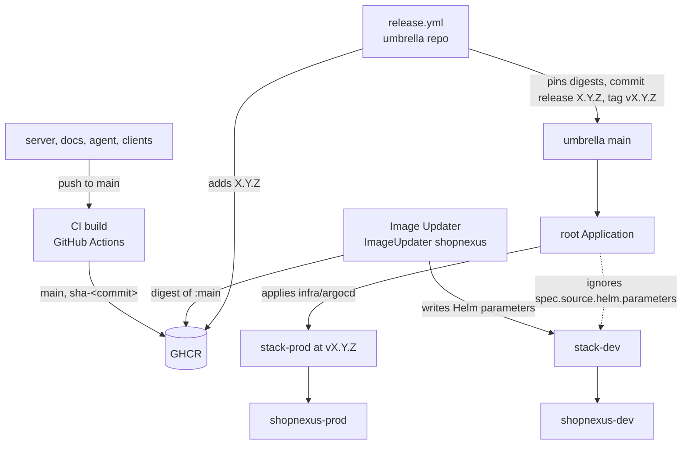

The stack chart runs five images built by four repos: `server`, `docs`, the console agent's repo, and `clients`, which builds the website and the console. A push to `main` reaches dev: Argo CD Image Updater sees the new digest of `:main` and writes it on `stack-dev`. Prod runs one release of the umbrella repo. The Release workflow (`.github/workflows/release.yml` in `shopnexus/shopnexus`) finds the image CI built for each component at the commit the umbrella points at, tags it `X.Y.Z`, pins its digest in `infra/`, and tags the umbrella `vX.Y.Z`. The process, hotfixes and rollback are also in `infra/RELEASING.md`.



## Images and tags

| Image | Built by | On |
|---|---|---|
| `ghcr.io/shopnexus/server` | `build.yml` in `server` | every push to `main` |
| `ghcr.io/shopnexus/docs` | `build.yml` in `docs` | every push to `main` |
| `ghcr.io/shopnexus/agent` | `build.yml` in the console agent's repo | every push to `main` |
| `ghcr.io/shopnexus/clients/website` | `website.yml` in `clients` | a push to `main` that changes `website/` or `brand/web/` |
| `ghcr.io/shopnexus/clients/console` | `console.yml` in `clients` | a push to `main` that changes `console/` |

Each build runs once and pushes two tags, `main` and `sha-<full commit sha>`. A version tag `X.Y.Z` comes only from the umbrella's Release workflow, which adds it to an image CI already built, without a rebuild. A tag in a component repo builds nothing and does not reach prod. Builds of the same ref share a concurrency group, and a newer push cancels the build in progress. The cluster pulls without credentials, so the GHCR packages must stay public.

## Image retention

Each build workflow has a `cleanup` job that runs after the build, with `dataaxiom/ghcr-cleanup-action` v1.2.2. It keeps `main` and every `X.Y.Z` tag, keeps the 10 newest other tagged images (the `sha-<commit>` builds), and deletes untagged and partial images.

Every image prod has run carries an `X.Y.Z` tag, so cleanup does not remove it. A release that changes an image has to name a commit among its 10 newest builds; for an older commit the `sha-<commit>` image is gone and the Release workflow stops. An image that does not change keeps the digest prod already runs.

## Image Updater

`infra/argocd/stacks.yaml` holds one `ImageUpdater` resource, `shopnexus` in namespace `argocd`. It has an entry for `stack-dev` only; prod has none. The Image Updater chart is 1.4.0, installed by the `image-updater` Application.

| Application | Images it watches | `updateStrategy` | Helm parameters it writes |
|---|---|---|---|
| `stack-dev` | the `:main` tag of the five images above | `digest` | `images.<component>.repository`, `images.<component>.tag` |

It moves when the digest behind `:main` changes and writes the tag as `main@sha256:…`. The other images in `values.yaml` (Postgres, Restate, RustFS, Bifrost, imgproxy, Grafana and the rest) are pinned there and change only by a commit.

## Parameters and the root Application

Argo CD gives Helm parameters precedence over value files. On `stack-dev`, once Image Updater has written `images.server.tag`, the `images.*.tag` lines in the values files no longer decide what runs. Prod has no parameters, so the digests in `values-prod.yaml` at the release tag decide what `stack-prod` runs.

The stack Applications are themselves resources of the app-of-apps `root` (`infra/argocd/root.yaml`), which syncs `infra/platform` and `infra/argocd` from the umbrella's `main` with `selfHeal: true`. Self-heal would put each Application back to its definition in git and erase the parameters on `stack-dev`. Two settings in `root` keep them:

```yaml title="infra/argocd/root.yaml"
ignoreDifferences:
  - group: argoproj.io
    kind: Application
    jsonPointers: [/spec/source/helm/parameters]
syncPolicy:
  automated: { prune: true, selfHeal: true }
  syncOptions: [RespectIgnoreDifferences=true]
```

`ignoreDifferences` makes `root` report no drift on that path. `RespectIgnoreDifferences=true` makes a sync leave the path as it is in the cluster. With only the first, the next sync of `root` would still overwrite the parameters.

## Argo CD settings

| Setting | Where | Effect |
|---|---|---|
| `automated: { prune: true, selfHeal: true }` | every Application | a commit is applied without a click, a resource removed from git is deleted, and a hand edit in the cluster is reverted |
| `retry: { limit: -1, refresh: true, backoff: { duration: 30s, factor: 2, maxDuration: 5m } }` | every Application | a failed sync is retried forever, 30 s apart at first and at most 5 min apart, each time on the newest commit, so a fix pushed after the failure lands |
| sync waves | platform Applications wave 0, `stack-dev`, `stack-prod` and the `ImageUpdater` wave 1 | the stacks start after the operators |
| Lua health check for `argoproj.io/Application` | `infra/cluster/argocd.yaml` | wave 1 of `root` waits for the platform Applications to be Healthy |
| Lua health check for `RestateDeployment` | `infra/cluster/argocd.yaml` | a stack's wave 3 waits for the new server version's pods to be ready |

The `ImageUpdater` carries `SkipDryRunOnMissingResource=true`, because its CRD arrives with the `image-updater` Application in the same sync. Inside a stack, each sync runs the waves of the chart again, including the Sync hook Jobs `migrate`, `objectstore-init` and `objectstore-init-snapshots` (wave 1). A new server image therefore runs its migrations before the new server pods start; the table of every wave is in [Postgres, Restate and RustFS](/en/operations/cluster/data#sync-waves-and-jobs).

## Ship to dev

<Steps>
<Step title="Push to main">
Merge or push to `main` in the component repo, for example `server`. CI builds the image and pushes `:main` and `:sha-<sha>`.

```bash title="Terminal"
gh run watch --repo shopnexus/server
```
</Step>

<Step title="Wait for Image Updater">
Image Updater checks the registry every two minutes by default. When the digest behind `:main` has changed, it writes `images.server.tag` on `stack-dev` as `main@sha256:…`.

```bash title="Terminal"
kubectl -n argocd get application stack-dev \
  -o jsonpath='{range .spec.source.helm.parameters[*]}{.name}={.value}{"\n"}{end}'
```
</Step>

<Step title="Watch the rollout">
Argo CD syncs `stack-dev`. `migrate` runs with the new image, then restate-operator starts a new server version beside the old one. Once its pods are ready, `server-api` moves to it, and the old version keeps running until its Restate invocations finish. Website, docs and console are plain Deployments and roll pod by pod.

```bash title="Terminal"
kubectl -n shopnexus-dev get rs -l app.kubernetes.io/name=server
```

You should see a new ReplicaSet with ready pods and the old one scaled to 0 once its invocations are done.
</Step>
</Steps>

## Release to prod

A release is one version `X.Y.Z` for everything on the cluster, without the `v`, higher than the highest `vX.Y.Z` tag of the umbrella. A minor release ships what `main` has, a patch is a hotfix, and a major marks a milestone or a change old app versions cannot follow.

<Steps>
<Step title="Bump the submodules">
In the umbrella, move the submodules to the commits dev has run, which are the heads of their `main` once each build has finished. Commit and push to the umbrella's `main`.

```bash title="Terminal"
git switch main && git pull
git submodule update --remote
git commit -am "bump the components for 0.2.0"
git push origin main
```
</Step>

<Step title="Read the plan">
`infra/release-plan.sh` prints, for each image, the commit prod runs and the commit the release would run. Server, docs and the agent are at their submodule's commit; website and console at the last `clients` commit that changed their folders.

```text
| image   | prod now | this release |                   |
| server  | 13aa05d9 | 13aa05d9     | unchanged         |
| website | 991ff690 | f9cc614f     | rolls (2 commits) |
```

If it shows something you did not mean to ship, stop and fix `main` first.
</Step>

<Step title="Run the Release workflow">
Start it from the terminal, or from the umbrella's Actions tab: <UI>Release</UI>, then <UI>Run workflow</UI> with the version.

```bash title="Terminal"
gh workflow run release.yml -R shopnexus/shopnexus -f version=0.2.0
gh run watch -R shopnexus/shopnexus
```

The workflow checks the version, then runs the plan and finds each image's digest on GHCR. One missing image stops the release before anything is tagged. It tags every image `0.2.0`, writes the release into two files, commits `release 0.2.0` on `main`, tags that commit `v0.2.0` and pushes both.

| File | What the workflow writes |
|---|---|
| `infra/stack/values-prod.yaml` | `tag: <digest>, commit: <sha>` for each of the five images |
| `infra/argocd/stacks.yaml` | `targetRevision: v0.2.0` on `stack-prod` |

Run `git pull` in your umbrella checkout afterwards, because the workflow has committed on `main`.
</Step>

<Step title="Watch stack-prod sync">
`root` applies the new `stacks.yaml` from `main`. `stack-prod` then renders `infra/stack` at the tag `v0.2.0`, so the chart and `values-prod.yaml` are the release's. An image whose digest did not change renders the same manifest, and its pods keep running.

```bash title="Terminal"
kubectl -n argocd annotate application root argocd.argoproj.io/refresh=normal
kubectl -n argocd get application stack-prod \
  -o custom-columns='NAME:.metadata.name,REVISION:.spec.source.targetRevision,SYNC:.status.sync.status,HEALTH:.status.health.status'
```
</Step>

<Step title="Check the new version">
```bash title="Terminal"
kubectl -n shopnexus-prod get rs -l app.kubernetes.io/name=server
hurl --test --continue-on-error --variable domain=shopnexus.id.vn infra/smoke.hurl
```

Prod runs three server pods per version. You should see the new ReplicaSet at 3/3 and Hurl report the smoke test as a success.
</Step>
</Steps>

A release also ships every change to `infra/` that reached `main` since the last one, because `stack-prod` moves to the new umbrella tag, and a fresh run of the migration jobs.

<Callout type="warning" title="Migrations run first">
The `migrate` Job applies the new version's migrations while the old server pods still serve traffic, and a rollback does not undo them. A migration has to work with the version before it, and the API stays backward compatible: add a field or an endpoint first, move the clients to it, and remove the old one in a later release.
</Callout>

<Callout type="note" title="First release">
Before the first release, `values-prod.yaml` names `0.1.0` for every image and `stack-prod` the tag `v0.1.0`, which does not exist, so `stack-prod` cannot render. Seal prod's secrets (`go -C infra run ./cmd/seal prod`) before the first run of the Release workflow.
</Callout>

### Hotfix

Fix the bug on the component's `main`, check it on dev, bump that submodule in the umbrella and push. `infra/release-plan.sh` should show only that image rolling. Release the next patch version.

## Roll back prod

Revert the release commit on the umbrella's `main` and push. The revert puts `values-prod.yaml` and `stacks.yaml` back to the previous release, so `stack-prod` returns to the previous `vX.Y.Z` and its digests. Those images are still in GHCR, because cleanup keeps every version tag.

```bash title="Terminal"
git switch main && git pull
git log --oneline --grep '^release ' -2
git revert <commit of release 0.2.0>
infra/check.sh
git push origin main
```

The revert leaves the submodule pointers and the tag `v0.2.0` in place. The next release must be higher than `0.2.0`, because the workflow compares the version with the highest `vX.Y.Z` tag.

## Change a config value

Non-secret settings live in `infra/stack/values.yaml`, the two stack files and the shared `infra/stack/env/*.env`. Secrets go through the seal command ([Secrets](/en/operations/cluster/secrets)).

`stack-dev` renders `infra/stack` at the umbrella's `main`, so dev gets a change on push. `stack-prod` renders it at the release tag, so a change to the chart or its values reaches prod with the next release. The Application definitions in `infra/argocd` come from `main` through `root` and reach both stacks on push.

<Steps>
<Step title="Edit the values file">
Change the value in `values-dev.yaml` or `values-prod.yaml`, for example `server.logLevel` or `replicas.server`. A value in `values.yaml` applies to both stacks unless a stack file sets it.
</Step>

<Step title="Check the chart">
```bash title="Terminal"
infra/check.sh
```

It renders the chart for both stacks and checks the result. It needs `helm`, `yq` and `kubeconform`, and CI runs it on every change under `infra/`.
</Step>

<Step title="Push to the umbrella">
Commit and push to `main`. Argo CD polls the repo every two to three minutes. To sync at once:

```bash title="Terminal"
kubectl -n argocd annotate application stack-dev argocd.argoproj.io/refresh=normal
```

For prod, [run a release](#release-to-prod) once the change is on `main`.
</Step>

<Step title="Watch it roll">
The server's pod template carries `checksum/env`, a hash of the `server-env` ConfigMap, so a server setting starts a new server version. Bifrost's Deployment carries `checksum/config` for `config.json`, `start.sh` and `env/bifrost.env`, and `checksum/secrets` for the stack's sealed secrets, so a change to either restarts it.
</Step>
</Steps>

A `kubectl edit` on a resource of a stack lasts until the next self-heal, which puts the resource back to git.

## Check what version runs

<Tabs labels={["kubectl", "Argo CD UI"]}>
<Tab>
The release `stack-prod` runs:

```bash title="Terminal"
kubectl -n argocd get application stack-prod -o jsonpath='{.spec.source.targetRevision}{"\n"}'
```

The digest and commit of each image in that release, from git:

```bash title="Terminal"
git show v0.2.0:infra/stack/values-prod.yaml | yq '.images'
```

The image and digest each pod runs:

```bash title="Terminal"
kubectl -n shopnexus-prod get pods \
  -o custom-columns='POD:.metadata.name,IMAGE:.spec.containers[0].image,DIGEST:.status.containerStatuses[0].imageID'
```
</Tab>
<Tab>
Open `https://argocd.<prod domain>`, behind the console's sign-in, or forward its port with `kubectl -n argocd port-forward svc/argocd-server 8080:80` and open `http://localhost:8080`. Open the `stack-prod` Application, then <UI>App Details</UI>, which shows the target revision `vX.Y.Z`. The resource tree shows each ReplicaSet with its pods and their images.
</Tab>
</Tabs>

<KeyRules>
- Dev follows `:main` by digest. Prod runs one release of the umbrella, `vX.Y.Z`, with every image pinned by digest and tagged `X.Y.Z`.
- `main` is always releasable: whatever is merged has run on dev and can ship.
- Read `infra/release-plan.sh` before you run the Release workflow.
- The prod lines of `values-prod.yaml` and `stacks.yaml` change by a release or by the revert of one.
- Every migration works with the server version before it.
- A change to the cluster goes through git. A hand edit is reverted by self-heal.
</KeyRules>

## Troubleshooting

<AccordionGroup>
<Accordion title="The Release workflow fails with an image that does not exist">
The plan names a commit with no `sha-<commit>` image in GHCR. Either CI has not built that commit yet, or cleanup removed the image because it is older than the 10 newest builds. Wait for the build, or bump the submodule to a newer commit, push, and run the workflow again. No image has been tagged at that point.
</Accordion>

<Accordion title="The Release workflow cannot tag an image">
The workflow's `GITHUB_TOKEN` writes a package only when that package grants the umbrella repository write access. This is a one-time step in the GitHub UI for each of the five packages: open the package settings, then <UI>Manage Actions access</UI>, add `shopnexus/shopnexus` and give it the Write role. The workflow also reads the private `clients` repo with the deploy key in the secret `CLIENTS_DEPLOY_KEY`.
</Accordion>

<Accordion title="The Release workflow refuses the version">
The version must be `X.Y.Z` without a `v`, its tag `vX.Y.Z` must not exist, and it must be higher than the highest `vX.Y.Z` tag of the umbrella, including a release that was reverted.
</Accordion>

<Accordion title="Prod runs other tags than values-prod.yaml">
Check `stack-prod` for Helm parameters, which win over the values file, and delete them:

```bash title="Terminal"
kubectl -n argocd patch application stack-prod --type json \
  -p '[{"op":"remove","path":"/spec/source/helm/parameters"}]'
```
</Accordion>

<Accordion title="Parameters disappear after a sync of root">
`root.yaml` must keep both the `ignoreDifferences` entry for `/spec/source/helm/parameters` and `RespectIgnoreDifferences=true`. `infra/check.sh` fails when the first is missing.
</Accordion>

<Accordion title="A stack Application stays OutOfSync or Unknown">
Read the condition with `kubectl -n argocd get application stack-prod -o jsonpath='{.status.conditions}'`. A ComparisonError that names `./cmd/seal` means `infra/stack/secrets/<stack>/` holds no SealedSecrets. Before the first release, `stack-prod` cannot resolve `v0.1.0`. Other errors come from the chart; reproduce them with `infra/check.sh`. Argo CD retries the sync with backoff up to 5 minutes, so a fix in git is picked up without a click.
</Accordion>
</AccordionGroup>
