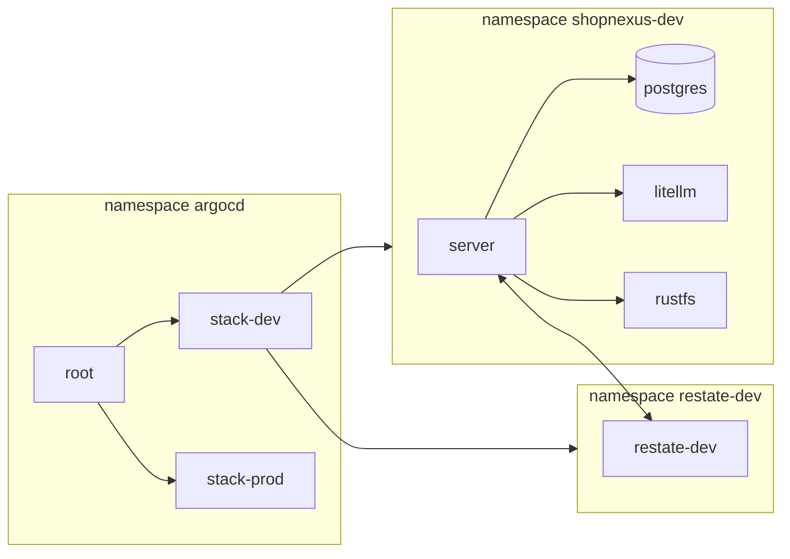

Run the commands on the machine where `kubectl` points at the k3d cluster `shopnexus`, from the root of the umbrella repository checkout. On the author's server that is the server itself, reached over SSH. The examples use dev; replace `dev` with `prod` in the namespace names for prod.

| | dev | prod |
|---|---|---|
| Argo CD Application | `stack-dev` | `stack-prod` |
| Stack namespace | `shopnexus-dev` | `shopnexus-prod` |
| Restate namespace and cluster | `restate-dev` | `restate-prod` |
| Domain | `dev.shopnexus.id.vn` | `shopnexus.id.vn` |
| Server pods | 1 | 3 |
| Postgres instances | 1 | 2 |
| Restate nodes | 1 | 3 |



## Status

```bash
kubectl -n argocd get applications
kubectl -n shopnexus-dev get pods -o wide
kubectl -n restate-dev get pods -o wide
kubectl -n shopnexus-dev get cluster postgres
kubectl -n shopnexus-dev get rs
```

Every Application should be `Synced` and `Healthy`. `kubectl get rs` shows one ReplicaSet per server version: restate-operator keeps an old version until its invocations finish. Argo CD shows a crash-looping server as Healthy, because it has no health check for `RestateDeployment`, so read the pods.

After a push, Argo CD polls the repository. To make it read `main` now:

```bash
kubectl -n argocd annotate application stack-dev argocd.argoproj.io/refresh=hard --overwrite
```

Check every public host of a stack:

```bash
hurl --test --continue-on-error --variable domain=dev.shopnexus.id.vn infra/smoke.hurl
```

Hurl reports the file as a success and exits with 0. Add `--insecure` if the certificates come from Let's Encrypt staging.

## Logs

```bash
kubectl -n shopnexus-dev logs -l app.kubernetes.io/name=server --prefix --tail=200
kubectl -n shopnexus-dev logs deploy/litellm --tail=200
kubectl -n shopnexus-dev logs job/litellm-key
kubectl -n shopnexus-dev logs job/migrate
kubectl -n restate-dev logs restate-dev-0 --tail=200
kubectl -n shopnexus-dev logs postgres-1 --tail=200
```

The server logs JSON. CNPG names the Postgres pods `postgres-1`, `postgres-2`; the current primary is in `kubectl -n shopnexus-dev get cluster postgres -o jsonpath='{.status.currentPrimary}'`. The Sync hook Jobs `migrate`, `objectstore-init`, `objectstore-init-snapshots` and `litellm-key` stay until the next sync replaces them.

## Port-forwards

None of these have an Ingress. Each command holds the terminal; open the address in a browser or with `curl` from a second one.

<Tabs labels={["Argo CD", "Restate admin", "LiteLLM"]}>
<Tab>
```bash
kubectl -n argocd get secret argocd-initial-admin-secret -o jsonpath='{.data.password}' | base64 -d; echo
kubectl -n argocd port-forward svc/argocd-server 8080:443
```

Open `https://localhost:8080`, accept the self-signed certificate, and sign in as `admin` with the printed password.
</Tab>
<Tab>
```bash
kubectl -n restate-dev port-forward svc/restate 9070:9070
curl -s http://localhost:9070/deployments
```

Port 9070 is Restate's admin API, with its UI at `http://localhost:9070/ui`. Inside a Restate pod the CLI talks to the same API: `kubectl -n restate-dev exec restate-dev-0 -- restate deployments list`.
</Tab>
<Tab>
```bash
kubectl -n shopnexus-dev get secret litellm-secrets -o jsonpath='{.data.LITELLM_MASTER_KEY}' | base64 -d; echo
kubectl -n shopnexus-dev port-forward svc/litellm 4000:4000
```

Open `http://localhost:4000/ui` and sign in as `admin` with the master key. [Language model gateway](/en/operations/cluster/llm-gateway) shows how to read the spend.
</Tab>
</Tabs>

## Staff admins

Admins exist only through the `staff` command (`server/cmd/staff`). The API and the console create and manage moderators, and refuse to act on an admin. The server image ships the command as `/staff`, and it reads the database and `STAFF_KEY` from the pod's environment, so run it inside a server pod of the stack:

```bash
kubectl -n shopnexus-prod exec -it $(kubectl -n shopnexus-prod get pod -l app.kubernetes.io/name=server -o name | head -1) -- /staff create-admin --email <email> --name <name>
```

| Command | Use it when |
|---|---|
| `create-admin --email <email> --name <name>` | a new cluster has no admin yet, or another admin is needed. It prints a temporary password, which the console replaces at the first sign-in. |
| `unlock --email <email>` | an admin is locked out. Five wrong passwords lock an email for 15 minutes, and anyone who knows the email can cause that. |
| `reset-password --email <email>` | an admin forgot the password. It prints a new temporary password and ends the admin's sessions. |
| `reset-totp --email <email>` | an admin lost the authenticator. The next sign-in enrolls a new one. |
| `disable --email <email>` | an admin leaves. It ends every session of the member. |
| `enable --email <email>` | a disabled admin comes back. Old sessions stay ended. |

Every command except `create-admin` also works on a moderator, and each change is recorded in `staff_actions` with the CLI as its author. Use `shopnexus-dev` for the dev stack.

## Failover drills

The drills come from the plan's Task 17. They have not been run on the author's server yet. Record each run (date, command, what you saw) in `infra/drills.md`. The Postgres and agent drills run against prod, the isolation drill probes prod from dev, and the release and upload drills use dev.

<Steps>
<Step title="Postgres primary">
```bash
p=$(kubectl -n shopnexus-prod get cluster postgres -o jsonpath='{.status.currentPrimary}')
kubectl -n shopnexus-prod delete pod "$p"
for i in $(seq 30); do kubectl -n shopnexus-prod get cluster postgres -o jsonpath='{.status.currentPrimary} {.status.phase}{"\n"}'; sleep 2; done
hurl --test --continue-on-error --variable domain=shopnexus.id.vn infra/smoke.hurl
```

Expected: `currentPrimary` changes to the other instance within a minute, and the smoke test passes.
</Step>
<Step title="An agent stops">
```bash
docker stop k3d-shopnexus-agent-1
sleep 90
kubectl -n shopnexus-prod get pods -o wide
kubectl -n restate-prod get pods -o wide
hurl --test --continue-on-error --variable domain=shopnexus.id.vn infra/smoke.hurl
docker start k3d-shopnexus-agent-1
```

Expected: after the node's eviction timeout, the server pods from agent-1 run on other nodes. Two Restate pods stay Running and Restate keeps serving, so `https://api.shopnexus.id.vn/readyz` answers 200 and the smoke test passes.
</Step>
<Step title="A release during a running invocation">
Start a durable flow that takes a while on dev, such as posting a listing with photos from the app. Within the same minute, push a commit to `main` of the `server` repository. When CI has built the image:

```bash
kubectl -n shopnexus-dev get rs
kubectl -n restate-dev exec restate-dev-0 -- restate deployments list
```

Expected: two server ReplicaSets and two Restate deployments while the flow runs. The flow completes, and afterwards the old ReplicaSet scales to 0.
</Step>
<Step title="Dev cannot reach prod">
```bash
kubectl -n shopnexus-dev run probe --rm -i --restart=Never --image=busybox:stable -- sh -c "nc -zv -w 3 postgres-rw.shopnexus-prod 5432; nc -zv -w 3 postgres-rw.shopnexus-dev 5432"
```

Expected: the connection to dev succeeds, and the connection to prod times out because the NetworkPolicy of `shopnexus-prod` drops it.
</Step>
<Step title="A presigned upload through both proxies">
```bash
mkdir -p tmp
grep -E "^OBJECT_STORE_(ACCESS|SECRET)_KEY=" infra/stack/secrets/dev.env > tmp/s3.env
echo smoke > tmp/smoke.txt
docker run --rm --env-file <(sed -e 's/^OBJECT_STORE_ACCESS_KEY=/AWS_ACCESS_KEY_ID=/' -e 's/^OBJECT_STORE_SECRET_KEY=/AWS_SECRET_ACCESS_KEY=/' tmp/s3.env) \
  -e AWS_REGION=us-east-1 -v "$PWD/tmp:/w" amazon/aws-cli \
  s3 cp /w/smoke.txt s3://shopnexus/media/smoke.txt --endpoint-url https://media.dev.shopnexus.id.vn
curl -fsS https://media.dev.shopnexus.id.vn/shopnexus/media/smoke.txt
rm tmp/s3.env
```

Run it in bash: `<(...)` is bash process substitution. Expected: the upload succeeds, which shows the signature over `media.dev.shopnexus.id.vn` survives Caddy and Traefik, and `curl` prints `smoke`, because the `media/` prefix is public-read.
</Step>
<Step title="Memory">
```bash
free -g | sed -n 2p
docker stats --no-stream --format "{{.Name}} {{.MemUsage}}" | grep k3d-shopnexus
```

Record the available memory and the use of each k3d node in `infra/drills.md`. The spec estimates the two stacks at 6 to 8 GB, and this drill measures it.
</Step>
</Steps>

## Known failures

<AccordionGroup>
<Accordion title="stack-dev shows ComparisonError and asks to run the seal command" open>
The Application is `Unknown` with a message `infra/stack/secrets/dev/ holds no sealed secrets: run go -C infra run ./cmd/seal dev, commit and push`. The chart refuses to render a stack that has no SealedSecrets, and right after the cluster is created none exist yet. Run `go -C infra run ./cmd/seal dev`, commit `infra/stack/secrets/dev/*.yaml` and push. The Application retries on its own, every 30 seconds at first and at most every 5 minutes.
</Accordion>
<Accordion title="Traefik runs with defaults and ignores the edge config">
In direct mode there is no HTTP to HTTPS redirect and no Let's Encrypt certificate, or `X-Forwarded-For` is not believed behind a proxy. k3s installs Traefik through its Helm controller, and when the `HelmChartConfig` from the k3d config (`infra/cluster/k3d-*.yaml`) fails the Traefik chart's schema, k3s runs Traefik with the chart's defaults and says so only in the install job's log. Read it with `kubectl -n kube-system logs job/helm-install-traefik`. The Traefik configs are written for Traefik chart 41.4.0, and `infra/check.sh` renders both against it; run it after any edit to a k3d config.
</Accordion>
<Accordion title="Postgres pods fail on the image or on file permissions">
CNPG reads the Postgres major version from the image tag, and ParadeDB's tags such as `0.26.4-pg18` do not parse. The chart works around it with an `ImageCatalog` that states major 18, so keep `major: 18` in `postgres.yaml` in step with the tag in `images.postgres`. CNPG also assumes uid 26, its own images' user, while the ParadeDB image runs Postgres as uid 999; the chart sets `postgresUID: 999` and `postgresGID: 999`. A permission error on the data directory after an image change means the new image uses another uid: read it with `docker run --rm --entrypoint id paradedb/paradedb:0.26.4-pg18`, with the new tag.
</Accordion>
<Accordion title="The server never becomes ready">
`/readyz` answers 503 and the server logs `not ready` with `check restate: ...`. Readiness pings Postgres and Restate's admin API at `http://restate.restate-dev:9070`. restate-operator admits traffic to Restate's ingress and admin ports only from the peers in `spec.security.networkPeers` of the `RestateCluster`, which the chart sets to the server pods of the stack namespace. Check that the Restate pods run (`kubectl -n restate-dev get pods`) and that the operator's policies name the server (`kubectl -n restate-dev get networkpolicy -o yaml`). Restate can call back only pods labelled `allow.restate.dev/restate-dev: "true"`, which the server's pod template carries.
</Accordion>
<Accordion title="The seal command stops on a missing restate.pem, or Restate's calls are refused">
The seal command keeps Restate's signing key in `infra/stack/secrets/<stack>.restate.pem` and its public half in `RESTATE_IDENTITY_KEY` in `<stack>.env`. When the `.env` has the public key but the `.pem` is gone, the seal command stops with `restore dev.restate.pem from the backup`. Restore the file from the backup. A new pair would make Restate sign its requests with a key the running server does not know: the server refuses those requests, and durable flows stop while Restate retries them. A deliberate rotation deletes both the line and the `.pem` and restarts the Restate pods afterwards; [Secrets](/en/operations/cluster/secrets#the-restate-key) has the steps.
</Accordion>
<Accordion title="The server crash-loops with LLM_* or another variable not set">
The server has no defaults. At start it exits with one line per variable that is missing or empty, such as `LLM_API_KEY is not set`. `LLM_BASE_URL` and `LLM_MODEL` come from the ConfigMap `server-env`; `LLM_API_KEY` and the other keys come from the sealed `server-secrets`. A missing key in `server-secrets` means the SealedSecrets were made before the seal command knew that key: run `go -C infra run ./cmd/seal dev` again (it keeps the existing keys and adds the new ones), commit and push. An empty `litellm.model` or `litellm.apiBase` never reaches the server: the chart fails to render with `litellm.model is required`, which Argo CD shows as a ComparisonError.
</Accordion>
<Accordion title="dev.shopnexus.id.vn does not resolve">
`api.dev.shopnexus.id.vn` resolves but `dev.shopnexus.id.vn` does not. A `*` record does not cover `dev` once a `*.dev` record exists, so the zone needs an explicit `dev` record next to `@`, `*` and `*.dev`. Check with `dig +short dev.shopnexus.id.vn`.
</Accordion>
<Accordion title="Let's Encrypt refuses certificates">
In direct mode Traefik's log shows ACME errors about rate limits. Let's Encrypt's production endpoint limits how many certificates a domain gets per week, and repeated bring-ups use them up. Traefik uses the production endpoint by default. For repeated test bring-ups, add `caServer: https://acme-staging-v02.api.letsencrypt.org/directory` under `acme` in `infra/cluster/k3d-direct.yaml` before you create the cluster, and run the smoke test with `--insecure`. Behind a proxy, the proxy holds the certificates and this does not apply.
</Accordion>
<Accordion title="The host runs out of memory">
Pods are `OOMKilled` or `Pending`, or the host swaps. The spec estimates both stacks at 6 to 8 GB, and the author's server already used 17 of 19 GB before them. Scale dev to zero when it is not in use: in `infra/stack/values-dev.yaml`, set `replicas.server`, `replicas.website`, `replicas.docs` and `replicas.console` to 0 and keep `postgres.instances: 1` and `restate.replicas: 1`, then commit and push. `kubectl scale` does not last, because Argo CD's self-heal puts the replica count from git back. Another fallback in the spec is a cluster with two agents.
</Accordion>
<Accordion title="Pods cannot pull ghcr.io/shopnexus images">
Pods are in `ImagePullBackOff` and `kubectl describe pod` shows an unauthorized or denied error from `ghcr.io`. The cluster pulls without credentials, so every package it uses must be public: `server`, `website`, `docs` and `console` under `ghcr.io/shopnexus`. On GitHub, open the package, then <UI>Package settings</UI>, then <UI>Change visibility</UI>. A fork that pushes to another owner also changes the image names in `infra/stack/values.yaml` and `infra/argocd/stacks.yaml`.
</Accordion>
</AccordionGroup>
