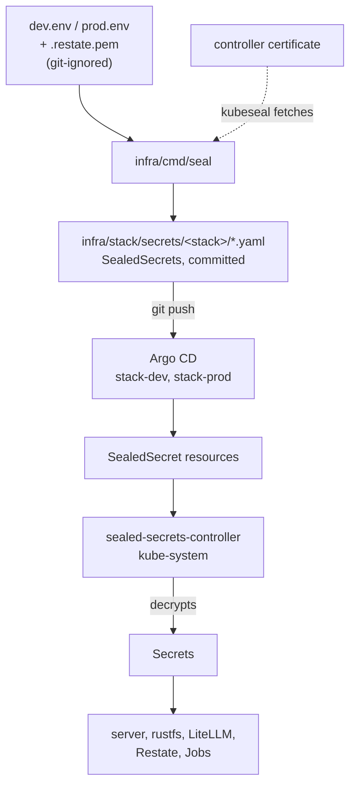

The keys of a stack live in two git-ignored files on the machine that runs the seal command: `infra/stack/secrets/<stack>.env` and `infra/stack/secrets/<stack>.restate.pem`. The seal command, `infra/cmd/seal`, encrypts them with the public certificate of the Sealed Secrets controller and writes the result as SealedSecrets to `infra/stack/secrets/<stack>/`, which is committed. Only the controller, inside the cluster, can turn them back into Secrets.



## The Sealed Secrets model

The `sealed-secrets` Application (`infra/platform/sealed-secrets.yaml`, chart 2.22.0) runs the controller in `kube-system` as `sealed-secrets-controller`, the name `kubeseal` looks for. On its first start the controller creates a key pair and keeps it in a Secret labelled `sealedsecrets.bitnami.com/sealed-secrets-key`. `kubeseal` encrypts with the public half; the private half never leaves the cluster.

The seal command calls `kubeseal` without `--scope`, so each SealedSecret uses the default strict scope: it decrypts only under its own name and namespace. A SealedSecret copied to the other stack does not open there.

The chart includes every file in `infra/stack/secrets/<stack>/`. When the directory is empty, the render fails with `infra/stack/secrets/<stack>/ holds no sealed secrets: run go -C infra run ./cmd/seal <stack>, commit and push`, and the stack's Application shows that error until the files arrive.

## What the seal command does

Run it from the umbrella root:

```bash title="Terminal"
go -C infra run ./cmd/seal dev|prod [-dry-run]
```

`-C infra` makes `infra/` the working directory, so the default paths are relative to it. `-dir` sets the secrets directory (default `stack/secrets`), `-example` the template (default `stack/secrets/example.env`) and `-image` the server image that runs `/envgen` (default `ghcr.io/shopnexus/server:main`). Flags may come before or after the stack name. An extra argument makes the command print its usage and exit with status 2.

<Steps>
<Step title="Create the .env file">
On the first run `/envgen` copies `infra/stack/secrets/example.env` to `<stack>.env` with mode 600. On later runs it adds the variables that `example.env` has and `<stack>.env` lacks, with their example values.
</Step>

<Step title="Generate the missing keys">
For each generated key that has no value in `<stack>.env`, it makes one. The JWT, staff and Restate keys come from `/envgen` in the server image (`-image`), which runs in Docker. The rest are random bytes from Go's `crypto/rand`, hex-encoded. Both fill in an empty `KEY=` line where it is and append a missing one.
</Step>

<Step title="Check the operator's values">
It stops with `seal: .../<stack>.env: set LLM_UPSTREAM_API_KEY` while that value is empty. For prod it stops while `FCM_CREDENTIALS` is empty, with `prod needs FCM_CREDENTIALS (APP_ENV=prod refuses to only log pushes)`.
</Step>

<Step title="Seal four Secrets">
It builds each Secret itself, pipes it to `kubeseal --format yaml`, and writes `server-secrets.yaml`, `restate-secrets.yaml`, `litellm-secrets.yaml` and `litellm-db.yaml` to `infra/stack/secrets/<stack>/`. `kubeseal` fetches the certificate from the cluster that kubectl points at. The command ends with `sealed into .../infra/stack/secrets/<stack>; commit and push`.
</Step>
</Steps>

A second run finds every key already set and seals the same values. `kubeseal` encrypts with a fresh random session key each time, so the sealed files change anyway.

## Keys

| Key | Made by | Secret | Read by |
|---|---|---|---|
| `JWT_KEY_ID` | `/envgen`: `k` and the UTC time, e.g. `k20261104120000` | `server-secrets` | server |
| `JWT_PRIVATE_KEY` | `/envgen`: base64 of a 32-byte Ed25519 seed | `server-secrets` | server, which signs access tokens with it |
| `STAFF_KEY` | `/envgen`: base64 of 32 random bytes | `server-secrets` | server, which derives the TOTP sealing key and the sign-in lock key from it |
| `RESTATE_IDENTITY_KEY` | `/envgen`: the public key, `publickeyv1_…` | `server-secrets` | server, which rejects Restate requests not signed by the matching private key |
| `<stack>.restate.pem` | `/envgen`: the Ed25519 private key | `restate-secrets` as `private.pem` | Restate (`requestSigningPrivateKey`) |
| `OBJECT_STORE_ACCESS_KEY` | 12 random bytes, hex | `server-secrets`; `restate-secrets` as `AWS_ACCESS_KEY_ID` | server, RustFS (`RUSTFS_ACCESS_KEY`), Restate snapshots |
| `OBJECT_STORE_SECRET_KEY` | 24 random bytes, hex | `server-secrets`; `restate-secrets` as `AWS_SECRET_ACCESS_KEY` | server, RustFS (`RUSTFS_SECRET_KEY`), Restate snapshots |
| `LLM_API_KEY` | `sk-` and 24 random bytes, hex | `server-secrets` | server; the `litellm-key` Job registers it as the server's virtual key |
| `LITELLM_MASTER_KEY` | `sk-` and 24 random bytes, hex | `litellm-secrets` | LiteLLM, the `litellm-key` Job |
| `LITELLM_DB_PASSWORD` | 24 random bytes, hex | `litellm-db` as `password`, with `username: litellm` | CloudNativePG (the managed role `litellm`), LiteLLM |
| `LLM_UPSTREAM_API_KEY` | you | `litellm-secrets` | LiteLLM, to call `litellm.apiBase` (today one of cli-proxy-api's `access.api-keys`) |
| `FCM_CREDENTIALS` | you: a Firebase service account's JSON in base64 | `server-secrets` | server, to send pushes |

`FCM_CREDENTIALS` may stay empty on dev, where the server logs pushes instead of sending them. `APP_ENV=prod` refuses it empty, so the seal command for prod does too. `LLM_UPSTREAM_API_KEY` is required on both stacks.

`server-secrets`, `litellm-secrets` and `litellm-db` land in `shopnexus-<stack>`. `restate-secrets` lands in `restate-<stack>`, the namespace of the `RestateCluster`. The server also gets every key of `server-secrets` in the `migrate`, `objectstore-init` and `objectstore-init-snapshots` Jobs, which run the server image with the same environment.

CloudNativePG creates one more Secret, `postgres-app`, whose `uri` is the server's `DATABASE_URL`. `JWT_PREVIOUS_KEY_ID` and `JWT_PREVIOUS_PUBLIC_KEY` are empty strings in the `server-env` ConfigMap (`infra/stack/templates/_server-env.tpl`).

## Files to back up

| File | Holds | Without it |
|---|---|---|
| `infra/stack/secrets/dev.env`, `prod.env` | every key in the table above, in plain text | a reseal generates new keys. A new `STAFF_KEY` makes every stored TOTP secret unreadable; a new JWT key rejects access tokens issued before it, for up to their 15-minute life |
| `infra/stack/secrets/dev.restate.pem`, `prod.restate.pem` | Restate's private signing key | `/envgen` stops, and the seal command prints its message after `envgen in <image>`: `<stack>.env has RESTATE_IDENTITY_KEY but <stack>.restate.pem is missing: restore <stack>.restate.pem from the backup` |
| the controller's key | the private key that opens every SealedSecret in git | the committed SealedSecrets cannot be opened on a new cluster; you reseal from the `.env` and `.pem` files |

Export the controller's key with:

```bash title="Terminal"
kubectl -n kube-system get secret -l sealedsecrets.bitnami.com/sealed-secrets-key -o yaml > sealed-secrets-key.yaml
```

Keep the five files in a password manager or another store that is not this machine.

While a cluster still runs, the decrypted values are also in its Secrets, for example `kubectl -n shopnexus-prod get secret server-secrets -o yaml` and `kubectl -n restate-prod get secret restate-secrets -o yaml`. That is a way to rebuild a lost `.env` before the cluster goes.

<Callout type="danger" title="One disk">
On k3d the controller's key, both stacks and the `.env` files usually sit on the same host disk. A backup on that disk is lost with it.
</Callout>

## File permissions

`/envgen` creates `<stack>.env` and `<stack>.restate.pem` with mode 600, running in Docker as your own uid and gid, so the files belong to you. The seal command then sets `<stack>.env` to mode 600 at every run, which also repairs an older file left at 644, and writes it back with that mode. Other users of the host cannot read either file. The chart's `.helmignore` leaves `secrets/*.env` and `secrets/*.pem` out of the chart, and the umbrella's `.gitignore` ignores them; only `example.env` is tracked.

## Dry run

`-dry-run` prints the four plain Secrets to stdout, as JSON, instead of sealing them. It needs no cluster and no `kubeseal`, so it shows what the seal command would seal before the controller exists.

It still needs Docker, creates `<stack>.env`, generates the missing keys and stops on an empty `LLM_UPSTREAM_API_KEY`, like a real run. The output holds every key in plain text; do not paste it into a ticket or a chat.

## Rotating a key

<Steps>
<Step title="Remove the line">
Delete the whole line of the key from `<stack>.env`, including the name. An empty `KEY=` line also works: the seal command writes the new value into it. For the JWT key, delete both `JWT_KEY_ID` and `JWT_PRIVATE_KEY`: `/envgen` writes the pair when either is missing.
</Step>

<Step title="Reseal and push">
```bash title="Terminal"
go -C infra run ./cmd/seal prod
git add infra/stack/secrets/prod
git commit -m "infra: rotate <key> in prod"
git push
```
</Step>

<Step title="Restart the Restate pods if needed">
Argo CD applies the new SealedSecrets, the controller updates the Secrets, and the workloads in the table below restart on their own or by hand, as it says.
</Step>
</Steps>

| Workload | On a reseal |
|---|---|
| server (`RestateDeployment`) | a new version starts, because the pod template carries `checksum/secrets`, a hash of every file in `infra/stack/secrets/<stack>/` |
| RustFS (StatefulSet) | restarts, through the same `checksum/secrets` |
| LiteLLM (Deployment) | restarts, through the same `checksum/secrets` |
| `migrate`, `objectstore-init`, `objectstore-init-snapshots`, `litellm-key` | run at every sync anyway |
| Restate pods (`RestateCluster`) | keep the old values until they restart; the chart puts no checksum on them |

Each key has its own effect:

- A new `LLM_API_KEY` makes `litellm-key` fail to update the old key and create the new one. The old virtual key stays in LiteLLM's database until you delete it there.
- A new `LITELLM_DB_PASSWORD` is set on the `litellm` role by CloudNativePG, and LiteLLM restarts with it.
- A new pair of object store keys reaches RustFS and the server through the checksum, and reaches Restate's snapshot writer only when the Restate pods restart. Rotating them on a RustFS volume that already has data has not been exercised.
- A new `STAFF_KEY` cannot be rotated without loss. The server has no previous-key setting for it, and the TOTP secrets in Postgres are sealed under a key derived from it.

### The Restate key

The private key in `restate-secrets` and the public key in `server-secrets` must match. A server pod rejects every request signed by any other key. During a rotation the two change at different times: the new server version starts with the new public key through the checksum, while the Restate pods sign with the old private key until they restart. Requests from Restate to the new version fail in that window, and the old server version, still draining, rejects the new key after Restate restarts.

The seal command refuses a `.env` that has `RESTATE_IDENTITY_KEY` while its `.pem` is missing. Without that check, a restore that forgot the `.pem` would generate a new pair and rotate the key by accident. To rotate on purpose, delete the `RESTATE_IDENTITY_KEY` line and the `.pem` file, run the seal command, push, and then restart the Restate pods one at a time:

```bash title="Terminal"
kubectl -n restate-prod get pods -l app.kubernetes.io/name=restate
kubectl -n restate-prod delete pod <one pod>
```

Deleting only the line keeps the old key: `/envgen` reuses a `.pem` that exists and writes its public key back. A deliberate rotation of the Restate key has not been exercised on a cluster.

### The JWT key

The server verifies access tokens against `JWT_KEY_ID` and, while a rotation is in progress, also against `JWT_PREVIOUS_KEY_ID` with `JWT_PREVIOUS_PUBLIC_KEY`. The two previous-key variables are set together or not at all, and the previous ID must differ from the current one. Access tokens live 15 minutes, so the previous key has to stay for at least 15 minutes after the new key is live.

In the cluster, the chart fixes both previous-key variables to empty strings in `server-env`, and the seal command does not seal them. A rotation without loss therefore needs a change first: add `JWT_PREVIOUS_KEY_ID` and `JWT_PREVIOUS_PUBLIC_KEY` to the keys of `server-secrets` in `infra/cmd/seal/main.go`. The pod reads `server-secrets` after `server-env`, and Kubernetes gives the later `envFrom` source precedence, so the sealed values override the empty ones. To get the old public key from the old seed in `<stack>.env`:

```bash title="Terminal"
seed=$(grep -m1 '^JWT_PRIVATE_KEY=' infra/stack/secrets/prod.env | cut -d= -f2-)
{ printf '302e020100300506032b657004220420' | xxd -r -p; base64 -d <<<"$seed"; } \
  | openssl pkey -inform DER -pubout -outform DER | tail -c 32 | base64
```

Write the old ID and that public key as `JWT_PREVIOUS_KEY_ID` and `JWT_PREVIOUS_PUBLIC_KEY`, delete the old `JWT_KEY_ID` and `JWT_PRIVATE_KEY` lines, reseal and push. After 15 minutes, delete the two previous-key lines and reseal again.

## Restoring on a new cluster

<Tabs labels={["With the controller's key", "With the .env files only"]}>
<Tab>
The SealedSecrets in git open again once the new controller has the old key.

<Steps>
<Step title="Create the cluster">
Run `k3d cluster create` with `infra/cluster/k3d-direct.yaml` or `infra/cluster/k3d-behind-proxy.yaml` as in [Bring up a cluster](/en/operations/cluster/bootstrap), and wait until `sealed-secrets` is Synced and Healthy.
</Step>

<Step title="Apply the old key">
Strip the fields the old cluster set, then apply:

```bash title="Terminal"
yq 'del(.items[].metadata.resourceVersion, .items[].metadata.uid, .items[].metadata.creationTimestamp)' \
  sealed-secrets-key.yaml | kubectl apply -f -
```
</Step>

<Step title="Restart the controller">
The controller loads its keys at start.

```bash title="Terminal"
kubectl -n kube-system rollout restart deployment sealed-secrets-controller
```

It now opens SealedSecrets made with the old key and with the key it created on its first start.
</Step>

<Step title="Restore the plain files">
Copy `dev.env`, `prod.env`, `dev.restate.pem` and `prod.restate.pem` back to `infra/stack/secrets/` and run `chmod 600` on them, so a later reseal keeps the same keys.
</Step>
</Steps>
</Tab>
<Tab>
Without the controller's key, reseal against the new controller.

<Steps>
<Step title="Create the cluster">
Create the cluster with `k3d cluster create` and wait for `sealed-secrets` to be Healthy.
</Step>

<Step title="Restore the plain files">
Copy the four files back to `infra/stack/secrets/` with mode 600. Restore each `.pem` with its `.env`; the seal command stops if one is missing.
</Step>

<Step title="Reseal and push">
```bash title="Terminal"
go -C infra run ./cmd/seal dev
go -C infra run ./cmd/seal prod
git add infra/stack/secrets/dev infra/stack/secrets/prod
git commit -m "infra: reseal for the new cluster"
git push
```

The seal command reuses every key in the `.env` files, so the stacks get the same keys under new ciphertext.
</Step>
</Steps>
</Tab>
</Tabs>

After a reseal with the second tab, back up the new controller's key, because the SealedSecrets in git are now sealed with it.

<KeyRules>
- `<stack>.env` and `<stack>.restate.pem` are never committed. Only the sealed YAML under `infra/stack/secrets/<stack>/` is.
- `<stack>.env`, `<stack>.restate.pem` and the controller's key are backed up off the host after every change.
- `STAFF_KEY` is permanent for the life of a stack's database.
- A `.pem` is restored with its `.env`. The Restate key is rotated only on purpose, by deleting both the line and the file.
- A JWT key is rotated with the old key in `JWT_PREVIOUS_KEY_ID` and `JWT_PREVIOUS_PUBLIC_KEY` for at least 15 minutes.
- A key is changed in `<stack>.env` and resealed. A Secret edited in the cluster is overwritten at the next reseal.
</KeyRules>

## Troubleshooting

<AccordionGroup>
<Accordion title="kubeseal: error: cannot fetch certificate">
`kubeseal` reaches the controller through the current kubectl context. Check `kubectl config current-context` names the k3d cluster and that `kubectl -n kube-system get deploy sealed-secrets-controller` is ready.
</Accordion>

<Accordion title="A SealedSecret does not become a Secret">
Read its status and the controller's log:

```bash title="Terminal"
kubectl -n shopnexus-prod get sealedsecret server-secrets -o jsonpath='{.status.conditions}'
kubectl -n kube-system logs deploy/sealed-secrets-controller --tail=50
```

`no key could decrypt secret` means the files were sealed for another cluster's controller. Restore that controller's key, or reseal against this one.
</Accordion>

<Accordion title="The server logs a missing or malformed variable">
The server names every variable it is missing at start. Check that the key is among the keys of `server-secrets` in `infra/cmd/seal/main.go` and has a value in `<stack>.env`, then reseal. `RESTATE_IDENTITY_KEY` must start with `publickeyv1_`.
</Accordion>
</AccordionGroup>
