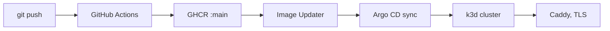

The server runs only on developer machines for now. CI, a container image and a production deployment for it are listed as later work and are not built. The Android app is built and installed from Gradle.

## The GitOps setup

The umbrella repository holds a GitOps setup in `deploy/`. A k3d cluster runs Argo CD, which keeps the cluster in step with the Kubernetes manifests in `deploy/k8s`. Each component's repository has a GitHub Actions workflow that builds its image and pushes it to GHCR with a `:main` and a `:sha-<commit>` tag. Argo CD Image Updater watches the `:main` digest and triggers a sync when it changes. CI never reaches the cluster, because the cluster pulls its own updates.

Caddy on the host terminates TLS and forwards to the cluster's Traefik ingress. The public domain names are configured only in Caddy.

<Callout type="warning">
Most of the manifests in `deploy/k8s` describe the old system: an API gateway, NATS, Redis and the Next.js storefront. They do not fit the new server, which needs Postgres with ParadeDB, Restate and RustFS.
</Callout>

## The docs

The docs do not use this path. Every push to the docs repository's `main` builds the Astro site with Bun and publishes it on GitHub Pages at https://shopnexus.github.io/docs/. The build sets `DOCS_BASE` to the Pages path prefix; the internal Developers tab is left out of this build.

## What production will need from the server

The server already refuses to start in production with development shortcuts in place. `APP_ENV=prod` requires the Restate identity key, real push credentials, and PNV test numbers turned off. Logs should be JSON there (`LOG_FORMAT=json`).
