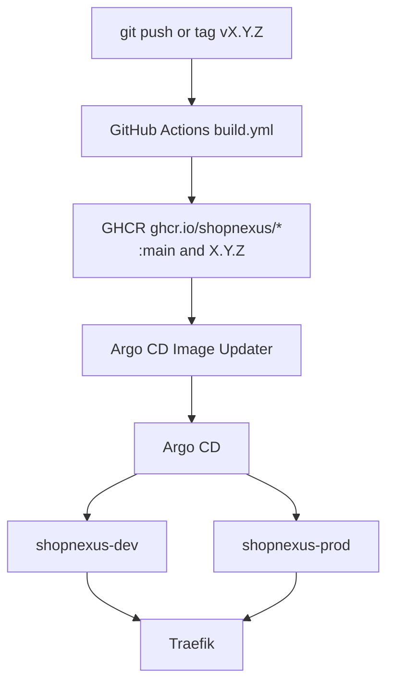

The server, the website, the docs and the staff console run on one k3d cluster in two stacks, dev and prod. Each stack has its own namespace and its own Postgres, Restate, RustFS and LiteLLM. Everything the cluster needs is in `infra/` in the umbrella repo. The Android app is built and installed from Gradle and is not part of the cluster.

| Stack | Domain | Namespace | Follows |
|---|---|---|---|
| dev | `dev.shopnexus.id.vn` | `shopnexus-dev` | `:main`, by digest |
| prod | `shopnexus.id.vn` | `shopnexus-prod` | the newest `X.Y.Z` tag |

Each stack serves the website on its domain and four hosts below it: `api.` for the server, `media.` for the object store, `docs.` for the docs and `console.` for the staff console.

The system is built and checked on a local k3d cluster. Bringing it up on the author's server and running the failover drills are the next steps, so the public hosts above are not live yet.

## From a push to a pod

Each component repo (`server`, `website`, `docs`, `console`) has a `.github/workflows/build.yml`. A push to `main` builds the image and pushes it to GHCR with the tags `main` and `sha-<commit>`. A tag `vX.Y.Z` pushes the tag `X.Y.Z`. The packages are public, because the cluster pulls them without credentials.

Argo CD Image Updater watches GHCR. For `stack-dev` it follows the digest of `:main`; for `stack-prod` it follows the newest `X.Y.Z` by semver. It writes the new tag as a Helm parameter on the stack's Argo CD Application, and Argo CD syncs the chart in `infra/stack` into the stack's namespace. CI never connects to the cluster. Traefik, bundled with k3s, routes each request by its `Host` header to the stack's Services.

## The cluster

<Cards cols={2}>
  <Card title="Cluster overview" href="/en/operations/cluster" icon="ri:node-tree">Nodes, the two stacks, every component and its replica count.</Card>
  <Card title="Bring up a cluster" href="/en/operations/cluster/bootstrap" icon="ri:rocket-line">Fork, set the domains, create the cluster with k3d, seal the secrets, push.</Card>
  <Card title="Edge and network" href="/en/operations/cluster/networking" icon="ri:global-line">The two edge modes, TLS, hosts and NetworkPolicy.</Card>
  <Card title="Postgres, Restate and RustFS" href="/en/operations/cluster/data" icon="ri:database-2-line">The stateful workloads, their operators and their storage.</Card>
  <Card title="Releases" href="/en/operations/cluster/releases" icon="ri:price-tag-3-line">How dev follows main and prod follows a version tag.</Card>
  <Card title="Secrets" href="/en/operations/cluster/secrets" icon="ri:key-2-line">Sealed Secrets, the seal command and the key to back up.</Card>
  <Card title="Language model gateway" href="/en/operations/cluster/llm-gateway" icon="ri:robot-2-line">LiteLLM in each stack, the search alias and its daily budget.</Card>
  <Card title="Runbook and troubleshooting" href="/en/operations/cluster/runbook" icon="ri:first-aid-kit-line">Daily commands, drills and fixes for known failures.</Card>
</Cards>

## The docs on GitHub Pages

The docs have a second deployment outside the cluster. Every push to the docs repository's `main` runs `.github/workflows/pages.yml`, which builds the Astro site with Bun and publishes it on GitHub Pages at https://shopnexus.github.io/docs/. That build sets `DOCS_BASE` to the Pages path prefix and leaves out the internal Developers tab. The image in each stack is built with `DOCS_BASE=/` and serves the site at the root of `docs.<domain>`.

## Production checks in the server

The server refuses to start with `APP_ENV=prod` when:

- `RESTATE_IDENTITY_KEY` is empty;
- `FCM_CREDENTIALS` is empty, so pushes would only be logged;
- `PNV_TEST_NUMBERS=true`, so PNV's test numbers would sign in.

It also refuses to start in any environment while migrations are pending, which is why the `migrate` Job runs before the server in each stack. The chart sets `APP_ENV` from `appEnv` in the values file, `PNV_TEST_NUMBERS=false` in `values-prod.yaml`, and `LOG_FORMAT=json` in both stacks; the other server variables are on the [Configuration](/en/operations/configuration) page.
