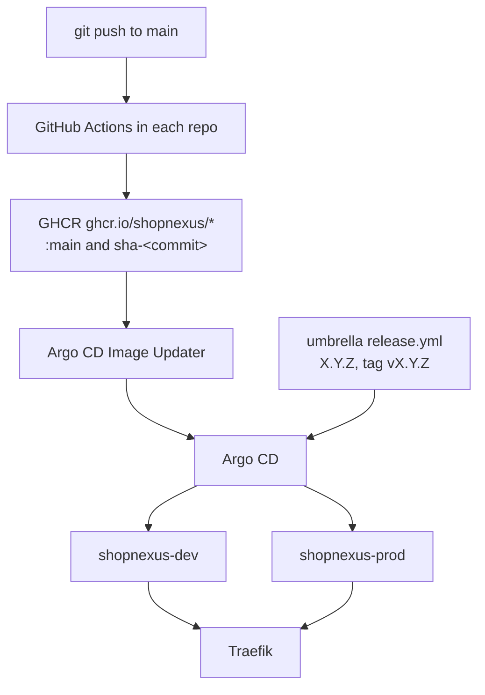

The server, the website, the docs, the console and the console agent run on one k3d cluster in two stacks, dev and prod. Each stack has its own namespace and its own Postgres, Restate, RustFS and Bifrost, the gateway to the remote models. Everything the cluster needs is in `infra/` in the umbrella repo. The Android app is built with Gradle and is not part of the cluster; its live flavor calls the dev API.

| Stack | Domain | Namespace | Follows |
|---|---|---|---|
| dev | `dev.shopnexus.id.vn` | `shopnexus-dev` | `:main`, by digest |
| prod | `shopnexus.id.vn` | `shopnexus-prod` | a release of the umbrella, `vX.Y.Z` |

Each stack serves the website on its domain and four hosts below it: `api.` for the server, `media.` for the object store, `docs.` for the docs and `console.` for the console. The staff dashboards have hosts of their own (see [Monitoring](/en/operations/monitoring)).

The cluster runs on the author's [Linux server](/en/operations/cluster/linux-server). Prod runs from the first release on; until then the dev stack also answers on `shopnexus.id.vn`.

## From a push to a pod

A push to `main` of `server`, `docs` or the agent builds that repo's image, and a push to `clients` builds the website or the console image when its folder changed. Each image goes to GHCR with the tags `main` and `sha-<commit>`: `ghcr.io/shopnexus/server`, `docs` and `agent`, and `ghcr.io/shopnexus/clients/website` and `console`. For a prod release, the umbrella's Release workflow finds the image of each commit its submodules point at and tags it `X.Y.Z`. The packages are public, because the cluster pulls them without credentials.

Argo CD Image Updater watches GHCR for dev. It follows the digest of `:main`, writes the new tag as a Helm parameter on `stack-dev`, and Argo CD syncs the chart in `infra/stack` into `shopnexus-dev`. Prod has no Image Updater: the Release workflow writes each image's digest into `infra/stack/values-prod.yaml`, tags the umbrella `vX.Y.Z`, and `stack-prod` renders `infra/stack` at that tag. `infra/RELEASING.md` is the release process, with hotfixes and rollback. CI never connects to the cluster. Traefik, bundled with k3s, routes each request by its `Host` header to the stack's Services.

## The cluster

<Cards cols={2}>
  <Card title="Cluster overview" href="/en/operations/cluster" icon="ri:node-tree">Nodes, the two stacks, every component and its replica count.</Card>
  <Card title="Bring up a cluster" href="/en/operations/cluster/bootstrap" icon="ri:rocket-line">Fork, set the domains, create the cluster with k3d, seal the secrets, push.</Card>
  <Card title="Edge and network" href="/en/operations/cluster/networking" icon="ri:global-line">The two edge modes, TLS, hosts and NetworkPolicy.</Card>
  <Card title="Postgres, Restate and RustFS" href="/en/operations/cluster/data" icon="ri:database-2-line">The stateful workloads, their operators and their storage.</Card>
  <Card title="Releases" href="/en/operations/cluster/releases" icon="ri:price-tag-3-line">How dev follows main and prod runs a release of the umbrella.</Card>
  <Card title="Secrets" href="/en/operations/cluster/secrets" icon="ri:key-2-line">Sealed Secrets, the seal command and the key to back up.</Card>
  <Card title="Bifrost gateway" href="/en/operations/cluster/llm-gateway" icon="ri:robot-2-line">Bifrost in each stack: providers, agents, keys and monthly budgets.</Card>
  <Card title="Runbook and troubleshooting" href="/en/operations/cluster/runbook" icon="ri:first-aid-kit-line">Daily commands, drills and fixes for known failures.</Card>
</Cards>

## The docs on GitHub Pages

The docs have a second deployment outside the cluster. Every push to the docs repository's `main` runs `.github/workflows/pages.yml`, which builds the Astro site with Bun and publishes it on GitHub Pages at https://shopnexus.github.io/docs/. That build sets `DOCS_BASE` to the Pages path prefix and leaves out the internal Developers tab. The image in each stack is built with `DOCS_BASE=/` and serves the site at the root of `docs.<domain>`.

## Production checks in the server

The server refuses to start with `APP_ENV=prod` when:

- `RESTATE_IDENTITY_KEY` is empty;
- `FCM_CREDENTIALS` is empty, so pushes would only be logged;
- `EMAIL_SENDER=log`, so mail would only be logged;
- `PNV_TEST_NUMBERS=true`, so PNV's test numbers would sign in;
- `CARRIER_GHTK` or `CARRIER_GHN` is `fake`.

It also refuses to start in any environment while migrations are pending, which is why the `migrate` Job runs before the server in each stack. The chart sets `APP_ENV` from `appEnv` in the values file and `LOG_FORMAT=json` in both stacks. Each stack's values file sets the test numbers, the mail sender and each carrier's mode: dev runs the fake carriers, test numbers and mail to the log, and prod turns test numbers off and sends mail through Resend. The other server variables are on the [Configuration](/en/operations/configuration) page.
