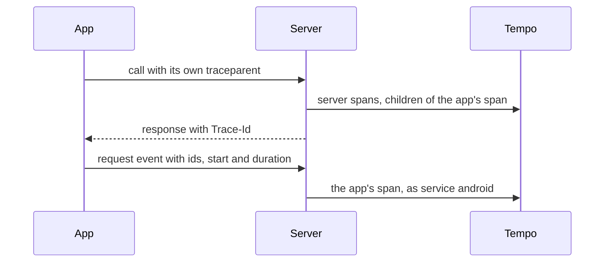
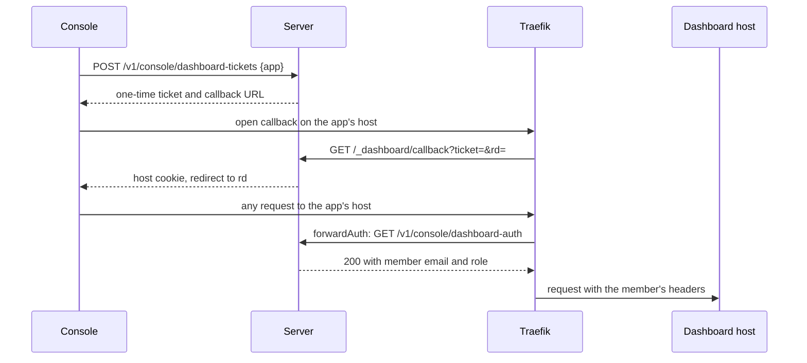

Every stack has one Grafana with Loki, Tempo and Prometheus behind it, the `otel-lgtm` image. The server sends it logs, traces and metrics over <Term id="otlp">OTLP</Term>/HTTP. The website and the app send their own measurements to the server, which turns them into metrics and log lines as well. This covers <Req id="NFR-OBS-01" />.

## From a failed call to its logs

Every response has a `Trace-Id` header, and an error body repeats it as `trace_id`. Search that id in Grafana and you get the request's trace in Tempo and its log lines in Loki.

If `OTEL_EXPORTER_OTLP_ENDPOINT` is empty, nothing leaves the process. Spans still get ids, so the header, the error bodies and the log lines still match.

## Logs

- Logs go to stdout and to OTLP at once. They are text in development and JSON in the cluster (`LOG_FORMAT`).
- A line written during a request carries `trace_id` and `span_id`.
- Passwords, codes and tokens are never logged. Phone numbers and email addresses are masked.
- Each request ends with one access line, `request`: method, route pattern, status and duration, plus the client app, the country and a visitor id. The visitor id is the account or staff member, or for a guest a hash of the address and the day, so a guest cannot be followed across days. Health probes and calls the website makes for itself have no visitor. A bot is marked as client `bot` and its User-Agent is kept, cut short.

## Traces

- Each HTTP request opens a server span named after its route pattern, never its raw path. Each SQL statement opens a child span.
- Each call the server makes to another service opens a client span named by method and host, and sends `traceparent` on. That includes the calls to Restate's ingress, so a durable flow's handler joins the trace of the request that started it.
- Each Restate handler attempt opens a server span named `Service/Handler`. A retried or suspended handler shows one span per attempt.
- The app's own timing of a call becomes the root span of that call's trace; see [client events](#client-events).
- Every request is sampled.

## Metrics

Metrics are exported every 10 seconds. Each process exports under its own instance id, so two replicas never merge into one series. Durations are histograms in seconds with buckets from 5 ms to 10 s.

| Metric | What it measures |
|---|---|
| `http.server.request.duration` | API requests, by route pattern, method, status and client app |
| `http.client.request.duration` | calls the server makes, by host, method and status, or the error when no answer came |
| `restate.invocation.duration` | Restate handler attempts, by service and handler |
| `db.client.connection.*` | the database pool: in use, idle, maximum and waits |
| runtime and container | CPU and memory against the container's limits, goroutines, heap and scheduler wait |
| business counters | sign-ins by result, codes sent, reused refresh tokens, events handed to Restate |
| inventory gauges | what the marketplace holds now; see below |
| `client.*` | what the website and the app measured; see [client events](#client-events) |

### Inventory gauges

The account, catalog, deal, chat, trust and support modules each export gauges of the rows they hold now. Each module counts its own tables, so a process that runs only the AI role has none.

| Gauge | Split by |
|---|---|
| `account.accounts` | status: active, suspended. Deleted accounts and ShopNexus's own are left out. |
| `account.accounts.phone_verified` | none |
| `catalog.listings` | status: processing, active, hidden, rejected, reserved, sold |
| `catalog.listing_drafts` | none; drafts not expired |
| `deal.deals` | status: negotiating, agreed, sold |
| `deal.orders` | status: pending, shipped, completed, failed, cancelled |
| `chat.conversations` | kind: pair, support |
| `trust.reports.open`, `trust.report_cases.open` | none |
| `trust.reviews` | role: seller, buyer; deleted reviews left out |
| `support.tickets.open` | none |

A gauge runs its query at most once a minute and repeats its last answer in between. A failed query keeps the old answer and logs one warning until a query succeeds again. A split gauge always has one series per value, 0 included. Every API process exports the same numbers, so a panel takes `max` over instances. All the queries together take about 100 ms on the 110,000 listings of the development data.

There is no gauge of recent chat messages, because messages have no index on their creation time.

## Client events

`POST /v1/client-events` takes a batch of up to 50 events from the website or the Android app. Anyone may call it. It keeps no rows: each event becomes a metric and sometimes a log line. Its rate limit tier, `telemetry`, lets one client address send 2 batches a second with bursts of 60. The website's server forwards the buyer's address, so its batches count per buyer.

| Event | Metric | Log line |
|---|---|---|
| `error`, a script error the website did not catch | `client.errors` by app | `client error`, with the page, message and stack |
| `vital`, a Core Web Vital | `client.web_vital.duration` for LCP, INP, FCP and TTFB, `client.web_vital.cls` for CLS, by app and name | none |
| `request`, an API call as the client timed it | `client.request.duration` by app, route, method, status and network | `client request`, for a call with no answer, a 5xx or one of 3 s or more |
| `search_impression`, `search_click` | `client.search.impressions` and `client.search.clicks` by app and position band (1, 2, 3, 4–5, 6–10, 11–20, 21+) | one line each, with the `search_id` |

The page is never a label. The server reads a request's route from its path itself, so a client cannot invent label values; a path no route serves counts as `other`.

The app sends its crashes to Crashlytics instead, because its release build is minified and Crashlytics can map the stack back.

### The app's network time in a trace

The app exports no spans, and Tempo accepts none from outside. The server exports the app's span for it, so a slow call shows where the time went.

The `client request` log line carries the `Trace-Id` the response had, so a slow or failed call on a phone leads straight to the server's side of it.

### Joining a click to its search

Every `GET /v1/search` response carries a fresh `search_id`, and the server's `search terms` log line records it beside the query. Impressions and clicks carry the same id, so Loki joins a click to the query that showed the result.

## Dashboards

The dashboards and alert rules are one set of files in `infra/stack/grafana`. The chart and the local compose stacks both load them. Pods and Platform read the cluster's own Prometheus, so they exist only in the cluster.

| Dashboard | What it answers |
|---|---|
| Server | Is the server near its CPU, memory or pool limits? Which routes, outgoing hosts, Restate handlers and SQL statements are slow or failing? How are sign-ins, codes and events going, and what are the latest warnings? |
| Marketplace | How much is on sale, sold and published in the range, how many orders are shipping, and how many people go from search to sale? It reads the inventory gauges. |
| Users | Who is online now, signed in or not, from which app and country, and how much traffic is bots? It counts from the access lines in Loki. |
| Clients | How fast do website pages load (LCP, INP, CLS), which script errors happen, how long app calls take by network, and which result positions get clicked? |
| Platform | Are the public hosts up and their certificates valid? How are Traefik, Postgres, Restate and Bifrost doing, and what do the agents spend on models? |
| Pods | Which pods run, restart or use the most CPU, memory and disk, and how full are the nodes? |

## Alerts

Grafana evaluates the alert rules in every stack. The dev stack sends them to a Telegram group.

| Alert | Fires when |
|---|---|
| API 5xx | more than 2% of API requests fail with a 5xx over 5 minutes |
| API slow | API p95 is over 2 s for 10 minutes |
| Server silent | no server process sent metrics for 5 minutes |
| External calls failing | more than 20% of calls to one host fail over 5 minutes |
| Many failed sign-ins | more than 30 failed sign-ins in 15 minutes |
| Refresh token reused | any rotated refresh token is used again |
| Website script errors | more than 20 script errors in 15 minutes |

The cluster adds rules from its own Prometheus: a public host down, a TLS certificate near expiry, pods restarting or not ready, a node's disk or memory nearly full, Postgres down, short of connections or holding a long transaction, and the [Bifrost](/en/operations/cluster/llm-gateway) alerts on failing model calls, a failing provider key and an agent out of monthly budget.

## Queries from the console

The console agent answers questions about the system's health from the same Prometheus and Loki, through the server, which limits each query and masks personal data in log lines ([System health questions](/en/agent/monitoring)). The server reads them at `MONITORING_METRICS_URL` and `MONITORING_LOGS_URL`, `lgtm`'s ports 9090 and 3100 in each stack; only the server's pods may reach those ports. When either is empty its part of the monitoring answers 503 `monitoring_unavailable`.

## Opening the ops dashboards

Grafana, Restate's UI, Bifrost's UI, RustFS's console, pgweb on the stack's database and, in the prod stack, Argo CD each sit on a host of their own: `grafana.`, `restate.`, `bifrost.`, `s3.`, `db.` and `argocd.` under the stack's domain. Nobody signs in to them directly. Staff open them from the console, and Traefik asks the server before every request.

Each app has a floor, the lowest console role that may open it. Grafana starts at moderator and the others at admin. An admin changes the floors in the console's settings, and every change is a `dashboard.floor` console action. The console's sidebar shows only the dashboards the member's role reaches.

1. The console asks for a ticket for one app. The ticket opens that app once, within 60 seconds.
2. The browser opens the callback on the app's host. One statement marks the ticket used and creates a dashboard session, so a second callback with the same ticket is refused. The cookie is for that host only and lasts as long as the console session has left.
3. The redirect follows `rd` only when it is a plain path on the same host; anything else goes to `/`.
4. On every later request Traefik's forwardAuth asks the server. It answers 200 with the member's email and role, which Grafana reads to sign the member in as `Admin` (an admin) or `Viewer` (a moderator). A GET without a session is sent to the console's `/dashboards/open` to get a ticket; any other method gets 401. A role below the floor, or a host the server does not know, gets 403.

A dashboard session has no end of its own. It lives exactly as long as its console session, so signing out of the console or being removed from staff ends every dashboard at the next request. The floor is read on every request too, so a floor an admin raises shuts out a moderator who already has the dashboard open.

`DASHBOARD_HOSTS` maps each app to its host. It must be set, and when it is empty every dashboard is refused, which is how the local compose stacks run: there Caddy routes the hosts and signs Grafana in as an admin itself.
