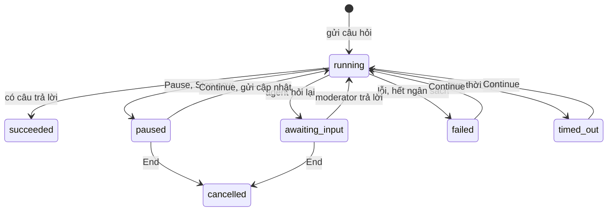

Trong lúc lượt chạy, nút gửi của ô hỏi thành **Pause** (phím Esc cũng tạm dừng); sau khi bấm, nút thành **Stop now** cho tới khi lượt dừng hẳn. Lượt đã tạm dừng hiện "Paused after 3 steps" với hai nút **End** và **Continue**. Gõ vào ô hỏi lúc lượt chạy là gửi cập nhật. Mỗi lệnh là một request lên server; server ghi lệnh vào `agent_turn_inputs` với một số thứ tự tăng dần, và agent đọc chúng qua `GET /agent/turns/{id}/control?after=<seq>` khoảng mỗi giây.

## Các lệnh

| Nút | Endpoint | Tác dụng |
|---|---|---|
| **Pause** | `POST …/turns/{id}/pause` | Có hiệu lực trước lần gọi model kế tiếp. Lần gọi đang chạy và các tool nó xin vẫn chạy xong, nên mọi lần gọi tool đều có kết quả. |
| **Stop now** | `POST …/turns/{id}/stop` | Huỷ lần gọi model đang chạy ngay lập tức; đoạn kết thúc `PAUSED` với lý do `stop_now`. Một lần gọi MCP đã bắt đầu ở server vẫn chạy hết. |
| Gõ vào ô hỏi | `POST …/turns/{id}/steer {text}` | Thêm một tin "Update from the member: …" trước lần gọi model kế tiếp. Lượt đang tạm dừng thì chạy tiếp luôn. |
| **Continue** | `POST …/turns/{id}/continue` | Chạy tiếp lượt đang tạm dừng, hoặc lượt lỗi chạy tiếp được, cùng id, không thêm tin nhắn nào. |
| **End** | `POST …/turns/{id}/end` | Huỷ lượt đang tạm dừng hay đang chờ trả lời; lượt thành `cancelled`. |

Pause và Stop now chỉ nhận lượt `running`. Lệnh gửi trước khi đoạn chạy bắt đầu có số thứ tự không lớn hơn `control_after`, nên đoạn đó không nhận.

## Cập nhật trong lúc chạy

Mỗi cập nhật hiện trạng thái chờ cho tới khi agent đọc nó. Khi đọc, agent ghi event `steer.read` kèm bước đang mở, và console ghi cập nhật đó đã được đọc trước bước nào. Cập nhật đã nhận nhưng chưa đưa cho model nằm trong `pending_steers` của checkpoint, nên đoạn sau vẫn đọc nó, mỗi `steer_id` đúng một lần. Cập nhật nào lượt kết thúc mà chưa đọc thì console cho gửi lại thành câu hỏi mới.

## Câu hỏi của agent

Khi câu hỏi chưa rõ, model gọi `ask_user` với các câu hỏi, mỗi câu có các lựa chọn để chọn một hoặc nhiều. Đoạn kết thúc `AWAITING_INPUT` và event `clarify` mang các câu hỏi. Moderator trả lời qua `POST …/turns/{id}/input {answers}`; server kiểm câu trả lời với `pending_ask` trong checkpoint rồi mở đoạn mới ở mode `resume` với câu trả lời đã ghép thành chữ.

## Chạy tiếp

Một đoạn `resume` bắt đầu từ checkpoint: danh sách tin nhắn Strands như lúc dừng, cộng kết quả "interrupted" cho lần gọi tool chưa có kết quả. Server đặt lượt về `running` dưới khoá dòng và ghi `turn.resumed {by}`, với `by` là `continue`, `steer` hoặc `input`. Console mở lại stream từ số thứ tự cuối nó đã thấy.
