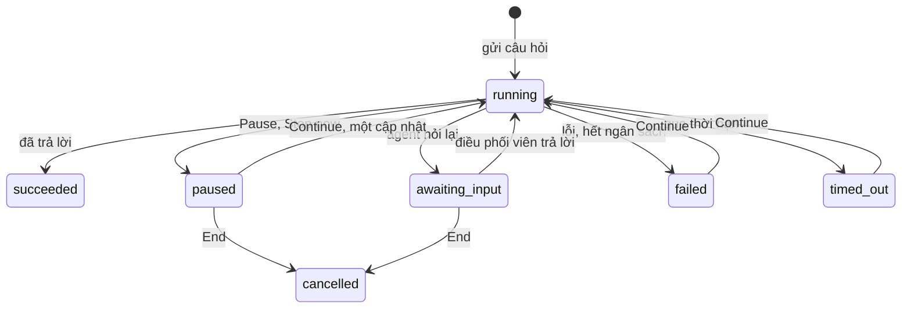

Trong lúc một lượt chạy, nút gửi của ô hỏi thành **Pause** (phím Esc cũng tạm dừng); sau khi bấm, nút thành **Stop now** cho tới khi lượt chạy dừng hẳn. Lượt đã tạm dừng hiện "Paused after 3 steps" với hai nút **End** và **Continue**. Gõ vào ô hỏi lúc lượt đang chạy là gửi một cập nhật.

Mỗi lệnh điều khiển là một request lên server. Server ghi lệnh vào `agent_turn_inputs` với một số thứ tự tăng dần, dưới khóa dòng của lượt, nên các lệnh được commit theo đúng thứ tự và một lần hỏi không bao giờ bỏ sót lệnh nào. Agent đọc chúng khoảng mỗi giây một lần qua `GET /agent/turns/{id}/control?after=<seq>` trên cổng MCP, kèm MCP token. Câu trả lời liệt kê các lệnh mới và cho biết lượt còn đang chạy hay không. Lượt đã mất hoặc đã kết thúc thì trả `running: false`, và agent dừng.

## Các lệnh điều khiển

| Lệnh | Endpoint | Tác dụng |
|---|---|---|
| **Pause** | `POST …/turns/{id}/pause` | Có hiệu lực trước lần gọi model kế tiếp. Lần gọi đang chạy và các tool nó xin vẫn chạy xong, nên mọi lần gọi tool đều giữ kết quả. |
| **Stop now** | `POST …/turns/{id}/stop` | Hủy ngay lần gọi model đang chạy; đoạn kết thúc `PAUSED` với lý do `stop_now`. Một lần gọi MCP đang chạy ở server vẫn chạy tới hết. |
| Gõ vào ô hỏi | `POST …/turns/{id}/steer {text}` | Thêm một tin nhắn "Update from the member: …" trước lần gọi model kế tiếp. Lượt đang tạm dừng thì chạy tiếp ngay. |
| **Continue** | `POST …/turns/{id}/continue` | Chạy tiếp một lượt đang tạm dừng, hoặc một lượt lỗi chạy tiếp được, giữ nguyên id và không thêm tin nhắn mới. |
| **End** | `POST …/turns/{id}/end` | Hủy một lượt đang tạm dừng hay đang chờ trả lời; lượt thành `cancelled`. |

Pause và Stop now cần lượt đang `running`. Lệnh mà trạng thái hiện tại của lượt không nhận thì trả `409 agent_turn_state`. Lệnh gửi trước khi một đoạn bắt đầu có số thứ tự không lớn hơn `control_after`, nên đoạn đó không nhận nó.

## Cập nhật trong lúc chạy

Cập nhật tính chung giới hạn với câu hỏi: 30 mỗi phút cho mỗi điều phối viên. Mỗi cập nhật hiện là đang chờ cho tới khi agent đọc nó. Khi đọc, agent ghi một event `steer.read` kèm tên bước đang mở, và trang điều hành cho biết cập nhật đã được đọc trước bước nào. Cập nhật đã nhận nhưng chưa đưa cho model nằm trong `pending_steers` của checkpoint, nên đoạn sau vẫn đọc nó, mỗi `steer_id` đúng một lần. Cập nhật mà lượt kết thúc mà chưa đọc thì gửi lại được thành một câu hỏi mới.

## Câu hỏi từ agent

Khi câu hỏi chưa rõ, model gọi `ask_user` với các câu hỏi, mỗi câu có các lựa chọn để chọn một hoặc nhiều. Đoạn kết thúc `AWAITING_INPUT`, và event `clarify` mang các câu hỏi. Điều phối viên trả lời qua `POST …/turns/{id}/input {answers}`, ánh xạ id của từng câu hỏi tới id của một lựa chọn hoặc một danh sách id.

Server kiểm câu trả lời với `pending_ask` trong checkpoint: mỗi câu trả lời phải chỉ đúng một câu hỏi và các lựa chọn của nó, câu hỏi chọn một chỉ nhận một lựa chọn, và phải có ít nhất một câu trả lời; nếu không thì trả `agent_answers_invalid`. Sau đó server mở một đoạn `resume` với các câu trả lời đã viết thành chữ.

## Chạy tiếp

Một đoạn `resume` bắt đầu từ checkpoint: danh sách tin nhắn Strands như lúc dừng, cộng một kết quả "interrupted" cho lần gọi tool nào còn thiếu kết quả. Server đặt lượt về `running` dưới khóa dòng của nó, với thời điểm bắt đầu đoạn mới, rồi mở đoạn và ghi `turn.resumed {by}`, trong đó `by` là `continue`, `steer` hoặc `input`. Nếu agent từ chối đoạn, lượt quay về trạng thái trước đó. Trang điều hành mở lại stream từ số thứ tự cuối nó đã thấy.

Continue dùng được với lượt đang tạm dừng. Với lượt lỗi hay quá thời hạn, Continue chỉ dùng được khi đó là lượt mới nhất của cuộc trò chuyện, lượt đã ghi ra được gì đó, và mã lỗi cho phép chạy tiếp; xem [Giới hạn và lỗi](/vi/agent/limits#mã-lỗi).
