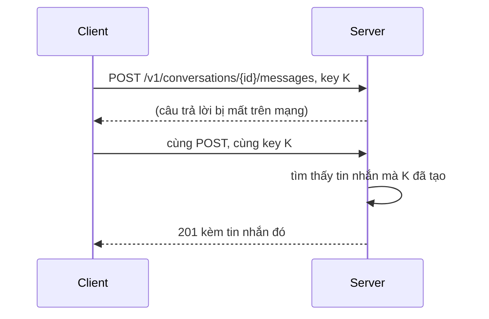

Endpoint khởi động một durable flow nhận header `Idempotency-Key`, là một UUID. Key này trở thành request key của dòng mà request tạo ra hoặc làm đổi trạng thái. Key lặp lại sẽ tìm thấy dòng đó và trả kết quả của request đầu tiên. Nhờ vậy, người dùng bấm lại sau khi timeout vẫn nhận cùng câu trả lời, và không sinh thêm tin đăng, tin nhắn hay đơn COD thứ hai. <Req id="NFR-IDEM-01" />

```http
Idempotency-Key: 0192a4e1-7b3c-7d2e-9f10-5a6b7c8d9e0f
```



## Quy tắc cho client

- Mỗi thao tác của người dùng tạo một UUID mới.
- Gửi lại thao tác đó thì dùng lại đúng key cũ, dù client tự retry hay người dùng bấm lại sau khi báo lỗi.
- Không bao giờ dùng chung một key cho hai thao tác khác nhau. Server trả key lặp lại bằng kết quả đầu tiên, bất kể body mới ghi gì.

Thiếu key hoặc key sai định dạng trên endpoint bắt buộc key trả 400 `invalid_request`.

## Phạm vi

Key thuộc về người gọi. Key của tài khoản khác không bao giờ tìm thấy dòng đó, nên hai người không thể đụng nhau trên một key. Đăng nhập gắn key vào phiên đăng nhập mới, và lần gửi lại của một lần đăng ký vẫn trả `is_new: true`. Mã OTP qua email gắn key vào mã được gửi, theo từng địa chỉ.

Các lượt chuyển của một deal cũng giữ key của chúng. Lượt chuyển mà key của người gọi đã thực hiện sẽ trả về deal như hiện tại, không chuyển thêm lần nữa.

## Endpoint nào nhận key

Spec đánh dấu từng endpoint.

| Nhóm | Endpoint bắt buộc có khóa |
|---|---|
| Đăng nhập và định danh | `POST /v1/auth/sign-in`, `POST /v1/auth/email-codes`, `POST /v1/auth/sessions/current/reauthenticate`, `POST /v1/accounts/me/identities`, `POST /v1/accounts/me/email-codes` |
| Tin đăng | `POST /v1/listings`, `POST /v1/listings/{id}/photo-copies`, `POST /v1/listing-reads` |
| Đơn COD | `POST /v1/orders/{order_id}/shipment`, `POST /v1/orders/{order_id}/confirm` |
| Trò chuyện và hỗ trợ | `POST /v1/conversations`, `POST /v1/conversations/{id}/messages`, `POST /v1/support/tickets`, `POST /v1/feedback`, `POST /v1/addresses` |
| Trang điều hành | câu trả lời của nhân viên trên một phiếu hỗ trợ |

Hai endpoint của deal nhận key nhưng không bắt buộc, vì các bản ứng dụng cũ không gửi key: `POST /v1/deals/{id}/cod` và `POST /v1/orders/{order_id}/cancel`. Không có key thì mỗi request tự chuyển trạng thái riêng. Các thao tác tạo của trợ lý AI trên trang điều hành (một cuộc trò chuyện, một câu hỏi, một chỉ dẫn, một skill) cũng nhận key không bắt buộc.

`PUT /v1/listings/{id}` không nhận khóa: sửa tin ghi lại toàn bộ tin, nên gửi lại chỉ ghi cùng nội dung lần nữa. Endpoint không có header này khử trùng lặp theo thứ nó ghi, ví dụ mỗi người chỉ lưu một tin đăng một lần.
