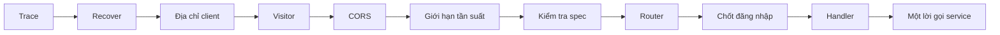

API HTTP đi theo hướng OpenAPI first. Thiết kế một tính năng bắt đầu từ spec trong repository server, rồi code được viết để khớp với spec. Ứng dụng sinh client từ chính spec đó, và [playground](/vi/api/playground) của trang docs hiển thị nó.

Server nhúng spec vào binary, nên binary luôn mang theo đúng hợp đồng mà nó dùng để kiểm tra. Luật về hình dạng dữ liệu (trường bắt buộc, độ dài, format, enum) chỉ nằm trong spec. Luật nghiệp vụ nằm trong các module. Bộ test giữ cho tập route đã đăng ký và tập operation trong spec luôn trùng nhau, và bộ test end-to-end gặp đủ mọi status code mà spec khai báo. <Req id="NFR-API-01" />

## Một request đi qua những gì

1. **Trace** mở span. Sau request, nó ghi dòng access log kèm status và trace ID. Request bị panic vẫn được ghi log với mã 500.
2. **Địa chỉ client** được tính một lần, chỉ tin các header forwarded từ những proxy đã biết.
3. **Visitor** ghi lại client nào đã gọi (ứng dụng, website, trang điều hành hay bot) cho các dashboard thống kê sử dụng. Khách được nhận diện bằng hash theo ngày của địa chỉ, nên không địa chỉ nào lọt vào log.
4. **Giới hạn tần suất** tính request vào tier của route (xem bên dưới).
5. **Kiểm tra spec** validate tham số path và query, header và body JSON theo operation, rồi điền giá trị mặc định cho query. Route có trong spec mà server này không gắn, ví dụ route dev trên production, chỉ trả 404 thường.
6. **Chốt đăng nhập** trên route cần đăng nhập kiểm tra token và tài khoản. Sau đó giới hạn tần suất theo người gọi được áp dụng.
7. **Handler** gọi một method của service rồi ghi kết quả hoặc [lỗi](/vi/api/errors).

## Quy ước

- Mọi route bắt đầu bằng `/v1`. Khi có thay đổi phá vỡ tương thích thì thêm `/v2` song song, vì ứng dụng đã cài có thể ở bản cũ hàng tháng trời.
- JSON dùng `snake_case`, trường lạ bị từ chối, body tối đa 1 MB.
- ID là UUIDv7, nên sắp theo thời điểm tạo.
- `/healthz` và `/readyz` nằm ngoài `/v1`. Readiness kiểm tra Postgres và Restate.
- Endpoint khởi động một durable flow nhận header [`Idempotency-Key`](/vi/api/idempotency).
- Danh sách phân trang bằng cursor, mới nhất trước ([Phân trang](/vi/api/pagination)).

## Giới hạn tần suất

Mỗi route có một tier. Spec ghi tier trên operation. Nếu không ghi, GET là `read` và mọi method khác là `write`, nên route mới bị giới hạn ngay từ đầu. Mỗi request được tính một lần theo địa chỉ, và khi đã biết người gọi thì tính thêm một lần theo tài khoản hoặc nhân viên. Một dải IPv6 /64 tính là một địa chỉ. NAT của nhà mạng đặt nhiều điện thoại sau cùng một địa chỉ, nên giới hạn theo địa chỉ là giới hạn lỏng hơn.

| Tier | Theo địa chỉ | Theo người gọi | Dùng cho |
|---|---|---|---|
| `read` | 50/s, burst 1.000 | 20/s, burst 400 | GET theo mặc định |
| `write` | 10/s, burst 200 | 5/s, burst 100 | các method khác theo mặc định |
| `auth` | 1/s, burst 60 | 1 lần mỗi 5 s, burst 10 | đăng nhập, xác thực lại, đăng nhập trang điều hành |
| `code` | 1 lần mỗi 10 s, burst 10 | 1 lần mỗi 30 s, burst 5 | hai endpoint gửi mã OTP qua email |
| `costly` | 1/s, burst 30 | 1 lần mỗi 2 s, burst 20 | xem trước liên kết, đọc tin đăng, bảng giá tham khảo, báo giá và lấy hàng của hãng, liên kết và nhập tin từ Chợ Tốt |
| `telemetry` | 2/s, burst 60 | không có | client gửi báo cáo event |
| `exempt` | không có | không có | health check, webhook của hãng, bước kiểm tra đăng nhập của các dashboard |

Khách tìm kiếm có từ khóa còn bị tính vào `guest-search`, 2/s với burst 30 cho mỗi địa chỉ. Vượt giới hạn thì nhận 429 `rate_limited` kèm `details.retry_after`, là số giây tới lần thử tiếp theo.

Mỗi process server giữ bộ đếm trong bộ nhớ, nên ba replica cho một địa chỉ đi qua nhanh gấp khoảng ba lần. Các giới hạn này chặn tấn công dồn dập và vòng lặp. Những luật phải đúng tuyệt đối, như hạn mức gửi mã OTP, khóa đăng nhập và hạn mức đọc, do module của chúng giữ trong Postgres hoặc Restate và trả mã lỗi riêng.

## Hình dạng mà client sinh ra đọc được

Ứng dụng sinh client từ spec, nên spec chỉ dùng những hình dạng mà bộ sinh code đọc đúng như đã viết. Lựa chọn giữa nhiều schema phải có discriminator. Không schema nào ứng dụng chạm tới là map chứa giá trị tùy ý. Operation ứng dụng không gọi được gắn tag `internal` (hoặc `websocket` với socket) để client của nó bỏ qua.

## Ngôn ngữ

Ở chỗ nào làm được, client tự viết câu chữ từ mã và số: mã lỗi, mã trường, mã từ chối ảnh, các con số của một tín hiệu lừa đảo. Câu chữ của server vẫn đi kèm mỗi mã cho client cũ.

Ở chỗ server viết chữ vào response (thông báo, tên danh mục, chip tìm kiếm, tín hiệu lừa đảo, câu trả lời nhanh mặc định, nhãn thông số), nó theo `Accept-Language` của request. Server viết tiếng Việt hoặc tiếng Anh, chọn tiếng Việt khi header không nêu ngôn ngữ nào trong hai, và thêm `Vary: Accept-Language`. Mỗi lần đăng nhập ghi lại ngôn ngữ để dùng cho thông báo đẩy và email của tài khoản đó. Tên địa danh vẫn giữ tiếng Việt, cũng như mọi thứ được lưu lại hoặc gửi cho mô hình ngôn ngữ.
