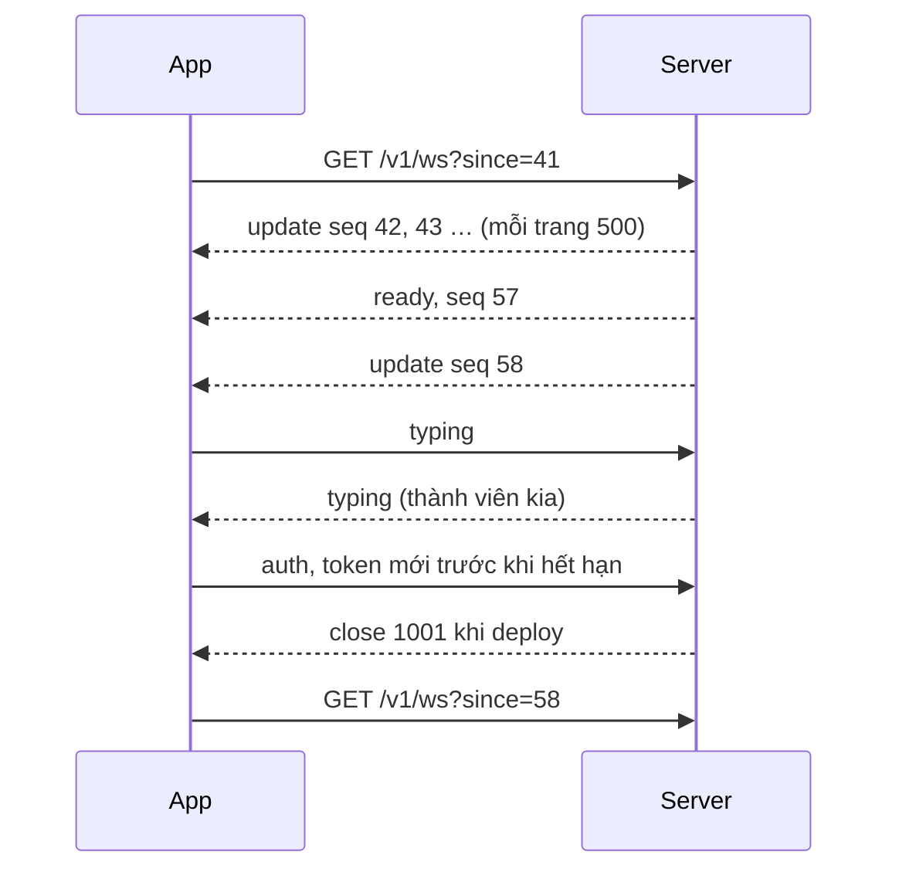

`GET /v1/ws` là một WebSocket báo cho ứng dụng hoặc website đang mở biết tài khoản đã đăng nhập có gì thay đổi: tin nhắn mới, đã đọc, một lượt chuyển của deal, một thông báo <Req id="FR-DEAL-01" />. Bản cập nhật chỉ mang ID. Ứng dụng tải lại thứ đang hiển thị, thường là một lần gọi screen, và bỏ qua bản cập nhật không đụng tới gì trên màn hình.

Thông báo đẩy tới ứng dụng đã đóng đi theo kênh riêng; xem [Thông báo](/vi/architecture/notifications).

## Nhật ký cập nhật

Mỗi tài khoản có một nhật ký cập nhật. Mỗi thay đổi liên quan tới tài khoản thêm vào một bản cập nhật với **seq** kế tiếp, một bộ đếm chạy 1, 2, 3 không có khoảng trống. Bản cập nhật được ghi trong cùng transaction với thay đổi, nên thay đổi bị rollback không để lại bản cập nhật hay lỗ hổng nào, và các bản cập nhật hiện ra theo đúng thứ tự seq.

Socket là một khung nhìn vào nhật ký đó. Vì ứng dụng nhớ seq cuối cùng nó đã thấy, kết nối lại sẽ tiếp tục đúng chỗ đã dừng: không phải tải lại mọi thứ sau một lần chập chờn mạng hay một lần deploy server.

Nhật ký giữ bản cập nhật trong 30 ngày.

## Kết nối

Ứng dụng gửi access token dưới dạng `Authorization: Bearer <token>`. Trình duyệt không đặt được header đó trên WebSocket, nên website đưa token qua subprotocol, `new WebSocket(url, ["bearer", token])`, và server chọn `bearer`. Server không bao giờ đọc token từ query string, vì proxy ghi log nó.

Request có header `Origin` phải đến từ một origin của website hoặc từ chính host của API; origin khác trả 403. Ứng dụng Android không gửi `Origin` nên không bị kiểm tra.

Thiếu token hoặc token sai trả 401 trước khi upgrade.

## Giao thức

Mọi frame là JSON dạng text, tối đa 4 KB.



**Khi kết nối**, server gửi mọi bản cập nhật sau `since` theo thứ tự seq, rồi gửi `{"type":"ready","seq":N}`. Không có `since` thì bắt đầu từ thời điểm hiện tại. Nếu nhật ký không còn giữ bản cập nhật sau `since` (cũ hơn 30 ngày), hoặc `since` vượt quá nhật ký, server gửi `{"type":"reset","seq":N}` thay cho các bản cập nhật: ứng dụng tải lại mọi thứ và giữ `N`.

**Sau ready**, mỗi thay đổi tới thành một frame, theo thứ tự seq, không trùng lặp và không có khoảng trống:

```json
{"type":"update","seq":58,"kind":"message","conversation_id":"0192…","message_id":"0192…"}
```

Ứng dụng lưu seq cuối cùng đã xử lý và gửi nó làm `since` ở lần sau.

### Loại cập nhật

| Kind | ID | Ghi khi | Cho ai |
|---|---|---|---|
| `message` | `conversation_id`, `message_id` | một tin nhắn được ghi hoặc đổi trạng thái | mọi thành viên khi tin đã gửi; chỉ người gửi khi tin đang xử lý hoặc gửi lỗi |
| `read` | `conversation_id` | mốc đã đọc tiến lên; một cuộc trò chuyện được đánh dấu chưa đọc hoặc bỏ dấu đó | thành viên kia khi mốc tiến lên; chính thành viên đó với dấu chưa đọc |
| `deal` | `deal_id` | mỗi lần lưu một deal: một lượt chuyển, một đơn COD, mọi thay đổi trên đơn của nó | người mua và người bán |
| `notification` | `notification_id` | một thông báo được thêm, hoặc một thông báo chưa đọc được đẩy lên | người nhận thông báo |
| `scam_warning` | `conversation_id` | một cảnh báo lừa đảo được bật, tăng lên hoặc bị bỏ qua | thành viên được cảnh báo |
| `listing_read` | `listing_read_id` | một lần AI đọc video hoặc ảnh bắt đầu hoặc lưu một bước | tài khoản đang đọc |
| `ticket` | `conversation_id` | một phiếu hỗ trợ được tạo, có tin nhắn đầu tiên, được giải quyết hoặc mở lại | chủ phiếu hỗ trợ |

Mở một deal không ghi gì; bản cập nhật đầu tiên của nó đến cùng lượt chuyển đầu tiên.

### Frame từ ứng dụng

- `{"type":"typing","conversation_id":…}` báo cho thành viên kia biết người dùng của ứng dụng đang gõ. Mỗi cuộc trò chuyện chỉ cho qua tối đa một frame mỗi 3 giây. Typing không bao giờ được ghi vào nhật ký, nên frame bị lỡ là mất luôn. Frame cho cuộc trò chuyện mà người gửi không được viết vào (không phải thành viên, hoặc bị chặn) bị bỏ qua trong im lặng.
- `{"type":"auth","token":…}` trao access token đã refresh. Access token sống 15 phút <Req id="NFR-SEC-01" />, và socket đóng khi token hết hạn, trừ khi ứng dụng gửi trước một token mới hơn của cùng tài khoản.

Mỗi kết nối được gửi 10 frame cùng lúc, sau đó một frame mỗi giây.

### Mã đóng

| Mã | Ý nghĩa | Ứng dụng nên |
|---|---|---|
| 1001 | server đang tắt | kết nối lại ngay với seq của mình; instance khác sẽ nhận và không mất gì |
| 4001 | token hết hạn, không hợp lệ hoặc thuộc tài khoản khác | refresh token rồi kết nối lại |
| 4003 | tài khoản đang bị tạm khóa, kiểm tra khi kết nối và ở mỗi `auth` | không kết nối lại |
| 1008 | frame không phải JSON dạng text, có type lạ, hoặc vượt tốc độ frame | sửa client |
| 1009 | frame quá 4 KB | sửa client |

Server ping mỗi 25 giây và đóng kết nối có pong về chậm hơn 10 giây.

## Không dùng socket

`GET /v1/updates?since=` đọc cùng nhật ký qua REST: tối đa 500 bản cập nhật sau `since`, seq hiện tại, `reset` và `has_more`. Ứng dụng không giữ được socket mở, hoặc muốn bắt kịp trước khi mở socket, thì dùng endpoint này.

Ngoài production, `POST /v1/dev/updates` thêm một bản cập nhật giả vào nhật ký của chính người gọi, để client kiểm tra rằng bản cập nhật tới được socket của mình.

## Cách giao bản cập nhật

Ghi một bản cập nhật cũng rung một chiếc chuông mà mọi instance server đều nghe thấy khi transaction commit. Hub của mỗi instance chuyển tiếng chuông tới các socket đang mở của tài khoản đó. Nhật ký là nguồn sự thật; tiếng chuông chỉ báo có thứ mới.

Tiếng chuông có thể bị lỡ, và nhật ký bù cho mọi trường hợp lỡ:

- **Socket chậm.** Mỗi kết nối xếp hàng tối đa 16 tiếng chuông. Hàng đợi đầy thì kết nối bị đánh dấu là tụt lại, và nó đọc nhật ký từ seq cuối cùng đã gửi.
- **Mất kết nối lắng nghe.** Khi kết nối lắng nghe của hub rớt rồi mở lại, mọi socket trên instance đó đọc nhật ký.
- **Hỏng im lặng.** Mỗi phút hub rung một tiếng chuông thăm dò tới chính nó. Nếu tiếng thăm dò không quay về, mọi socket trên instance đó đọc nhật ký. Tiếng chuông bị lỡ theo cách này chậm tối đa khoảng hai phút.

Socket không đọc nhật ký theo hẹn giờ: với 10.000 ứng dụng đang mở, việc đó sẽ là hàng trăm truy vấn mỗi giây mà không được gì.

Socket cũng giữ thời điểm "hoạt động gần nhất" của tài khoản: nó được ghi khi kết nối và khi đóng, và mỗi phút một lần cho mọi tài khoản có socket đang mở. Màn trò chuyện và trang người bán hiển thị thời điểm này.
