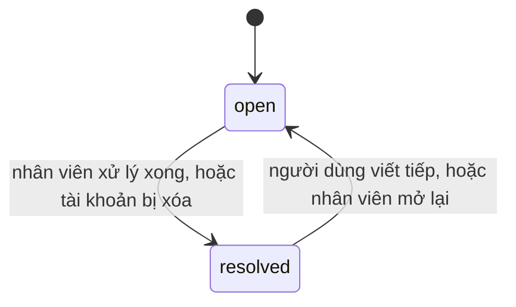
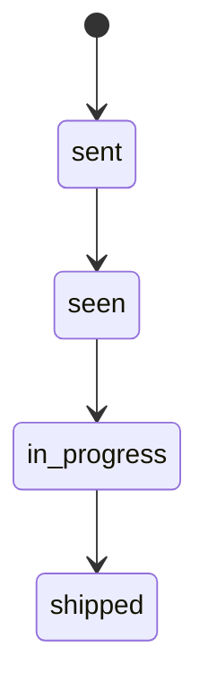
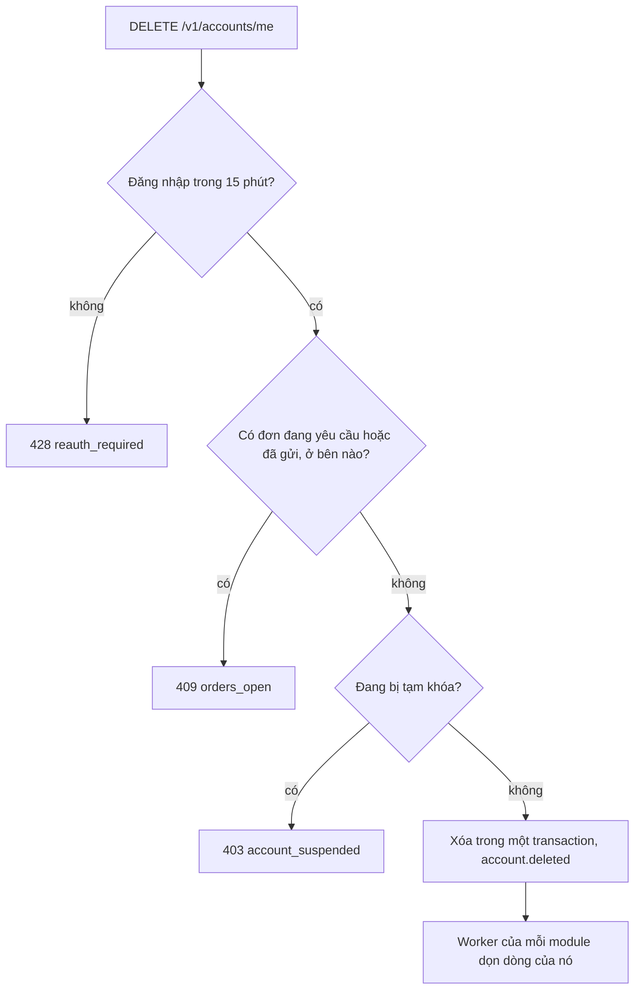

Trang này nói về những gì người dùng lưu về bản thân, cách họ liên hệ với hệ thống, và cách họ rời đi. Định danh nằm ở trang [Đăng nhập](/vi/architecture/sign-in).

## Hồ sơ và chế độ vắng mặt

`PATCH /v1/accounts/me` đổi một hoặc nhiều trường `display_name`, `bio` (tối đa 200 ký tự, công khai), `avatar_upload_id` (`null` thì xóa ảnh đại diện) và `away_until` <Req id="FR-ACC-03" />. Lệnh này ghi `account.updated`. Vi phạm quy tắc thì trả 422 `invalid_account`, mỗi quy tắc một trường.

Chế độ vắng mặt kéo dài tới `away_until`, tối đa 30 ngày tới; `null` thì tắt. Mốc kết thúc đã qua được hiểu là không vắng mặt, nên không cần ai xóa nó đi. Trong lúc chế độ này còn hiệu lực, mọi chỗ hiển thị người đó đều mang nó, từ dòng người bán trên tin đăng tới cuộc trò chuyện. Tin đăng vẫn nằm trong kết quả tìm kiếm.

## Sổ địa chỉ

Mỗi tài khoản có tối đa 10 địa chỉ. Mỗi địa chỉ có tên, số di động Việt Nam, số nhà và đường, phường/xã và loại. Địa chỉ của người khác trả `address_not_found`.

- Loại địa chỉ (`home`, `work`, `other`) cho shipper biết nên giao lúc nào. Đơn COD chép loại này, và vận đơn của hãng vận chuyển truyền nó đi dưới dạng ghi chú, ví dụ địa chỉ công ty chỉ nhận hàng trong giờ hành chính.
- Một địa chỉ là mặc định. Địa chỉ đầu tiên luôn là mặc định. `is_default: true` khi thêm hoặc sửa, hoặc `POST /v1/addresses/{id}/default`, chuyển mặc định ngay trong cùng request. Không thao tác nào bỏ mặc định đi; xóa địa chỉ mặc định thì địa chỉ mới nhất còn lại lên thay.
- `POST /v1/addresses` cần `Idempotency-Key` và chạy không qua Restate: key lặp lại trả về địa chỉ mà request đầu đã thêm, kể cả khi đã chạm giới hạn <Req id="NFR-IDEM-01" />.
- Thêm, đặt mặc định và xóa đều khóa tài khoản, nơi giữ giới hạn số địa chỉ và địa chỉ mặc định duy nhất. Lệnh sửa thua trong một lượt chạy song song trả `try_again`. Đơn giữ bản sao người nhận của riêng nó, nên xóa địa chỉ chỉ là xóa dòng.

## Phiếu hỗ trợ

Phiếu hỗ trợ là một câu hỏi gửi hệ thống. Mỗi phiếu là một cuộc trò chuyện riêng giữa người dùng và tài khoản hệ thống ShopNexus <Req id="FR-MOD-04" />. Không ai đăng nhập được bằng ShopNexus, và tài khoản này không thể bị tạm khóa, xóa, chặn hay báo cáo vi phạm (409 `account_is_system`). Tin nhắn nằm trong [chat](/vi/architecture/chat).

| Loại | Khi nào |
|---|---|
| `not_received` | đơn của người mua đã gửi, hoặc hệ thống đã hoàn tất nó chưa tới 7 ngày; mỗi đơn một phiếu |
| `carrier_request` | một hãng vận chuyển hệ thống chưa có, từ 1 tới 50 ký tự; các yêu cầu cho cùng một hãng được đếm chung |
| `other` | mọi việc khác; cần tin nhắn đầu tiên |

`POST /v1/support/tickets` chạy một flow bền vững dưới key của request:

1. Đọc tài khoản (tài khoản bị tạm khóa vẫn được hỏi), số phiếu trong ngày và, với một đơn, chính đơn đó. Quá 10 phiếu trong 24 giờ thì trả 429 `too_many_tickets` và không mở phiếu nào.
2. Mở cuộc trò chuyện hỗ trợ, rồi chèn phiếu trỏ tới nó. Nếu lệnh chèn thấy một phiếu mà key hoặc đơn đã có, flow bỏ cuộc trò chuyện mới và trả về phiếu đó.
3. Gửi tin nhắn đầu tiên qua chat; tin này có thể không có chữ. Nếu chat từ chối (một ảnh không phải ảnh người đó đã tải lên), flow rút lại phiếu cùng cuộc trò chuyện của nó, và request gửi lại nhận đúng lời từ chối đó.

Nhân viên trả lời từ [trang điều hành](/vi/architecture/console) dưới tên ShopNexus, và mỗi câu trả lời ghi lại nhân viên nào đã viết. Worker của support theo dõi `message.sent` để mở lại phiếu và ghi nhận ai viết sau cùng; trang điều hành hiển thị điều này thành trạng thái đang chờ trả lời. Xử lý xong một phiếu `carrier_request` thì trước hết gửi một tin nhắn báo hãng đã được ghi nhận. Xử lý xong một phiếu đã xong, hoặc mở lại một phiếu đang mở, không đổi gì và trả 200.

## Góp ý

Góp ý là điều người dùng muốn nói với hệ thống và không cần trả lời. Một câu hỏi thì là phiếu hỗ trợ loại `other`.

`POST /v1/feedback` nhận một mức cảm xúc (1 tới 5), một loại (`bug`, `idea`, `praise`), tối đa 1.000 ký tự, tối đa 3 ảnh chụp màn hình, thiết bị (không bắt buộc), màn hình, và việc hệ thống có được liên hệ lại hay không. Góp ý cần mức cảm xúc hoặc chữ (422 `invalid_feedback`). Lệnh chạy không qua Restate dưới key của request, tối đa 20 lần trong 24 giờ (429 `too_many_feedback`). `GET /v1/feedback` liệt kê 100 góp ý mới nhất.

Nhân viên đặt trạng thái, trả lời một lần, thả tim, và gom các góp ý trùng dưới một góp ý gốc. Một nhóm dùng chung trạng thái, ghi chú và phiên bản đã phát hành. Chuyển sang `in_progress` hoặc `shipped` phát `feedback.moved`, còn câu trả lời đầu tiên phát `feedback.replied`. Mỗi event thành một thông báo đẩy, không bao giờ thành email. Mọi thao tác của nhân viên đều được ghi vào nhật ký kiểm toán.

## Xóa tài khoản

`DELETE /v1/accounts/me` do một module nhỏ riêng phục vụ, vì deal phụ thuộc vào account và account không thể hỏi deal về đơn.

Đang bị tạm khóa thì không xóa được, nên không ai thoát lệnh tạm khóa bằng cách rời đi.

Dòng tài khoản được giữ lại làm bia mộ, vì đơn, đánh giá và tin nhắn trỏ tới nó, nhưng không còn tên, bio hay ảnh đại diện. Cùng transaction đó xóa định danh, mã OTP qua email, địa chỉ, danh sách chặn và theo dõi, và thu hồi mọi phiên. Số điện thoại hoặc email sau đó có thể đăng ký thành tài khoản mới.

Khi có `account.deleted`, mỗi module dọn dòng của riêng nó, và chạy hai lần cũng không đổi gì:

- catalog xóa tin đăng chưa bán và bản nháp; deal kết thúc các deal đang mở và hủy các đơn đang yêu cầu;
- discovery, notifications, assist và chat xóa tin đã lưu, lịch sử, thông báo, push token và các gợi ý trả lời;
- support xử lý xong các phiếu đang mở, feedback xóa góp ý, trust rút các báo cáo vi phạm chưa xử lý;
- một năm sau, deal xóa trắng tên, số điện thoại và địa chỉ người nhận trên các đơn mà tài khoản đã mua.

Các lượt chạy song song:

- Một lệnh ghi giữ lại dòng của người gọi (một địa chỉ, một tin đã lưu, một báo cáo vi phạm) kiểm tra dòng tài khoản trong transaction của nó. Sau khi xóa, lệnh từ chối với `session_revoked`, nên không dòng mới nào sống lâu hơn việc xóa tài khoản.
- Yêu cầu COD lọt vào sau bước kiểm tra đơn bị worker của deal hủy như mọi đơn khác.
- Lượt đăng nhập đã tìm thấy định danh trước khi xóa trả `try_again`; lần thử lại đăng ký một tài khoản mới.

Người khác thấy người đó là đã xóa trên tài khoản, cuộc trò chuyện và đánh giá, và các đánh giá vẫn được tính. Trả lời hoặc theo dõi họ trả 409 `account_deleted`; trang người bán của họ trả 404.
