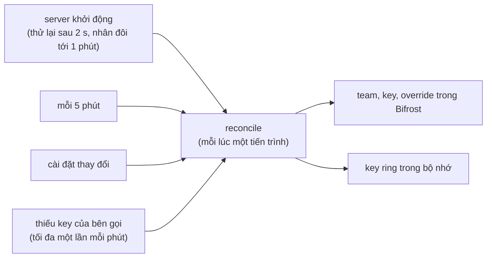

Server dùng hai loại mô hình. Mô hình từ xa (các mô hình chat và mô hình embedding văn bản) chỉ được gọi qua Bifrost, cổng AI của stack. Mô hình tự chạy (chuyển giọng nói thành chữ, vector ảnh và khung hình video) chạy trên CPU ngay trong binary của server, dưới dạng module ai. Không chỗ nào trong server gọi thẳng nhà cung cấp mô hình. <Req id="ADR-0004" />

## Ai gọi gì

Một **agent** là một mục đích có gọi mô hình. Một **bên gọi** là một phần của code dùng một agent, có key và giới hạn tốc độ riêng. Ngân sách thuộc về agent.

| Agent | Bên gọi | Dùng để |
|---|---|---|
| `search` | `server-search` | Đọc câu tìm kiếm thành bộ lọc và mức ưu tiên ([Tìm kiếm và khám phá](/vi/architecture/search-and-discovery)). |
| `embed-text` | `server-embed-index`, `server-embed-search` | Vector văn bản: tin đăng lúc được đánh chỉ mục; câu tìm kiếm và bản nháp của bảng giá tham khảo. |
| `listing-read` | `server-assist` | Đọc một video hay một ảnh thành bản nháp, và điền các tin nhập từ Chợ Tốt ([Đọc tin đăng](/vi/architecture/assist)). |
| `scam-check` | `server-trust` | Phân loại một đoạn cuộc trò chuyện theo dấu hiệu lừa đảo ([Trust](/vi/architecture/trust)). |
| `console-agent` | `console-agent` | Trợ lý AI của trang điều hành, chạy riêng và nhận key theo từng lượt chạy ([Agent và cấu hình](/vi/agent/setup)). |

Module ai phục vụ phần còn lại:

| Mô hình | Dùng bởi |
|---|---|
| Chuyển giọng nói thành chữ (tiếng Việt, có phát hiện giọng nói) | Lượt đọc video, khi điện thoại không gửi bản ghi lời nói. |
| Khung hình video (ffmpeg, chọn khung hình nét) | Lượt đọc video. |
| Vector ảnh (SigLIP 2) | Vector ảnh của tin đăng, tìm bằng ảnh, bảng giá tham khảo. |

## Module ai

Module ai là một Restate service có ba handler. `Transcribe` nhận một key trong object store và trả về chữ. `Frames` nhận một key và trả về thời lượng cùng tối đa 8 khung hình, mỗi khung có thời điểm và độ nét. `EmbedImages` nhận ảnh JPEG, PNG hoặc WebP và trả về vector của chúng. Bên gọi tới module qua Restate, nên lệnh gọi có thể rơi vào một tiến trình khác.

Handler không bao giờ tự thử lại và không ghi gì vào journal. Lời từ chối trả về bên gọi dưới dạng lý do có kiểu: không đọc được, không có object ở key đó, quá ngắn, quá dài, hoặc đầu vào sai kiểu khác. Lỗi của mô hình hay của ffmpeg, hoặc không gọi tới được service, trả về dưới dạng lỗi thường, và chính bước của bên gọi sẽ thử lại.

Một binary chạy ở ba vai trò:

- **all**, dùng cho Docker Compose: mọi module và module ai trong một tiến trình.
- **api**, server chính của cụm: mọi module, nhưng không nạp mô hình nào.
- **ai**, server mô hình của cụm: nạp mô hình và chỉ phục vụ module ai cùng health check. Nó không mở database.

Các mô hình, khoảng 5 GB, không nằm trong image. Mỗi stack tải chúng vào một volume lúc khởi động và kiểm tra checksum của từng file.

### Tắt một loại vector

Vector văn bản và vector ảnh có thể được tắt riêng. Khi một loại bị tắt, tin đăng không có vector loại đó, phép so sánh câu tìm kiếm và giá bỏ loại đó ra, và tìm bằng ảnh trả 503 `search_unavailable`, như khi mô hình ảnh gặp lỗi. Mỗi vector đã lưu ghi lại mô hình đã tạo ra nó, nên một mô hình mới coi các vector cũ là chưa có cho tới khi đánh chỉ mục lại.

## Cổng

Mỗi lệnh gọi từ xa tới endpoint chat hoặc embeddings tương thích OpenAI của Bifrost, kèm virtual key của bên gọi, một mô hình đặt tên `provider/model` và các fallback của agent. Bifrost thử các fallback khi mô hình lỗi, kiểm tra giới hạn tốc độ của key và ngân sách của team, rồi ghi chi phí của từng lệnh gọi.

| Thứ gì | Ai giữ |
|---|---|
| Nhà cung cấp, URL và API key của họ | Hạ tầng: file cấu hình và secret của Bifrost. Thêm nhà cung cấp hay key là một thay đổi hạ tầng. |
| Agent, mô hình, fallback, giá, tag, ngân sách, bên gọi và giới hạn của chúng | Database của server, sửa trong trang điều hành. |
| Team, virtual key, ngân sách và pricing override bên trong Bifrost | Chỉ reconciler của server ghi. |
| Chi phí đo được và log lệnh gọi | Bifrost, server đọc từ đó. |

Góc nhìn của người vận hành (triển khai, file cấu hình, secret, mạng, metric) nằm ở trang [Cổng Bifrost](/vi/operations/cluster/llm-gateway).

### Reconciler

Reconciler ghi chính sách của server vào Bifrost qua admin API của Bifrost:

- Mỗi agent thành một **team** mang tên slug của nó, với ngân sách hằng tháng. Ngân sách đặt lại vào ngày 1 mỗi tháng, theo giờ UTC. Team không bao giờ bị xóa, vì agent cũng không bị xóa.
- Mỗi bên gọi thành một **virtual key** mang tên của nó, nằm trong team của agent, chỉ được dùng mô hình và các fallback của agent, với giới hạn tốc độ theo phút. Key bị lộ không gọi được gì khác. Key của agent bị tắt cũng bị tắt.
- Mỗi giá mô hình thành một **pricing override**, Bifrost dùng nó để tính chi phí từng lệnh gọi.
- Key hoặc override do server tạo mà không còn gì nhắc tới thì bị xóa. Object không do server tạo thì được để yên. Mỗi stack có Bifrost riêng, nên hai stack không bao giờ dùng chung một Bifrost.

Reconciler chạy dưới một khóa database, nên hai replica không bao giờ ghi cùng lúc. Nó chạy tiếp khi Bifrost lỗi ở một object, và luôn kết thúc bằng việc nạp các key Bifrost đang có vào key ring của server.

### Key

Bifrost tạo giá trị của key. Không key nào của bên gọi được lưu trong git, trong secret hay trong database của server; server đọc chúng từ Bifrost vào bộ nhớ.

- Key đã có trong ring được trả về ngay. Key cũ hơn 5 phút khởi động một lần làm mới ở nền, nên lệnh gọi không bao giờ chờ admin API của Bifrost cho một key nó đã có.
- Bên gọi mà ring chưa có thì chờ một lần đọc (tối đa một lần mỗi 10 s) và yêu cầu reconcile. Lần đọc thất bại không được thử lại trong 5 s.
- Khi Bifrost từ chối chính key đó (không biết key, key bị tắt, hoặc key không được dùng mô hình hay nhà cung cấp đó), ring đọc lại, tối đa mỗi 10 s, và lệnh gọi chạy thêm một lần nếu key đã đổi. Lỗi 401 hay 403 của chính nhà cung cấp thì được chuyển thẳng về.

## Cài đặt AI

Quản trị viên đổi chính sách AI trong trang điều hành, dưới `/v1/console/settings/*`. Ở đó nhà cung cấp chỉ xem được.

- **Mô hình** được đặt tên `provider/model_id`. Mô hình của một agent và từng fallback phải có giá (`ai_model_unpriced` 422) và mang các tag agent yêu cầu (`ai_model_lacks_tags` 422). Agent embedding không nhận fallback, vì vector của mô hình khác nằm trong không gian khác (`ai_agent_invalid` 422). Chọn mô hình mới thì bỏ các tùy chọn request thêm của mô hình cũ, như việc ghim một nhà cung cấp.
- **Tag** có tám cái: hai loại Chat và Embedding, và các khả năng Vision, Tool use, Long context, Reasoning, Structured output và Multilingual.
- **Giá** tính bằng USD mỗi token cho input, output, cache read và cache write; giá cache để trống nghĩa là bằng giá input. Danh sách mô hình hiển thị giá của từng mô hình cạnh giá niêm yết trong catalog của nhà cung cấp, và bộ chọn mô hình đọc catalog đó.
- **Agent** thuộc loại `app` hoặc `console`. Có năm agent được seed sẵn: trợ lý AI của trang điều hành, kiểm tra lừa đảo, đọc tin đăng, tìm kiếm và embedding cho tìm kiếm. Ngân sách là 100 USD mỗi tháng cho trợ lý AI và 30 USD cho các agent còn lại. Agent loại `app` chỉ đổi được mô hình, fallback, giới hạn, ngân sách và giới hạn của các bên gọi (nếu không thì `ai_agent_app_fixed` 422). Chỉ agent loại `console` có tool và chỉ dẫn; mỗi lần đổi chỉ dẫn lưu thành một phiên bản mới.
- **Giới hạn của bên gọi** đổi số request và số token mỗi phút; request phải ghi tên mỗi bên gọi của agent đúng một lần. Agent loại `console` mới tạo có một bên gọi, mang tên slug của nó.
- **Tình trạng nhà cung cấp** lấy từ các lệnh gọi trong một giờ qua: `unknown` khi không có lệnh gọi nào; `down` khi Bifrost đánh dấu nhà cung cấp đang lỗi, hoặc ít nhất một nửa trong ít nhất 5 lệnh gọi thất bại; `degraded` khi từ 5% trong ít nhất 20 lệnh gọi thất bại; còn lại là `ok`.
- **Chi phí** đọc từ log của Bifrost: tổng mỗi ngày theo UTC và chi phí theo agent, trong khoảng tối đa 366 ngày (`ai_spend_range_invalid` 422). Tổng của Bifrost có thể trễ khoảng một phút. Mỗi agent còn hiển thị phần ngân sách đã tiêu trong tháng và lúc ngân sách đặt lại, hoặc để trống khi không đọc được Bifrost.

Một thay đổi lưu dòng database trước, kiểm tra write ID của nó (`try_again` 409 khi người khác đã đổi), ghi vào nhật ký kiểm toán của trang điều hành trong cùng transaction, rồi reconcile. Nếu không gọi tới được Bifrost, câu trả lời là `ai_gateway_unavailable` 503, dòng vẫn được giữ, và lần reconcile định kỳ kế tiếp sẽ áp dụng nó. Request bị Bifrost từ chối trả `ai_gateway_refused` 422. Lệnh tạo gửi lại tìm thấy agent của chính nó và reconcile, thay vì trả `ai_agent_taken`.

## Khi một mô hình hay một ngân sách gặp lỗi

Ngân sách đã hết, hoặc credit của nhà cung cấp đã hết, là lỗi 402 của Bifrost. Với code của server, đây là lỗi tạm thời, giống giới hạn tốc độ, chứ không phải request bị từ chối. Mỗi agent có một ngân sách, và không có trần chung, ngưỡng cảnh báo hay ngân sách theo từng người. Bước kiểm tra sẵn sàng của server không xem Bifrost lẫn module ai.

| Bên gọi | Khi lỗi |
|---|---|
| Đọc câu tìm kiếm | Mô hình có 4 giây. Gặp bất kỳ lỗi nào, tìm kiếm chỉ dùng nguyên các từ, không có chip hay mức ưu tiên. Câu tìm kiếm đã đọc trong 7 ngày qua lấy từ cache. |
| Vector văn bản của tin đăng | Đầu vào bị từ chối được ghi log và bỏ qua. Ngân sách đã hết thì tin đăng chưa có vector văn bản và được thử lại 6 giờ sau. Các lỗi khác được thử lại. |
| Tìm bằng ảnh | Mô hình ảnh lỗi, hoặc vector ảnh bị tắt, trả 503 `search_unavailable`. |
| Bảng giá tham khảo | Mô hình vector lỗi thì phía của nó bị bỏ khỏi phép so sánh. |
| Đọc tin đăng | Tối đa 3 lần thử mỗi bước trong hạn 2 phút, sau đó là `unavailable`. Request bị từ chối thì thành `unavailable` ngay. |
| Kiểm tra lừa đảo | Lời từ chối, hoặc bước phân loại quá 3 lần thử và 10 phút, thì bỏ qua lần kiểm tra. |
| Trợ lý AI của trang điều hành | Mỗi lượt chạy nhận key, mô hình, fallback và giá từ server; agent có mô hình chưa có giá bị từ chối. Ngân sách đã hết thì lượt chạy kết thúc và trang điều hành báo đã tiêu hết ngân sách của tháng ([Giới hạn và lỗi](/vi/agent/limits)). |
