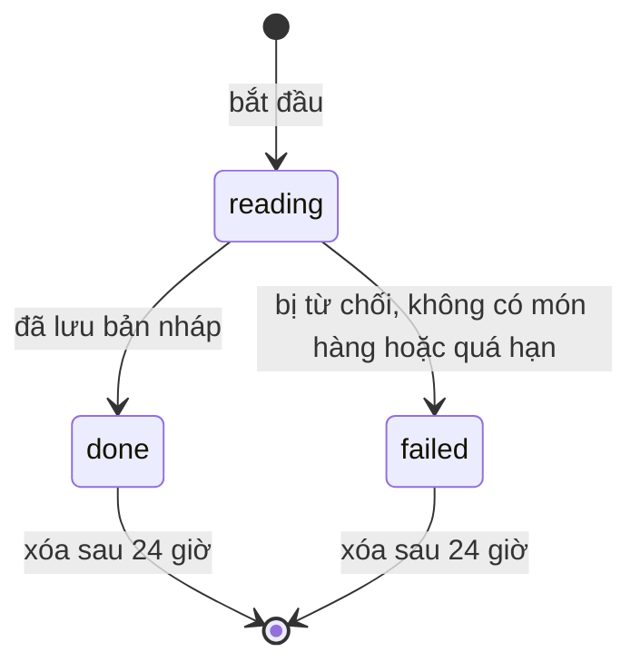
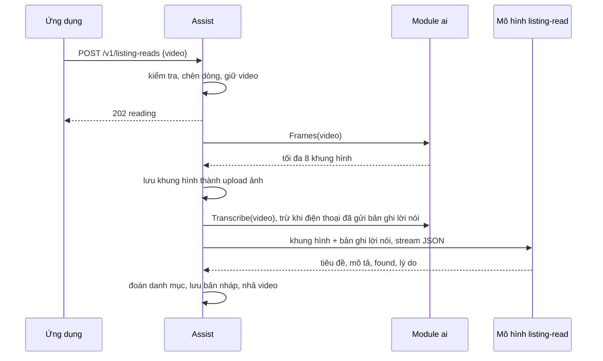
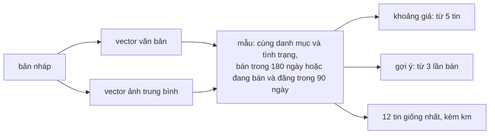
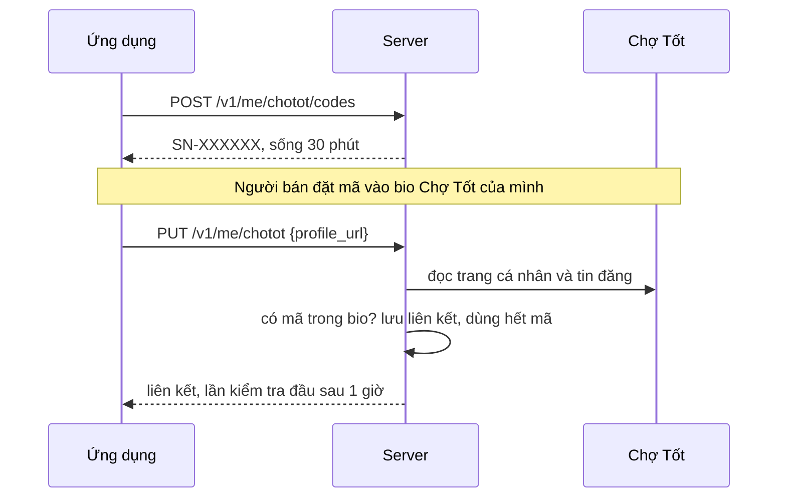

Module assist giữ những việc AI làm cho người dùng ứng dụng. Nó đọc thứ người bán đã có (một video, một ảnh hoặc tin của họ trên Chợ Tốt) thành bản nháp tin đăng, và định giá một bản nháp khi được yêu cầu. Người bán luôn kiểm tra bản nháp và đăng nó bằng lệnh đăng tin thông thường, nên một lượt đọc không bao giờ tự đăng gì. Đây là phần AI của <Req id="UC-LST-01" /> và <Req id="FR-LST-01" />. Phát hiện lừa đảo thuộc về điều phối và nằm ở [trust](/vi/architecture/trust).

Mô hình nào chạy ở từng bước, và chuyện gì xảy ra khi một mô hình lỗi hay hết ngân sách, nằm ở trang [Lớp AI](/vi/architecture/ai).

## Bắt đầu một lượt đọc

Client gửi `POST /v1/listing-reads` với đúng một nguồn, `video`, `photo` hoặc `link`, kèm `Idempotency-Key`. Server trả 202 với lượt đọc ở trạng thái `reading`, và một flow nền làm phần còn lại. Không có nguồn hoặc có hai nguồn thì trả `invalid_request` 400. Ứng dụng khởi động lượt đọc ảnh và video. Ứng dụng đưa tin Chợ Tốt sang qua liên kết trang cá nhân ở cuối trang này, còn lượt đọc một link đơn lẻ chỉ có trong API.

Mọi lần bắt đầu đều qua cùng các bước kiểm tra:

- Tài khoản bị tạm khóa bị từ chối, và tài khoản chưa có số điện thoại cũng vậy (`phone_required`, <Req id="BR-ACC-03" />). Lượt đọc có ra là để đăng tin, nên nó theo cùng quy tắc.
- Mỗi tài khoản có giới hạn theo từng nguồn trong 24 giờ: 30 lượt đọc video, 60 lượt đọc ảnh và 30 lượt đọc link. Quá giới hạn thì trả `read_limit_reached` 429. Việc đếm chạy dưới một khóa trên tài khoản và nguồn, nên các lần bắt đầu song song không lọt qua được.
- `Idempotency-Key` lặp lại trả về lượt đọc đầu tiên.

`GET /v1/listing-reads/{id}` cho một góc nhìn chung cho mọi nguồn. Lượt đọc của tài khoản khác hoặc đã hết hạn trả `listing_read_not_found` 404. Mỗi lần lưu gửi cho tài khoản một cập nhật `listing_read` để các màn hình đang mở tải lại. Dòng bị xóa 24 giờ sau lúc bắt đầu, và khung hình hay bản sao ảnh mà người bán không đăng sẽ hết hạn cùng upload của chúng.

| Lỗi | Nguồn | Nghĩa |
|---|---|---|
| `unreadable` | video, photo | Không đọc được hình nào, hoặc ảnh không còn là upload đang chờ. |
| `video_too_short`, `video_too_long` | video | Dưới 3 s hoặc trên 35 s. |
| `listing_not_found` | link | Chợ Tốt không có tin nào như vậy đang bán, hoặc không chép được ảnh nào của tin. |
| `no_item` | tất cả | Mô hình không thấy một món hàng duy nhất nào để bán; lý do của nó, một câu tiếng Việt, được gửi cho người bán. |
| `unavailable` | tất cả | Các mô hình hoặc Chợ Tốt không trả lời kịp. Người bán có thể thử lại. |

## Hạn chót và thử lại

Mỗi lượt đọc có 2 phút tính từ lúc bắt đầu. Mỗi bước gọi mô hình có tối đa 3 lần thử trong thời gian còn lại, và flow lưu lượt đọc sau mỗi bước. Bước hết thời gian, hoặc sẽ bắt đầu sau hạn chót, làm lượt đọc thất bại với `unavailable`. Mô hình từ chối chính request đó (một lỗi 4xx không phải hết ngân sách hay giới hạn tốc độ) làm lượt đọc thất bại với `unavailable` ngay. Câu trả lời không phải JSON như mong đợi được tính là lỗi mô hình và được thử lại.

Ở bước đọc đầu vào riêng tư (bản ghi lời nói, một tin Chợ Tốt), việc lấy dữ liệu và lệnh gọi mô hình chạy trong một bước, nên chỉ kết quả vào journal của flow.

## Đọc video

1. Lúc bắt đầu, upload video bị giữ lại để không gì khác dùng được nó. Video mà một flow khác đang giữ trả `invalid_upload`, và dòng bị xóa lại.
2. **Khung hình.** Module ai chọn tối đa 8 khung hình nét. Mỗi khung thành một upload ảnh đang chờ của người bán, nên bản nháp đăng được như ảnh do ứng dụng tải lên.
3. **Điền.** Lời nói là bản ghi lời nói của điện thoại khi client có gửi, nếu không thì lấy từ bộ chuyển giọng nói thành chữ của module ai. Mô hình nhận các khung hình ở 768 px cùng bản ghi lời nói, và stream JSON: đối tượng, có món hàng hay không, tiêu đề, mô tả và, khi không có món hàng, lý do.
4. Câu trả lời "không có món hàng" được hỏi lại một lần. Lần thứ hai vẫn vậy, hoặc tiêu đề trống, thì lượt đọc thất bại với `no_item`.
5. Catalog đoán danh mục từ tiêu đề và mô tả; đoán không được thì để người bán chọn.
6. Mọi kết thúc, thành công hay thất bại, đều nhả video trước khi lưu.

Video không có tiếng, hoặc bộ chuyển giọng nói thành chữ từ chối hay lỗi, thì được đọc không có lời nói, vì khung hình đã cho mô hình thứ để đọc.

Bản nháp có tình trạng `used`, không có thông số, không có giá và tắt trả giá. Tiêu đề bị cắt ở 70 ký tự và mô tả ở 1.500. Ảnh của bản nháp là khung hình nét nhất trước, rồi các khung còn lại theo thứ tự thời gian, tối đa 6 ảnh. Mô tả chỉ nói lại những gì người bán đã nói và không bao giờ nêu thương hiệu mà người bán không nêu.

Bản ghi lời nói của điện thoại dài tối đa 1.000 ký tự và được coi là lời của chính người bán. Nó không bao giờ được ghi log, trả về hay ghi vào journal: nó chờ tối đa 10 phút cho dòng lượt đọc, chuyển vào dòng đó, và bị xóa khi lượt đọc kết thúc.

## Đọc ảnh

Lượt đọc ảnh đọc một ảnh, là ảnh bìa của ứng dụng: một ảnh, không chuyển giọng nói thành chữ. Lúc bắt đầu, server kiểm tra đó là upload ảnh đang chờ của chính người gọi (nếu không thì `invalid_upload` 422). Lượt đọc không giữ gì, vì lệnh đăng tin dùng ảnh đó. Một bước gọi mô hình ở 768 px điền bản nháp, bản nháp giữ ảnh đó và cắt mô tả ở 300 ký tự. Mô tả chỉ nói những gì ảnh cho thấy và không bao giờ nêu thương hiệu hay lỗi của món hàng. Ảnh không còn ở trạng thái chờ khi bước chạy thì thành `unreadable`, không gọi mô hình.

## Đọc link

Lượt đọc link biến tin Chợ Tốt của chính người bán thành bản nháp. Server chỉ đọc Chợ Tốt, qua API công khai của Chợ Tốt, và tin lời người bán rằng tin đó là của họ.

Link được kiểm tra trước tài khoản: tối đa 2.048 ký tự; không phải URL http hay https thì trả `not_a_link` 422; site khác ngoài `chotot.com` và các subdomain của nó, hoặc không có ID tin ở đoạn cuối của đường dẫn, thì trả `unsupported_source` 422. Chưa lấy gì về cho tới khi flow chạy.

1. **Đọc.** Server lấy tin về và chỉ giải mã tiêu đề, nội dung, giá, tên danh mục, URL ảnh và thông số món hàng, không bao giờ lấy tên, số điện thoại, địa chỉ hay tọa độ của người bán. Mô hình nhận phần chữ, không kèm ảnh. Giá là giá của chính tin đó, giữ trong khoảng 10.000 tới 1.000.000.000 đồng. Thứ gì vẫn trông như số điện thoại Việt Nam đều bị xóa, và lượt đọc được đánh dấu `contact_removed`; trong lúc stream, một số đang viết dở cũng bị ẩn.
2. **Chép.** 10 ảnh đầu tiên được chép vào upload của người bán. Ảnh chỉ được lấy từ host ảnh của Chợ Tốt, không theo chuyển hướng, tối đa 15 MB, và chỉ khi các byte đầu cho thấy là JPEG, PNG hoặc WebP. Ảnh thiếu hoặc không phải ảnh thì bị bỏ qua; ảnh mà host không trả lời được thử hai lần.

Tin đã mất hoặc không còn bán thì trả `listing_not_found`; Chợ Tốt không trả lời thì trả `unavailable`. Khi không chép được ảnh nào: nếu chỉ là ảnh chưa về tới thì bước chạy lại; nếu ảnh nằm trên host khác thì lượt đọc thất bại với `unavailable`; còn lại là `listing_not_found`.

## Theo dõi một lượt đọc

`GET /v1/listing-reads/{id}/events` là một luồng server-sent event: event `read` kèm lượt đọc, event `text` kèm tiêu đề và mô tả trong lúc mô hình viết (tối đa mỗi 100 ms), và `read` thêm lần nữa khi kết thúc. Phần chữ đi giữa các tiến trình qua một kênh notification của Postgres. Mỗi tin chứa toàn bộ phần chữ tới lúc đó, nên mất một tin cũng không sao. Luồng gửi keep-alive mỗi 15 s và đóng muộn nhất 30 s sau hạn chót của lượt đọc.

## Bảng giá tham khảo

`POST /v1/price-guides` định giá một bản nháp bất kỳ cho bước giá của ứng dụng, có hay không có lượt đọc; bản thân các lượt đọc không bao giờ định giá bản nháp. Lệnh nhận tiêu đề, danh mục, tình trạng, thông số, mô tả, phường/xã và tối đa 3 ảnh của bản nháp, trả 200 và không lưu gì. Các bước kiểm tra chạy trước mọi mô hình: `account_suspended` 403, `invalid_listing` 422 (không phải danh mục con, phường/xã không xác định), `invalid_upload` 422 (ảnh không phải upload đang chờ của người gọi). Lệnh không có giới hạn số lần và nằm ở bậc giới hạn tốc độ costly.

- Một lần bán được tính theo ngày bán, nên tin bị xóa sau khi bán vẫn góp vào việc định giá.
- "Giá thị trường" là trung vị của khoảng giá, kèm trung vị số ngày tới lúc bán. "Bán nhanh" là trung vị giá và số ngày của các lần bán ít nhất nhanh như thế, chỉ hiện khi thấp hơn giá thị trường.
- 12 tin giống nhất đi kèm khoảng cách từ phường/xã của bản nháp. Tin đã mất từ đó, hoặc của người bán có chặn theo một trong hai chiều, thì không được liệt kê, nhưng giá của nó vẫn được tính.
- `watchers` đếm số lượt theo dõi tìm kiếm mà một tin như thế này sẽ khớp (xem [Tìm kiếm và khám phá](/vi/architecture/search-and-discovery)).

Mô hình vector lỗi thì phía của nó bị bỏ ra. Lấy mẫu lỗi thì bảng giá tham khảo không có phần so sánh; `watchers` vẫn có câu trả lời.

## Liên kết trang cá nhân Chợ Tốt

Người bán có thể liên kết trang cá nhân Chợ Tốt của mình và đưa tin của nó sang. Hệ thống chỉ đọc Chợ Tốt: tên, ảnh đại diện và bio của trang cá nhân, cùng 200 tin đang bán mới nhất của nó.

- **Bằng chứng.** Mã là `SN-` cùng sáu ký tự không có 0, O, 1, I hay L, mỗi tài khoản một mã. Liên kết kiểm tra theo thứ tự: `invalid_profile_url` 422, `code_expired` 422, `chotot_profile_not_found` 404, `chotot_unavailable` 503, `code_not_found` 422 (bỏ qua chữ hoa thường, khoảng trắng, gạch ngang và gạch dưới). Lỗi cuối mang tên và ảnh đại diện của trang cá nhân để ứng dụng cho thấy nó đã đọc trang nào.
- **Một tài khoản cho mỗi trang cá nhân.** Một liên kết thay mọi liên kết của tài khoản và của trang cá nhân, nên chứng minh được mã thì chuyển trang cá nhân sang. Tin đã nhập của tài khoản kia vẫn còn và ngừng theo dõi. Liên kết lại cùng trang cá nhân thì giữ nguyên cài đặt.
- **Cài đặt.** `auto_import`, `follow_updates` và `remind_hide` bắt đầu ở trạng thái bật và đổi bằng `PATCH`. `DELETE` hủy liên kết; các lần kiểm tra nền dừng ở lần chạy kế tiếp.
- **Danh sách.** `GET /v1/me/chotot/ads` đọc Chợ Tốt ở mỗi lần gọi và đánh dấu từng tin là `imported`, `importing`, `unsupported` (bất động sản, hoặc không tìm thấy món hàng hay ảnh), `already_here` (một tin đang bán của người bán có cùng giá và các từ trong tiêu đề) hoặc `importable`. `room` là phần còn lại của giới hạn 20 tin đang bán.

### Nhập tin

`POST /v1/me/chotot/imports` nhận từ 1 tới 20 ID tin và trả 202; ứng dụng hỏi lại danh sách tin của người bán theo chu kỳ. Một dòng cho mỗi cặp tài khoản và tin Chợ Tốt là khóa chống trùng, nên request gửi lại không cần `Idempotency-Key`. Lần nhập đã đăng, bản nháp chưa tới 30 ngày, lần nhập không hỗ trợ hoặc đang nhập chưa tới một giờ thì trả về như hiện trạng; lần nhập bị bỏ qua hoặc đã cũ thì bắt đầu lại.

Mỗi lần nhập kiểm tra liên kết vẫn trỏ tới trang cá nhân của nó (`not_yours`) và người bán được phép đăng tin (trạng thái, số điện thoại, giới hạn). Sau đó nó điền bản nháp như một lượt đọc link, với ba lần thử, lấy tình trạng từ mục "Tình trạng" của Chợ Tốt, nếu không có thì là `used` kèm đánh dấu cần xem lại. Phường/xã là của địa chỉ mặc định của người bán, nếu không có thì lấy của tin mới nhất của họ. Lần nhập chép ảnh và đăng qua catalog, với ID của lần nhập làm idempotency key.

Lệnh đăng bị từ chối với `invalid_listing` thì lần nhập được giữ thành bản nháp, kèm các trường cần xem lại, và ảnh được giữ 30 ngày; người bán hoàn thiện nó bằng `POST /v1/me/chotot/ads/{list_id}/listing`. Mọi lời từ chối khác thì lần nhập bị bỏ qua.

### Kiểm tra nền

Mỗi liên kết được kiểm tra mỗi giờ, cộng thêm tối đa 10 phút ngẫu nhiên. Khi Chợ Tốt không trả lời, khoảng cách nhân đôi tới tối đa 8 giờ.

- Với `follow_updates`, bản sao có giá trên Chợ Tốt đã đổi được cập nhật giá. Bản sao có tin gốc đã mất thì bị ẩn và đánh dấu `ad_gone`, nhưng chỉ khi Chợ Tốt nói vậy cho riêng tin đó (tối đa 20 tin được hỏi mỗi lần kiểm tra).
- Với `auto_import`, các tin mới hơn được nhập lần lượt, nhiều nhất bằng mức giới hạn cho phép, và người bán nhận một cập nhật `chotot_link.imported`.

Khi có `listing.sold`, nếu bật `remind_hide`, người bán được nhắc ẩn tin trên Chợ Tốt (`chotot_import.sold`). `listing.updated` làm trống danh sách cần xem lại của lần nhập, `listing.deleted` làm tin nhập được trở lại, và `account.deleted` xóa mã, liên kết và các lần nhập của tài khoản.
