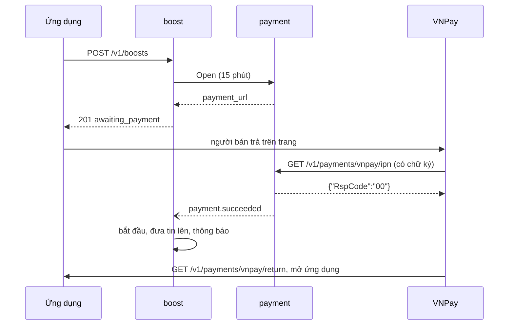

<Term id="boost">Đẩy tin</Term> là thứ đầu tiên người bán trả tiền cho ShopNexus (<Req id="UC-LST-03" />). Tiền giữa người mua và người bán vẫn không bao giờ đi qua hệ thống (<Req id="BR-DEAL-01" />). Gói đẩy tin là một lần bán riêng của ShopNexus cho người bán, trả một lần cho mỗi lần mua qua cổng thanh toán, không có ví hay số dư (<Req id="ADR-0006" />).

Hai module chia việc:

- **payment** giữ một dòng cho mỗi lần mua và làm việc với cổng thanh toán: trang thanh toán, thông báo của cổng (IPN), trang kết quả, hết hạn và hoàn tiền. Nó chỉ biết sản phẩm của một lần thanh toán qua tên và ID, nên một sản phẩm sau này như gói người bán dùng lại được module này.
- **boost** giữ các gói, các lần mua và bộ hẹn giờ của chúng, và nhờ catalog đưa tin lên. Nó mở lần thanh toán qua service của payment và nghe kết quả qua các event `payment.*`.

## Các gói

`GET /v1/boost-packages` liệt kê các gói, ngắn nhất trước, kèm `available`, bằng false khi server không nhận thanh toán (<Req id="BR-LST-04" />). Giá lấy từ `BOOST_PACKAGES`, hôm nay là 3 ngày 15.000 ₫ và 7 ngày 29.000 ₫. ID của gói là số ngày, như `3d`. Mỗi lần mua giữ số ngày và giá lúc mua, nên đổi giá không ảnh hưởng gói đang chạy.

## Mua

`POST /v1/boosts` nhận `listing_id`, `package` và một `Idempotency-Key`. Nó kiểm theo thứ tự này (<Req id="BR-LST-05" />):

| Kiểm | Lỗi |
|---|---|
| Server nhận thanh toán | 503 `payment_unavailable` |
| Gói có trong bảng giá | 422 `unknown_boost_package` |
| Tài khoản được ghi | 403 `account_suspended` |
| Tài khoản có số điện thoại | 403 `phone_required` |
| Tin là của người gọi và chưa xóa | 404 `listing_not_found` |
| Tin đang bán | 409 `listing_not_boostable` |
| Tin chưa có gói đang chạy | 409 `boost_active`, kèm `details.boost_id` |

Sau đó nó mở một lần thanh toán đúng giá và lưu lần mua ở `awaiting_payment`, trả 201 kèm `payment_url` và `payment_expires_at`. Ứng dụng mở `payment_url` trên trình duyệt.

Gửi lại cùng key thì trả 200 với lần mua của lần đầu. Mỗi tin có tối đa một lần mua chờ thanh toán hoặc đang chạy, do một unique index một phần giữ. Mua lại cùng gói khi một lần đang chờ thanh toán thì trả 200 với lần đó, để người bán trả tiếp. Mua gói khác thì lần đang chờ bị hủy và lần mới thay chỗ. Nếu tiền của lần bị hủy vẫn về sau đó, tiền được hoàn.

Màn tin đăng của người bán và Tin của bạn có `boostable`: true khi lần mua lúc này sẽ qua hết các bước kiểm trên. Service boost tính nó bằng chính các bước kiểm của lần mua, nên ứng dụng không phải tự lặp quy tắc.

## Trả tiền

Chỉ hai thứ ghi một lần thanh toán là đã trả: một IPN có chữ ký đúng, hoặc câu trả lời của chính cổng khi server hỏi (`querydr`). Trang kết quả một mình không bao giờ ghi (<Req id="NFR-SEC-02" />). IPN kiểm chữ ký HMAC-SHA512 và mã terminal, tìm lần thanh toán theo mã tham chiếu (ID của lần thanh toán bỏ dấu gạch), so số tiền rồi ghi kết quả một lần. IPN lặp lại không đổi gì (<Req id="NFR-IDEM-02" />). Nó trả lời VNPay bằng mã của VNPay:

| `RspCode` | Khi nào |
|---|---|
| `00` | Đã ghi |
| `01` | Không có lần thanh toán nào mang mã đó |
| `02` | Lần thanh toán đã có kết quả |
| `04` | Số tiền khác của lần thanh toán |
| `97` | Chữ ký sai |
| `99` | Lỗi khác; VNPay gửi lại |

Trang kết quả hiện kết quả theo ngôn ngữ của người trả và mở ứng dụng ở `shopnexus://boost/{id}`. Khi trang báo đã trả mà lần thanh toán vẫn đang chờ, server hỏi VNPay trước và chỉ ghi điều VNPay trả lời.

Một lần thanh toán sống 15 phút, và trang của VNPay cũng từ chối sau đó. Lúc mở, payment hẹn một lời gọi Restate trễ. Nếu tới lúc đó lần thanh toán vẫn đang chờ, server hỏi VNPay một lần: VNPay biết là đã trả thì ghi đã trả, nếu không lần thanh toán hết hạn. Người trả hủy hoặc ngân hàng từ chối thì lần thanh toán thất bại ngay. Cả hai trường hợp lần mua đóng ở `expired` hoặc `failed` và người bán nhận thông báo.

## Bắt đầu và đưa tin lên

Khi nghe `payment.succeeded`, boost nhờ catalog đưa tin lên. Nếu tin vẫn đang bán, lần mua chuyển sang `active` với lần lên đầu đầu tiên đã xong, `ends_at` là lúc bắt đầu cộng số ngày, và lượt kế tiếp sau 24 giờ. Mỗi tin giữ `bumped_at`, và thứ tự tin mới xếp theo `fresh_at`, cái muộn hơn giữa `published_at` và `bumped_at`. `published_at` không bao giờ đổi, nên thẻ tin hiện thời gian đăng kèm nhãn "Được đẩy".

Các danh sách sau xếp theo `fresh_at`:

- tìm kiếm và trang danh mục khi xếp mới nhất;
- Dành cho bạn ở Trang chủ, mỗi luồng của nó xếp mới nhất trước, và Vì bạn đã xem gần đây;
- tin công khai của một người bán.

Xếp theo độ liên quan, khoảng cách và giá không đổi. Lượt đẩy không phải lần công khai: theo dõi tìm kiếm và người theo dõi không nghe gì.

Mỗi lượt là một lời gọi Restate trễ, có key theo lần mua và thời điểm của lượt. Lượt kế tiếp được gửi trước khi lượt hiện tại được lưu, nên server sập cũng không mất lượt nào, và lượt lặp cùng key bị bỏ. Một lượt chỉ đưa tin lên khi tin đang bán. Tin đang ẩn, đang giữ chỗ hoặc bị nhân viên ẩn thì bỏ ngày đó, và gói không được thêm ngày (<Req id="BR-LST-06" />). Lượt ở `ends_at` kết thúc gói và báo người bán.

## Hoàn tiền

Không hoàn tiền cho những ngày mất vì tin bị ẩn hay đã bán. Một lần thanh toán chỉ được hoàn đủ, tự động, khi tiền đã về mà gói không bắt đầu được (<Req id="BR-LST-07" />):

- lúc tiền về tin không còn đang bán;
- tiền về sau khi lần mua đã hết hạn, thất bại hoặc bị thay.

Boost đánh dấu lần mua `refunding` và gọi `Refund` của payment, một flow bền: đánh dấu lần thanh toán `refunding`, xin VNPay hoàn toàn bộ (`vnp_TransactionType` 02), rồi ghi `refunded`. Lần hoàn VNPay đã nhận rồi thì tính là xong. Khi nghe `payment.refunded`, lần mua chuyển sang `refunded` và người bán được báo số tiền.

## Trạng thái

| Lần mua | Nghĩa |
|---|---|
| `awaiting_payment` | Người bán có 15 phút để trả ở `payment_url` |
| `active` | Đã trả và đang chạy |
| `ended` | Đã chạy hết số ngày |
| `failed` | Người trả hủy hoặc ngân hàng từ chối |
| `expired` | Không trả trong 15 phút |
| `cancelled` | Bị thay bằng lần mua gói khác trước khi trả |
| `refunding`, `refunded` | Đã trả nhưng không bắt đầu được; tiền đang được hoàn, hoặc đã hoàn |

Một lần thanh toán ở `pending`, `paid`, `failed`, `expired`, `refunding` hoặc `refunded`. Lần thanh toán đã thất bại hay hết hạn vẫn có thể thành `paid` khi tiền về muộn; khi đó boost hoàn tiền.

## Thông báo

Người bán nhận một thông báo cho mỗi lần mua, cập nhật tại chỗ: `boost_started`, `boost_ended`, `boost_failed`, `boost_expired` và `boost_refunded`. Chúng nằm cùng nhóm thông báo tin đăng, thông báo đẩy theo công tắc của nhóm đó, và không bao giờ gửi email.

## Cổng thanh toán giả

Với `PAYMENT_VNPAY=fake`, trang thanh toán là `GET /v1/dev/payments/{id}` của chính server, có nút Thanh toán và Hủy. Bấm nút thì gửi tới cùng đường dẫn, nơi server dựng lời gọi VNPay sẽ gửi, ký như VNPay ký, và đưa thẳng vào phần xử lý IPN. Sau đó nó chuyển hướng tới trang kết quả với cùng query. Bản giả không biết lần thanh toán nào khi được hỏi và nhận mọi lần hoàn. `APP_ENV=prod` từ chối nó. Các stack dev và kiểm thử chạy bản giả, nên mọi luồng được kiểm mà không cần hợp đồng với cổng.

## Trang điều hành

`GET /v1/console/listings/{id}/boosts` liệt kê các lần mua của một tin kèm lần thanh toán, mới nhất trước, cho nhân viên có `listings.read`. Trang điều hành chỉ đọc; chưa có cách hoàn tay, nên lần hoàn VNPay từ chối dừng ở `refunding` và được ghi log.

## Thiết lập

| Biến | Đặt gì |
|---|---|
| `PAYMENT_VNPAY` | `live`, `fake` hoặc `off`. Off thì không bán gói nào. |
| `API_PUBLIC_URL` | Origin công khai của server, cho trang kết quả của VNPay và trang của bản giả |
| `VNPAY_TMN_CODE`, `VNPAY_PAY_URL`, `VNPAY_API_URL`, `VNPAY_SERVER_IP` | Terminal, trang thanh toán, API merchant và địa chỉ server gọi từ đó; chỉ khi live |
| `VNPAY_HASH_SECRET` | Khóa ký của terminal, chỉ khi live, niêm phong trong `server-secrets` và không bao giờ ghi log |
| `BOOST_PACKAGES` | Các gói dạng cặp `ngày:giá`, ngắn nhất trước |

URL IPN được đặt trên terminal ở VNPay là `https://api.<domain>/v1/payments/vnpay/ipn`.
