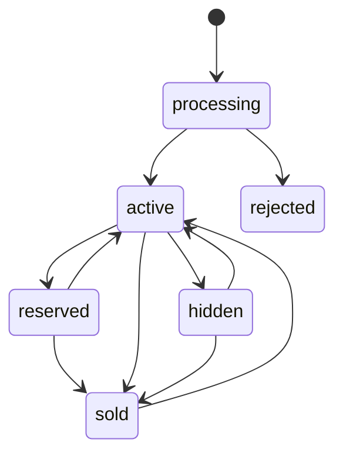

Module catalog giữ tin đăng, cây danh mục và địa giới hành chính. Mỗi tin đăng là một món đồ với một giá, bán C2C và thu tiền khi giao (COD). Luật về tin đăng ở phía sản phẩm nằm ở trang [Tin đăng](/vi/marketplace/listings).

## Vòng đời tin đăng

Bản nháp nằm trên điện thoại. Server chỉ nhận tin đăng đã đủ, và tin bắt đầu ở trạng thái processing trong lúc ảnh được xử lý.

Từ trạng thái nào cũng xóa được (deleted). Tin active và reserved là tin công khai. Sửa tin mà thêm ảnh, hoặc sửa một tin bị rejected, thì tin quay về processing.

Tin ở trạng thái reserved khi bưu kiện của một đơn đang trên đường, và tin ghi lại đơn nào đang giữ nó. Module deal giữ chỗ, nhả và bán tin; gọi lại các thao tác này nhiều lần vẫn ra cùng kết quả, vì một flow durable có thể chạy lại chúng.

## Đăng và sửa tin

Đăng và sửa tin chạy dưới dạng flow Restate, khóa theo người bán và `Idempotency-Key` của request, nên bấm lại vẫn chỉ ra một tin. Khi đăng, server kiểm tra tài khoản trước, rồi tới giới hạn 20 tin đang processing, active, hidden hoặc rejected, rồi mới tới các trường, và báo hết các trường sai trong một lần. Sau đó một flow publish chờ module media xử lý từng ảnh: ảnh nào cũng xong thì tin thành active, một ảnh hỏng thì tin bị rejected và lý do nằm trên ảnh đó.

Mỗi thay đổi ghi một event trong cùng transaction (`listing.published`, `listing.updated`, `listing.sold`…). Module deal, search và notification nghe các event này; xem [Event](/vi/architecture/events).

## Danh mục và địa giới

Cây danh mục có 9 gốc, mỗi gốc có các danh mục con và một mục "Khác" ở cuối; tin đăng phải chọn danh mục con. Địa giới gồm 34 tỉnh và 3.321 xã, phường sau đợt sáp nhập 2025, mỗi xã có một điểm dùng để tính khoảng cách. Giá là số đồng chẵn, từ 10.000 tới 1.000.000.000; mức trần chặn giá bị gõ thừa số 0.
