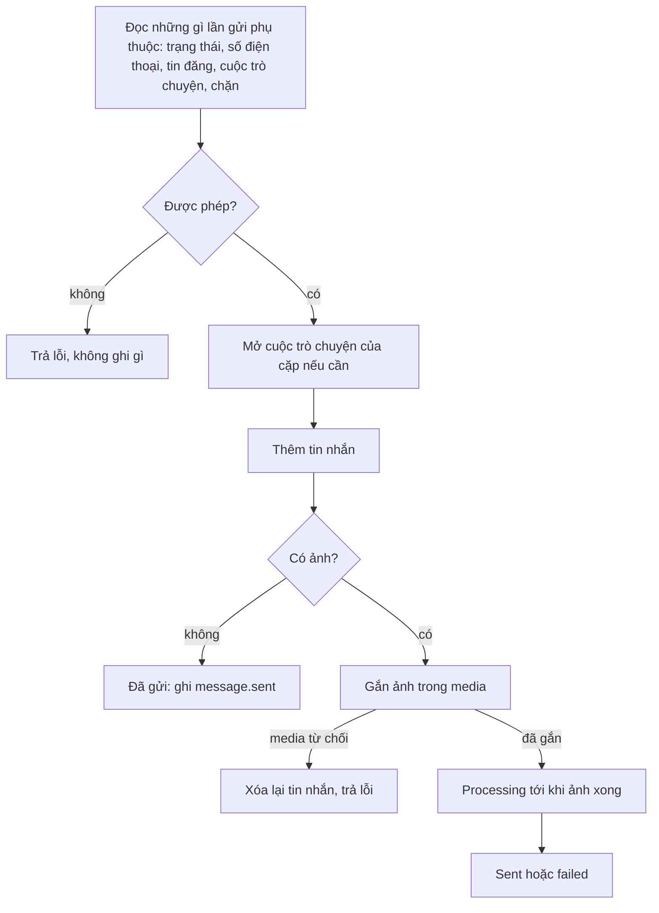
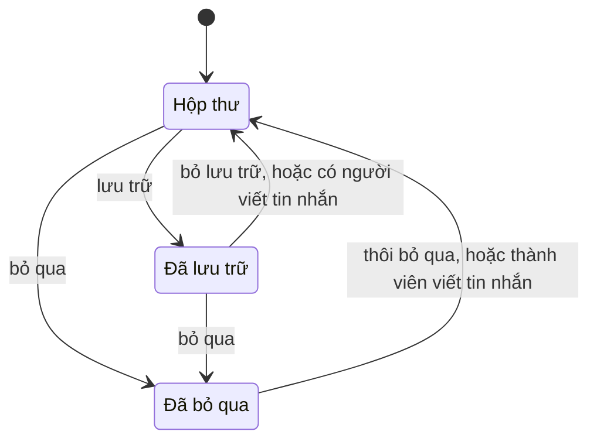

Module chat giữ cuộc trò chuyện và tin nhắn của chúng <Req id="FR-DEAL-01" />. Hai người dùng chung đúng một cuộc trò chuyện, bất kể vai trò: cùng một cuộc trò chuyện chứa mọi trao đổi của họ về mọi tin đăng và mọi deal giữa hai người, theo cả hai chiều. Module screen ghép các deal của cặp đó vào màn trò chuyện; bản thân chat không bao giờ gọi module deal.

Một cuộc trò chuyện thuộc một trong hai loại:

- **pair**: cuộc trò chuyện duy nhất của hai người. Mỗi cặp chỉ có một.
- **support**: cuộc trò chuyện của một phiếu hỗ trợ giữa một người dùng và ShopNexus <Req id="FR-MOD-04" />. Mỗi người có thể có bao nhiêu cũng được. Xem [Cuộc trò chuyện hỗ trợ](#cuộc-trò-chuyện-hỗ-trợ).

## Ai được nhắn cho ai

<KeyRules>
- Cuộc trò chuyện bắt đầu từ một tin đăng đang bán của người khác. Người mở cần có số điện thoại trên tài khoản <Req id="BR-ACC-03" />.
- Chặn có hiệu lực hai chiều: không ai được nhắn cho người kia, mở cuộc trò chuyện với họ, theo dõi họ hay mở deal trên tin của họ <Req id="BR-ACC-01" />.
- Tài khoản bị tạm khóa không viết được, trừ trong các cuộc trò chuyện hỗ trợ của chính mình.
- Không ai viết được cho tài khoản đã bị xóa.
</KeyRules>

Mở cuộc trò chuyện là `POST /v1/conversations` với tin đăng và tin nhắn đầu tiên. Nếu cặp đó đã có cuộc trò chuyện, nó được dùng lại và tin nhắn rơi vào đó. Mở deal trên một tin cũng mở cuộc trò chuyện của cặp, nên cuộc trò chuyện có thể tồn tại trước khi ai gõ gì.

Văn bản và số ảnh được kiểm tra trước (422 `invalid_message` kèm các trường). Các bước còn lại chạy theo thứ tự cố định, và bước đầu tiên không qua sẽ trả lời:

| Kiểm tra | Lỗi |
|---|---|
| Người gọi bị tạm khóa | 403 `account_suspended` |
| Người gọi không có số điện thoại | 403 `phone_required` |
| Tin đăng không tồn tại | 404 `listing_not_found` |
| Tin đăng là của người gọi | 409 `own_listing` |
| Tin đăng không còn bán | 409 `listing_unavailable` |
| Tin nhắn được trích không hợp lệ | 422 `invalid_message` trên `reply_to` |
| Hai người đang chặn nhau | 403 `blocked` |
| Một ảnh không phải của người gọi, chưa upload hoặc đã dùng | 422 `invalid_upload` |

Gửi trong cuộc trò chuyện đã có (`POST /v1/conversations/{id}/messages`) bỏ qua các bước kiểm tra tin đăng. Nó trả 409 `account_deleted` khi người kia đã xóa tài khoản.

### Chặn

Chặn nằm trong module account, vì cả chat và deal đều kiểm tra <Req id="FR-ACC-06" />. `POST /v1/blocks`, `GET /v1/blocks` và `DELETE /v1/blocks/{account_id}` thêm, phân trang và gỡ chặn. Tự chặn mình thì trả `invalid_block`, và không chặn được ShopNexus (`account_is_system`). Chặn lại lần nữa không đổi gì.

Chặn đổi những gì mỗi bên thấy:

- Hộp thư, số chưa đọc và tìm kiếm hộp thư của người chặn bỏ cuộc trò chuyện đó ra. Của người bị chặn thì vẫn giữ, nên việc chặn không bị lộ.
- Deal và đơn đang chạy giữ nguyên. Một lượt trên deal như vậy vẫn ghi tin nhắn deal vào cuộc trò chuyện.
- Tín hiệu đang gõ qua lại giữa hai người đã chặn nhau bị bỏ lặng lẽ, nên việc gõ cũng không làm lộ việc chặn.

### Theo dõi

Theo dõi cho người mua biết khi một người bán đưa tin mới lên bán <Req id="FR-DSC-03" />. `POST /v1/follows`, `GET /v1/follows` và `DELETE /v1/follows/{account_id}` hoạt động như các endpoint chặn.

- Tài khoản nào cũng theo dõi được. Một tài khoản theo dõi tối đa 1.000 tài khoản khác (`follow_limit_reached`).
- Tài khoản bị tạm khóa không theo dõi được (`account_suspended`).
- Khi đang chặn nhau, theo dõi trả 403 `blocked`. Chặn xóa các lượt theo dõi giữa hai người, theo cả hai chiều, và bỏ chặn không khôi phục lượt nào.
- Theo dõi và chặn giữa cùng hai người lấy chung một khóa theo cặp, nên lượt theo dõi ghi cùng lúc với lần chặn không thể còn lại sau đó.

Trang người bán hiện số người theo dõi cho mọi người, và cho biết người đọc có đang theo dõi người bán không. Thông báo người theo dõi nhận được nằm ở trang [Thông báo](/vi/architecture/notifications#người-bán-được-theo-dõi-đăng-tin-mới).

## Tin nhắn

Tin nhắn có văn bản 1 tới 1.000 ký tự, tối đa 4 ảnh, hoặc cả hai. Nó có thể gắn một tin đăng của một trong hai thành viên. Tin nhắn đã gửi thì không ai sửa hay xóa được.

- **Trích dẫn.** Tin nhắn có thể trích một tin nhắn đã gửi trước đó trong cùng cuộc trò chuyện. Trích bất kỳ thứ gì khác, kể cả tin nhắn deal, thì trả `invalid_message` trên trường `reply_to`. Phần trích được đọc lúc đọc tin nhắn, văn bản cắt ở 200 ký tự.
- **Thẻ link.** Link của hệ thống trong văn bản (trang tin đăng, người dùng, đơn, danh mục hoặc tìm kiếm trên website, hoặc link mở ứng dụng), tối đa 5 link, được trả về dưới dạng thẻ. Không có gì được lưu: mỗi thẻ đọc tin đăng hoặc người dùng như hiện tại. Link mà người đọc không được xem, như đơn của người khác hay tin đang ẩn, giữ là văn bản thường.

### Gửi tin nhắn

Mọi lần gửi đều là một flow durable, kể cả tin nhắn chỉ có văn bản, khóa theo người gửi và `Idempotency-Key` của request. Vì vậy bấm lại vẫn chỉ gửi một tin nhắn <Req id="NFR-IDEM-01" />.

Tin nhắn có ảnh ở trạng thái `processing` cho tới khi media xử lý xong ảnh, và tới lúc đó chỉ người gửi thấy nó. Sau đó nó thành `sent` hoặc `failed`. Chỉ tin nhắn còn processing mới chuyển trạng thái: nếu bước publish chạy lại sau khi tin nhắn đã được công khai, nó không ghi thêm gì và kết thúc.

Khi một tin nhắn thành sent, cùng một transaction:

1. dời tin nhắn cuối của cuộc trò chuyện, chỉ về phía trước, nên lần ghi muộn không bao giờ thay một tin mới hơn;
2. đưa cuộc trò chuyện ra khỏi mục lưu trữ của cả hai thành viên, và ra khỏi hộp bỏ qua của người gửi;
3. ghi event `message.sent`, với ID là ID của tin nhắn, nên ghi hai lần cũng không thêm event thứ hai;
4. ghi một cập nhật `message` vào [luồng cập nhật trực tiếp](/vi/api/live-updates) của mỗi thành viên thấy được tin nhắn.

`message.sent` kích hoạt thông báo đẩy tới thành viên kia ([Thông báo](/vi/architecture/notifications)) và bước kiểm tra lừa đảo ([Trust](/vi/architecture/trust)) <Req id="FR-TRS-04" />.

### Tin nhắn deal

Mỗi lượt trên một deal của cặp (giá đề nghị, chấp nhận giá, yêu cầu COD, tạo vận đơn…) ghi một tin nhắn deal vào cuộc trò chuyện, nên cuộc trò chuyện kể lại diễn biến của deal xen giữa các lời trao đổi. Client không gửi được loại này. Tin nhắn deal không có văn bản hay ảnh, chỉ có deal và lượt.

Với mọi thứ đọc tin nhắn, tin nhắn deal là một tin nhắn đã gửi, với ba điểm khác:

- Nó dời tin nhắn cuối nhưng để cuộc trò chuyện đã lưu trữ hoặc đã bỏ qua ở yên chỗ cũ. Chỉ tin nhắn do người viết mới đưa cuộc trò chuyện trở lại.
- Nó không ghi `message.sent`. Thông báo riêng của deal đã đẩy lượt đó, nên đẩy thêm từ chat sẽ báo hai lần.
- Nó được tính là chưa đọc với mọi thành viên không đi lượt đó. Lượt của hệ thống do ShopNexus đi, nên được tính cho cả hai.

Tỉ lệ phản hồi trên hồ sơ người bán không tính tin nhắn deal, nên vẫn đo việc trả lời trong cuộc trò chuyện.

## Đã đọc và hộp thư

Mỗi thành viên có mốc đã đọc, cờ lưu trữ, cờ bỏ qua và cờ "đánh dấu chưa đọc" của riêng mình. Mỗi cờ được ghi bằng một câu lệnh riêng, nên hai thiết bị của cùng một người không bao giờ ghi đè nhau.

- **Đã đọc.** `POST /v1/conversations/{id}/read` nêu một tin nhắn. Mốc chỉ dời tới tin mới hơn, nên lần đọc muộn từ thiết bị khác không dời gì. Dời mốc thì báo cho luồng của thành viên kia, bật chữ "Đã xem" của họ.
- **Chưa đọc.** Số chưa đọc đếm các tin nhắn đã gửi của thành viên kia sau mốc. `POST /v1/conversations/{id}/unread` đánh dấu cuộc trò chuyện là chưa đọc: nó được tính ít nhất 1 cho tới khi thành viên đọc lại. Mốc, và những gì thành viên kia thấy là đã đọc, giữ nguyên.
- **Lưu trữ.** Cuộc trò chuyện đã lưu trữ rời hộp thư chính và quay lại khi có người viết tin nhắn tiếp theo.
- **Bỏ qua.** Cuộc trò chuyện bị bỏ qua chỉ nằm trong hộp bỏ qua, không tính chưa đọc ở đâu, và không đẩy thông báo nào cho tin nhắn, giá đề nghị hay phản giá trong đó. Các bước của đơn vẫn được báo. Thành viên kia không được báo. Viết vào đó, hoặc thôi bỏ qua, thì kết thúc trạng thái này.

Hộp thư là màn `GET /v1/screens/inbox`, phân trang theo tin nhắn đã gửi cuối của mỗi cuộc trò chuyện. Nó hiện hộp chính, hộp lưu trữ (`archived=true`) hoặc hộp bỏ qua (`ignored=true`), và bỏ ra các cuộc trò chuyện chưa có tin nhắn đã gửi nào và các cuộc trò chuyện với người mà người đọc đang chặn. `GET /v1/me/unread` đếm tin nhắn chưa đọc trên các cuộc trò chuyện pair chưa lưu trữ, cạnh thông báo chưa đọc và giá đề nghị đang chờ.

### Tìm kiếm hộp thư

`GET /v1/screens/inbox/search` tìm cuộc trò chuyện và tin nhắn. Truy vấn bỏ qua hoa thường và dấu tiếng Việt (đ khớp với d). Mọi từ trừ từ cuối phải khớp nguyên từ, còn từ cuối khớp với phần đầu của một từ.

- **Cuộc trò chuyện** khớp khi tên của thành viên kia, hoặc tiêu đề của một tin đăng mà một tin nhắn gắn, chứa mọi từ. Tối đa 20, chỉ ở trang đầu.
- **Tin nhắn** khớp khi văn bản chứa mọi từ, mới nhất trước, có phân trang.

Cuộc trò chuyện đã lưu trữ vẫn được tìm. Cuộc trò chuyện với người mà người đọc đang chặn thì không. Truy vấn không có chữ cái hay chữ số nào, hoặc dài quá 100 ký tự, thì trả `invalid_query`.

## Cuộc trò chuyện hỗ trợ

Cuộc trò chuyện hỗ trợ là cuộc trò chuyện của một phiếu hỗ trợ giữa một người dùng và ShopNexus. Nó khác cuộc trò chuyện pair ở các điểm sau:

- Nó nằm ngoài hộp thư, số chưa đọc của hộp thư và tìm kiếm hộp thư. Màn hỗ trợ đếm nó riêng.
- Nó không lưu trữ, bỏ qua hay đánh dấu chưa đọc được (409 `conversation_is_support`).
- Nó không qua bước kiểm tra lừa đảo.
- Người bị tạm khóa vẫn viết được trong đó, để họ kháng nghị.
- Câu trả lời của nhân viên được đẩy tới chủ phiếu hỗ trợ với tiêu đề ShopNexus và mở phiếu đó. Tin nhắn của chủ phiếu không đẩy gì; hàng chờ trên trang điều hành hiện chúng.

## Tín hiệu trực tiếp

Hai tín hiệu đi trên [luồng cập nhật trực tiếp](/vi/api/live-updates) và không phải tin nhắn:

- **Đang gõ.** Ứng dụng gửi một frame đang gõ tối đa 3 giây một lần cho mỗi cuộc trò chuyện. Server kiểm tra người gửi là thành viên và hai bên không chặn nhau, rồi báo cho thành viên kia. Không có gì được lưu.
- **Hoạt động lần cuối.** Server ghi lại lúc socket của một tài khoản kết nối và đóng, và mỗi phút một lần trong lúc socket còn mở. Màn trò chuyện và trang người bán hiện thông tin này.

## Trả lời nhanh

`GET` và `PUT /v1/me/quick-replies` giữ các câu trả lời đã lưu của người bán, mà ô soạn tin gợi ý để chèn vào. `PUT` thay toàn bộ danh sách, theo thứ tự: tối đa 20 câu, mỗi câu 1 tới 200 ký tự, không để trống. Tài khoản chưa từng lưu danh sách thì đọc được ba câu mặc định theo ngôn ngữ của request, và việc đọc không lưu gì. Danh sách rỗng thì giữ rỗng. Xóa tài khoản thì xóa danh sách.
