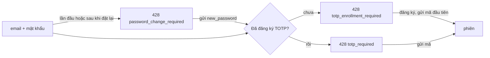

Điều phối viên và quản trị viên làm việc trên trang điều hành, một ứng dụng web, với tư cách nhân viên và bằng tài khoản riêng. Nhân viên không bao giờ là tài khoản người dùng gắn thêm vai trò, và đăng nhập bằng số điện thoại không mở được quyền vào trang điều hành. Trang điều hành chỉ chạm tới dữ liệu người dùng qua các service mà module account, support, trust và catalog công bố.

## Vai trò

Có hai vai trò, và quản trị viên làm được mọi việc của điều phối viên. Mỗi route của trang điều hành ghi rõ vai trò thấp nhất nó chấp nhận.

| Phần | Điều phối viên | Chỉ quản trị viên |
|---|---|---|
| Tài khoản | Tìm, xem một tài khoản cùng lịch sử tạm khóa, tạm khóa, gỡ tạm khóa | |
| Phiếu hỗ trợ | Xem hàng đợi và cuộc trò chuyện của một phiếu, trả lời, xử lý xong, mở lại | |
| Ca báo cáo | Xem, bác bỏ, xử lý xong, mở lại; ẩn tin và hiện tin | |
| Góp ý | Xem, gom nhóm, trả lời, đặt trạng thái | |
| Trợ lý AI | Hỏi, xem mọi cuộc trò chuyện được chia sẻ, quản lý cuộc trò chuyện và skill của mình | Đổi tên hoặc xóa bất kỳ cuộc trò chuyện nào, sửa bất kỳ skill nào, cài đặt AI |
| Nhân viên | Đổi mật khẩu của mình | Tạo, đổi tên, vô hiệu hóa, kích hoạt lại, gỡ khóa đăng nhập, đặt lại mật khẩu hoặc TOTP của điều phối viên |
| Nhật ký kiểm toán | | Xem |
| Dashboard vận hành | Những dashboard có mức tối thiểu là điều phối viên (mặc định là Grafana) | Các dashboard còn lại, và đặt mức tối thiểu cho từng dashboard |

Quản trị viên chỉ được tạo qua công cụ dòng lệnh của server, chạy với quyền truy cập database. API chỉ quản lý điều phối viên và từ chối mọi thay đổi nhắm vào quản trị viên. Cũng công cụ đó gỡ khóa đăng nhập trên email của quản trị viên, vì ai cũng có thể làm email đó bị khóa bằng năm lần gửi sai mật khẩu.

## Đăng nhập

Nhân viên đăng nhập bằng email, mật khẩu và mã TOTP, và TOTP bắt buộc ngay từ lần đăng nhập đầu. Mỗi lần gọi `POST /v1/console/login` đều gửi lại email và mật khẩu. Server đọc thông tin nhân viên và trả `428` kèm bước mà lần gọi còn thiếu. Client không bỏ qua bước nào được, vì server tự suy ra bước đó từ nhân viên.

- Email không tồn tại, sai mật khẩu và nhân viên đã bị vô hiệu hóa đều nhận chung `invalid_credentials`, nên câu trả lời không cho biết email có thuộc nhân viên nào không.
- Mật khẩu dài từ 12 tới 128 ký tự và không trùng email; không có quy tắc về thành phần ký tự. Khi quản trị viên đặt lại, nhân viên nhận một mật khẩu tạm và phải thay nó.
- Mã TOTP có bước thời gian không muộn hơn mã được chấp nhận gần nhất sẽ bị từ chối, nên một mã không dùng lại được.
- Không có mã khôi phục; quản trị viên đặt lại mật khẩu hoặc TOTP cho điều phối viên.

Mỗi lần gọi bị tính vào bộ đếm khóa của email trước khi kiểm tra bất cứ gì, trong một câu lệnh, nên các lượt đoán song song không cùng lọt qua được. Sai mật khẩu hoặc sai mã thì lượt tính được giữ lại; mọi câu trả lời khác thì lượt tính được trả lại. Năm lượt bị giữ lại khóa email trong 15 phút (`login_locked`), dù email đó có thuộc nhân viên nào hay không. Đăng nhập xong thì bộ đếm về không. Lượt đăng nhập bị từ chối được ghi vào security log cùng email và địa chỉ IP.

## Phiên

Đăng nhập xong, server đặt cookie `console_session`: một token ngẫu nhiên, `HttpOnly`, `Secure`, `SameSite=Strict`, giới hạn ở `/v1/console`, sống 8 giờ và không bao giờ gia hạn. Server chỉ lưu hash của nó. Không có access token và không có refresh, nên mọi tab của trang điều hành dùng chung một phiên.

Phiên còn sống khi chưa bị thu hồi, chưa quá 8 giờ, nhân viên còn hoạt động và phiên bản thông tin đăng nhập của phiên bằng của nhân viên. Đổi mật khẩu, đặt lại mật khẩu hoặc TOTP, và vô hiệu hóa đều tăng phiên bản này, nên mọi phiên của nhân viên kết thúc cùng lúc, kể cả phiên của chính người gọi. Kích hoạt lại nhân viên không đem phiên nào trở lại. Đăng xuất thu hồi một phiên đó.

## Cách một request của trang điều hành được kiểm tra

Mọi request dưới `/v1/console/` đi qua cùng các bước kiểm tra, theo thứ tự:

<Steps>
<Step title="Header của trang điều hành">
Request phải mang `X-Requested-With: shopnexus-console`, thứ mà form hay link trên site khác không đặt được. Cùng với cookie `SameSite=Strict`, header này ngăn mọi request từ site khác đi nhờ phiên.
</Step>
<Step title="Phiên">
Ở mỗi request, server đọc phiên cùng nhân viên của nó từ database. Vì vậy vô hiệu hóa hay đặt lại có hiệu lực ngay ở request kế tiếp của nhân viên, không có cache nào phải chờ hết hạn. Không có phiên còn sống thì trả `401`.
</Step>
<Step title="Vai trò">
Vai trò của nhân viên phải đạt mức tối thiểu của route, nếu không thì trả `403`. Vai trò không xác định không có quyền gì.
</Step>
<Step title="Giới hạn tốc độ">
Nhân viên bị tính vào giới hạn tốc độ của route, theo ID nhân viên chứ không theo IP.
</Step>
</Steps>

Các route đăng nhập chỉ cần header. Vì cookie để `SameSite=Strict`, trang điều hành và API phải cùng site, ví dụ `console.x.vn` và `api.x.vn`. CORS chỉ cho origin của trang điều hành gọi `/v1/console/`, kèm credentials. API playground trên trang tài liệu có thể gọi API của người dùng mà không kèm credentials, vì API đó nhận bearer token; cookie của trang điều hành không bao giờ rời origin của nó.

Module khác có thể phục vụ một route của trang điều hành sau cùng các bước kiểm tra này. Các route của trợ lý AI và các trang đơn và tin đăng chạy theo cách đó.

## Dashboard vận hành

Grafana, UI của Restate, UI của Bifrost, UI của object store, Argo CD và một trình duyệt database nằm sau lớp đăng nhập của trang điều hành, mỗi cái trên một host riêng. Mỗi dashboard có một mức tối thiểu, là vai trò thấp nhất mở được nó. Grafana chỉ hiển thị trace, metric và log nên mức tối thiểu là điều phối viên. Các dashboard còn lại có thể hủy invocation, tiêu ngân sách mô hình, đọc mọi object, deploy hoặc sửa bất kỳ dòng nào, nên mức tối thiểu là quản trị viên. Quản trị viên có thể đổi mức tối thiểu, và thay đổi đó được ghi vào nhật ký kiểm toán.

<Sequence
  caption="Mở một dashboard từ trang điều hành."
  actors={[
    { id: "console", label: "Trang điều hành", icon: "ri:computer-line" },
    { id: "server", label: "Server", icon: "ri:server-line" },
    { id: "proxy", label: "Ingress", icon: "ri:shield-keyhole-line", note: "Hỏi server trước mỗi request" },
    { id: "dash", label: "Dashboard", icon: "ri:dashboard-line" },
  ]}
  steps={[
    { from: "console", to: "server", label: "Xin một vé", detail: "`POST /v1/console/dashboard-tickets`; vai trò phải đạt mức tối thiểu" },
    { from: "server", to: "console", label: "Vé dùng một lần, sống 60 giây", back: true },
    { from: "console", to: "dash", label: "Mở callback của dashboard kèm vé" },
    { from: "dash", to: "server", label: "Dùng vé", detail: "đặt cookie dashboard chỉ cho host đó" },
    { from: "proxy", to: "server", label: "Kiểm tra mọi request", detail: "phiên, host, mức tối thiểu" },
    { from: "proxy", to: "dash", label: "Chuyển tiếp kèm email và vai trò của nhân viên" },
  ]}
/>

Phiên dashboard kết thúc cùng phiên trang điều hành đã sinh ra nó. Bước kiểm tra chạy ở mọi request và đọc mức tối thiểu ngay lúc đó, nên vai trò bị hạ hoặc mức tối thiểu bị nâng sẽ từ chối request kế tiếp. Request không có phiên được đưa về trang điều hành để mở lại dashboard.

## Nhật ký kiểm toán

Mỗi thao tác ghi của nhân viên là một dòng trong `console_actions`, được ghi trong cùng transaction với thay đổi, nên không thay đổi nào được áp dụng mà thiếu dòng của nó. Nhật ký bao gồm tạm khóa, thay đổi về nhân viên, câu trả lời và thay đổi trạng thái phiếu hỗ trợ, quyết định về ca báo cáo, ẩn tin, góp ý, cài đặt AI và mức tối thiểu của dashboard. Mỗi dòng ghi nhân viên (hoặc công cụ dòng lệnh), thao tác, đối tượng, địa chỉ IP của nhân viên và những chi tiết mà tên thao tác không nói ra, như lý do và thời hạn của một lần tạm khóa. Thêm một thao tác mới thì cũng phải thêm nó vào danh sách thao tác của API.

Lượt đăng nhập thành công là các dòng trong bảng phiên; lượt bị từ chối nằm trong security log. Những gì trợ lý AI đọc cho một nhân viên được ghi riêng, trong [nhật ký đọc dữ liệu cá nhân](/vi/agent/tools#lần-đọc-dữ-liệu-cá-nhân).

## Bí mật khi lưu trữ

Mật khẩu được lưu dưới dạng hash argon2id, và tối đa bốn lần hash chạy cùng lúc, để một đợt đăng nhập dồn dập không chiếm hết bộ nhớ của tiến trình. Secret TOTP được niêm phong bằng một khóa suy ra từ khóa của trang điều hành và gắn với nhân viên, nên secret đã niêm phong chép sang dòng của nhân viên khác sẽ không mở được.
