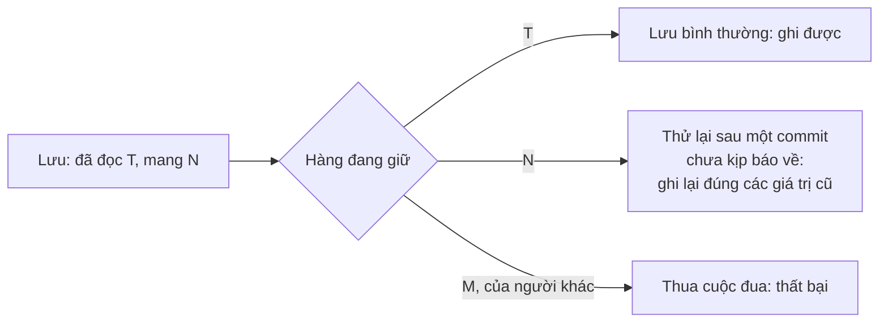

Mọi module giữ dữ liệu trong một database Postgres chạy ParadeDB, bản này thêm index full-text cho tìm kiếm và hỗ trợ vector. Ảnh nằm trong RustFS; database giữ object key của chúng.

## Aggregate và transaction

Aggregate là đơn vị mà module đọc và lưu nguyên khối: một tài khoản, một tin đăng, một deal, một phiên đăng nhập. Nó có thể trải trên nhiều bảng, như thông tin đăng nhập của một người gồm một hàng gốc và các danh tính. Một transaction phủ một aggregate.

Có hai lần ghi phủ nhiều hơn, vì một bản làm dở sẽ sai:

- **Đăng ký** insert tài khoản cùng thông tin đăng nhập của nó. Lần đăng ký bị lần khác giành mất số điện thoại hoặc email thì không ghi gì cả, và client nhận `try_again`.
- **Xóa tài khoản** lưu tài khoản đã xóa và, trong cùng transaction, xóa thông tin đăng nhập, địa chỉ, chặn và theo dõi của nó, đồng thời thu hồi các phiên đăng nhập. Lần xóa thua cuộc đua thì tài khoản vẫn nguyên vẹn.

Một vài bảng không phải aggregate. Cài đặt thông báo và câu trả lời nhanh là một hàng cho mỗi tài khoản, và lần lưu sau cùng thắng. Lịch sử tìm kiếm, lượt xem và lượt đánh dấu hữu ích là các hàng không có write ID. Ở chỗ các hàng như vậy phải nhất quán theo nhóm, lần ghi lấy một lock trên nhóm đó.

## Một commit chứa gì

Một thay đổi được gửi thành một batch: lần lưu, các [event](/vi/architecture/events) của nó, các bản cập nhật cho [live socket](/vi/api/live-updates) và, với thao tác trên trang điều hành, dòng nhật ký kiểm toán. Chúng commit hoặc rollback cùng nhau, trong một round trip. Thay đổi trên nhiều hàng cùng dạng là một câu lệnh trên cả danh sách, không bao giờ mỗi hàng một câu lệnh.

Batch chỉ bị tách ở chỗ kết quả của một câu lệnh quyết định lần ghi tiếp theo là gì.

## Ghi đồng thời

Ghi được kiểm tra theo kiểu optimistic. Mỗi hàng aggregate mang một write ID, là ID của lần ghi gần nhất vào nó. Khi lưu, lần lưu nêu write ID đã đọc và write ID mới mang theo, và chỉ ghi được nếu hàng vẫn giữ một trong hai. <Req id="NFR-CONC-01" />

Lần lưu bị thua nhận `try_again`, và client đọc lại. Ở deal thì nhận `deal_changed`, vì lượt chuyển của phía bên kia có thể làm đổi ý nghĩa của thao tác. Bộ đếm version không dùng được ở đây, vì người ghi khác có thể tăng nó lên đúng giá trị mà lần thử lại đang chờ.

Write ID mới luôn do bên gọi tạo ra trước khi lưu, không bao giờ do SQL tạo, nên lần thử lại gửi đúng ID cũ. Điều này cũng đúng với lần ghi theo tập hợp, ví dụ thu hồi mọi phiên đăng nhập của một tài khoản.

Có một trường hợp được chấp nhận: khi một bước đã commit, process chết trước khi Restate ghi nhận bước đó, và người khác ghi trước lần thử lại, thì lần thử lại thấy xung đột dù thay đổi của nó đã được ghi. Flow xử lý nó như mọi xung đột khác và đọc lại.

Các giới hạn trải trên nhiều hàng, như 20 tin đang bán mỗi người bán hay 3 đơn COD đang xử lý mỗi người mua, được đếm dưới một advisory lock của Postgres trên tài khoản, trước khi ghi.

## Thử lại và trùng lặp

Điện thoại ở chỗ mạng kém gửi cùng một request hai lần, và Restate thử lại một bước sau khi crash. Mỗi lần ghi mà lần thử lại có thể lặp đều theo một trong ba quy tắc. <Req id="NFR-IDEM-01" />

<Steps>
<Step title="Tạo: giành một key">
Mỗi hàng được tạo có một dedupe key được giữ bằng ràng buộc unique, và lệnh insert giành key đó trước mọi lời gọi ra bên ngoài. Khi insert thấy key đã bị giữ, server trả về hàng đã có, như cùng một response. Key là một trong các loại:

- một sự thật bên ngoài, dưới dạng các cột riêng của nó: loại và giá trị của một danh tính;
- một request của client: tài khoản và [`Idempotency-Key`](/vi/api/idempotency) của request;
- một bước nội bộ: ID tạo ở một bước đã ghi journal trước đó, hoặc suy ra từ request key và vị trí của hàng khi một request tạo nhiều hàng, như bản sao ảnh.
</Step>
<Step title="Đổi: lưu và so sánh">
Thay đổi trên một hàng đã có là lần lưu theo write ID cộng với bước kiểm tra trạng thái mà nó thấy. Lần thử lại của cùng request trả thành công kèm khung nhìn hiện tại. Lượt chuyển khác mà xung đột vẫn nhận lỗi của nó. Các lượt chuyển của deal giữ request key, nên lượt chuyển mà key của người gọi đã thực hiện sẽ trả kết quả mà không chuyển thêm lần nữa.
</Step>
<Step title="Lời gọi ra ngoài mang key của mình">
Mọi lời gọi ra bên ngoài có thể thực hiện hai lần đều mang một key của hệ thống. Vận đơn ở hãng dùng mã đơn làm ID, và lệnh tạo có thể đã thành công sẽ đọc lại theo mã đó. Lần gửi lại email mang challenge ID. Thông báo đẩy thay thế bản lặp trên điện thoại bằng cùng collapse key. Mã tham chiếu của một lần thanh toán ở VNPay là ID của chính nó, nên lần thanh toán server chưa chắc được hỏi lại theo ID đó, và lần hoàn VNPay đã nhận rồi thì tính là xong.
</Step>
</Steps>

Báo cáo của hãng vận chuyển là chỗ duy nhất không có key unique. Webhook và polling ghi thời điểm của cùng một sự kiện từ các trường khác nhau, nên một báo cáo được so với sự kiện mới nhất cùng loại và với các sự kiện trong vòng 10 phút, dưới một lock cho mỗi vận đơn.

## Luật trong database

Luật nào thể hiện được trên một hàng thì cũng là một ràng buộc `CHECK`, nên lần ghi thô hay một bug không phá được nó: tin đăng đang giữ chỗ phải ghi người mua, tin đăng có từ 1 đến 10 ảnh, đơn đã hủy phải có lý do, đơn hoàn tất phải có thời điểm đóng. Ràng buộc check thêm vào bảng đã có hàng chỉ áp dụng cho hàng mới và hàng bị sửa, nên hàng cũ không bao giờ làm hỏng một lần deploy.

Mọi foreign key trỏ vào bảng có hàng bị xóa đều có index, nên xóa hàng cha không phải quét bảng con.

## Giới hạn

Pool của server giữ 20 kết nối, và câu lệnh chạy quá 10 giây bị hủy, nên truy vấn chậm không giữ kết nối mãi được. Truy vấn chậm nhất mà server chạy mất vài giây. Việc chạy một lần như migration và reindex thì không có timeout.

## Migration

Schema là chuỗi file SQL đánh số, mỗi file chạy một lần trong transaction riêng, theo thứ tự version. File đã chạy ở bất cứ đâu thì không bao giờ sửa, kể cả comment; sai thì sửa bằng một file mới, và migrator dừng lại khi checksum cho thấy một file bị đổi. Số bị nhảy cóc không sao, số nhỏ hơn tới sau số lớn hơn khi hai nhánh merge cũng không sao; chỉ hai file trùng số mới bị từ chối.

Cùng một bộ migration chạy ở stack local và trong cụm máy chủ, nên role, grant, extension và dữ liệu seed nằm ở đó. Server không chịu khởi động khi còn migration chưa chạy. Không cột nào đặt tên trùng từ khóa SQL, và một linter kiểm tra việc đó.
