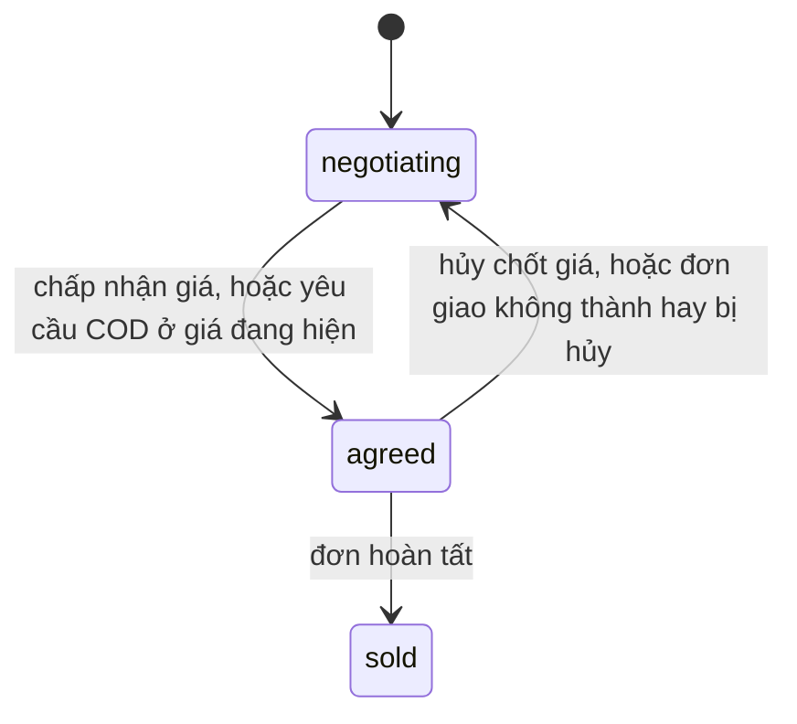
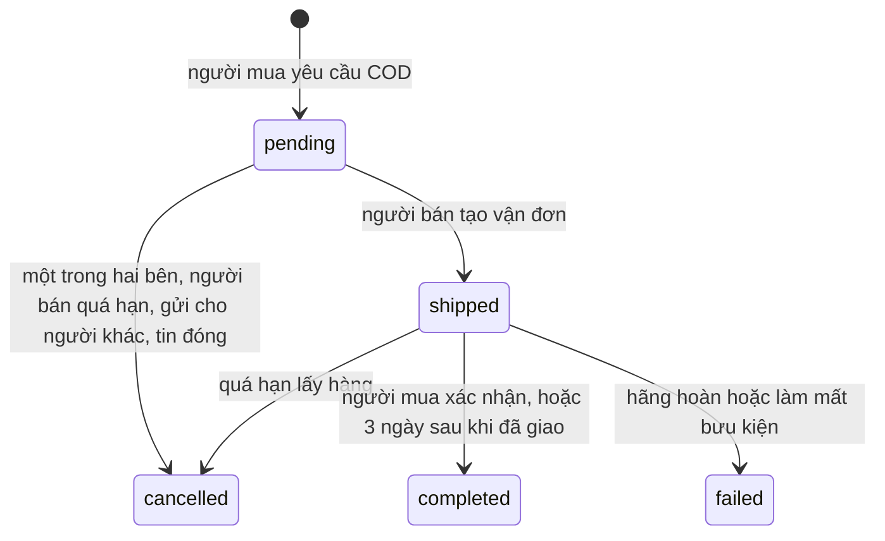
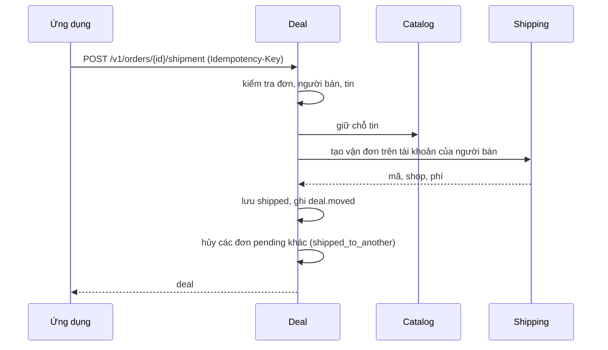

Một deal là một người mua và một người bán chốt giá cho một tin đăng. Mỗi người mua chỉ có một deal trên một tin. `POST /v1/deals` trả deal đang có của người gọi với 200, hoặc mở deal mới với 201. Mở deal cần số điện thoại, hai bên không chặn nhau (<Req id="BR-ACC-01" />, <Req id="BR-ACC-03" />), tài khoản không bị tạm khóa, và tin active của người khác.

Deal giữ đơn mới nhất của nó. Các đơn trước trên cùng deal vẫn nằm trong `orders`, nên một deal có thể có nhiều lần mua sau các lần giao không thành và hủy. Hãng vận chuyển, vận đơn và theo dõi nằm ở trang [Vận chuyển](/vi/architecture/shipping); luật cho người dùng nằm ở trang [Giao dịch COD](/vi/marketplace/cod-deal).

## Deal và cuộc trò chuyện

Mỗi deal nằm trong cuộc trò chuyện của người mua và người bán, mỗi cặp một cuộc trò chuyện. Mở deal thì mở hoặc dùng lại cuộc trò chuyện đó, và điều kiện mở deal cũng là điều kiện mở cuộc trò chuyện, nên chat không kiểm tra gì thêm. Deal gọi chat; chat không bao giờ gọi deal.

Cuộc trò chuyện và deal là dòng dữ liệu của hai module, nên không nằm trong một transaction. Nếu insert deal lỗi ngay sau khi cuộc trò chuyện vừa mở, deal nhờ chat bỏ cuộc trò chuyện đó. Nếu server sập giữa hai bước, sẽ còn lại một cuộc trò chuyện rỗng. Hộp thư ẩn nó, và deal hay tin nhắn tiếp theo của cặp đó dùng lại nó.

## Trả giá

Khi đang negotiating, deal giữ tối đa một giá đang mở: giá đề nghị của người mua hoặc phản giá của người bán. Giá đang mở không bao giờ hết hạn. Chốt giá không giữ chỗ gì, nên nhiều người mua có thể cùng chốt giá trên một tin (<Req id="BR-DEAL-04" />).

Các lượt trả giá gồm:

- Người mua đưa giá đề nghị khi chưa có giá nào đang mở, hoặc thấp hơn phản giá của người bán.
- Người bán đưa phản giá cho giá đề nghị đang mở của người mua.
- Bên đang đứng trước một giá đang mở thì chấp nhận giá hoặc từ chối.
- Bên đưa ra giá đang mở thì rút giá.
- Bên nào cũng hủy được chốt giá, và deal quay lại trả giá.

Số tiền là số đồng chẵn, bội của 1.000 (<Req id="BR-DEAL-03" />). Giá đề nghị ít nhất bằng một nửa giá niêm yết, làm tròn lên tới 1.000, và thấp hơn phản giá hoặc giá niêm yết. Phản giá cao hơn giá đề nghị và thấp hơn giá niêm yết. Màn deal mang `offer_range`, tức các mức mà giá đề nghị tiếp theo của người xem được phép, nên luật chỉ nằm ở server.

`accept` và yêu cầu COD mang mức giá người đó đã thấy. Giá hiện tại khác mức đó thì trả `price_changed`, nên không ai chấp nhận một mức giá vừa đổi ngay dưới ngón tay mình.

### Ai được đi lượt

- Tài khoản bị tạm khóa không đưa giá đề nghị, chấp nhận giá hay yêu cầu COD được (<Req id="BR-MOD-02" />). Từ chối, rút giá và hủy là lấy lại một mức giá, nên vẫn chạy với tài khoản bị tạm khóa và với tin ở mọi trạng thái.
- Đưa giá đề nghị và chấp nhận giá cần tin active.
- Khi người bán đang vắng mặt, giá đề nghị, chấp nhận giá và yêu cầu COD của người mua trả 409 `seller_away`, vì mỗi thao tác đó ràng buộc người bán. Lượt của chính người bán, từ chối, rút giá, hủy, nhắn tin và mọi bước của đơn đã tạo vẫn đi tiếp.

### Chạy đua

Hai người có thể đi lượt cùng lúc. Lần lưu thua nhận `deal_changed`, trong khi các module khác trả `try_again`. Sau khi bên kia đã đi một lượt, cùng một thao tác có thể mang nghĩa khác, nên ứng dụng đọc lại deal thay vì thử lại (<Req id="NFR-CONC-01" />).

## Lượt, event và cuộc trò chuyện

Mỗi lần lưu ghi deal, đơn của nó, các lượt mới trong `deal_moves` và một event `deal.moved` trong cùng một transaction. Màn deal liệt kê mọi lượt từ cũ tới mới. Thay đổi của đơn không có event riêng: chúng đi kèm `deal.moved` dưới dạng lượt, và chat cùng notification đọc chúng.

Mọi lượt do người dùng đi và mọi bước của đơn, dù ai làm, đều thành một tin nhắn deal trong cuộc trò chuyện của cặp đó. Một worker của chat đọc các lượt được nêu trong mỗi `deal.moved` và đăng một tin nhắn cho mỗi lượt. Tin nhắn lấy ID và thời điểm của lượt, nên event được giao lại không ghi tin nhắn thứ hai, và event tới muộn vẫn nằm đúng chỗ trong cuộc trò chuyện. Lượt của một bên do tài khoản của bên đó gửi, lượt của hệ thống do ShopNexus gửi. Lượt nào chat không đặt được thì việc đó dừng hẳn, vì thử lại cũng không đặt được.

## Khi tin đăng thay đổi

Một worker theo dõi `listing.updated`, `listing.hidden`, `listing.sold` và `listing.deleted`, đọc tin đăng và từng deal trên tin, rồi ghi các lượt của hệ thống:

| Thay đổi của tin | Ảnh hưởng tới deal | Lượt |
|---|---|---|
| Bị ẩn, đã bán hoặc đã xóa | Bỏ giá đang mở và hủy các đơn pending | `listing_closed` |
| Đã bán hoặc đã xóa | Kết thúc cả chốt giá | `listing_closed` |
| Giá niêm yết mới | Bỏ giá đang mở | `price_changed` |
| Tắt trả giá | Bỏ giá đang mở | `offers_closed` |

Các lượt hệ thống này không ghi tin nhắn nào vào cuộc trò chuyện. Tin quay về processing sau khi sửa ảnh không tính là đóng. Deal lưu giá niêm yết tại lúc có giá đang mở, nên event lặp hoặc tới muộn không đổi gì.

## Giá đề nghị đang mở cho người bán

Người bán thấy các deal trên tin của mình đang chờ trả lời giá đề nghị của người mua, giá đề nghị mới nhất trước, kèm số lượng. Cursor của trang là một deal; nếu giá đề nghị của deal đó đã được trả lời trong lúc đó, trang tiếp theo bắt đầu lại từ mới nhất và client bỏ các dòng đã hiện.

## Đơn

Đơn là COD đồng kiểm (<Req id="BR-DEAL-05" />). Hệ thống không giữ tiền.

Đơn hoàn tất làm deal thành sold. Đơn giao không thành hoặc bị hủy đưa deal về negotiating, không còn giá đã chốt. Bưu kiện bị hãng làm thất lạc sau khi lấy hàng thì đơn giao không thành với vận đơn `lost`: lỗi của hãng, nên không tính vào số liệu của bên nào, không được đánh giá, và tin bị ẩn cho người bán thay vì mở bán lại. Ẩn tin rút các giá đang mở trên tin như mọi lần ẩn, và người bán hiện lại tin khi có hàng. Sau khi tạo vận đơn, người bán không còn lượt nào trên đơn; cập nhật của hãng và người mua chuyển trạng thái đơn. Đơn hiện `completed_by`: người mua hoặc hệ thống.

Lý do hủy là `buyer`, `seller`, `seller_timeout`, `pickup_timeout`, `shipped_to_another` và `listing_closed`. Đơn đã gửi chỉ bị hủy bởi quá hạn lấy hàng (<Req id="BR-DEAL-07" />).

### Yêu cầu COD

`POST /v1/deals/{id}/cod` mang mức giá người mua đã thấy và một `address_id` trong sổ địa chỉ của người mua.

- Giá là giá đã chốt, hoặc với deal còn đang trả giá thì là giá niêm yết hay phản giá đang mở của người bán. Trên deal đang trả giá, đây là "Mua ngay": cùng một lần lưu chốt giá và mở đơn, với một lượt `cod_requested` và không có `accept`, nên mua ở giá đang hiện không bao giờ để lại deal đã chốt giá mà không có đơn.
- Deal đã sold, deal đang có đơn mở, hoặc người bán gửi yêu cầu thì trả `move_not_allowed`. Giá khác thì trả `price_changed`, và tin không còn active thì trả `listing_unavailable`.
- Đơn chép địa chỉ, nên sửa hay xóa địa chỉ sau đó không đổi đơn. Địa chỉ của người khác thì trả `address_not_found`, và lỗi này trả trước `move_not_allowed`.
- Mỗi người mua có tối đa 3 đơn pending hoặc shipped (<Req id="BR-DEAL-06" />). Lần lưu đếm chúng dưới một khóa theo người mua, nên hai request cùng lúc không cùng lấy được suất cuối; request thứ tư nhận `cod_limit_reached`.

Mã đơn, như `SN-100001`, lấy từ một sequence. Nó cũng là mã tham chiếu đơn ở hãng, nên lần tạo thử lại tìm được đơn đầu tiên.

### Endpoint của đơn

Các lượt trên đơn nhận ID của đơn: `POST /v1/orders/{order_id}/shipment` (người bán), `/confirm` (người mua) và `/cancel` (bên nào cũng được, chỉ khi pending). Mỗi endpoint trả toàn bộ deal. Đơn không tồn tại, hoặc người gọi không phải một bên của đơn, thì trả 404 `order_not_found`. Đơn không phải đơn đang mở hiện tại của deal thì trả `move_not_allowed`, nên một request cũ không hủy được đơn sau. Lượt `cancel` của chính deal cũng hủy đơn pending.

Tài khoản bị tạm khóa không yêu cầu COD được, nhưng tạo vận đơn, xác nhận và hủy là để hoàn tất hoặc lấy lại một đơn đang chạy, nên không từ chối ai vì bị tạm khóa. Khi một bên còn đơn đang mở, tài khoản của họ không xóa được.

Người mua luôn đọc đầy đủ thông tin người nhận. Người bán cũng đọc đầy đủ, trừ đơn đã hủy, chỉ giữ tên và phường/xã. Người mua không bao giờ thấy địa chỉ lấy hàng, vì đó có thể là bản chép địa chỉ của người bán.

## Flow durable

Yêu cầu COD, tạo vận đơn, xác nhận và hủy đơn chạy bằng flow Restate (<Req id="NFR-DUR-01" />). Mỗi lượt giữ `Idempotency-Key` của người gọi, duy nhất theo deal và bên, và flow có key đã đi lượt rồi thì trả deal đọc lại (<Req id="NFR-IDEM-01" />). Key không bắt buộc; không có key thì mỗi request đi lượt riêng. Flow chạy lại sau khi sập không ghi gì hai lần, vì lần lưu nhận ra commit trước của chính nó.

| Flow | Các bước |
|---|---|
| Yêu cầu COD | Tải deal, đọc trạng thái, chế độ vắng mặt và địa chỉ của người mua, tạo đơn với ID cố định, lưu, bắt đầu timer người bán. |
| Tạo vận đơn | Kiểm tra đơn và tin, xác định địa chỉ lấy hàng đã lưu, giữ chỗ tin, tạo vận đơn ở hãng, lưu, hủy các đơn pending khác trên tin, bắt đầu timer lấy hàng và lượt poll. |
| Xác nhận | Lưu đơn thành completed, rồi bán tin. |
| Hủy | Lưu lần hủy. Không đụng tới tin đăng. |

Tạo vận đơn là flow có nhiều cách hỏng nhất:

- Hãng từ chối thì tin được trả lại và request trả lời lỗi từ chối đó.
- Khi lần lưu thua một lần hủy, flow nhả tin và gọi hủy vận đơn mà đơn không nhận. Khi thua một lần bấm khác đã gửi chính đơn đó, flow giữ tin.
- Khi người bán gỡ liên kết hoặc đổi shop ở hãng trong lúc đang tạo vận đơn, lần lưu từ chối với `carrier_not_linked`. Flow trả lại tin và chỉ ghi log vận đơn, vì tài khoản của người bán không còn với tới nó.
- Tin được giữ chỗ cho một đơn chưa gửi được tính là tạm dừng, nên vận đơn thua một lần hủy không kết thúc đơn của người mua khác.

## Timer

Các timer là lệnh gửi trễ của Restate. Mỗi timer ghi tên đơn của nó, đọc deal khi chạy, và không làm gì nếu đơn đó đã đi tiếp. Không timer nào so đồng hồ; lần lưu thua cuộc đua thì đọc lại.

| Timer | Bắt đầu | Chạy sau | Tác dụng |
|---|---|---|---|
| Người bán | Yêu cầu COD | 3 ngày | Hủy đơn còn pending với `seller_timeout`. |
| Lấy hàng | Tạo vận đơn | 3 ngày | Đọc hãng trước. Đã lấy hàng: chuyển đơn đi tiếp. Vẫn chờ: hủy với `pickup_timeout`, nhả tin, rồi gọi hủy bưu kiện ở hãng. |
| Hoàn tất | Cập nhật đã giao | 3 ngày | Hoàn tất đơn với tư cách hệ thống (<Req id="BR-DEAL-11" />). |
| Vận chuyển | Bưu kiện đang đi | 30 ngày | Đọc hãng. Mất dấu, đã hủy hoặc thất lạc thì đơn giao không thành với vận đơn `lost` và tin bị ẩn. Trạng thái mới thì chuyển đơn và timer chờ tiếp. |
| Poll | Tạo vận đơn | mỗi 2 giờ | Đọc hãng trong lúc đơn ở shipped. Xem [Vận chuyển](/vi/architecture/shipping). |

Quá hạn lấy hàng để đơn ở cancelled ngay cả khi hãng đã có bưu kiện hoặc không còn biết bưu kiện đó. Đơn hiện hạn kế tiếp dưới dạng `due_at`: timer người bán khi pending, timer lấy hàng khi bưu kiện chờ lấy, và timer hoàn tất khi đã giao. Giá trị này được tính, không lưu.

## Cập nhật từ hãng

Mọi cập nhật của hãng, từ webhook, lượt poll hay endpoint dev, đều đi qua một cửa vào duy nhất với hãng, mã vận đơn, trạng thái, thời điểm của nó và phí mới nhất. Nó chuyển mọi đơn shipped có mã đó và không đổi gì trên đơn đã đóng. Mã lạ thì không đổi gì: webhook vẫn trả 200, chỉ endpoint dev trả 404 `shipment_not_found`. Cách ánh xạ trạng thái sang đơn nằm ở trang [Vận chuyển](/vi/architecture/shipping#theo-dõi).

- Cập nhật không mới hơn bản đã lưu thì không đổi gì, nên webhook tới muộn không bao giờ đặt trạng thái cũ hơn vào cuối. Cập nhật mới hơn mà cùng trạng thái thì chỉ dời thời điểm, không có lượt hay event.
- Hãng giao không thành hoặc hoàn hàng thì đơn giao không thành ngay và tin được nhả (<Req id="BR-DEAL-08" />). Bưu kiện thất lạc sau khi lấy hàng thì đơn giao không thành với vận đơn `lost` và tin bị ẩn (<Req id="BR-DEAL-11" />).
- Phí trong cập nhật thay phí của đơn mà không tạo lượt, trừ khi cập nhật cũ hơn bản đã lưu. Đơn đã đóng giữ nguyên phí.
