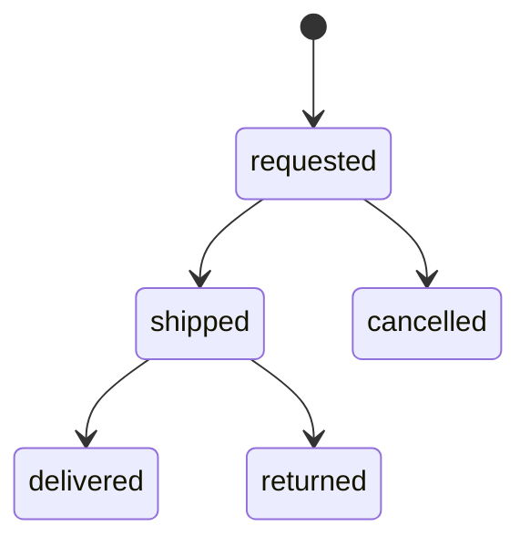

Một deal là một người mua và một người bán thỏa thuận giá cho một tin đăng. Mỗi người mua chỉ có một deal trên một tin, mở lại thì nhận về deal đang có. Luật cho người mua và người bán ở trang [Deal COD](/vi/marketplace/cod-deal).

## Trả giá

Deal ở trạng thái negotiating hoặc agreed, và kết thúc ở sold. Khi đang negotiating, deal giữ tối đa một mức giá đang mở: giá người mua đưa ra hoặc giá người bán trả lại. Nhiều người mua có thể cùng chốt giá trên một tin; chốt giá không giữ chỗ gì cả. Server tính khoảng giá mà lần trả giá tiếp theo được phép và gửi kèm deal, nên app không phải lặp lại luật. Mọi bước đều được lưu, và màn deal liệt kê chúng từ cũ tới mới cho luồng chat.

Khi hai bên cùng thao tác một lúc, bên thua nhận `deal_changed` và app đọc lại deal. App không tự thử lại, vì sau khi bên kia đã đi một bước thì cùng một thao tác có thể mang nghĩa khác.

## Đơn hàng

Đơn hàng nằm trong deal. Sàn không tích hợp hãng vận chuyển nào: người bán tạo vận đơn trên app của hãng rồi nhập vào.

Giữa requested và shipped không có bước nào, nên khi người bán đã báo gửi hàng thì người mua không hủy được nữa. Delivered làm deal thành sold. Returned hoặc cancelled đưa deal về negotiating. Mỗi người mua có tối đa 3 đơn requested hoặc shipped cùng lúc.

## Flow và worker theo dõi tin

Ship, delivered và returned đều đổi cả tin đăng, nên chúng chạy bằng flow Restate. Flow ship giữ chỗ tin trước, nên tin không còn bán thì bị từ chối trước khi ghi gì, rồi mới lưu đơn và hủy các đơn requested khác trên tin đó. Flow kết thúc đơn lưu đơn trước, rồi bán hoặc nhả tin.

Một worker nghe event của tin đăng. Tin bị ẩn, bán hoặc xóa thì giá đang mở bị bỏ và các đơn requested bị hủy; đổi giá hoặc tắt trả giá thì giá đang mở bị bỏ. Mỗi lần như vậy được ghi thành một bước của hệ thống, để luồng chat hiện lý do.
