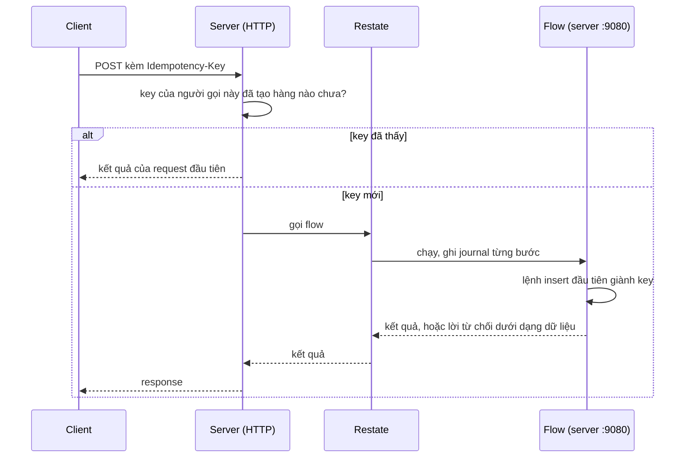

Phần lớn use case là lời gọi thường: handler gọi service của module, service làm việc với Postgres. Một use case chỉ chạy thành flow trên Restate khi nó có nhiều bước phải xảy ra đủ dù server sập giữa chừng, ví dụ một lần ghi rồi tới gửi email hoặc gọi hãng vận chuyển. Giữ phần còn lại ngoài Restate thì khi Restate ngừng, các thao tác đọc và refresh token vẫn chạy. <Req id="ADR-0002" /> <Req id="NFR-DUR-01" />

## Các flow trong server

| Module | Flow |
|---|---|
| account | Đăng nhập, gửi mã OTP qua email, thêm danh tính, xác thực lại |
| catalog | Đăng, sửa và công khai tin đăng, sao chép ảnh vào tin đăng, embed tin đăng, báo cho IndexNow |
| media | Xử lý ảnh tải lên, cho hết hạn ảnh tải lên không được gắn vào đâu, nhả ảnh mà tin đăng đã bỏ |
| deal | Yêu cầu COD, gửi hàng, xác nhận và hủy đơn, các bộ hẹn giờ của đơn, áp cập nhật từ hãng vận chuyển |
| chat | Gửi và công khai tin nhắn |
| trust | Kiểm tra lừa đảo sau một tin nhắn |
| assist | Đọc ảnh, video hoặc liên kết Chợ Tốt |
| chotot | Nhập tin đăng và đồng bộ mỗi giờ |
| support | Mở phiếu hỗ trợ |
| ai | Chuyển giọng nói thành văn bản, vector ảnh, khung hình video |

Việc chuyển event, các handler event của mọi module và các lần quét định kỳ cũng chạy trên Restate (xem [Event](/vi/architecture/events)).

## Chuyển sang flow

Method service đứng trước flow gọi nó qua ingress của Restate rồi chờ kết quả, nên handler nhận đúng kết quả và lỗi như một lời gọi thường. Flow không dựa vào idempotency key của Restate. Nó khử trùng lặp theo key của các hàng nó ghi: lệnh insert đầu tiên giành request key của người gọi, nên lần thử lại chạy đua với lần chạy đầu sẽ tìm thấy hàng đó và trả về nó. Quy chuẩn đầy đủ nằm ở [Dữ liệu](/vi/architecture/data#thử-lại-và-trùng-lặp).

Một vài flow nội bộ vẫn giữ key của Restate, vì key đó là ID tự nhiên của công việc: xử lý ảnh tải lên chạy một lần cho mỗi lần tải lên, công khai tin đăng một lần cho mỗi tin đăng và lần ghi, công khai tin nhắn một lần cho mỗi tin nhắn, và chuyển event một lần cho mỗi event.

## Luật bên trong flow

- Một bước chỉ đọc hoặc ghi một kho dữ liệu, hoặc gọi một dịch vụ bên ngoài. Lỗi nào từ một bước cũng là sự cố, và Restate thử lại bước đó.
- Mọi quyết định nghiệp vụ nằm giữa các bước, dựa trên giá trị journal đã giữ. Vì vậy chạy lại vẫn ra cùng quyết định.
- Bước có thể thua cuộc đua, ví dụ lần lưu thấy hàng đã đổi, trả kết quả đó về dưới dạng giá trị. Sau đó flow quyết định giữa các bước: đọc lại, hoặc trả `try_again`.
- Đồng hồ được đọc một lần cho mỗi lần chạy qua journal, và ID được tạo từ nó trước bước insert chúng. Lệnh insert thử lại rơi đúng vào hàng cũ và lần hai không làm gì.
- Lời từ chối nghiệp vụ, như chạm giới hạn số tin đăng hay tài khoản đang bị tạm khóa, trả về dưới dạng dữ liệu trong kết quả. Restate chỉ giữ mã và thông điệp của một lần gọi thất bại, trong khi client cần cả chi tiết lỗi.

## Flow theo từng tin đăng

Embed tin đăng chạy mỗi lúc một lần cho mỗi tin đăng, và request mới xếp hàng sau lần đang chạy. Vì vậy một loạt lần sửa liên tiếp chỉ embed nội dung mới nhất một lần, và các lần chạy sau thấy không còn gì để làm. Khi gateway báo đã hết ngân sách, lần chạy kết thúc mà không có vector và thử lại sau 6 giờ.

## Chạy Restate

Lúc khởi động, server đăng ký endpoint của mình với Restate. Trong cụm máy chủ, một operator đăng ký từng phiên bản server thay cho bước đó và giữ phiên bản cũ chạy tới khi các lần gọi của nó xong, nên một lần chạy không bao giờ chạy lại trên code khác với code nó bắt đầu. Restate ký mọi request tới endpoint, và ở production server chỉ chạy request có chữ ký.
