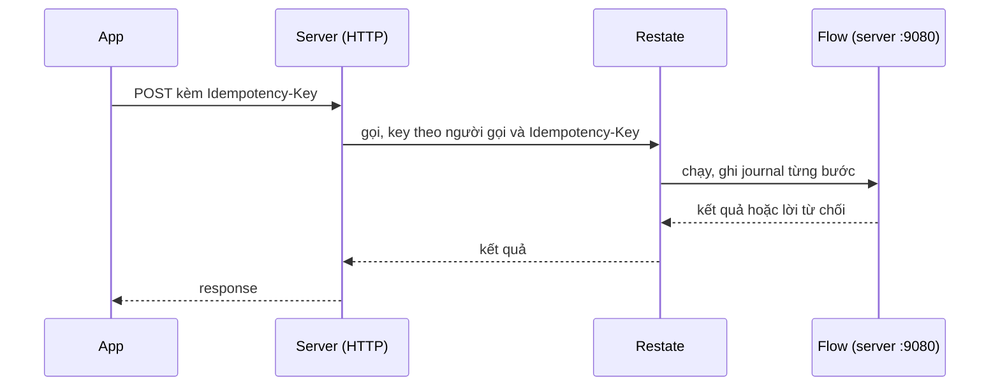

Phần lớn use case là lời gọi thường: handler gọi service của module, service làm việc với Postgres. Một use case chỉ chạy thành flow trên Restate khi nó ghi vào nhiều chỗ và phải chạy xong dù server sập giữa chừng. Giữ phần còn lại ngoài Restate thì khi Restate ngừng, các thao tác đọc và refresh token vẫn chạy.

## Các flow trong server

| Flow | Vì sao cần durable |
|---|---|
| Đăng nhập | Lần đầu đăng nhập tạo tài khoản rồi tới danh tính số điện thoại, và xóa tài khoản nếu số đó vừa bị người khác lấy |
| Đăng và sửa tin | Ghi tin đăng, gắn ảnh đã tải lên, rồi bắt đầu đăng |
| Đăng tin công khai | Chờ mọi ảnh xử lý xong rồi chuyển tin sang active hoặc rejected |
| Xử lý và hết hạn ảnh tải lên | Thu nhỏ ảnh trong kho; xóa ảnh không được gắn vào đâu sau 24 giờ |
| Gửi hàng và kết thúc đơn | Đổi trạng thái đơn và giữ chỗ, bán hoặc nhả tin đăng |
| Gửi tin nhắn chat | Thêm tin nhắn và gắn ảnh của nó |

Việc chuyển event và các handler event của từng module cũng chạy trên Restate (xem [Event](/vi/architecture/events)).

## Chuyển sang flow

Method service đứng trước flow gọi nó qua ingress của Restate rồi chờ kết quả, nên handler nhận đúng kết quả và lỗi như một lời gọi thường. `Idempotency-Key` của client thành key của lần gọi. Key lặp lại sẽ gắn vào lần chạy đầu và trả kết quả của lần đó, không chạy lại bước nào.

## Luật bên trong flow

- Một bước chỉ đọc hoặc ghi kho dữ liệu. Lỗi nào từ một bước cũng là sự cố, và Restate thử lại.
- Mọi quyết định nghiệp vụ nằm giữa các bước, dựa trên giá trị journal đã giữ, nên chạy lại vẫn ra cùng quyết định.
- ID và đồng hồ lấy từ journal, nên lệnh insert thử lại rơi đúng vào hàng cũ và lần hai không làm gì.
- Lời từ chối nghiệp vụ, như chạm giới hạn số tin, trả về dưới dạng dữ liệu trong kết quả. Restate chỉ giữ mã và thông điệp của một lần gọi thất bại, trong khi client cần cả chi tiết lỗi.

Bản đầu quyết định ngay trong bước, và một bước được thử lại đã áp thay đổi hai lần. Từ 2026-10-21, cách chia đọc, quyết định, lưu thay cho cách đó.

## Chạy Restate

Lúc khởi động, server đăng ký endpoint của mình qua admin API của Restate. Restate ký mọi request tới endpoint bằng một private key, và ở production server chỉ chạy request có chữ ký đó. Một tiền tố tên service giữ cho các package test dùng chung một Restate server không đụng nhau.
