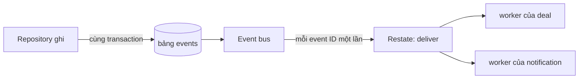

Module báo một thay đổi bằng event, module nào quan tâm thì subscribe theo loại event. Module thay đổi dữ liệu không biết ai sẽ phản ứng. Mọi subscriber đều là module của cùng một server nên không cần broker: outbox là một bảng Postgres, `events`, còn Restate lo việc chuyển.

## Phát event

Repository ghi event của một thay đổi trong chính transaction của thay đổi đó. Lần ghi thua race thì không để lại event nào, còn commit thì luôn kèm event của nó. Event rất mỏng: một loại như `listing.sold`, ID của thứ vừa đổi, và với vài loại thì thêm vài trường mà subscriber cần, như thời điểm hết hạn khóa tài khoản.

Các loại đang dùng đến từ account (updated, suspended, unsuspended), catalog (tin đăng published, updated, hidden, unhidden, sold, unsold, deleted, reserved, released, rejected), deal (`deal.moved`), chat (`message.sent`) và trust (`review.posted`).

## Subscriber

| Module | Nghe | Làm gì |
|---|---|---|
| deal | tin đăng updated, hidden, sold, deleted | Bỏ giá đang mở và hủy yêu cầu trên tin đã đóng hoặc đổi giá |
| notification | bước deal, tin nhắn, tin đăng published hoặc rejected, đánh giá, khóa tài khoản | Ghi thông báo và gửi push |

Subscriber đọc trạng thái hiện tại qua service của module nguồn. Vì vậy thứ tự, độ trễ hay event tới hai lần đều không làm đổi kết quả.

## Chuyển event

Bus chạy trong server. Nó thức dậy khi Postgres báo có commit, và cứ mỗi giây một lần, lấy tối đa 100 hàng đang chờ rồi đưa từng hàng cho Restate với event ID làm idempotency key. Sau đó Restate mở cho mỗi subscriber một lần gọi riêng và thử lại riêng lần đó tới khi thành công, nên một subscriber lỗi không chặn subscriber khác hay event khác.

- Event tới service Restate của bus ít nhất một lần, và Restate bỏ event ID lặp lại trong 24 giờ.
- Event bị ingress từ chối sẽ lùi thời gian thử lại, từ 1 giây tới tối đa một giờ.
- Khi Restate ngừng, event nằm chờ trong bảng và API vẫn chạy.
- Hàng đã chuyển bị xóa sau 7 ngày. Không có replay lịch sử; subscriber cần dựng lại dữ liệu thì tự chạy một job đọc các bảng hiện tại.
