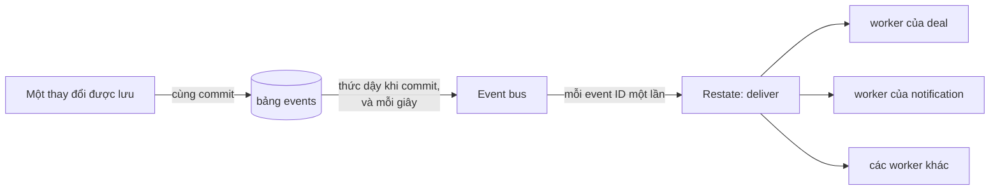

Module báo một thay đổi bằng event, và module nào quan tâm thì subscribe theo loại event. Module thay đổi dữ liệu không bao giờ biết ai sẽ phản ứng. Mọi subscriber đều là module của cùng một server, nên không cần broker: outbox là một bảng Postgres, `events`, còn Restate lo việc chuyển. <Req id="NFR-MSG-01" />

## Phát event

Một thay đổi và các event của nó được ghi trong một commit. Lần ghi thua cuộc đua không để lại event nào, còn commit thì luôn để lại event của nó. Event có ID đã tồn tại thì không được ghi lại, nên bước durable thử lại lần lưu của nó chỉ ghi một event.

Event rất mỏng: một loại có dạng `aggregate.past_tense`, ID của thứ vừa đổi, và với vài loại thì thêm các trường mà subscriber cần, như thời điểm hết hạn tạm khóa.

| Module | Loại |
|---|---|
| account | `account.updated`, `account.suspended`, `account.unsuspended`, `account.deleted` |
| catalog | `listing.published`, `listing.updated`, `listing.hidden`, `listing.unhidden`, `listing.sold`, `listing.unsold`, `listing.reserved`, `listing.released`, `listing.rejected`, `listing.deleted` |
| deal | `deal.moved` |
| chat | `message.sent` |
| trust | `review.posted`, `review.replied` |
| discovery | `saved.price_dropped`, `search_watch.matched` |
| feedback | `feedback.moved`, `feedback.replied` |
| chotot | `chotot_link.imported`, `chotot_import.sold` |
| payment | `payment.succeeded`, `payment.failed`, `payment.expired`, `payment.refunded` |
| boost | `boost.started`, `boost.failed`, `boost.expired`, `boost.refunded`, `boost.ended` |

## Subscriber

| Module | Nghe | Làm gì |
|---|---|---|
| deal | tin đăng updated, hidden, sold, deleted | Đưa các deal đang mở về đúng trạng thái: bỏ giá hoặc hủy yêu cầu trên tin đăng đã đổi hoặc đã đóng |
| deal | `deal.moved` | Đăng lượt chuyển vào cuộc trò chuyện của hai bên |
| catalog | tin đăng deleted; tin đăng thay đổi | Nhả ảnh của tin đăng đã xóa; xếp thay đổi vào hàng đợi cho IndexNow |
| discovery | tin đăng published, updated | Ghi lại lần công khai đầu tiên cho theo dõi tìm kiếm, và kiểm tra tin đã lưu có giảm giá không |
| trust | `message.sent` | Chạy kiểm tra lừa đảo trên cuộc trò chuyện |
| support | `message.sent` | Chuyển trạng thái phiếu hỗ trợ của cuộc trò chuyện hỗ trợ: tin nhắn của người dùng mở lại phiếu, câu trả lời của nhân viên đánh dấu phiếu đã trả lời |
| chotot | tin đăng sold, updated, deleted | Nhắc người bán ẩn tin trên Chợ Tốt, hoặc cập nhật hay bỏ theo dõi tin đã nhập |
| boost | `payment.*` | Bắt đầu gói của lần thanh toán đã trả hoặc hoàn tiền, đóng gói khi thanh toán thất bại hay hết hạn, ghi đã hoàn |
| notification | lượt chuyển của deal, tin nhắn, tin đăng published hoặc rejected, đánh giá và trả lời đánh giá, tạm khóa tài khoản, giảm giá, khớp theo dõi tìm kiếm, góp ý, nhập tin từ Chợ Tốt, đẩy tin | Ghi thông báo và gửi thông báo đẩy và email |
| mọi module có dữ liệu về một người | `account.deleted` | Xóa hoặc kết thúc những gì nó giữ của tài khoản đó |

Subscriber đọc trạng thái hiện tại qua service của module nguồn. Vì vậy thứ tự, độ trễ hay event tới hai lần đều không làm đổi kết quả. Subscriber nào tự ghi thứ của riêng mình thì suy ID từ ID của event, nên lần chuyển thứ hai không ghi thêm gì.

## Chuyển event

Bus chạy trong server. Nó thức dậy khi Postgres báo có commit, và thêm mỗi giây một lần. Mỗi vòng lấy tối đa 100 hàng đang chờ và đưa từng hàng cho Restate với event ID làm idempotency key. Sau đó Restate mở cho mỗi subscriber một lần gọi riêng và thử lại riêng lần đó tới khi thành công. Một subscriber lỗi không chặn subscriber khác hay event khác.

- Event tới service Restate của bus ít nhất một lần, và Restate bỏ event ID lặp lại trong 24 giờ.
- Event không có subscriber nào được đánh dấu xong mà không gửi.
- Event bị ingress từ chối chờ 1 giây, rồi 2, 4 và cứ thế, tối đa một giờ. Lỗi khác thì kết thúc vòng, và vòng sau gửi lại phần còn lại.
- Trong lúc deploy cuốn chiếu, lần chuyển tới subscriber mà Restate chưa biết được thử lại có backoff tới khi phiên bản mới được đăng ký.
- Khi Restate ngừng, event nằm chờ trong bảng và API vẫn chạy.
- Hàng đã chuyển bị xóa sau 7 ngày. Không có replay lịch sử; subscriber cần dựng lại dữ liệu thì tự chạy một job đọc các bảng hiện tại.
