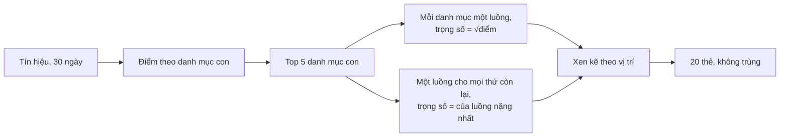
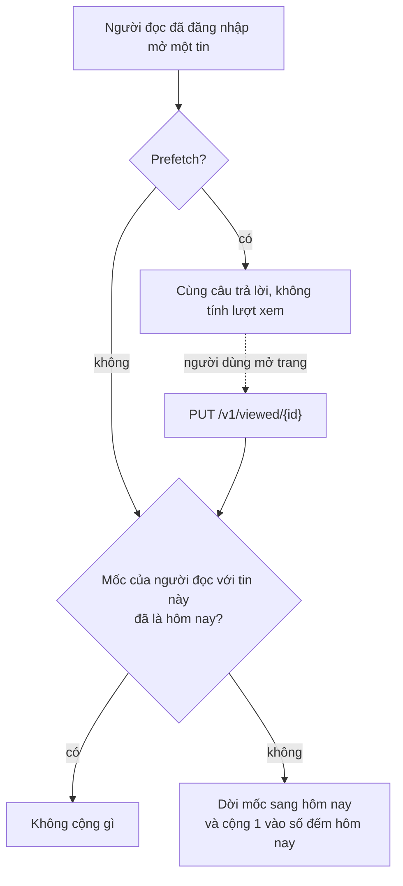

Home hiện ba feed, và màn tin của chính người bán cho thấy từng tin đang ra sao. Tất cả đều do module screen đọc từ discovery, catalog, deal và chat. Mọi feed bỏ những gì [tìm kiếm](/vi/architecture/search-and-discovery) bỏ: tin người xem đã ẩn và tin của các tài khoản ở hai phía của các lần chặn của họ.

## Home

`GET /v1/screens/home` chạy được khi đã đăng nhập hay chưa, và trả về cây danh mục cùng ba feed.

| Feed | Chứa gì | Phân trang |
|---|---|---|
| `nearby` | Trang đầu của lần tìm `nearby` | Có, qua `GET /v1/search?sort=nearby` |
| `for_you` (Dành cho bạn) | 20 thẻ cân theo sở thích của người dùng | Không |
| `viewed` (Vì bạn đã xem gần đây) | Tối đa 10 thẻ từ danh mục con người dùng xem gần nhất | Không |

Home không mang số tin của từng danh mục. Đếm mọi tin đang bán mỗi lần mở là query bận nhất của database, cho những con số người dùng không nhìn tới.

### Gần bạn

Feed gần bạn là trang đầu của `GET /v1/search?sort=nearby` với cùng vị trí và bán kính: các tin đang bán trong bán kính (mặc định 50 km, từ 1 tới 200), chấm theo các vòng khoảng cách và độ mới. `next_cursor` của Home phân trang tiếp qua tìm kiếm. Khi không có vị trí, Home trả `nearby` trống và không có cursor thay vì báo lỗi.

### Dành cho bạn

Dành cho bạn đọc các tín hiệu của người dùng trong 30 ngày UTC gần nhất:

- 100 tin mới nhất họ đã mở,
- 100 tin mới nhất họ đã lưu,
- các mục lịch sử tìm kiếm trong khoảng đó có chip danh mục đầu tiên là danh mục con (lịch sử giữ 10 lần tìm gần nhất).

Mỗi tín hiệu cộng điểm cho danh mục con của nó: một lượt lưu 3, một lần tìm 2, một tin đã mở 1. Chip chỉ một danh mục gốc không cộng điểm. Chỉ 5 danh mục con nặng nhất được tính, bằng điểm thì mã nhỏ hơn đi trước, để lần đọc vẫn nhanh với người xem nhiều.

Mỗi luồng liệt kê các tin đang bán trên toàn quốc, mới nhất trước, trong đó một lượt [đẩy tin](/vi/architecture/boosts-and-payments) tính là mới. Tin thứ k của một luồng nhận vị trí (k − ½) / trọng số, và trang sắp theo vị trí, rồi theo thời điểm muộn hơn giữa lúc đăng và lúc đẩy, rồi theo ID. Căn bậc hai giữ cho một sở thích được xem nhiều lần không lấn hết các sở thích khác. Một sở thích duy nhất chiếm nửa trang, nửa còn lại là các tin mới nhất; hai sở thích bằng nhau mỗi cái chiếm một phần ba. Khách, hoặc tài khoản chưa có tín hiệu, nhận các tin mới nhất. Dành cho bạn cũng bỏ tin của chính người xem.

### Đã xem gần đây

`viewed` đọc cùng 100 tin đã mở đó. Nó lấy ngày gần nhất trong số đó, và danh mục con mà phần lớn tin của ngày ấy thuộc về; bằng nhau thì lấy danh mục con của tin mới nhất. Các thẻ là tin đang bán của danh mục con đó mà người dùng chưa mở, mới nhất trước. Feed vắng mặt với khách, khi không có tin đã mở nào trong khoảng thời gian đó, hoặc khi không có tin nào như vậy.

## Lượt xem tin

Một lượt xem là một người đọc đã đăng nhập, không phải người bán, mở `GET /v1/screens/listing/{id}`. Mỗi người đọc, mỗi tin, mỗi ngày UTC được tính một lần. Khách không được tính, và lần đọc tin của chính người bán qua `GET /v1/listings/{id}` cũng không. Chỉ tin đang bán hoặc đang giữ chỗ được tính, và lần mở của tài khoản đã xóa không tính gì.

Discovery giữ hai bảng cạnh bảng lượt lưu. `listing_view_marks` giữ ngày gần nhất của mỗi người với mỗi tin, và `listing_view_days` giữ số lượt xem theo tin và ngày. Một câu lệnh dời mốc tới và chỉ cộng vào số đếm của ngày khi mốc đã dời, nên lần mở thứ hai trong ngày, lần gọi lại hay lần mở đồng thời đều không cộng gì. Lượt xem được đếm sau các lần đọc của trang; đếm lỗi thì được log và trang vẫn trả kết quả như thường.

Prefetch của trình duyệt không tính lượt xem. Website prefetch những trang nó đoán người dùng sẽ mở, và chuyển header `Sec-Purpose: prefetch` của trình duyệt tới API. Lần đọc đó trả về như thường nhưng không tính gì, và khi người dùng thật sự mở trang thì client báo bằng `PUT /v1/viewed/{listing_id}`. Các lần đọc khác của trang tin (tin tương tự, tin và đánh giá của người bán) không ghi gì.

Một mốc gắn với một người, nên xóa tài khoản thì xóa các mốc của họ và giữ số đếm theo ngày. Một lượt xem đang được ghi trong lúc tài khoản bị xóa thì hoặc xong trước và mốc của nó bị xóa, hoặc bắt đầu sau và không ghi gì.

## Tin của bạn

`GET /v1/screens/my-listings?pane=on_sale|sold` là danh sách của chính người bán. Ngăn `on_sale` giữ các tin đang xử lý, đang bán, đang ẩn, bị từ chối hoặc đang giữ chỗ; `sold` giữ các tin đã bán, kèm lúc bán và không có người mua.

Mỗi item là tin như người bán của nó đọc, kèm:

| Trường | Ý nghĩa |
|---|---|
| `views`, `views_7d` | Lượt xem tổng cộng và trong bảy ngày gần nhất |
| `askers` | Số người đã hỏi về tin, mỗi người một lần |
| `saves` | Số lượt lưu còn đến hiện tại |
| `order` | Đơn người bán cần xử lý, nếu có |
| `from_chotot` | Tin được chuyển sang từ trang cá nhân Chợ Tốt của người bán, cho nhãn trên ứng dụng |

Mỗi phản hồi cũng có `week`: lượt xem, người hỏi và lượt lưu trong bảy ngày gần nhất trên mọi tin đang bán của người bán, dù đọc ngăn nào hay trang nào. Tuần là bảy ngày UTC kết thúc hôm nay, đúng các ngày mà lượt xem được lưu theo. Màn đọc đồng hồ một lần và đếm mọi con số từ cùng một mốc bắt đầu.

Người hỏi là người có deal trên tin, hoặc đã viết cho người bán về tin đó trong cuộc trò chuyện của họ, tính một lần cho mỗi tin ở lần liên hệ đầu tiên. Tin nhắn của deal không được tính, còn người bị chặn hoặc đã xóa tài khoản vẫn được tính. Tuần đếm những người hỏi có lần liên hệ đầu tiên rơi vào bảy ngày đó. Lượt lưu trong tuần là các lượt lưu từ đầu tuần tới nay và vẫn còn.

`order` là đơn đã gửi, đang giữ tin, nếu không thì là đơn chờ tạo đơn được yêu cầu sớm nhất, tức đơn có hạn của người bán hết sớm nhất. Nó mang deal, đơn và trạng thái đơn.

Một trang tốn cùng năm hoặc sáu lần gọi service dù chứa gì: chính trang đó, ID của mọi tin đang bán (cho tuần), rồi cùng lúc lượt xem và lượt lưu từ discovery, người mua từ deal và người hỏi từ chat, và các dấu Chợ Tốt của trang.

### Đăng lại

`POST /v1/listings/{id}/photo-copies` sao chép các ảnh đã xử lý của một tin thành các ảnh tải lên mới cho một bản nháp mới. Nó nhận `Idempotency-Key` và chạy như một durable flow. ID ảnh tải lên của mỗi bản sao được suy ra từ người bán, tin, key và vị trí của ảnh, nên lần bấm lại trả về các ảnh của lần chạy đầu thay vì một bộ thứ hai. Flow từ chối tin của người bán khác hoặc tin đã xóa bằng `listing_not_found`, rồi sao chép mỗi bước một ảnh mà dữ liệu ảnh không vào journal. Nó trả 201 với các ảnh tải lên và signed URL mới, theo thứ tự của tin.

Mọi trạng thái trừ đã xóa đều đăng lại được, và ảnh chưa xử lý xong thì bị bỏ. Bản sao giữ nguồn gốc, nên ảnh từng được chép từ trang khác vẫn được đánh dấu là ảnh chép. Các bản sao không có bản nháp nào đăng thì hết hạn sau 24 giờ như mọi ảnh tải lên.
