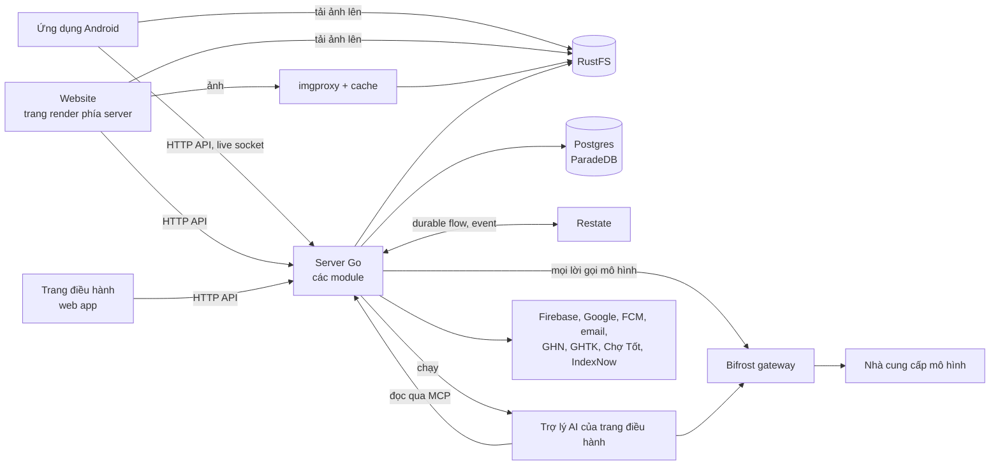

Hệ thống gồm ba client và một server Go. Ứng dụng Android và website dành cho người mua và người bán. Trang điều hành là web app mà điều phối viên và quản trị viên làm việc trên đó. Cả ba gọi cùng một HTTP API.

Server là một modular monolith: một binary duy nhất, chia thành các module, mỗi module giữ bảng của riêng nó và đưa ra một service cho module khác gọi. Server phục vụ HTTP API ở cổng 8080, endpoint cho Restate gọi ở cổng 9080, và một endpoint MCP ở cổng 9090 cho trợ lý AI của trang điều hành.

## Các kho dữ liệu

Postgres bản ParadeDB chứa mọi bảng, index full-text mà tìm kiếm dùng, và vector của tin đăng và ảnh. Restate chạy các use case buộc phải chạy xong dù server có sập giữa chừng, và chuyển event từ module này sang các module khác. RustFS lưu ảnh qua S3 API. Client tải ảnh thẳng lên bằng URL presigned, rồi server biến mỗi lần tải lên thành một ảnh công khai và một ảnh thu nhỏ. Website phục vụ ảnh ở các cỡ khác qua imgproxy, dịch vụ này đổi cỡ ảnh từ RustFS và đặt sau một lớp cache.

## Dịch vụ bên ngoài

- Firebase xác minh số điện thoại. Client đăng nhập bằng Firebase và gửi cho server token mà Firebase trả về. Đăng nhập Google và mã OTP qua email là hai bằng chứng còn lại.
- Firebase Cloud Messaging chuyển thông báo đẩy, và một nhà cung cấp email gửi mã OTP và thông báo.
- GHN và GHTK là các hãng vận chuyển. Người bán liên kết tài khoản hãng của chính mình, và server tạo, theo dõi và hủy vận đơn trên tài khoản đó. Hãng báo lại qua webhook và polling.
- API công khai của Chợ Tốt cho người bán đưa sang các tin đăng họ đã có ở đó.
- IndexNow báo cho các công cụ tìm kiếm khi một tin đăng công khai thay đổi.

## Mô hình

Mọi lời gọi mô hình đều đi qua Bifrost, AI gateway của stack. Server cấp cho mỗi bên gọi của nó một virtual key có ngân sách, và Bifrost chuyển mỗi lời gọi tới một nhà cung cấp, có phương án dự phòng. Tìm kiếm dùng mô hình ngôn ngữ để đọc câu tìm kiếm và để embed văn bản. Module assist đọc ảnh, video hoặc liên kết Chợ Tốt của người bán thành bản nháp tin đăng.

Một số mô hình chạy ngay trong server, ở module ai: chuyển giọng nói thành văn bản, vector ảnh và các khung hình cắt từ video. Trong cụm máy chủ, chúng chạy trong một deployment thứ hai của cùng binary, chỉ phục vụ module ai, nên các pod API không nạp mô hình nào.

Trợ lý AI của trang điều hành là một dịch vụ riêng. Server khởi động các lần chạy của nó, và trợ lý đọc dữ liệu qua endpoint MCP của server, nên nó không bao giờ chạm vào database.

## Khi một thành phần ngừng chạy

- Khi Restate ngừng chạy, các thao tác đọc, refresh phiên đăng nhập và mọi use case không phải durable flow vẫn chạy. Event nằm chờ trong bảng và được gửi đi khi Restate chạy lại.
- Khi mô hình lỗi hoặc hết ngân sách, tìm kiếm vẫn chạy bằng chính các từ trong câu tìm kiếm. Tìm kiếm bằng ảnh trả 503 `search_unavailable`. Tin đăng chưa embed được sẽ được thử lại sau.
- `/readyz` chỉ kiểm tra Postgres và Restate, nên mô hình hay hãng vận chuyển chậm không bao giờ làm một pod ngừng phục vụ.

<Cards cols={2}>
  <Card title="Module" href="/vi/architecture/modules" icon="ri:layout-grid-line">Server được chia ra sao, và luật giữa các module.</Card>
  <Card title="Durable flow" href="/vi/architecture/durable-flows" icon="ri:loop-right-line">Việc nào chạy trên Restate, và vì sao.</Card>
  <Card title="Event" href="/vi/architecture/events" icon="ri:broadcast-line">Outbox và ai phản ứng với cái gì.</Card>
  <Card title="Dữ liệu" href="/vi/architecture/data" icon="ri:database-2-line">Postgres, transaction, thử lại và migration.</Card>
  <Card title="Đăng nhập" href="/vi/architecture/sign-in" icon="ri:smartphone-line">Đăng nhập bằng số điện thoại, Google và email.</Card>
  <Card title="Tài khoản" href="/vi/architecture/account" icon="ri:user-3-line">Hồ sơ, địa chỉ, hỗ trợ, góp ý và xóa tài khoản.</Card>
  <Card title="Catalog" href="/vi/architecture/catalog" icon="ri:store-2-line">Tin đăng, danh mục và địa giới.</Card>
  <Card title="Vòng đời tin đăng" href="/vi/architecture/listings-lifecycle" icon="ri:git-commit-line">Bản nháp, đăng, sửa, giữ chỗ và bán.</Card>
  <Card title="Deal" href="/vi/architecture/deal" icon="ri:hand-coin-line">Trả giá và đơn COD.</Card>
  <Card title="Vận chuyển" href="/vi/architecture/shipping" icon="ri:truck-line">Tài khoản hãng, vận đơn và theo dõi.</Card>
  <Card title="Tìm kiếm và khám phá" href="/vi/architecture/search-and-discovery" icon="ri:search-line">Tìm kiếm, tìm kiếm đã lưu và báo giá giảm.</Card>
  <Card title="Bảng tin" href="/vi/architecture/feeds" icon="ri:home-4-line">Bảng tin trang chủ, lượt xem tin đăng và Tin của bạn.</Card>
  <Card title="Assist" href="/vi/architecture/assist" icon="ri:magic-line">Đọc ảnh, video hoặc liên kết thành bản nháp tin đăng.</Card>
  <Card title="AI" href="/vi/architecture/ai" icon="ri:cpu-line">Gateway, các agent và các mô hình server tự chạy.</Card>
</Cards>
