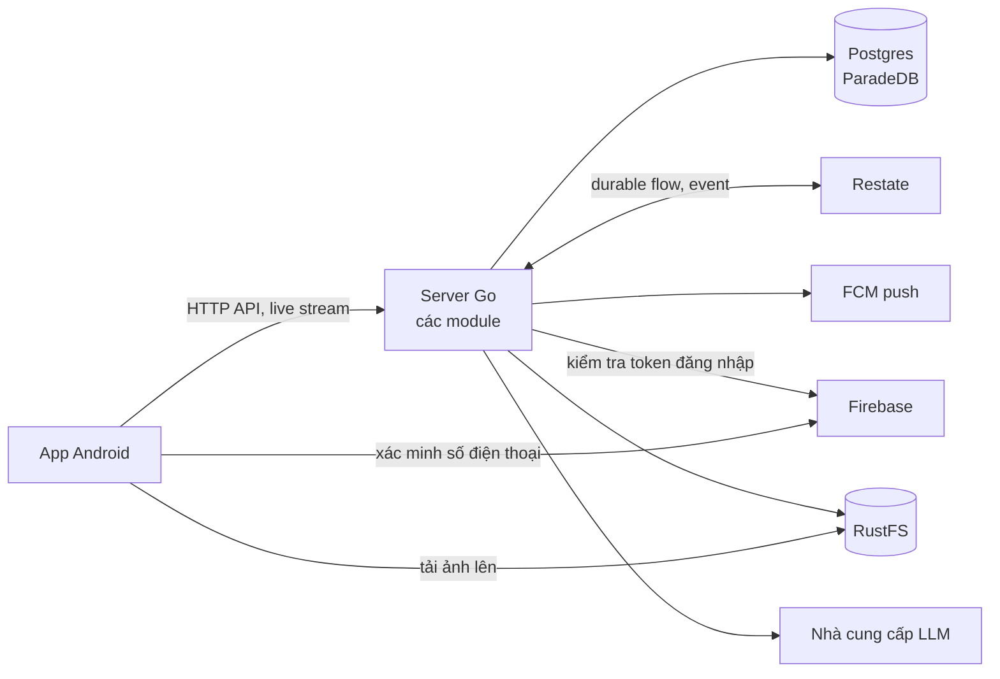

ShopNexus gồm một app Android native và một server Go. Server là một modular monolith: một binary duy nhất, chia thành các module, mỗi module giữ bảng của riêng nó và đưa ra một service cho module khác gọi. Server phục vụ HTTP API ở cổng 8080 và endpoint cho Restate gọi ở cổng 9080.

Postgres 18 bản ParadeDB chứa mọi bảng và cả index full-text mà tìm kiếm dùng. Restate chạy vài use case buộc phải chạy xong dù server có sập giữa chừng, và chuyển event từ module này sang các module khác. RustFS lưu ảnh qua S3 API: app tải ảnh thẳng lên bằng URL presigned, rồi server xử lý từng ảnh thành bản đã thu nhỏ, công khai.

App xác minh số điện thoại qua Firebase rồi gửi cho server token mà Firebase trả về. Server gửi push qua Firebase Cloud Messaging, và hỏi một mô hình ngôn ngữ (qua API tương thích OpenAI) xem câu tìm kiếm của người dùng nghĩa là gì.

Khi Restate ngừng chạy, các thao tác đọc, refresh phiên đăng nhập và mọi use case không phải durable flow vẫn chạy bình thường; event nằm chờ trong bảng.

<Cards cols={2}>
  <Card title="Module" href="/vi/architecture/modules" icon="ri:layout-grid-line">Server được chia ra sao, và luật giữa các module.</Card>
  <Card title="Durable flow" href="/vi/architecture/durable-flows" icon="ri:loop-right-line">Việc nào chạy trên Restate, và vì sao.</Card>
  <Card title="Event" href="/vi/architecture/events" icon="ri:broadcast-line">Outbox và ai phản ứng với cái gì.</Card>
  <Card title="Dữ liệu" href="/vi/architecture/data" icon="ri:database-2-line">Postgres, transaction và migration.</Card>
  <Card title="Đăng nhập" href="/vi/architecture/sign-in" icon="ri:smartphone-line">Đăng nhập bằng số điện thoại qua Firebase.</Card>
  <Card title="Catalog" href="/vi/architecture/catalog" icon="ri:store-2-line">Tin đăng, danh mục và địa giới.</Card>
  <Card title="Deal" href="/vi/architecture/deal" icon="ri:hand-coin-line">Trả giá và đơn COD.</Card>
  <Card title="Tìm kiếm và khám phá" href="/vi/architecture/search-and-discovery" icon="ri:search-line">Tìm kiếm, bảng tin gần bạn và tin đã lưu.</Card>
</Cards>
