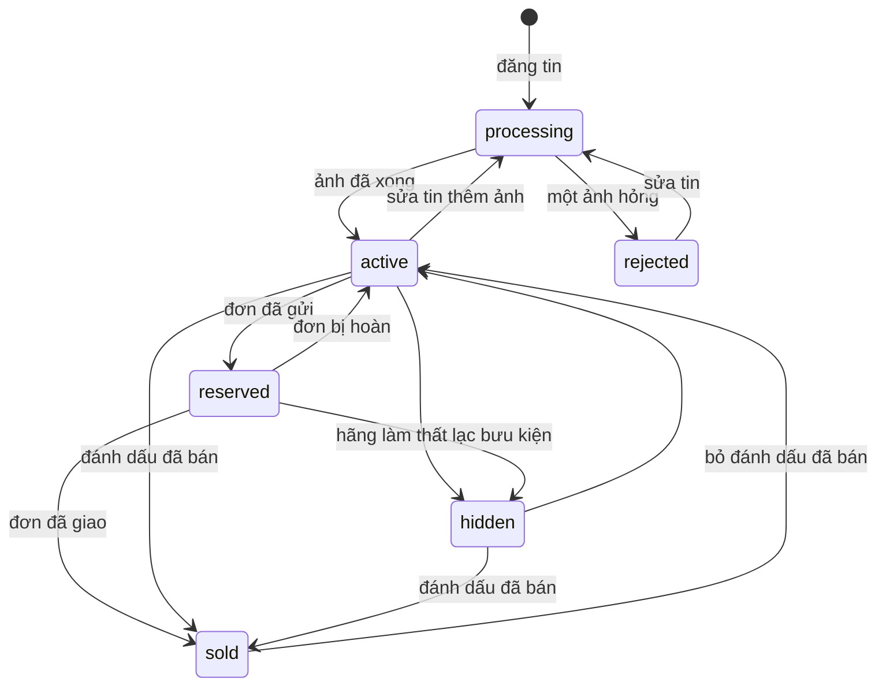
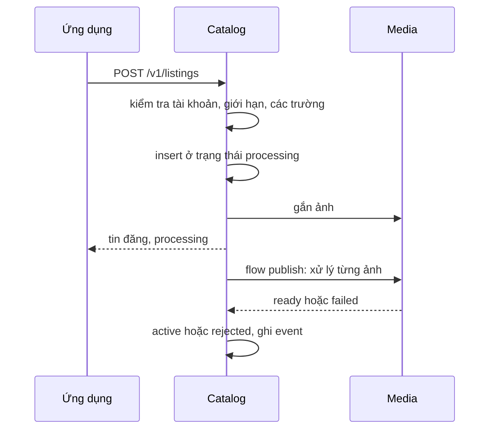

Trang này theo một tin đăng từ bản nháp tới lúc bị xóa. Danh mục, địa giới và cách đọc công khai nằm ở trang [Catalog](/vi/architecture/catalog); ảnh nằm ở trang [Media](/vi/architecture/media).

## Bản nháp

Bản nháp nằm trên server để các thiết bị khác của người bán cũng thấy. Bản nháp không bị ràng buộc: luật đăng tin chỉ áp dụng khi tin đăng đầy đủ tới `POST /v1/listings`.

- `PUT /v1/listing-drafts/{id}` tạo hoặc thay một bản nháp. Ứng dụng tự tạo ID, và lần ghi sau cùng thắng.
- `GET /v1/listing-drafts` trả mọi bản nháp đầy đủ, mới nhất trước. Bản nháp của tài khoản khác, đã hết hạn hoặc không tồn tại thì trả `draft_not_found`; `DELETE` luôn trả 204.
- Server chỉ đọc tiêu đề (tối đa 100 ký tự), giá và tối đa 10 ID ảnh. Phần còn lại của form là JSON của ứng dụng, tối đa 32.768 ký tự, được lưu mà không đọc.

Mỗi tài khoản giữ tối đa 20 bản nháp (`draft_limit_reached`). Bản nháp sống 30 ngày kể từ lần ghi cuối. Không có job dọn dẹp: lần liệt kê hoặc PUT tiếp theo của tài khoản xóa các bản nháp hết hạn trước.

Mỗi lần PUT bỏ các ảnh mà media báo đã mất, và nhờ media giữ các ảnh còn lại 30 ngày. Đọc không gia hạn gì, nên đọc không giữ bản nháp sống. Ảnh của bản nháp luôn riêng tư, sau URL được ký có hạn một giờ.

## Trạng thái

Mọi trạng thái trừ reserved đều chuyển được sang deleted; dòng dữ liệu vẫn còn. Tin active và reserved là tin công khai. Sửa một tin sold, deleted hoặc reserved thì trả `listing_state_conflict`.

## Đăng tin

Đăng tin là một flow durable. `POST /v1/listings` nhận `Idempotency-Key`, được giữ theo người bán ngay trong lệnh insert, nên bấm lại vẫn chỉ ra một tin.

Các bước kiểm tra chạy theo thứ tự (<Req id="BR-LST-02" />, <Req id="BR-LST-03" />):

1. Tài khoản bị tạm khóa thì bị từ chối.
2. Tài khoản chưa có số điện thoại thì trả `phone_required` (<Req id="BR-ACC-03" />).
3. Đã có 20 tin ở trạng thái processing, active, hidden, reserved hoặc rejected thì trả `listing_cap_reached`.
4. Các trường: tiêu đề 1–70 ký tự, giá là số đồng chẵn từ 10.000 tới 1.000.000.000, mô tả tối đa 1.500 ký tự, 1–10 ảnh với ảnh đầu là ảnh bìa, tối đa 20 thông số gồm cả các thông số bắt buộc của danh mục con. `invalid_listing` liệt kê mọi trường sai trong một lần.

Một khóa theo người bán bao quanh lệnh insert, nên hai lần đăng chạy đua không cùng lấy được suất cuối. Giới hạn được kiểm tra trước khi gắn ảnh nào; nếu gắn ảnh lỗi, flow xóa dòng đó.

Tin đăng không khai vết hay lỗi (<Req id="BR-LST-01" />): mỗi người đánh giá độ mòn một khác, và người mua đồng kiểm món hàng tại cửa. Tình trạng, thông số và ảnh mô tả món hàng.

## Công khai tin

Mỗi lần ghi để tin ở trạng thái processing sẽ bắt đầu một lượt publish, khóa theo tin đăng và lần ghi. Lượt này nhờ media xử lý từng ảnh mới và chờ tất cả xong.

- Tất cả ready: tin thành active, key ảnh được lưu, ghi `listing.published`. Lần publish đầu tiên mang `first: true`.
- Một ảnh failed: tin thành rejected, lý do nằm trên ảnh đó.

Nếu tin đã đổi trong lúc chờ, lượt publish dừng lặng lẽ; lần ghi mới hơn có lượt riêng. Ảnh mà server chép từ tin của người bán trên trang khác hiện `copied: true` với mọi người đọc.

## Sửa tin

`PUT /v1/listings/{id}` thay toàn bộ tin đăng, vì ứng dụng gửi cả form. Lần sửa lưu cùng `listing.updated`, rồi báo media nhả các ảnh đã bỏ. Thêm ảnh, hoặc sửa một tin bị rejected, thì tin đi lại qua processing.

Khi hai lần sửa chạy đua, bên thua nhận `try_again`. Ảnh mới của nó đã được gắn, nên lần thử sau qua được. Một bước dọn dẹp 24 giờ sau nhả những ảnh mà tin vẫn không hiện.

Tin đăng nhớ lần đổi giá gần nhất sau khi lên bán lần đầu. Giảm ít nhất 5 % trong 7 ngày gần nhất thì hiện là giảm giá, với giá cũ bị gạch. Tăng giá sau đó thì hết giảm giá, và một lần tăng chưa quá 7 ngày không được dùng làm mốc để tính giảm.

## Giữ chỗ và bán

[Module deal](/vi/architecture/deal) giữ chỗ tin cho một đơn trong lúc bưu kiện đang đi. Giữ chỗ, nhả và bán đều ghi tên đơn, nên một flow durable lặp lại chúng vẫn an toàn. Chúng ghi `listing.reserved`, `listing.released` và `listing.sold`. Khi hãng làm thất lạc bưu kiện, lần nhả để tin ở trạng thái người bán ẩn, ghi `listing.hidden`, vì người bán không còn hàng; người bán hiện lại tin như bình thường. Tin reserved được tính vào giới hạn; người bán không ẩn tin, sửa, đánh dấu đã bán hay xóa được.

`unmark-sold` chỉ hoàn tác lần bán tự đánh dấu; hoàn tác lần bán qua đơn thì trả `listing_state_conflict`, nên một món hàng không bán được hai lần. Bỏ đánh dấu được tính vào giới hạn. Ẩn tin, hiện tin, đánh dấu đã bán, bỏ đánh dấu đã bán và xóa vẫn chạy với tài khoản bị tạm khóa.

## Tạm giữ từ trang điều hành

`POST /v1/console/listings/{id}/hide` ẩn một tin active hoặc đang bị người bán ẩn, và giữ nó lại. Trong lúc bị giữ, người bán hiện tin thì nhận `listing_held` (409), và publish sau khi sửa vẫn để tin ẩn. `…/unhide` bỏ lệnh giữ và đưa tin bán lại. Cả hai ghi một dòng nhật ký kiểm toán trong transaction của tin đăng. Chính sách nằm ở trang [Kiểm duyệt](/vi/marketplace/moderation).

## Xóa tin và event

`listing.deleted`, dù do người bán xóa hay do xóa tài khoản, nhả mọi ảnh trừ ảnh bìa đã xử lý: đơn, deal và cuộc trò chuyện vẫn hiện thumbnail của nó. Tin đã xóa giữ ngày bán, nên số đã bán không giảm.

Mỗi thay đổi ghi event của nó trong transaction riêng: `listing.published`, `.updated`, `.hidden`, `.unhidden`, `.sold`, `.unsold`, `.deleted`. Tìm kiếm, thông báo và IndexNow phản ứng theo; xem [Event](/vi/architecture/events).
