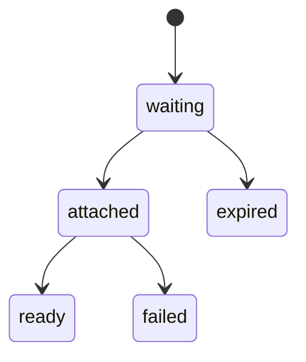

Module media giữ các lượt upload; catalog dùng cho ảnh tin đăng, chat cho ảnh trong tin nhắn và account cho ảnh đại diện.

## Object store

Ảnh nằm trên RustFS qua API S3, trong một bucket. Ảnh gốc nằm dưới một prefix riêng tư và chỉ ghi được qua presigned URL; ảnh đã xử lý nằm dưới một prefix đọc công khai. Server ký URL theo địa chỉ mà điện thoại truy cập được, cấu hình riêng với địa chỉ server tự dùng.

## Luồng upload

App xin một lượt upload với loại file (JPEG, PNG hoặc WebP) và dung lượng tối đa 15 MB, rồi nhận một URL PUT có hạn 15 phút. App upload file thẳng lên store, nên byte của ảnh không đi qua API. Lượt upload vẫn waiting sau 24 giờ thì bị xóa cùng object.

Sau đó tin đăng hoặc tin nhắn gắn các lượt upload vào mình, gắn hết hoặc không gắn cái nào. Gắn lại một upload đã thuộc về mình thì vẫn qua, nên request thử lại vẫn chạy.

## Xử lý ảnh

Một flow Restate kiểm tra loại file thật, từ chối ảnh trên 40 megapixel trước khi giải mã, rồi tạo một JPEG cạnh dài tối đa 1600 px và một thumbnail 400 px. Mã hóa lại thì bỏ hết EXIF, kể cả GPS. Mỗi process giải mã hai ảnh cùng lúc. Ảnh gốc bị xóa sau khi xong. Ảnh đại diện dùng dạng vuông: phần giữa ảnh, tối đa 400 px mỗi cạnh, không có thumbnail.

Tin đăng lưu key của object, còn URL được ghép lúc đọc từ một base URL công khai.

## Ảnh có dấu thời gian

Mô hình sản phẩm muốn ảnh mang thời điểm chụp. Phần này chưa làm: lúc xử lý, thời điểm chụp bị bỏ cùng phần EXIF còn lại.
