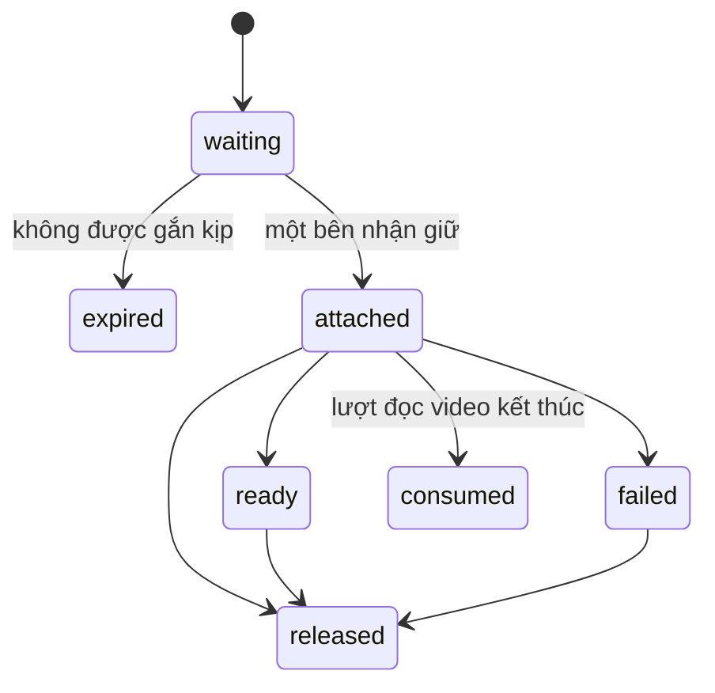

Module media giữ các lượt upload: ảnh tin đăng, ảnh tin nhắn, ảnh đánh giá, ảnh đại diện, cùng video và ảnh chép về cho các lượt AI đọc tin đăng. Media không đọc bảng của module nào khác; mỗi bên giữ upload tự nêu các upload của mình.

## Object store

File nằm trên RustFS qua API S3, trong một bucket:

- `uploads/<id>` là riêng tư, chỉ ghi được qua presigned PUT. Ảnh gốc giữ EXIF và GPS ở đây.
- `media/` cho đọc công khai: ảnh đã xử lý và thumbnail.

URL được ký theo địa chỉ mà điện thoại truy cập được, và chữ ký bao cả host. CORS của bucket cho website upload thẳng từ trình duyệt.

## Trạng thái upload

Upload đã expired, consumed hoặc released không bao giờ được gắn lại.

## Upload và hết hạn

`POST /v1/uploads` nhận loại file và dung lượng: JPEG, PNG hoặc WebP tối đa 15 MB, hoặc MP4 hay QuickTime tối đa 50 MB. Nó trả một URL PUT có hạn 15 phút, ký cả hai giá trị đó. Client upload thẳng lên store; byte của file không bao giờ đi qua API.

Upload ở trạng thái waiting hết hạn 24 giờ sau khi tạo, rồi một job xóa nó cùng object. Bản nháp tin đăng có thể gia hạn ảnh của mình tới 30 ngày kể từ lúc đó, gia hạn hết hoặc không ảnh nào. Không gì rút ngắn hạn, nên một ảnh dùng chung cho hai bản nháp sống tới khi bản nháp hết hạn sau cùng. Job hết hạn tự hẹn lại khi thấy hạn đã dời.

## Gắn upload

Một bên giữ, như tin đăng hay tin nhắn, gắn các upload của mình, gắn hết hoặc không cái nào. Mỗi upload phải thuộc về chủ của bên giữ, và hoặc đã thuộc bên giữ, hoặc đang waiting và có trong store với đúng loại và dung lượng đã khai. Ngược lại thì trả `invalid_upload`. Upload mà bên giữ đã có thì vẫn qua, nên gắn lại vẫn thành công.

## Xử lý

Một bước durable xử lý một upload, khóa theo ID của nó, nên các bên gọi dùng chung một lượt chạy và lần gọi lặp trả kết quả đầu tiên.

1. Kiểm tra magic bytes so với loại file đã khai.
2. Từ chối ảnh trên 40 megapixel hoặc 160 MB pixel sau giải mã, đọc từ header trước khi giải mã.
3. Tạo một JPEG đứng thẳng, cạnh dài tối đa 1600 px, và một thumbnail 400 px.
4. Ghi cả hai dưới `media/`. Mã hóa lại thì bỏ hết EXIF, kể cả GPS.
5. Lưu upload thành ready, hoặc failed kèm lý do, rồi xóa ảnh gốc.

Mỗi process server giải mã hai ảnh cùng lúc. Byte của ảnh không bao giờ vào journal của flow.

| Dạng | Kết quả | Dùng cho |
|---|---|---|
| photo | 1600 px kèm thumbnail 400 px | Tin đăng, tin nhắn, đánh giá |
| square | Cắt phần giữa, tối đa 400 px, không có thumbnail | Ảnh đại diện |
| query | 768 px, không lưu gì | Tìm bằng ảnh |

Flow của tin đăng và tin nhắn xử lý mọi upload cùng lúc rồi chờ. Ảnh đại diện và ảnh đánh giá chờ xử lý xong rồi request mới trả lời.

## Nhả upload

Bên giữ nhả các upload mà nó không còn hiện: ảnh bị bỏ khi sửa tin, hoặc ảnh của tin đã xóa trừ ảnh bìa. Ảnh gốc bị xóa ngay, vì nó mang EXIF và GPS. Bản công khai bị xóa 24 giờ sau, để các trang đã cache vẫn tải được. Hiện chỉ tin đăng nhả upload; object của tin nhắn, đánh giá và ảnh đại diện cũ vẫn còn.

## Ảnh và video do server tạo

Server có thể tự ghi một ảnh và chèn một upload waiting cho người bán, rồi tin đăng gắn nó như mọi upload khác. Nguồn của nó là `app`, `frame` (từ video), `link` (chép từ trang khác; tin đăng đánh dấu là ảnh chép) hoặc `listing` (chép từ tin đăng khác của chính người bán).

Video chỉ dùng cho lượt AI đọc video. Gắn, dạng square và tìm kiếm đều từ chối video với `invalid_upload`. Lượt đọc giữ video, rồi dùng hết nó, tức là xóa object. Xem [Assist](/vi/architecture/assist).

Tìm bằng ảnh đọc một upload waiting của người gọi ở dạng query, nếu không thì trả `invalid_upload` (422). Ảnh bản nháp và màn xem lượt AI đọc nhận một URL GET đã ký của ảnh gốc, có hạn một giờ; ảnh chưa đăng không bao giờ thành công khai.
