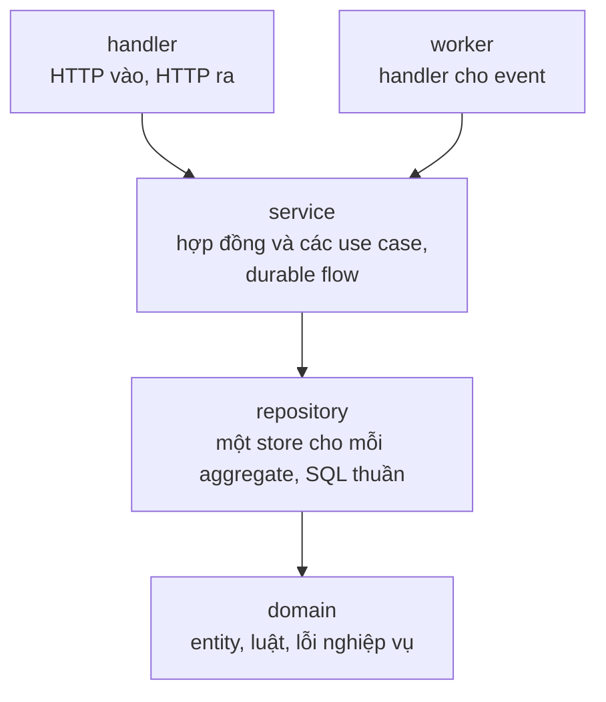

Server là một binary gồm các module. <Req id="ADR-0005" /> Cách chia module bám theo mô hình của hệ thống, một chợ C2C đồ cũ trả tiền khi nhận hàng (COD). ShopNexus không giữ tiền, nên không có module thanh toán hay tài chính.

## Các module

| Module | Giữ gì |
|---|---|
| account | Hồ sơ, tạm khóa tài khoản, địa chỉ, chặn và theo dõi, và đăng nhập: danh tính số điện thoại, Google và email cùng phiên đăng nhập của từng thiết bị |
| catalog | Tin đăng từ bản nháp tới khi bán, danh mục, tỉnh thành và phường/xã, và vector của tin đăng |
| media | Ảnh tải lên, việc xử lý chúng thành ảnh công khai và ảnh thu nhỏ, và việc hết hạn của chúng |
| deal | Trả giá và đơn COD |
| shipping | Tài khoản GHN và GHTK của người bán, vận đơn và báo cáo của hãng |
| chat | Cuộc trò chuyện giữa hai người và tin nhắn trong đó |
| trust | Đánh giá, hồ sơ công khai của người bán, tín hiệu lừa đảo và báo cáo vi phạm |
| discovery | Tìm kiếm với feed gần bạn là một cách sắp, tin đã lưu, lịch sử tìm kiếm và theo dõi tìm kiếm |
| assist | Đọc ảnh hoặc video thành bản nháp tin đăng, viết bản nháp cho tin nhập từ Chợ Tốt, và bảng giá tham khảo |
| chotot | Trang cá nhân Chợ Tốt mà người bán đã liên kết và các tin đăng đưa sang từ đó |
| notification | Danh sách thông báo trong ứng dụng, thông báo đẩy và email |
| support | Phiếu hỗ trợ, được trả lời trong một cuộc trò chuyện với ShopNexus |
| feedback | Những gì mọi người góp ý với ShopNexus mà không cần trả lời |
| console | Tài khoản điều phối viên và quản trị viên, phiên đăng nhập và vai trò của họ, và API của trang điều hành |
| agent | Cuộc trò chuyện và các lần chạy của trợ lý AI trên trang điều hành, endpoint MCP của nó, và cài đặt AI |
| ai | Các mô hình server tự chạy: chuyển giọng nói thành văn bản, vector ảnh, khung hình video |
| erasure | Xóa tài khoản |
| beacon | Lỗi script, tốc độ trang và các báo cáo khác từ client, dưới dạng metric và log |
| screen | Mỗi màn hình của ứng dụng hoặc website một lần đọc, ghép từ các module khác |

Không có module xác minh danh tính: số điện thoại đã xác minh là đủ, vì hãng vận chuyển kiểm tra danh tính người bán khi mở tài khoản cho họ. Uy tín cũng không có module hay bảng riêng; screen đọc các số liệu từ những module giữ chúng. `billing`, cho gói đẩy tin và gói người bán, là module dự kiến làm tiếp.

Cạnh các module có hai vùng dùng chung. Platform chứa phần mà module nào cũng dùng: config, Postgres, helper cho Restate, event bus, helper HTTP, live socket, lỗi, ngôn ngữ và telemetry. Provider bọc các dịch vụ bên ngoài: Firebase, Google, thông báo đẩy, email, các hãng vận chuyển, Chợ Tốt, Bifrost và các mô hình embedding.

## Bên trong một module

Một module có tối đa năm tầng, và lời gọi chỉ đi một chiều, từ trên xuống:

- Domain chứa entity cùng luật của nó, và các lỗi nghiệp vụ mà client thấy được.
- Repository nạp và lưu từng aggregate một.
- Service là hợp đồng của module. Mỗi use case là một method. Vài use case cần sống sót qua crash chạy dưới dạng Restate service.
- Handler đổi request HTTP thành một lời gọi service, không tự thêm luật nào.
- Worker, ở module phản ứng với event, giữ một handler Restate cho mỗi loại event nó nghe.

Screen, erasure và beacon không giữ bảng nào, nên chỉ có service và handler.

## Luật giữa các module

<KeyRules>
- Module chỉ gọi module khác qua service của module đó.
- Module không bao giờ đọc hay ghi bảng của module khác.
- Module báo một thay đổi bằng event và không bao giờ liệt kê ai sẽ phản ứng.
- Không module nào gọi screen hay erasure. Chỉ screen được gọi notification; notification nghe các module khác qua event.
- Module cần lời gọi theo chiều ngược với một lời gọi đã có thì được truyền vào, như deal truyền chính nó cho shipping, nên không có hai module nào import lẫn nhau.
</KeyRules>

Một bài test từ chối mọi import đi ngược thứ tự tầng hay vi phạm các luật trên. Vì mọi lời gọi đều đi qua hợp đồng service, sau này có thể tách một module ra process riêng, đặt sau một client mạng cài đặt đúng hợp đồng đó. Tách bảng của nó ra khỏi database chung là việc riêng.

## Một binary, hai vai trò

Cùng một binary chạy ở hai vai trò. Vai trò API phục vụ HTTP, endpoint Restate và MCP, và không nạp mô hình nào. Vai trò ai chỉ phục vụ các mô hình của module ai và không mở database. Ở local, một process làm cả hai. Trong cụm máy chủ, vai trò ai là một deployment riêng, nên bộ nhớ và thời gian khởi động của mô hình không bao giờ làm chậm API. Các module gọi module ai qua Restate, nên chúng không cần biết nó chạy ở đâu.
