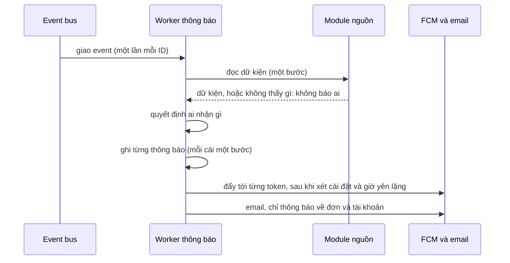

Module notification báo cho người dùng về deal, đơn, tin đăng, đánh giá, tìm kiếm đã lưu và tài khoản của họ <Req id="FR-SHR-02" />. Mọi ca sử dụng cần báo cho ai đó đều gọi chung một luồng này <Req id="UC-SHR-03" />. Nó tới người dùng theo ba đường:

- **Danh sách**: các thông báo trong màn thông báo của ứng dụng, kèm số chưa đọc.
- **Thông báo đẩy**: Firebase Cloud Messaging tới điện thoại Android và tới trình duyệt trên website.
- **Email**: chỉ thông báo về đơn và thông báo về tài khoản.

Mọi thứ bắt đầu từ một [event](/vi/architecture/events). Không module nào gọi notification, trừ module screen đọc số chưa đọc cho màn Home và `GET /v1/me/unread`.

## Từ event tới thông báo

Một worker durable có một handler cho mỗi loại event. Mỗi handler chạy cùng các bước:

Mỗi bước được ghi journal, nên server sập thì chạy tiếp sau bước xong cuối cùng và không lặp lại thông báo đẩy hay email nào <Req id="NFR-MSG-01" />. Nếu module nguồn không còn thứ mà event nói tới (một tìm kiếm đã lưu bị xóa, một tin đăng bị gỡ), handler không báo ai.

## Event nào gửi thông báo

| Event | Ai nhận | Thông báo | Công tắc đẩy | Email |
|---|---|---|---|---|
| `deal.moved`: giá đề nghị, phản giá | bên kia, trừ khi họ bỏ qua cuộc trò chuyện của cặp | `offer`, `counter` | offers | không |
| `deal.moved`: chấp nhận giá, từ chối, hủy | bên kia | `agreed`, `declined`, `agreement_cancelled` | offers | không |
| `deal.moved`: đổi giá, tắt trả giá, tin đóng | người mua | `offer_voided` | offers | không |
| `deal.moved`: yêu cầu COD, đã gửi, hoàn tất, giao không thành, đã hủy | bên kia; thêm người bán khi hệ thống hoàn tất đơn, giao không thành hoặc một mốc quá hạn hủy đơn | `cod_requested`, `shipped`, `completed`, `failed`, `order_cancelled` | orders | khi `order_emails` bật |
| `deal.moved`: giao không thành vì thất lạc | cả hai bên: người bán được nhắc yêu cầu bồi thường trên tài khoản hãng của mình, người mua được báo không phải trả gì | `parcel_lost` | orders | khi `order_emails` bật |
| `message.sent` | thành viên kia | chỉ đẩy, không vào danh sách | messages | không |
| `listing.published` | người bán | `listing_live` | không có | không |
| `listing.published`, lần đầu | từng người theo dõi | `followed_listing` | followed | không |
| `listing.rejected` | người bán | `listing_rejected` | không có | không |
| `review.posted` | người được đánh giá, khi đánh giá đã hiện | `review` | reviews | không |
| `review.replied` | người đánh giá | `review_reply` | reviews | không |
| `account.suspended`, `account.unsuspended` | tài khoản đó | `suspended`, `unsuspended` | không có | luôn gửi |
| `search_watch.matched` | chủ tìm kiếm đã lưu | `watch_matched` | chuông riêng của tìm kiếm đó | không |
| `saved.price_dropped` | người đã lưu tin | `price_dropped` | price_cuts | không |
| `feedback.moved`, `feedback.replied` | người gửi góp ý | `feedback_moved`, `feedback_replied` | không có | không |
| `chotot_link.imported`, `chotot_import.sold` | người bán | `chotot_imported`, `chotot_sold_here` | không có | không |

Rút giá đề nghị thì không báo ai. Tài khoản bị tạm khóa vẫn nhận thông báo, để biết mình bị tạm khóa.

Mỗi thông báo mang một đích, tức màn nó mở: thông báo về đơn mở chính đơn đó (một deal có thể có các đơn trước ngoài đơn mới nhất), thông báo về giá mở deal, thông báo về tin đăng mở tin, thông báo tìm kiếm đã lưu mở tìm kiếm đó.

### Tin nhắn

Tin nhắn chỉ được đẩy, không vào danh sách, vì hộp thư đã liệt kê nó. Thông báo đẩy hiện tên người gửi và 100 ký tự đầu. Tin nhắn trong cuộc trò chuyện mà người nhận bỏ qua thì không đẩy gì, và người gửi không được báo. Tin nhắn deal cũng không đẩy gì: thông báo riêng của deal đã báo lượt đó.

Trong cuộc trò chuyện hỗ trợ, câu trả lời của nhân viên chỉ đẩy tới chủ phiếu hỗ trợ, với tiêu đề ShopNexus, và mở phiếu đó. Tin nhắn của chủ phiếu gửi ShopNexus không đẩy gì.

### Đánh giá

Đánh giá có thể bị ẩn một thời gian sau khi đăng (xem [Trust](/vi/architecture/trust)). Handler của đánh giá đang ẩn chờ tới khi đánh giá hiện, rồi đọc lại. Khi đánh giá của bên thứ hai làm hiện đánh giá của bên thứ nhất, handler của nó báo cho cả hai người, còn handler của đánh giá thứ nhất không báo ai.

### Người bán được theo dõi đăng tin mới

Khi người bán đưa một tin lên bán lần đầu, người bán nhận thông báo tin đã lên, và từng người theo dõi nhận một thông báo `followed_listing`. Worker đọc người theo dõi mỗi lần 500 người và bắt đầu một job nhỏ cho mỗi người theo dõi, khóa theo event và người theo dõi, nên thử lại không báo ai hai lần. Mỗi job đọc lại tin đăng và không báo ai nếu tin không còn bán. Các thông báo này gộp theo người bán, nên một loạt tin mới chỉ để lại một thông báo chưa đọc.

Job phân phát ghi một mục journal cho mỗi người theo dõi. Với số người theo dõi hiện nay thì vậy là ổn; người bán có hàng chục nghìn người theo dõi sẽ cần chia job thành một chuỗi trang.

## Gộp và thứ tự

Thông báo về cùng một thứ được gộp theo một key, để danh sách không đầy các bước đã cũ:

| Key | Bao gồm |
|---|---|
| deal | mọi thông báo về deal và đơn |
| tin đăng | tin đã lên và bị từ chối |
| người bán | tin mới từ người bán được theo dõi |
| tìm kiếm đã lưu | kết quả khớp tìm kiếm đã lưu |
| tin đã lưu | giảm giá |

Thông báo mới thay thông báo **chưa đọc** có cùng key của người nhận, giữ ID của nó và đẩy nó lên đầu. Thông báo đã đọc thì giữ nguyên, và thông báo mới bắt đầu một dòng mới. Mỗi key có tối đa một thông báo chưa đọc <Req id="BR-SHR-02" />.

Hai trường hợp chạy đua được chặn:

- **Event tới muộn.** Event cũ hơn thông báo mới nhất của key đó ở người nhận, đã đọc hay chưa, thì không ghi gì và không đẩy gì. Lần giao trễ không kéo lại nội dung cũ, cũng không hiện lại thành thông báo chưa đọc mới.
- **Event được giao lại.** Thông báo ghi ID của event, nên lần giao thứ hai không ghi gì.

Thông báo được đẩy lên lần cuối quá 90 ngày thì bị xóa. Bước dọn dẹp chạy khi người nhận có thông báo mới, và còn dọn tối đa 100 thông báo cũ của bất kỳ ai, nên tài khoản im lặng cũng được dọn.

## Đọc danh sách

| Endpoint | Làm gì |
|---|---|
| `GET /v1/notifications` | Thông báo của người gọi, mới nhất trước, kèm số chưa đọc. |
| `POST /v1/notifications/{id}/read` | Đánh dấu một thông báo đã đọc. |
| `POST /v1/notifications/read-all` | Đánh dấu tất cả đã đọc và trả mọi ID nó đã đổi. |
| `POST /v1/notifications/unread` | Đưa 1 tới 500 thông báo đã đọc về chưa đọc. |

Đánh dấu chưa đọc dùng cho cả một thông báo riêng lẻ và việc hoàn tác đọc tất cả; hoàn tác hơn 500 thông báo thì gửi thành nhiều phần. Trong các thông báo đã đọc có chung key, chỉ thông báo mới nhất thành chưa đọc, và không thông báo nào nếu key đó đã có thông báo chưa đọc.

Mỗi thông báo mới hoặc được đẩy lên ghi một cập nhật `notification` trên [luồng cập nhật trực tiếp](/vi/api/live-updates), nên ứng dụng đang mở làm mới danh sách và huy hiệu.

## Thông báo đẩy

Một push token thuộc về một phiên đăng nhập. `PUT /v1/me/push-token` đưa token của phiên, còn `DELETE` quên nó.

- Đưa một token thì lấy nó khỏi mọi phiên khác đang có nó. Điện thoại đăng nhập tài khoản thứ hai sẽ thôi nhận thông báo đẩy của tài khoản thứ nhất.
- Trước mỗi lần đẩy, worker hỏi phiên nào của người nhận còn hoạt động và xóa token của các phiên còn lại. Một lần đọc bao cả đăng xuất, thu hồi, dùng lại refresh token, hết hạn và 30 ngày không dùng (xem [Phiên đăng nhập](/vi/architecture/sessions)).
- Mỗi token được gửi trong một bước riêng, nên thử lại không lặp lại lần gửi nào khác. Lỗi "unregistered" hoặc "invalid argument" của FCM thì xóa token. Giới hạn tần suất, lỗi server và lỗi mạng được thử lại tới một giờ. Lỗi khác thì ghi log và bỏ.

Thông báo đẩy của một thông báo mang tag `notification:<id>`. Vì thông báo được đẩy lên giữ ID, thông báo đẩy mới hơn thay bản cũ trong khay của điện thoại, và ứng dụng xóa mục trong khay khi thông báo được đọc trong ứng dụng. Thông báo đẩy của tin nhắn mang `conversation:<id>` theo cùng cách.

Website cũng nhận thông báo đẩy. Trình duyệt đưa FCM token như điện thoại, và cùng một message mang một khối web push với cùng tag. Service worker của site mở trang theo đích của thông báo đẩy trên origin của chính nó.

Không có credential FCM thì server chỉ ghi log thay cho thông báo đẩy, và production từ chối khởi động như vậy.

## Cài đặt và giờ yên lặng

`GET` và `PUT /v1/me/notification-settings` giữ một document. `PUT` thay toàn bộ và trả lại nó.

| Cài đặt | Mặc định | Tác dụng |
|---|---|---|
| `messages` | bật | thông báo đẩy tin nhắn, kể cả câu trả lời hỗ trợ |
| `offers` | bật | giá đề nghị, phản giá, chốt giá và giá đề nghị bị hủy |
| `orders` | bật | thông báo đẩy về đơn |
| `price_cuts` | bật | giảm giá trên tin đã lưu |
| `followed` | bật | tin mới từ người bán được theo dõi |
| `reviews` | bật | đánh giá mới và trả lời đánh giá |
| `order_emails` | bật | email cho thông báo về đơn |
| giờ yên lặng `{on, from, to}` | bật, 22:00 tới 07:00 | không đẩy trong khung giờ này |

- Công tắc tắt chỉ chặn thông báo đẩy. Thông báo vẫn vào danh sách <Req id="BR-SHR-01" />. Vì tin nhắn không bao giờ vào danh sách, tin nhắn khi `messages` tắt không tới điện thoại nào.
- Thông báo không có công tắc (tin đã lên hoặc bị từ chối, tạm khóa, góp ý, Chợ Tốt) luôn được đẩy, theo giờ yên lặng. Thông báo đẩy của tìm kiếm đã lưu theo chuông riêng của từng tìm kiếm.
- Giờ yên lặng dùng giờ Việt Nam, dạng HH:MM, và có thể qua nửa đêm. Thông báo đẩy bị giờ yên lặng chặn thì bị bỏ, không hoãn; thông báo vẫn ở trong danh sách. `from` bằng `to` thì trả 400 `invalid_quiet_hours`.
- Tài khoản chưa từng lưu cài đặt thì đọc được giá trị mặc định, và việc đọc không lưu gì.

## Email

Chỉ hai nhóm được gửi email. Thông báo về đơn (yêu cầu COD, đã gửi, hoàn tất, giao không thành, thất lạc, đã hủy) được gửi email khi `order_emails` bật. Thông báo tạm khóa luôn được gửi email. Mọi thông báo khác chỉ có ý nghĩa trong vài phút, và gửi email cho chúng sẽ khiến nhà cung cấp email xếp thư của hệ thống, kể cả mã OTP đăng nhập, vào thư rác.

Email bỏ qua công tắc đẩy và giờ yên lặng. Tài khoản không có địa chỉ email (chỉ có số điện thoại, hoặc đã bị xóa dữ liệu) không nhận email. Lần gửi chạy trong một bước riêng khóa theo event, người nhận và thông báo, nên chỉ gửi một lần; bị từ chối thì ghi log và bỏ, lỗi khác thử lại trong một giờ. Email quảng cáo, nếu sau này có, phải mặc định tắt và xin đồng ý.

## Ngôn ngữ

Thông báo chỉ lưu loại và tham số, không bao giờ lưu câu chữ, nên cùng một thông báo đọc được ở mọi ngôn ngữ. Tiếng Việt là mặc định, và có hỗ trợ tiếng Anh.

- Danh sách được viết theo ngôn ngữ của mỗi request `GET /v1/notifications`.
- Thông báo đẩy hoặc email được viết theo ngôn ngữ của người nhận, mà mỗi lần đăng nhập ghi lại từ header ngôn ngữ của ứng dụng.
