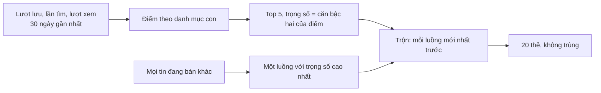

Module screen phục vụ một `GET` cho mỗi màn của ứng dụng. Ứng dụng đọc một màn bằng một lần gọi. Sau một [cập nhật từ stream](/vi/api/live-updates), nó tải lại màn đang hiện cũng bằng một lần gọi. Mobile và desktop đọc cùng các màn. Trang desktop hiện hai màn thì gọi cả hai cùng lúc.

## Một màn được dựng thế nào

Screen không có bảng nào. Mỗi màn đọc service của các module khác từ trên xuống dưới và đặt các kết quả cạnh nhau. Không module nào được phụ thuộc vào screen, nên screen không thêm liên kết nào giữa các module khác.

Mỗi màn gọi một số lượng service cố định cho mỗi trang, dù trang lớn hay nhỏ. Các service đọc người, phường/xã và tin đăng của một trang bằng một query cho mỗi loại.

Mỗi loại dữ liệu chỉ có một đường đọc. Không resource nào mang trường dành riêng cho một màn, và không có endpoint thứ hai trả về cùng một thứ. "Xem thêm" dùng các endpoint danh sách thông thường, trả về cùng dạng item với màn: `/v1/sellers/{id}/listings`, `/v1/sellers/{id}/reviews` và `/v1/conversations/{id}/messages`.

Giá trị phụ thuộc vào request, như khoảng cách tới người đọc, nằm cạnh resource chứ không nằm trong nó. Một tin đăng đọc ra giống nhau với mọi người gọi và mọi endpoint.

## Các màn

Màn mở cho mọi người cũng nhận người đọc đã đăng nhập, và khi đó thêm các trường của riêng người đọc đó.

| Màn | Đường dẫn | Ai | Chứa gì |
|---|---|---|---|
| Home | `/v1/screens/home` | mọi người | Cây danh mục, trang đầu của feed gần bạn, Dành cho bạn, Đã xem gần đây, số thông báo chưa đọc |
| Tin đăng | `/v1/screens/listing/{id}` | mọi người | Tin công khai, tóm tắt người bán, khoảng cách, cùng lượt lưu, deal và cuộc trò chuyện của người đọc |
| Tin đã bán | `/v1/screens/sold-listing/{id}` | mọi người | Món đã bán, cho các liên kết cũ |
| Người bán | `/v1/screens/seller/{id}` | mọi người | Hồ sơ người bán, trang đầu tin đăng và đánh giá, trạng thái chặn và theo dõi |
| Hộp thư | `/v1/screens/inbox` | đã đăng nhập | Một trang cuộc trò chuyện, mỗi cuộc kèm một deal, và tổng số chưa đọc |
| Tìm trong hộp thư | `/v1/screens/inbox/search` | đã đăng nhập | Các cuộc trò chuyện khớp, kèm deal của hai người |
| Cuộc trò chuyện | `/v1/screens/chat/{conversation_id}` | hai bên trò chuyện | Cuộc trò chuyện, các deal của hai người, trang tin nhắn đầu tiên |
| Giá đề nghị | `/v1/screens/offers` | đã đăng nhập | Các giá đề nghị đang mở chờ người bán trả lời, kèm từng người mua |
| Tin của bạn | `/v1/screens/my-listings` | đã đăng nhập | Tin của người bán theo từng ngăn |
| Danh sách đơn, đơn | `/v1/screens/orders`, `/v1/screens/order/{order_id}` | đã đăng nhập | Đơn của người gọi, ở vai người mua hoặc người bán |
| Thiết lập COD, đặt COD | `/v1/screens/cod-setup`, `/v1/screens/cod-checkout/{deal_id}` | đã đăng nhập | Những gì form COD cần |
| Hoàn thiện hồ sơ | `/v1/screens/profile-tasks` | đã đăng nhập | Bốn bước hồ sơ và bước nào đã xong |
| Uy tín của bạn | `/v1/screens/reputation` | đã đăng nhập | Số liệu và hạn mức của chính người gọi |
| Số chưa đọc | `/v1/me/unread` | đã đăng nhập | Tin nhắn chưa đọc, thông báo chưa đọc và giá đề nghị đang mở chờ người gọi |

Màn đơn, màn COD và màn quản lý tin được mô tả cùng các module [deal](/vi/architecture/deal), [shipping](/vi/architecture/shipping) và [catalog](/vi/architecture/catalog).

### Tin đăng và tin đã bán

Màn tin đăng chỉ hiện tin công khai (đang bán hoặc đang giữ chỗ). Tin ở trạng thái khác trả 404 với mọi người, kể cả người bán; người bán đọc tin của mình qua `GET /v1/listings/{id}`. Với người đọc đã đăng nhập mà không phải người bán, màn thêm `viewer`: đã lưu hay chưa, deal của người đọc trên tin, và cuộc trò chuyện của họ với người bán. Khi có vị trí (`near_lat`/`near_lng` hoặc `near_commune`), màn thêm `distance_km`.

Tóm tắt người bán gồm điểm đánh giá, `reply_time` và `phone_verified`. Bản thân số điện thoại không bao giờ hiện ra. Các số liệu này được giải thích ở trang [Trust](/vi/architecture/trust#uy-tín).

Màn tin đã bán giữ cho liên kết cũ còn dùng được. Màn hiện tiêu đề, giá, danh mục, tình trạng, nơi bán, ảnh và lúc bán, rồi dẫn tới các tin tương tự. Màn không có người bán, mô tả, thông số hay trường `viewer`, và không tính lượt xem. Trạng thái khác trả 404. Tin mà hệ thống đã ẩn sau khi bán cũng trả 404. Tin đã bán của người bán đã xóa tài khoản cũng vậy: việc xóa dữ liệu giữ tin đó cho đơn của người mua, không phải cho công chúng. Màn này tách riêng vì ứng dụng hiểu 404 của màn tin đăng là "có thể là tin của mình" và chuyển sang đọc theo đường của người bán.

### Người bán

Màn người bán gồm hồ sơ công khai (tên, ảnh đại diện, giới thiệu, ngày tham gia, điểm đánh giá, số tin đang bán và đã bán, số người theo dõi, thời gian trả lời, số điện thoại đã xác minh), trang đầu tin công khai của người bán dưới dạng thẻ tìm kiếm, và trang đầu đánh giá. Người đọc đã đăng nhập nhận thêm `blocked`, `following` và cuộc trò chuyện của họ với người bán. `blocked` là true khi có chặn theo bất kỳ chiều nào.

Thẻ tin đăng hoạt động như khi tìm kiếm: có `saved` với người đọc đã đăng nhập, có `distance_km` khi có vị trí, và bỏ các tin người đọc đã ẩn.

### Hộp thư và cuộc trò chuyện

Mỗi dòng hộp thư mang một deal của hai người, chọn theo thứ tự:

1. Deal mới nhất đang tới lượt người gọi.
2. Nếu không có, deal active mới nhất (đang trả giá hoặc đã chốt giá).
3. Nếu không nữa, deal mới nhất.

"Mới nhất" tính theo lượt trả giá mới nhất; deal chưa có lượt nào thì tính từ lúc mở. Luật tới lượt thuộc module deal. Trên deal đã chốt giá, chỉ tới lượt người mua khi tin còn đang bán, vì yêu cầu COD trên tin đang ẩn hoặc đang giữ chỗ bị từ chối. Mỗi dòng cũng đếm các deal active khác của hai người.

Màn cuộc trò chuyện liệt kê các deal của hai người, mới nhất trước, theo lúc mở. Màn thêm `blocked` (theo bất kỳ chiều nào) để ứng dụng tắt ô soạn tin, và mốc đã đọc của người kia để ứng dụng hiện "Đã xem". Mốc này vẫn hiện khi đang chặn. Người không ở trong cuộc trò chuyện nhận `conversation_not_found`.

Màn hộp thư, tìm trong hộp thư và cuộc trò chuyện mang [cảnh báo lừa đảo](/vi/architecture/trust#cảnh-báo-lừa-đảo) của từng cuộc trò chuyện, đọc một lần cho mỗi trang.

### Hoàn thiện hồ sơ

Màn liệt kê bốn bước theo thứ tự cố định, mỗi bước có `done`:

- `address`: sổ địa chỉ có một địa chỉ.
- `bio`: phần giới thiệu không trống.
- `phone`: tài khoản có số điện thoại.
- `avatar`: tài khoản có ảnh đại diện.

Màn cũng trả về tài khoản và địa chỉ mặc định của người gọi. Ứng dụng đếm số bước và lấy bước đầu tiên chưa xong làm bước tiếp theo. Thiết lập COD không phải một bước, vì người chỉ mua thì không bao giờ thiết lập nó.

### Số chưa đọc

`GET /v1/me/unread` trả về tổng tin nhắn chưa đọc (đếm như hộp thư), số thông báo chưa đọc và số giá đề nghị đang mở chờ người gọi ở vai người bán. Một lần gọi điền mọi số đếm trên biểu tượng. Screen phục vụ endpoint này vì chat không được phụ thuộc vào notifications.

## Home

Home chạy được khi đã đăng nhập hay chưa. Màn trả về:

- Cây danh mục, không có số tin. Đếm mọi tin đang bán mỗi lần mở là query bận nhất trong một lần load test, cho những con số người dùng không đọc.
- Trang đầu của feed gần bạn, giống `GET /v1/search?sort=nearby` với cùng vị trí và `radius_km` (1 tới 200, mặc định 50). Khi không có vị trí, `nearby` trống và không có trang tiếp.
- **Dành cho bạn**: một trang 20 thẻ tin, không phân trang.
- **Đã xem gần đây**: một danh mục con và tối đa 10 thẻ từ danh mục đó.
- Số thông báo chưa đọc, là 0 khi chưa đăng nhập.

Cả hai danh sách cá nhân đều bỏ những gì tìm kiếm bỏ (tin người đọc đã ẩn và mọi người ở hai phía của một lần chặn), và bỏ tin của chính người đọc.

### Dành cho bạn

Feed cân sở thích của người đọc trong 30 ngày gần nhất. Mỗi tín hiệu cộng điểm cho một danh mục con:

| Tín hiệu | Điểm | Giới hạn |
|---|---|---|
| Một tin đã lưu | 3 | 100 lượt lưu mới nhất |
| Một lần tìm có chip đầu tiên là danh mục con | 2 | 10 lần tìm gần nhất |
| Một tin đã mở | 1 | 100 tin mở gần nhất |

Chip chỉ một danh mục gốc không cộng điểm. Chỉ 5 danh mục con nặng nhất được tính, để query vẫn nhanh với người quan tâm nhiều thứ.

Mỗi danh mục con được tăng điểm là một luồng tin đang bán trên toàn quốc, mới nhất trước, có trọng số bằng căn bậc hai của điểm. Căn bậc hai giữ cho một sở thích được xem nhiều lần không lấn hết các sở thích khác. Mọi tin còn lại tạo thêm một luồng, có trọng số bằng luồng nặng nhất.

Phần trộn xen kẽ các luồng theo trọng số. Tin thứ k của một luồng nhận vị trí (k − ½) ÷ trọng số, và trang sắp theo vị trí. Một sở thích duy nhất chiếm nửa trang, nửa còn lại là tin mới; hai sở thích bằng nhau mỗi cái chiếm một phần ba. Khách, hoặc tài khoản chưa có tín hiệu, nhận các tin mới nhất.

### Đã xem gần đây

Feed lấy ngày gần nhất người đọc mở tin, và danh mục con mà phần lớn tin mở hôm đó thuộc về. Các thẻ là tin đang bán của danh mục con đó mà người đọc chưa mở, mới nhất trước, với cùng các loại trừ của feed. Feed vắng mặt khi chưa đăng nhập, khi không có lượt xem nào trong 30 ngày, hoặc khi không có tin nào như vậy.

## Sitemap của website

`GET /v1/sitemap/categories` liệt kê các danh mục con có ít nhất 5 tin đang bán. Website đọc nó mỗi giờ một lần cho sitemap và liên kết, để trang danh mục con quá thưa không vào máy tìm kiếm.
