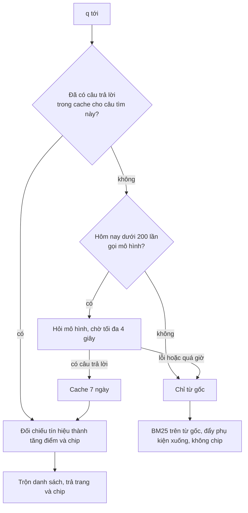
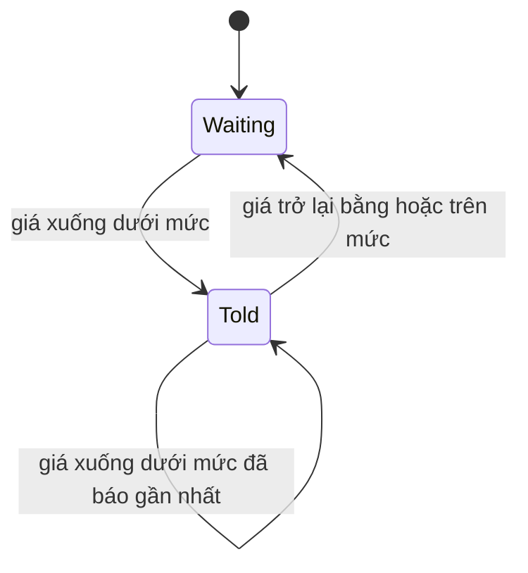
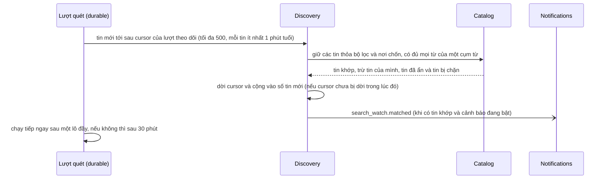

Tìm kiếm chia cho hai module. Catalog giữ tin đăng cùng index ParadeDB của chúng và chạy một câu truy vấn có cấu trúc: các bộ lọc phải thỏa, các cụm từ mà ít nhất một cái phải khớp, các mức tăng điểm cố định, và một cách sắp xếp. Discovery biến những gì người dùng gõ, một ảnh hoặc một tin đăng thành câu truy vấn đó, và giữ tin đã lưu, tin đã ẩn, lịch sử tìm kiếm và theo dõi tìm kiếm. Các feed trên Home nằm ở trang [Feed và lượt xem tin](/vi/architecture/feeds).

Index chạy trong transaction, nên tin tìm được ngay khi lệnh ghi commit. Chỉ tin đang bán hiện ra.

## Một endpoint, nhiều chế độ

Mọi thứ đi qua `GET /v1/search`. Tham số chọn chế độ, và các bộ lọc của người dùng (danh mục, tỉnh, người bán, khoảng giá, tình trạng, chỉ tin cho trả giá, vị trí và bán kính) áp dụng ở mọi chế độ.

| Chế độ | Tham số | Ai | Danh sách được trộn |
|---|---|---|---|
| Văn bản, đã đăng nhập | `q` | đã đăng nhập | BM25, vector văn bản, vector ảnh, tăng điểm |
| Văn bản, khách | `q` | khách | BM25 trên từ gốc, phụ kiện thiết bị bị đẩy xuống |
| Tin tương tự | `like` (có thể kèm `q`) | mọi người | BM25, vector văn bản, vector ảnh, tăng điểm |
| Ảnh | chỉ `photo` | đã đăng nhập | Chỉ vector ảnh |
| Theo dõi | `watch` | chủ của lượt theo dõi | như văn bản, đã đăng nhập |
| Duyệt | không có tham số nào ở trên | mọi người | không có: chỉ bộ lọc và sắp xếp |

`sort` là `relevance` (mặc định khi có `q`, `photo` hoặc `like`), `newest` (mặc định khi không có), `nearest`, `nearby`, `price_asc` hoặc `price_desc`. Các cách sắp xếp khác relevance sắp lại những tin mà lần tìm đã tìm được. `nearby` là feed trên Home và không nhận `q`, `photo` hay `like`. Kết quả phân trang bằng cursor theo offset và dừng ở 500 tin.

Mỗi phản hồi mang một `search_id` mới, mà client gửi lại cùng lượt hiển thị và lượt bấm.

## Đọc câu tìm

`q` của người đã đăng nhập được gửi tới một mô hình ngôn ngữ qua [cổng AI](/vi/architecture/ai), với một JSON schema chặt. Mô hình trả về tín hiệu, không trả về trọng số: cụm từ, danh mục, giá, tình trạng, nơi chốn, gần tôi, độ mới và trả giá, mỗi loại tối đa ba giá trị theo thứ tự ưu tiên. Nó cũng viết lại câu tìm bằng tiếng Việt đúng chính tả, cho vector văn bản, và một mô tả ngắn bằng tiếng Anh về hình dạng món hàng, cho vector ảnh. Mỗi giá trị được đối chiếu với dữ liệu thật (cây danh mục, tên tỉnh và phường/xã), không khớp thì bỏ. Mỗi tín hiệu đối chiếu được trở thành một chip mà người dùng tắt được. Mô hình chỉ đọc câu tìm; nó không bao giờ hành động thay người dùng. <Req id="BR-DSC-01" /> <Req id="FR-DSC-01" />

- **Cache.** Câu trả lời được cache theo câu tìm viết thường và phiên bản prompt trong 7 ngày. Cache không lưu tài khoản nào. Tắt một chip (`off=<id>`) thì dùng lại câu trả lời trong cache.
- **Gọi chung.** Các lần tìm cùng một câu dùng chung một lần gọi mô hình. Lần gọi chạy tách khỏi request, nên câu trả lời vẫn được cache dù người dùng đã rời đi.
- **Khi lỗi.** Câu tìm gốc luôn là một cụm từ với trọng số 0.5, trừ khi mô hình đã nêu nó. Mô hình lỗi hoặc chậm quá 4 giây thì để từ gốc tự tìm, không có chip. Trang đã tìm bằng từ gốc đánh dấu cursor của nó, và các trang sau cũng tìm bằng từ gốc, để kết quả không đổi giữa chừng.
- **Giới hạn mỗi ngày.** Câu tìm của một người tới mô hình tối đa 200 lần trong một ngày UTC. Câu trả lời từ cache không tính. Quá giới hạn thì tìm bằng từ gốc.

### Khách

`q` của khách bỏ qua mô hình và embedding: từ gốc chỉ tìm qua BM25, không có chip. Vector của khách, thường gõ không dấu, từng kéo về những tin không chung chữ nào. Nhờ vậy chi phí mô hình đi theo tài khoản, và tìm kiếm đầy đủ là một lý do để đăng nhập.

Từ gốc không có mô hình để đẩy phụ kiện xuống, mà tiêu đề ốp lưng thường kể mọi đời máy nó vừa, nên "iphone 12" sẽ ra ốp lưng trước. Mọi lần tìm trên từ gốc, của khách hay khi mô hình không trả lời, đẩy các danh mục phụ kiện thiết bị (`phones.accessories`, `camera.accessories`) xuống, trừ khi câu tìm nhắc tới phụ kiện ("ốp lưng", "cáp sạc", "tripod") hoặc bộ lọc danh mục đã chọn sẵn. Quy tắc chỉ đọc câu tìm và bộ lọc, nên mọi trang của lần tìm xếp như nhau.

Trang đầu của khách mang `preview_chips`: các chip của câu trả lời đã cache cho cùng câu tìm, khi một người đã đăng nhập tìm nó trong 7 ngày gần nhất. Lần tìm không áp dụng các chip này, và client hiện chúng ở dạng khóa cạnh nút đăng nhập. Bản xem trước không gọi mô hình nào.

Mỗi địa chỉ của khách chạy được 2 lần tìm có `q` mỗi giây, dồn tối đa 30 lần, sau đó nhận 429 `rate_limited`. Duyệt, `like` và trang danh mục không bị giới hạn, vì chúng không tới mô hình trả phí nào.

## Xếp hạng

BM25 chấm điểm các cụm từ. Một tiêu đề ngắn khớp được khoảng 1 tới 7 điểm, và các mức tăng điểm tính cùng đơn vị đó:

| Tín hiệu | Trọng số |
|---|---|
| Danh mục, giá | 1.5 |
| Tình trạng, trả giá | 0.75 |
| Độ mới | 1.0 trong 3 ngày, 0.5 trong 7 ngày |
| Khoảng cách | 1.25 trong 2 km, 0.75 trong 5 km, 0.4 trong 15 km |

Giá trị thứ hai và thứ ba của một tín hiệu được tính 0.5 và 0.33 trọng số. Một cụm từ khớp tiêu đề được gấp đôi trọng số, khớp mô tả và thông số được đúng trọng số, và khớp các từ trong tiêu đề dài từ 5 chữ cái trở lên với một lỗi gõ được một nửa.

Index giữ tiêu đề, mô tả và thông số hai lần: như khi viết, và đã bỏ dấu tiếng Việt. Từ gốc khớp với các trường đã bỏ dấu, nên "xe dap" tìm được "Xe đạp". Câu viết lại của mô hình có dấu, nên nó khớp với các trường như khi viết.

Khoảng cách và độ mới được chấm điểm ngay trong index, bằng các hộp phạm vi trên điểm vị trí và thời điểm đăng của tin. Cách sắp xếp `nearby` là cùng câu truy vấn nhưng không có cụm từ: tin trong bán kính, chỉ chấm theo các vòng khoảng cách và độ mới.

## Tìm kiếm lai

Khi có vector, lần tìm chạy tối đa bốn danh sách trong một câu lệnh SQL và trộn chúng bằng weighted reciprocal rank fusion với k = 60:

- **BM25** trên các cụm từ.
- **Vector văn bản**: câu viết lại (hoặc câu tìm gốc khi mô hình lỗi) so với vector văn bản của từng tin.
- **Vector ảnh**: mô tả hình dạng của mô hình, hoặc ảnh được tìm, so với ảnh của từng tin; một tin được tính theo ảnh gần nhất của nó.
- **Tăng điểm**: các tin của những danh sách kia, xếp chỉ theo điểm tăng.

Mỗi danh sách lấy tối đa 500 tin theo bộ lọc của người dùng. Một tin chỉ vào danh sách vector khi vượt một ngưỡng cosine, ngưỡng này thấp hơn khi so văn bản với ảnh. Lượt quét vector đi tiếp qua các dòng bị lọc bỏ, nên bộ lọc hẹp vẫn lấp đầy được danh sách vector.

| Chế độ | BM25 | Văn bản | Ảnh | Tăng điểm |
|---|---|---|---|---|
| `q` | 1.0 | 1.0 | 0.5 | 0.75 |
| `like` | 0.5 | 1.0 | 1.0 | 0.5 |
| `photo` | | | 1.0 | |

`like` nhận một tin đang bán hoặc đang giữ chỗ. Nó tìm bằng vector văn bản của tin đó, trung bình các vector ảnh của tin, tiêu đề của tin làm cụm từ, cùng mức tăng điểm cho danh mục con và khoảng giá ±30 %. Nó bỏ tin gốc và tin của chính người xem. <Req id="FR-DSC-02" />

`photo` nhận một ảnh tải lên đang chờ của người gọi. Nó chạy một mình, cần người gọi đã đăng nhập, và trả 503 `search_unavailable` khi ảnh không embed được.

Mô hình embedding lỗi thì danh sách của nó bị bỏ, nên tìm văn bản lùi về BM25.

Vector văn bản của câu tìm được cache theo mô hình embedding và văn bản đã chuẩn hóa, và bị bỏ khi không dùng (30 ngày không đọc, 180 ngày sau lần đọc cuối, cái ít dùng nhất đi trước khi quá 2.000.000 dòng). Cache có thể mất khi crash; khi đó các lần tìm embed lại. Vector của ảnh tìm kiếm được giữ tới khi ảnh tải lên hết hạn. Không ảnh tìm kiếm hay vector nào vào log hoặc journal.

## Bộ lọc và vị trí

- `province` giữ các tin có phường/xã thuộc tỉnh đó. Mã lạ trả 400 `invalid_province`. Index không giữ tỉnh, nên bộ lọc này chạy cạnh câu truy vấn index và chậm hơn khi duyệt rộng.
- `seller` giữ tin của một người bán, cho ô tìm trên trang người bán của website. Lần tìm như vậy không ghi lịch sử và không theo dõi được.
- Người tìm gửi `near_lat` và `near_lng`, hoặc `near_commune`. Cả hai đều không được lưu hay ghi log. `distance_km` là số km nguyên, cắt bỏ phần lẻ, với 0 nghĩa là dưới 1 km. `radius_km` từ 1 tới 200, mặc định 50, và `nearest` hoặc `nearby` khi không có vị trí trả `position_required`.
- Điểm vị trí của tin là GPS của người bán đã làm mờ (dời ngẫu nhiên tối đa 500 m, rồi khớp vào lưới khoảng 1 km), hoặc điểm của phường/xã. Điểm chính xác không vào dòng hay log nào.

### Những gì tìm kiếm bỏ ra

Lần tìm khi đã đăng nhập ở mọi chế độ, kể cả các feed trên Home, bỏ các tin người dùng đã ẩn và mọi tin của tài khoản ở hai phía của các lần chặn của họ. Trang người bán cũng bỏ các tin đã ẩn. Tin đã lưu và màn của chính tin đó vẫn hiện chúng.

`PUT /v1/hidden/{listing_id}` ẩn tin của người khác (409 `own_listing` với tin của mình) và `DELETE` hiện tin lại. Mỗi tài khoản giữ 1.000 lượt ẩn mới nhất; lượt ẩn tiếp theo hiện lại tin cũ nhất. Không endpoint nào liệt kê các tin đã ẩn.

## Lịch sử tìm kiếm

Trang đầu của lần tìm `q` khi đã đăng nhập được ghi lại sau khi lần tìm trả kết quả. Tìm bằng ảnh, `like` và tìm trên trang người bán, các trang sau và khách không ghi gì. Ghi lỗi thì được log và lần tìm vẫn trả kết quả.

Một mục giữ câu tìm như đã gõ, chip danh mục đầu tiên và ảnh thu nhỏ của thẻ đầu tiên. Chữ hoa, khoảng trắng và dấu tiếng Việt được gộp, nên "Xe Đạp" và "xe dap" là một mục. Tìm lại thì mục đó lên đầu. Mỗi người giữ 10 mục mới nhất. `GET /v1/search/history` liệt kê chúng, `DELETE /v1/search/history` xóa hết và `DELETE /v1/search/history/{id}` xóa một mục.

## Tin đã lưu và cảnh báo giảm giá

Người dùng lưu được tin đang bán hoặc đang giữ chỗ của người khác, tối đa 500 lượt lưu. Lượt lưu giữ giá ở thời điểm đó, và lưu lại thì không đổi gì. `GET /v1/saved` liệt kê tin còn bán trước, rồi tới tin đã bán, đang ẩn hoặc đã xóa, mỗi nhóm lượt lưu mới nhất trước. Tin đang ẩn hoặc đã xóa chỉ hiện trạng thái. Client hiện mức giá thay đổi kể từ lúc lưu. <Req id="UC-DSC-03" />

Mỗi lượt lưu có một mức cảnh báo: mức riêng (`PUT /v1/saved/{listing_id}/alert`, lưu tin trước nếu cần), hoặc giá lúc lưu khi chưa đặt mức nào. `DELETE` trên cảnh báo thì bỏ mức và giữ lượt lưu.

Một lượt lưu báo ở mỗi mức thấp mới dưới mức của nó, và chỉ khi đó. Discovery nghe `listing.published` và `listing.updated`, đọc giá hiện tại của tin, bỏ qua tin không đang bán, và ghi `saved.price_dropped` cho mỗi lượt lưu cần báo. Event tới trễ hoặc sai thứ tự được cân theo giá lúc handler chạy, và một bước chạy lại thấy lượt lưu đã ở giá đó thì không ghi gì. Notifications gửi thông báo đẩy trừ khi người dùng đã tắt mục giảm giá; bản thân thông báo luôn được ghi.

## Theo dõi tìm kiếm

Một lượt theo dõi đi theo một `q` cùng bộ lọc (danh mục, khoảng giá, tình trạng, chỉ tin cho trả giá) và một nơi chốn. `POST /v1/search/watches` tạo một lượt (201), hoặc, với cùng các từ đã gộp, cập nhật bộ lọc, giữ ID, đặt lại số đếm và trả 200. Mỗi tài khoản có tối đa 20 lượt theo dõi (`watch_limit_reached`). Lượt theo dõi giữ một phường/xã, không bao giờ giữ một điểm: điểm GPS được đổi thành phường/xã gần nhất. Nó lưu các cụm từ mà mô hình đọc ra lúc tạo, nên lượt quét không gọi mô hình. <Req id="UC-DSC-06" />

Discovery ghi lần đăng đầu tiên của mỗi tin vào bảng tin mới tới, đánh số theo thứ tự, và xóa các dòng cũ hơn 2 ngày. Nó không quét theo thời điểm đăng, vì thời điểm đó được đặt trước khi ảnh xử lý xong và một tin tới muộn sẽ bị sót. Mỗi lượt theo dõi có một lượt quét durable đọc bảng tin mới tới:

Lần chạy đầu được lên lịch với ID của lượt theo dõi làm idempotency key. Lượt theo dõi bị xóa thì chuỗi dừng, và tạo lại thì nhận ID mới cùng một chuỗi riêng. `/mute` và `/unmute` tắt và bật cảnh báo; lượt theo dõi đang tắt tiếng vẫn đếm.

`GET /v1/search?watch=<id>` chạy lượt theo dõi như một lần tìm đầy đủ; chỉ `cursor`, `limit`, `sort` và `off` được đi kèm. Trang đầu của nó đặt lại số tin mới. Lượt theo dõi của tài khoản khác trả `watch_not_found`. Phản hồi của lần tìm văn bản ghi lượt theo dõi câu tìm đó của người xem trong `watch_id`.

Khi người bán soạn một tin, phần gợi ý giá hỏi có bao nhiêu lượt theo dõi sẽ khớp với tin. Discovery trả tối đa 200 lượt theo dõi khớp của các tài khoản đang hoạt động (danh mục, tình trạng, khu vực và các từ của cụm từ, tách từ như index), mỗi lượt chỉ gồm khoảng giá và cờ chỉ tin cho trả giá, không có gì nêu tên người mua. Ứng dụng đếm chúng theo mức giá người bán gõ.

## Lỗi

| Mã | Khi nào |
|---|---|
| 400 `search_conflict` | `photo` cùng `q` hoặc `like`; `nearby` cùng `q`, `photo` hoặc `like`; `watch` cùng tham số khác; `province` hoặc `seller` trên lượt theo dõi |
| 400 `invalid_province`, `invalid_position`, `position_required` | Nơi chốn sai hoặc thiếu |
| 401 `unauthenticated` | `photo` hoặc `watch` khi chưa đăng nhập |
| 404 `listing_not_found`, `watch_not_found` | Tin `like` không tồn tại hoặc lượt theo dõi của tài khoản khác |
| 409 `own_listing`, `listing_unavailable` | Lưu hoặc ẩn tin của chính mình; lưu tin không đang bán hay đang giữ chỗ |
| 409 `saved_limit_reached`, `watch_limit_reached` | Quá 500 lượt lưu hoặc 20 lượt theo dõi |
| 422 `invalid_upload` | Ảnh tải lên không dùng được |
| 429 `rate_limited` | Khách tìm văn bản quá giới hạn |
| 503 `search_unavailable` | Không embed được ảnh tìm kiếm |
