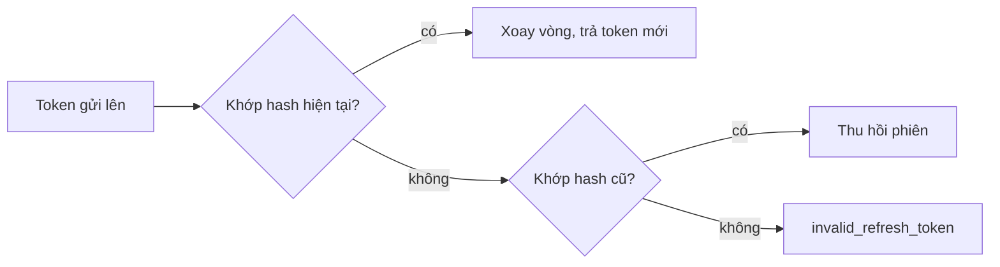

Mỗi phiên là một thiết bị đã đăng nhập. Đăng nhập tạo phiên, sau đó app giữ hai token: access token ngắn hạn và refresh token dài hạn. Refresh, đăng xuất và danh sách thiết bị chạy thẳng trên database, không qua Restate, nên Restate có sập thì vẫn chạy.

## Access token

Access token là JWT ký bằng Ed25519, sống 15 phút. Trong token có ID tài khoản, ID phiên và thời điểm đăng nhập, không có số điện thoại hay tên. Middleware chỉ kiểm tra chữ ký và hạn, không đọc database. Vì vậy người bị khóa vẫn đọc được tối đa 15 phút; các thao tác ghi thì tải tài khoản và kiểm tra trạng thái.

## Refresh và xoay vòng

Refresh token là chuỗi ngẫu nhiên, server chỉ lưu hash. Phiên hết hạn sau 60 ngày kể từ lúc đăng nhập, hoặc sau 30 ngày không dùng.

Mỗi lần refresh, token được thay mới và server giữ lại hash của token cũ. Nếu client gửi lên đúng token cũ đó thì có người đang dùng lại nó, server thu hồi cả phiên và trả `session_revoked`. Hai lượt refresh cùng token chạy song song cũng bị tính là dùng lại. Token lạ trả `invalid_refresh_token`; tài khoản bị khóa thì phiên bị thu hồi và nhận `account_suspended`.

## Khóa ký

Server ký bằng một khóa hiện tại, ID của khóa nằm trong header token. Khi đổi khóa, cấu hình giữ thêm ID và public key của khóa trước, token ký bằng khóa nào trong hai khóa đều qua, nên đổi khóa không đăng xuất ai. Ngoài lúc đổi khóa thì hai biến của khóa trước để trống. Hai biến này phải đặt cùng nhau, và ID khóa trước phải khác ID khóa hiện tại.

## Đăng xuất và thiết bị

Đăng xuất thu hồi phiên hiện tại. Access token vẫn dùng được đến khi hết hạn, tức tối đa 15 phút. Người dùng xem được danh sách thiết bị đang đăng nhập và đăng xuất từng cái; phiên của tài khoản khác trả về như không tồn tại. Đăng xuất mọi thiết bị đòi hỏi lần đăng nhập gần nhất trong vòng 15 phút, nếu không server trả `reauth_required`.
