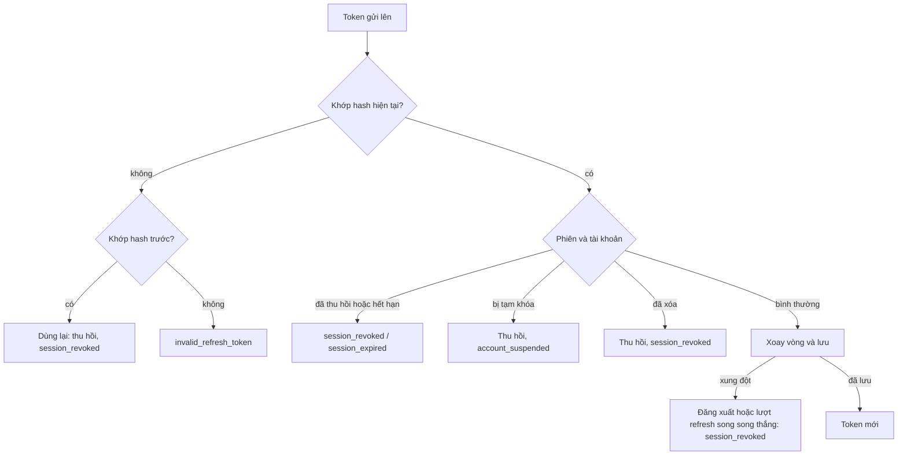

Mỗi phiên đăng nhập là một thiết bị đã đăng nhập <Req id="UC-ACC-02" />. [Đăng nhập](/vi/architecture/sign-in) tạo phiên và đưa cho ứng dụng một access token ngắn hạn cùng một refresh token dài hạn. Refresh, đăng xuất và danh sách thiết bị chạy thẳng trên Postgres, ngoài Restate.

## Access token

Access token là JWT ký bằng Ed25519, sống 15 phút <Req id="NFR-SEC-01" />. Trong token có ID tài khoản, ID phiên và thời điểm đăng nhập gần nhất, không có tên hay số điện thoại. Middleware chỉ kiểm tra chữ ký và hạn, không đọc database.

Vì vậy người bị tạm khóa hoặc đã xóa tài khoản vẫn đọc được tối đa 15 phút. Mọi thao tác ghi đều kiểm tra trạng thái tài khoản: bị tạm khóa trả 403 `account_suspended`, đã xóa trả 401 `session_revoked`.

Header của token có ID khóa, chỉ ra khóa đã ký. Trong lúc đổi khóa, khóa trước vẫn xác minh được, nên đổi khóa không đăng xuất ai.

## Refresh

Server chỉ lưu hash của refresh token. Phiên kết thúc 60 ngày sau lần đăng nhập, hoặc sau 30 ngày không dùng. Mỗi lần refresh, token được thay mới và server giữ hash trước để phát hiện dùng lại.

- Hai lượt refresh chạy song song với cùng một token bị tính là dùng lại: lượt thua thu hồi phiên.
- Phiên bị thu hồi vì tạm khóa vẫn trả `account_suspended` cho token hiện tại của nó trong suốt thời gian tạm khóa. Nhờ vậy client lỡ mất câu trả lời đầu vẫn biết lý do.
- Phiên bị thu hồi giữ lý do của lần thu hồi đầu tiên: `sign_out`, `reuse`, `suspended` hoặc `deleted`.

## Xác thực lại

Đăng xuất các thiết bị khác, thêm định danh, gửi mã OTP để thêm email và xóa tài khoản cần một lần đăng nhập trong vòng 15 phút, nếu không thì trả 428 `reauth_required`. `POST /v1/auth/sessions/current/reauthenticate` làm mới mốc đó mà không tạo hay đổi tài khoản nào.

1. Tài khoản phải ghi được và phiên phải còn dùng được.
2. Bằng chứng được kiểm tra như lúc đăng nhập. Mã OTP qua email lấy từ endpoint gửi mã đăng nhập, cùng quota và số lượt đoán của nó.
3. Bằng chứng của tài khoản khác, hoặc của một địa chỉ không tài khoản nào giữ, trả 403 `wrong_account`. Như vậy câu trả lời không để lộ ai đã đăng ký <Req id="BR-ACC-02" />.
4. Thời điểm đăng nhập của phiên được dời tới lúc bằng chứng được kiểm tra, nếu lúc đó phiên vẫn còn sống.
5. Câu trả lời là một access token mới cho cùng phiên. Refresh token giữ nguyên.

Hai lựa chọn giữ cho bước này an toàn khi đứng cạnh refresh. Thứ nhất, nếu xoay vòng refresh token ở đây, ứng dụng lỡ mất câu trả lời sẽ cầm một token trông như bị dùng lại. Thứ hai, lệnh cập nhật không đụng tới phiên bản ghi của phiên, vì refresh coi xung đột phiên bản là token bị dùng lại; ngược lại, refresh không bao giờ ghi thời điểm đăng nhập. Request gửi lại với cùng key chứng minh tại thời điểm của lần kiểm tra đầu, nên một mã OTP chỉ làm mới mốc đăng nhập một lần.

## Đăng xuất và thiết bị

Danh sách thiết bị và các thao tác đăng xuất dùng chung một resource <Req id="FR-ACC-02" />:

| Endpoint | Làm gì |
|---|---|
| `GET /v1/auth/sessions` | các thiết bị đang hoạt động, mới nhất trước |
| `DELETE /v1/auth/sessions/current` | đăng xuất phiên này |
| `DELETE /v1/auth/sessions/others` | đăng xuất mọi phiên khác; cần một lần đăng nhập gần đây |
| `DELETE /v1/auth/sessions/{id}` | đăng xuất một thiết bị; phiên của tài khoản khác trả 404 |

Access token của phiên đã đăng xuất vẫn dùng được tới khi hết hạn. Đăng xuất các thiết bị khác là một lệnh cập nhật hàng loạt, và push token của chúng ngừng ở lần gửi thông báo đẩy kế tiếp (xem [Thông báo](/vi/architecture/notifications)).
