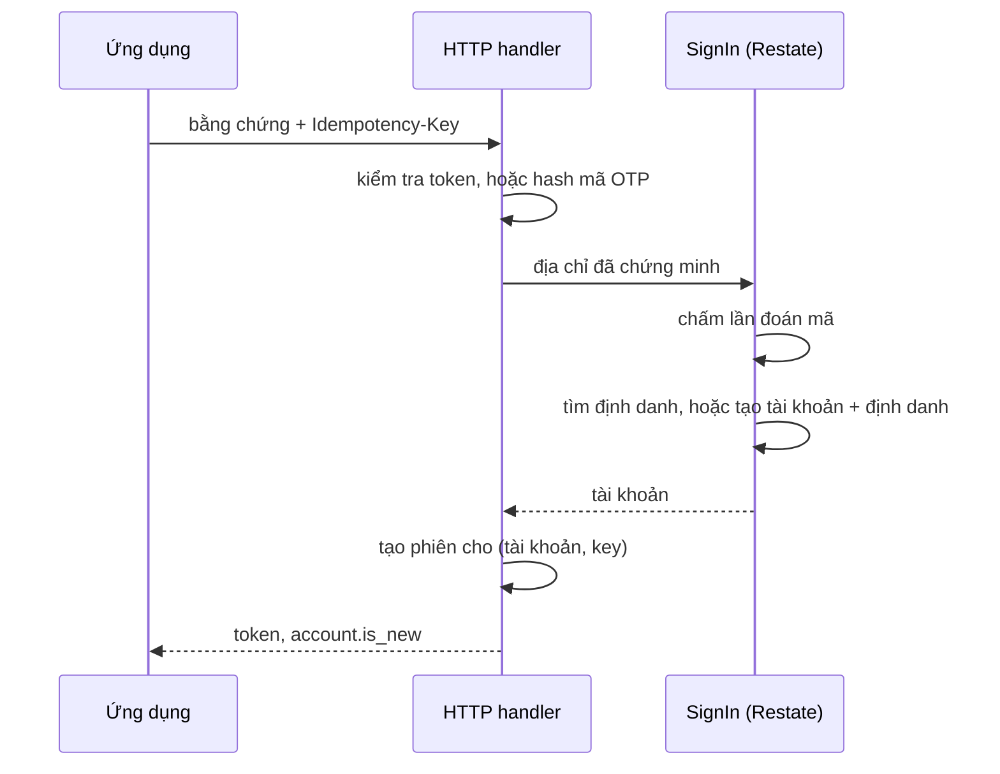

Người dùng đăng nhập, hoặc đăng ký ở lần dùng đầu, bằng một bằng chứng gửi tới `POST /v1/auth/sign-in` <Req id="FR-ACC-01" />. Nhân viên đăng nhập riêng; xem [Trang điều hành](/vi/architecture/console).

## Định danh và bằng chứng

Một tài khoản có định danh số điện thoại, định danh email, hoặc cả hai, mỗi loại tối đa một. Một số điện thoại hay một địa chỉ email chỉ thuộc một tài khoản. Tài khoản không bao giờ được gộp, và không endpoint nào đổi hay xóa định danh.

| Bằng chứng | Chứng minh | Nguồn |
|---|---|---|
| `phone_token` | một số điện thoại | Firebase: mã SMS, hoặc Phone Number Verification đọc từ SIM |
| `google_token` | một địa chỉ email | Google ID token từ Android Credential Manager |
| `email_code` | một địa chỉ email | ID của challenge và mã OTP sáu chữ số server đã gửi qua email |

Google không phải một loại định danh. Token Google cho một địa chỉ mà định danh email đang giữ sẽ đăng nhập vào tài khoản đó.

## Flow

Token và mã OTP không bao giờ vào Restate, vì journal của Restate đọc được qua admin API. Phía HTTP kiểm tra token rồi chỉ chuyển tiếp địa chỉ đã được chứng minh. Với mã OTP, phía HTTP chuyển ID của challenge và một hash có khóa của địa chỉ cùng mã.

1. Mã OTP bị từ chối khi challenge của nó không tồn tại, không phải challenge mới nhất của địa chỉ, dành cho việc thêm định danh, đã hết hạn hoặc hết lượt đoán. Lượt đoán đã tính được lưu lại.
2. Định danh đã có được đánh dấu vừa dùng. Tài khoản đang bị tạm khóa cũng đăng nhập được; sau đó ứng dụng và website chỉ hiện màn hình tạm khóa <Req id="BR-MOD-02" />.
3. Địa chỉ mới được tạo tài khoản và định danh trong cùng một transaction. Nếu một lượt đăng ký khác đã chiếm giá trị đó trước, không gì được ghi và câu trả lời là `try_again`.
4. Phía HTTP tạo [phiên đăng nhập](/vi/architecture/sessions). `account.is_new` báo cho ứng dụng hỏi thông tin hồ sơ.

Request gửi lại với cùng key và bằng chứng hợp lệ sẽ thấy phiên đã được tạo và nhận token mới cho phiên đó. Nếu phiên đã bị đăng xuất từ lúc ấy, câu trả lời là `session_revoked`. Request gửi lại bằng mã OTP thấy mã đã bị chính lần thử đầu dùng mất, và vẫn chứng minh được lại. Một mã OTP khác thì nhận `code_expired`.

## Kiểm tra token

Issuer của token quyết định bộ key, thuật toán và audience. Lần xác minh phải diễn ra trong vòng 5 phút (cho phép lệch đồng hồ 30 giây). Trong khoảng đó, cùng một token đăng nhập lại được. Kiểm tra thất bại trả 401 `invalid_phone_token` hoặc `invalid_google_token`, và số ngoài Việt Nam trả 422 `invalid_phone`.

Key của nhà cung cấp được cache và lấy lại tối đa một lần mỗi phút. Nếu chưa lấy được key lần nào, đăng nhập trả 503 `unavailable`, để ứng dụng thử lại thay vì xin mã mới.

## Mã OTP qua email

`POST /v1/auth/email-codes` gửi mã OTP để đăng nhập. `POST /v1/accounts/me/email-codes` gửi mã OTP để thêm email vào tài khoản của người gọi. Câu trả lời như nhau dù có tài khoản nào giữ địa chỉ đó hay không <Req id="BR-ACC-02" />.

- Giới hạn: 20 mã mỗi giờ cho một địa chỉ client, và mỗi email một mã mỗi 45 giây, 5 mã mỗi giờ (`otp_too_soon`, `otp_limit`).
- Mã OTP sống 5 phút và nhận 5 lượt đoán: sai thì `invalid_code` kèm `attempts_left`, hết lượt thì `code_locked`. Mã mới thay mã cũ (`code_expired`).
- Mã OTP được suy ra từ challenge nên không lưu ở đâu cả, và email được gửi với challenge làm idempotency key. Một bước hay một request chạy lại chỉ gửi một email và không tốn thêm quota <Req id="NFR-DUR-01" />.

## Thêm định danh

`POST /v1/accounts/me/identities` nhận bằng chứng của loại định danh mà tài khoản còn thiếu. Loại đã có trả 409 `identity_kind_taken`. Giá trị mà tài khoản khác đang giữ trả 409 `identity_taken`. Request gửi lại trả về danh sách định danh.

Thêm định danh và gửi mã OTP để thêm email cần một lần đăng nhập trong vòng 15 phút (428 `reauth_required`, xem [xác thực lại](/vi/architecture/sessions#xác-thực-lại)). Lý do là định danh được thêm bằng một access token bị lộ sẽ cho người giữ token vào tài khoản mãi mãi. Ở các lệnh gọi này, bằng chứng sai trả 422 chứ không phải 401: 401 trên một lệnh gọi có bearer luôn nói về chính bearer đó.

## Thao tác nào cần số điện thoại

Đăng tin, mở một deal và mở một cuộc trò chuyện cần định danh số điện thoại, nếu không thì trả 403 `phone_required` <Req id="BR-ACC-03" />. Trả lời tin nhắn, yêu cầu COD và mọi thao tác khác thì không cần. Số điện thoại của địa chỉ giao hàng không phải định danh.
