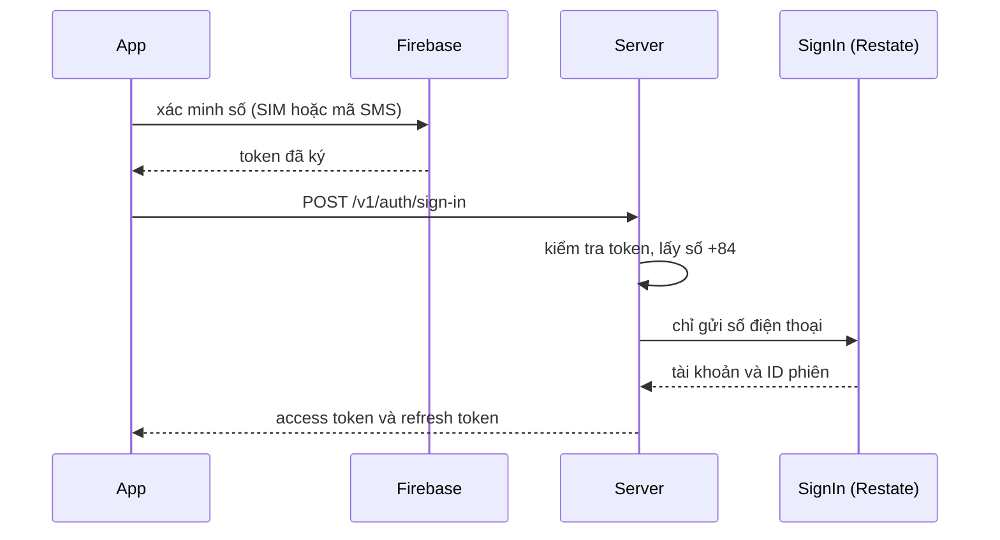

Tài khoản người dùng nào cũng có số điện thoại, và số điện thoại là cách đăng nhập duy nhất. Server không tự gửi mã. App xác minh số qua Firebase rồi gửi lên server token mà Firebase trả về.

## Xác minh số điện thoại

Firebase có hai cách. Phone Number Verification (PNV) đọc số từ SIM qua nhà mạng. Firebase Authentication gửi mã SMS. Đến tháng 9/2026 PNV chưa hỗ trợ nhà mạng Việt Nam nào, nên người dùng trong nước hiện đi đường SMS. Khi Google thêm nhà mạng, app đã cài dùng được ngay mà không cần cập nhật, còn server thì đã nhận token PNV từ trước.

## Server kiểm tra gì

Issuer của token quyết định bộ public key, thuật toán và audience cần khớp. Lần xác minh phải diễn ra trong vòng 5 phút. Trong khoảng đó cùng một token đăng nhập lại được; team chọn cách này thay vì bắt token chỉ dùng một lần. Số ngoài Việt Nam bị từ chối với `invalid_phone`, mọi lỗi kiểm tra khác trả `invalid_phone_token`, và log ghi rõ bước nào hỏng.

Server lấy key của từng issuer từ bộ key công khai của nó và cache lại. Nếu chưa lấy được key lần nào, endpoint trả `unavailable` để app thử lại, thay vì bắt người dùng xin mã mới. Endpoint không có quota riêng vì Firebase đã giới hạn số lần xin mã.

## Tìm hoặc tạo tài khoản

Token chỉ nằm ở HTTP handler. Flow bền vững <Term id="sign-in-flow">SignIn</Term> chỉ nhận số đã xác minh, vì journal của Restate đọc được qua admin API.

Flow tìm identity theo số điện thoại. Tài khoản đã có và đang hoạt động thì được đánh dấu vừa dùng. Tài khoản bị khóa thì dừng ở đây. Số mới thì flow tạo tài khoản trước, rồi tạo identity. Nếu giữa hai bước đó có lượt đăng ký khác chiếm mất số, flow xóa tài khoản vừa tạo và app nhận `try_again`.

Khóa của invocation ghép số điện thoại với idempotency key của request. Request gửi lại kèm token hợp lệ cho cùng số sẽ nhận lại đúng [phiên](/vi/architecture/sessions) cũ, với refresh token mới.

## Email và OTP

Đăng nhập bằng email, mã OTP do server gửi và quota của chúng đã bị bỏ từ 2026-10-28. Migration đã xóa các tài khoản chỉ có email, và database giờ chỉ nhận identity loại phone. Nhân viên vẫn đăng nhập bằng email, qua một luồng riêng ở trang [Nhân viên](/vi/architecture/staff).
