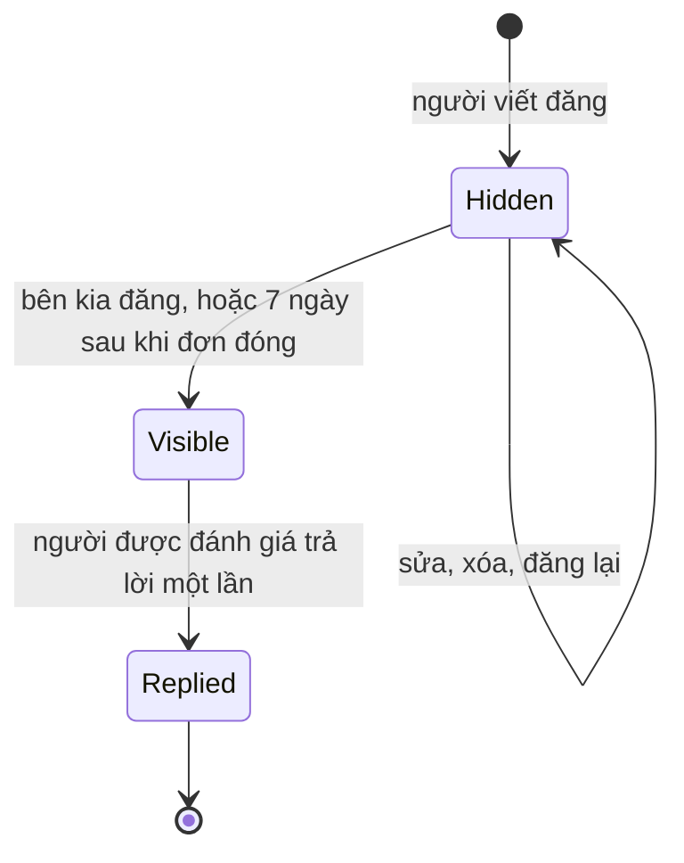
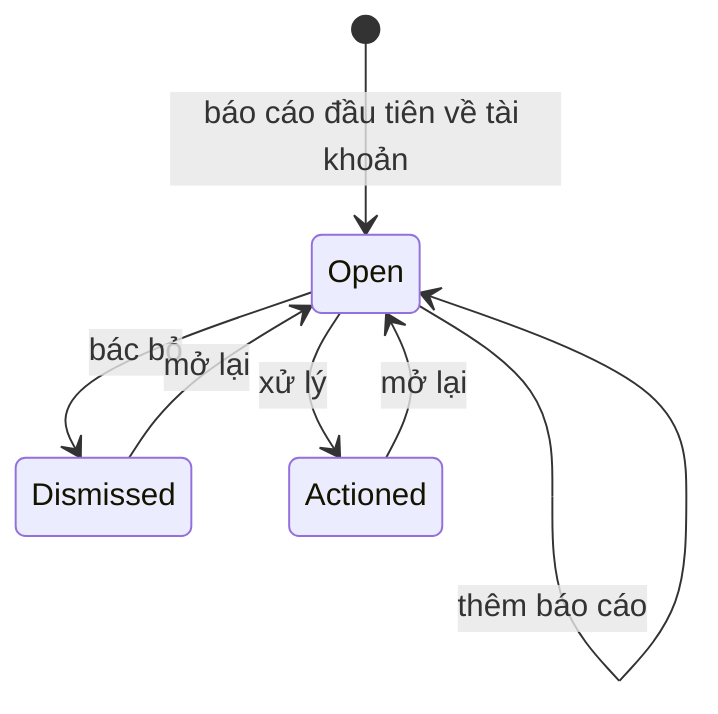
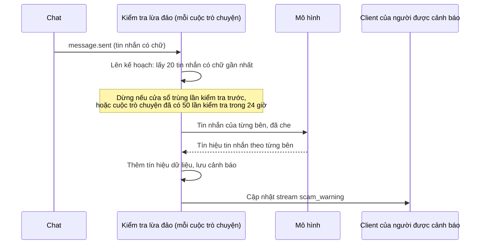

Module trust giữ đánh giá, ca báo cáo và cảnh báo lừa đảo, và đọc điểm đánh giá mà mọi màn hiện ra. Uy tín là một bộ số liệu server đã có sẵn: không điểm, không bậc, và cùng một hạn mức cho mọi tài khoản (<Req id="BR-TRS-05" />). Chặn nằm trong module account, vì cả chat và deal đều kiểm tra nó.

Tài khoản đang bị tạm khóa không viết, xóa hay đánh dấu được đánh giá, và không báo cáo vi phạm được. Nó nhận `account_suspended`.

## Đánh giá

Hai bên của một đơn đánh giá nhau khi đơn đã `completed` hoặc `failed` (<Req id="FR-TRS-01" />, <Req id="BR-TRS-04" />). Đơn ở trạng thái khác trả `order_not_delivered`, và đơn giao không thành có vận đơn `lost` cũng vậy: hãng làm thất lạc bưu kiện, không phải lỗi của bên nào. Đánh giá chấm một người, không chấm một tin đăng:

- `role` là phía mà người được đánh giá đứng: `seller` (người mua viết) hoặc `buyer` (người bán viết).
- 1 tới 5 sao và tối đa 500 ký tự.
- Thẻ tùy chọn, lấy từ một danh sách cố định theo vai. Người bán nhận được "đúng mô tả", "trả lời nhanh" và "đóng gói kỹ"; người mua nhận được "trả lời nhanh" và "đúng hẹn".
- Tối đa 4 ảnh, lấy từ các lần tải lên. Bỏ trống trường này thì giữ ảnh cũ, gửi `[]` thì xóa ảnh. Ảnh bị pipeline media từ chối trả `invalid_upload`.

Mỗi đơn có một đánh giá cho mỗi vai. `PUT /v1/orders/{order_id}/review` lấy vai từ phía của người gọi trong đơn, nên cùng một lệnh gọi phục vụ cả hai bên. Người không thuộc đơn nhận `order_not_found`.

### Ẩn cho tới khi cả hai cùng viết

Đánh giá được ẩn cho tới khi bên kia cũng đánh giá, hoặc tới 7 ngày sau khi đơn đóng, tùy cái nào tới trước. Cách này ngăn một bên viết để đáp lại số sao của bên kia. Thời điểm hiện được ghi lúc tạo đánh giá. Khi đánh giá thứ hai tới, cả hai cùng hiện, trong một transaction. Không có bộ hẹn giờ nào chạy; đánh giá hiện khi đã qua thời điểm hiện của nó.

Đánh giá đang ẩn chỉ hiện với người viết. Danh sách, điểm đánh giá và màn đơn của người được đánh giá đều bỏ qua nó.

### Sửa, xóa và trả lời

Người viết được sửa, xóa hoặc đăng lại khi đánh giá còn ẩn và chưa quá 7 ngày từ lần đăng đầu. Khi đánh giá đã hiện, mọi thay đổi trả `review_locked`: bên đã đọc số sao của bên kia không được đổi số sao của mình. Đánh giá đăng sau khi đơn đóng quá 7 ngày thì hiện ngay, nên nó cố định từ lúc đăng. Xóa thì giữ dòng nhưng bỏ nội dung, thẻ và ảnh, nên đăng lại không tính lại 7 ngày.

Người được đánh giá trả lời một lần cho đánh giá đã hiện, tối đa 500 ký tự (`POST /v1/reviews/{id}/reply`). Đánh giá đang ẩn trả `review_hidden`, lần trả lời thứ hai trả `review_replied`, và bất kỳ ai khác người được đánh giá nhận `review_not_found`. Sau khi trả lời, đánh giá đóng hẳn (`review_closed`).

### Đánh dấu hữu ích

Bất kỳ ai khác đều đánh dấu được một đánh giá đã hiện là hữu ích (`PUT /v1/reviews/{id}/helpful`) và bỏ đánh dấu (`DELETE`). Người viết và người được đánh giá nhận `own_review`; đánh giá đang ẩn hoặc đã xóa trả `review_not_found`. Đánh giá mang số lượt đánh dấu, và chỉ mang `marked` với người đọc được phép đánh dấu nó. Xóa đánh giá thì bỏ các lượt đánh dấu, và một lượt đánh dấu chạy đua với lệnh xóa hoặc tới trước, hoặc không tới.

### Gọi lại và chạy đua

Lệnh put thấy đánh giá của người gọi đã có đúng số sao, nội dung, thẻ và ảnh đó thì trả về đánh giá như hiện tại. Vì vậy một lần gọi lại mà lần đầu đã thành công, kể cả lần đã làm đánh giá hiện ra, vẫn nhận đánh giá chứ không nhận `review_locked`. Cùng một câu trả lời gửi hai lần thì đánh giá chỉ nhận một lần. Xóa một đánh giá đã xóa trả 204.

Hai lệnh ghi chạy đua trên một đánh giá thì lệnh thua nhận `try_again`, và client đọc lại.

### Ai đọc đánh giá

`GET /v1/accounts/{id}/reviews?role=` là công khai và liệt kê các đánh giá đã hiện. `GET /v1/sellers/{id}/reviews` là cùng danh sách đó với `role=seller`. Đánh giá đầu tiên ghi `review.posted` và câu trả lời đầu tiên ghi `review.replied`; module [notifications](/vi/architecture/notifications) biến mỗi event thành một thông báo.

## Uy tín

Mỗi số liệu trả lời một câu mà người mua hoặc người bán hỏi trước khi vào deal (<Req id="FR-TRS-03" />).

| Số liệu | Hiện ở đâu | Quy tắc |
|---|---|---|
| Điểm đánh giá khi bán, điểm đánh giá khi mua | Màn tin đăng, người bán và uy tín; điểm khi mua của người mua hiện trên thẻ giá đề nghị trong cuộc trò chuyện | Trung bình và số lượng đánh giá đã hiện ở vai đó. Không có đánh giá thì không có trung bình. |
| Đã bán | Màn người bán và uy tín | Mọi tin đã bán, qua đơn hoặc tự đánh dấu. |
| Tỉ lệ trả lời | Màn uy tín | Xem bên dưới. Vắng mặt khi đếm được ít hơn 5 cuộc trò chuyện. |
| Thời gian trả lời | Màn tin đăng và người bán | Xem bên dưới. Vắng mặt khi có ít hơn 5 lần trả lời trong 30 ngày, hoặc khi trung vị quá một ngày. |
| Số điện thoại đã xác minh | Màn tin đăng và người bán | Người bán đăng nhập bằng số điện thoại, đã được xác minh lúc đăng nhập. Số không bao giờ hiện ra. |
| Đơn COD và số đơn giao không thành, 90 ngày gần nhất | Màn uy tín | Người gọi ở vai người mua. Đơn giao không thành vì hãng làm thất lạc bưu kiện không được tính. |
| Hạn mức | Màn uy tín | Số tin đang bán so với 20, số đơn COD đang mở ở vai người mua so với 3. |

**Tỉ lệ trả lời.** Số liệu đếm các cuộc trò chuyện do người khác mở về một tin của người gọi, có tin nhắn đầu tiên trong 90 ngày gần nhất và đã được trả lời hoặc đã quá 24 giờ. Một cuộc trò chuyện là kịp thời khi người gọi trả lời trong 24 giờ. Tỉ lệ là phần trăm kịp thời, làm tròn xuống, kèm số lượng. Số liệu được tính lúc đọc.

**Thời gian trả lời.** Đây là khoảng thời gian người bán thường trả lời người viết về tin của mình, dưới dạng một nhóm mà client diễn đạt thành lời: trong vài phút (tới 10), trong một giờ, trong vài giờ (tới 6), trong một ngày. Một lần chờ bắt đầu ở tin nhắn đầu tiên của người kia sau tin nhắn cuối của người bán, nếu đã qua ít nhất một giờ, hoặc ở tin nhắn đầu tiên của cuộc trò chuyện. Tin nhắn trong vòng một giờ thuộc cùng lượt nói chuyện và không mở lần chờ mới. Lượt trả giá không được tính ở cả hai phía. Mỗi lần chờ được trả lời được lưu thành một mẫu khi câu trả lời được gửi, và các mẫu cũ hơn 30 ngày bị xóa khi mẫu mới được ghi. Số liệu là trung vị của 30 ngày gần nhất; lần chờ không được trả lời chỉ tính vào tỉ lệ trả lời.

## Báo cáo vi phạm

Người dùng báo cáo vi phạm một tin đăng hoặc một tài khoản (<Req id="UC-MOD-01" />) bằng `POST /v1/reports`:

- Đúng một trong hai trường `listing_id` và `account_id`.
- Một `reason`: `banned`, `fake`, `scam` hoặc `other`.
- Một ghi chú tùy chọn, tối đa 500 ký tự.
- Với tài khoản, có thể kèm cuộc trò chuyện của người báo cáo với tài khoản đó, để nhân viên đọc. Chặn vẫn giữ cuộc trò chuyện, nên ứng dụng chặn trước rồi báo cáo sau.

Vi phạm một quy tắc trên trả `invalid_report`; báo cáo chính mình hoặc tin của mình trả `self_report`. Tin đã xóa trả `listing_not_found`, nhưng tin đang ẩn, đang giữ chỗ, đã bán hoặc bị từ chối vẫn báo cáo được.

Mỗi báo cáo ghi tên tài khoản mà nó nói về; báo cáo tin đăng cũng ghi tên người bán của tin. Nhờ vậy một ca gom mọi thứ về một người.

Mỗi người báo cáo có một báo cáo đang mở cho mỗi đối tượng. Báo cáo lại cùng đối tượng thì thay lý do, ghi chú và cuộc trò chuyện, và trả 200; báo cáo mới trả 201. `DELETE /v1/reports/{id}` rút một báo cáo (nút hoàn tác của ứng dụng). Dòng vẫn được giữ, và lần báo cáo tiếp theo về đối tượng đó mở một báo cáo mới. `GET /v1/reports` liệt kê các báo cáo của người gọi, mới nhất trước, mỗi cái ở trạng thái `open`, `resolved` hoặc `withdrawn`.

## Ca báo cáo

Nhân viên trên trang điều hành xử lý báo cáo theo ca (<Req id="UC-MOD-02" />, <Req id="FR-MOD-01" />). Một ca là mọi báo cáo về một tài khoản chưa bị rút và chưa được xử lý. Xử lý xong ca thì đóng dấu các báo cáo đó, và báo cáo tiếp theo về tài khoản mở một ca mới.

- `GET /v1/console/reports?status=open|resolved` liệt kê các ca: ca đang mở theo báo cáo mới nhất kèm tổng số, ca đã xử lý theo lúc xử lý.
- `GET /v1/console/reports/{account_id}` hiện ca đang mở, nếu không có thì ca đã xử lý gần nhất. Nó liệt kê mọi tin bị báo cáo trong ca, tin bị báo cáo nhiều nhất trước, và các báo cáo mới nhất trước. Tài khoản chưa có báo cáo nào trả `report_case_not_found`.
- Bác bỏ ("không vi phạm") và xử lý ("đã hành động") đóng ca đang mở. Không có ca đang mở thì trả `report_case_not_open`.
- Mở lại đưa ca đã xử lý gần nhất trở lại. Báo cáo mà người báo cáo đã báo lại cùng đối tượng sau đó thì giữ kết quả xử lý cũ, để một người báo cáo không bao giờ có hai báo cáo đang mở cho một đối tượng. Không có ca đã xử lý thì trả `report_case_not_resolved`.

Mỗi thao tác khóa dòng của tài khoản và ghi mục nhật ký kiểm toán (`report.dismiss`, `report.resolve`, `report.reopen`) trong cùng một transaction. Lệnh bác bỏ hoặc xử lý gọi lại mà thấy ca đã đóng với cùng kết quả thì trả về ca đó thay vì 409. Tài khoản hệ thống ShopNexus không thể là một ca (`account_is_system`).

Trợ lý AI trên trang điều hành đọc được một ca và trả lời câu hỏi về nó; trợ lý không thay đổi gì, và mọi thay đổi đều do một nhân viên bấm (<Req id="BR-MOD-03" />).

### Chế tài

Nhân viên xử lý tài khoản trên trang điều hành, rồi đóng ca bằng thao tác xử lý. Các thao tác dưới đây không tự đóng ca:

- **Ẩn một tin đăng.** Tin do nhân viên ẩn bị giữ lại: người bán không hiện tin lại được (`listing_held`), và việc sửa hay "bỏ đánh dấu đã bán" vẫn để tin ẩn. Chỉ nhân viên gỡ được lệnh giữ.
- **Tạm khóa tài khoản**, kèm lý do và thời điểm kết thúc tùy chọn. Tài khoản đang bị tạm khóa vẫn đăng nhập, nhưng không viết thêm gì mới được (tin đăng, tin nhắn, giá đề nghị, yêu cầu COD, đánh giá, báo cáo vi phạm, lượt theo dõi, thay đổi hồ sơ). Tài khoản đó vẫn rút giá, từ chối, hủy, mở hoặc trả lời phiếu hỗ trợ, và đăng xuất được (<Req id="BR-MOD-02" />). `GET /v1/accounts/me` có lý do và ngày hết; ứng dụng và website chỉ hiện màn hình tạm khóa với hai thông tin đó, lối gửi hỗ trợ và nút đăng xuất.

Cả hai đều được ghi nhật ký kiểm toán. Nhân viên chỉ nhận hàng cấm và hàng giả, lừa đảo có tổ chức và yêu cầu từ cơ quan chức năng; giá và tình trạng là chuyện giữa hai người (<Req id="BR-MOD-01" />). Không có chế tài tự động.

## Cảnh báo lừa đảo

Trust theo dõi các cuộc trò chuyện và cảnh báo một bên khi tin nhắn của bên kia có dấu hiệu lừa đảo (<Req id="FR-TRS-04" />, <Req id="BR-TRS-06" />). Một cảnh báo là danh sách các tín hiệu cố định, mỗi tín hiệu có câu chữ do server viết:

- Đọc từ tin nhắn: `prepayment_request`, `off_app_contact`, `suspicious_link`, `sensitive_info_request`, `impersonation`, `fake_payment_proof`, `pressure`.
- Tính từ dữ liệu: `new_account` (dưới 7 ngày tuổi) và `price_far_below` (thấp hơn ít nhất 30% so với trung vị của từ 5 tin tương tự trở lên).

Một cảnh báo cần ít nhất một tín hiệu từ tin nhắn. Tín hiệu dữ liệu chỉ đi kèm; tài khoản mới đứng một mình không cảnh báo ai.

Các lần kiểm tra chạy lần lượt từng cái một cho mỗi cuộc trò chuyện, và khởi động lại thì chạy tiếp mà không hỏi lại mô hình. Nếu mô hình từ chối, hoặc bước phân loại vẫn lỗi sau 3 lần thử hoặc 10 phút, lần kiểm tra đó bị bỏ qua.

Bước che giữ lại số tiền: chữ số theo sau là đơn vị tiền (đ, vnd, k, tr) được giữ nguyên. Các dãy khác từ 8 tới 19 chữ số trở thành số điện thoại hoặc số tài khoản ngân hàng.

Mỗi tín hiệu ghi tin nhắn mà nó nằm dưới, là tin nhắn mới nhất của người bị nghi trong lần kiểm tra đó, để client hiện cảnh báo ngay cạnh tin nhắn ấy.

### Bỏ qua và quyền riêng tư

Người được cảnh báo bỏ qua bằng `POST /v1/conversations/{id}/scam-warning/dismiss`, kể cả sau khi đã chặn người kia. Cảnh báo đã bỏ qua chỉ quay lại khi có tín hiệu tin nhắn mới xuất hiện sau lúc bỏ qua. Tín hiệu mà mô hình tìm thấy trong lúc lệnh bỏ qua đang ghi được tính là sau lúc đó.

Người bị nghi không bao giờ thấy cảnh báo về chính mình. Màn hộp thư, tìm trong hộp thư và cuộc trò chuyện mang các cảnh báo của người gọi.

Mỗi lần kiểm tra được lưu cùng ID các tin nhắn nó đã đọc, bộ phân loại và các tín hiệu, không bao giờ lưu nội dung. Cùng các lần bỏ qua và báo cáo lừa đảo, đây là bộ dữ liệu huấn luyện cho một mô hình sau này. Các lần kiểm tra cũ hơn 365 ngày bị xóa. Xóa một tài khoản thì xóa các cảnh báo đã hiện cho tài khoản đó; cảnh báo về tài khoản đó vẫn ở lại với những người nó đã trò chuyện.
