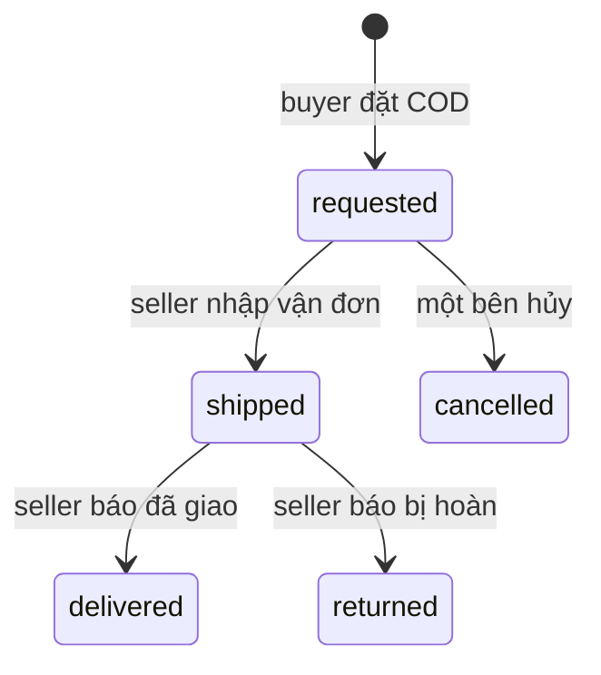

Một deal là buyer và seller thương lượng giá cho một tin. Buyer đồng ý giá niêm yết hoặc trả giá, tối thiểu bằng nửa giá niêm yết; seller trả giá lại được. Nhiều buyer có thể cùng chốt giá trên một tin, và chốt giá không giữ chỗ món hàng.

## Các bước

<Steps>
<Step title="Buyer đặt COD">
Buyer bấm **Đặt COD** trong chat và chọn một địa chỉ trong sổ địa chỉ của mình. Đơn chuyển sang chờ gửi. Khi seller chưa gửi, buyer khác vẫn đặt COD được cho cùng tin.
</Step>

<Step title="Seller gửi hàng">
Seller tạo vận đơn trên app của hãng bằng tài khoản đứng tên mình, để người nhận trả phí ship. Sau đó seller nhập hãng, mã vận đơn và phí ship vào ShopNexus. Đơn chuyển sang đang giao, tin bị giữ chỗ, và các đơn COD khác trên tin bị hủy với dòng "Người bán đã gửi cho người khác". Buyer thấy phí ship từ lúc này.
</Step>

<Step title="Buyer đồng kiểm ở cửa">
Shipper tới, buyer xem hàng. Ưng thì trả shipper tiền hàng cùng phí ship. Không ưng thì từ chối nhận và không mất đồng nào. Shipper báo kết quả cho hãng, buyer không phải bấm gì trong app.
</Step>

<Step title="Seller báo kết quả">
ShopNexus không theo dõi bưu kiện. Tiền COD về thì seller bấm **Đã giao xong**, tin được tính là đã bán cho buyer đó. Hàng quay về thì seller bấm **Hàng bị hoàn**, tin được mở bán lại.
</Step>
</Steps>

Đơn đã giao thì deal kết thúc. Đơn bị hoàn hoặc bị hủy thì deal quay lại thương lượng.

## Món giá cao và hẹn gặp

Món trên 5 triệu vẫn chọn COD được, app gợi ý hai bên hẹn gặp xem hàng trước. Gặp mặt do hai bên tự hẹn trong tin nhắn, app không có bước nào cho buổi gặp, vì sàn không giữ tiền, không kiểm được hàng và không biết lúc nào giao xong. Khi tin nhắn nhắc một địa điểm, app gắn nút mở bản đồ.

Hàng bán ngoài app vẫn được ghi qua **Đánh dấu đã bán** để tính vào uy tín.

## Giới hạn mỗi buyer

Mỗi buyer có tối đa 3 đơn COD đang chờ gửi hoặc đang giao cùng lúc. Lý do nằm ở trang [Uy tín và chế tài](/vi/marketplace/trust-and-sanctions).
