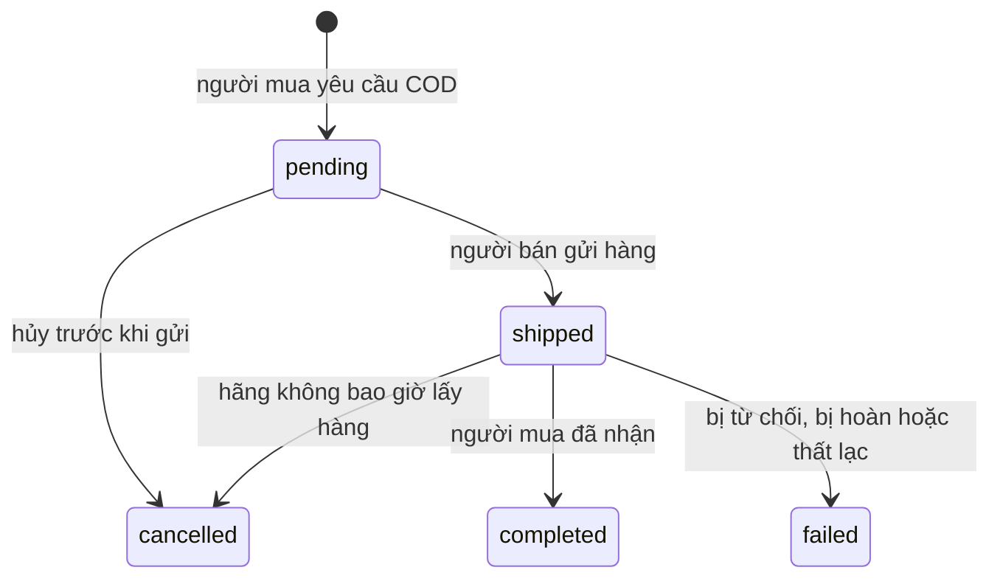

Một deal là người mua và người bán chốt giá cho một tin đăng. Người mua có thể mua với giá niêm yết bằng **Mua ngay**, hoặc trả giá với giá đề nghị ít nhất bằng một nửa giá niêm yết, và người bán có thể phản giá. Nhiều người mua có thể cùng chốt giá trên một tin, và chốt giá không giữ chỗ món hàng.

Bưu kiện đi bằng GHTK hoặc GHN, trên tài khoản hãng của chính người bán, mà người bán liên kết một lần trong phần thiết lập COD. Hãng thu tiền của người mua và trả cho người bán. ShopNexus không bao giờ giữ số tiền đó.

## Các bước

<Steps>
<Step title="Người mua yêu cầu COD">
Người mua bấm **Mua ngay**, hoặc **Chọn giao COD** trên một mức giá đã chốt, chọn một địa chỉ trong sổ địa chỉ và gửi yêu cầu. Đơn lúc này chờ người bán. Khi người bán chưa gửi hàng, người mua khác vẫn yêu cầu COD được trên cùng tin.
</Step>

<Step title="Người bán gửi hàng">
Người bán chọn hãng, dịch vụ, cân nặng và nơi shipper lấy bưu kiện. Hệ thống tạo vận đơn trên tài khoản hãng của người bán, thu tiền hàng khi giao và để người nhận trả phí vận chuyển. Tin được giữ chỗ cho người mua này, và mọi đơn đang chờ của người mua khác trên tin bị hủy với dòng "Người bán đã gửi cho người khác".
</Step>

<Step title="Hãng giao hàng">
Hãng lấy bưu kiện và báo từng bước, màn đơn hiện các bước đó. Người mua thấy phí vận chuyển ngay khi hãng báo.
</Step>

<Step title="Người mua đồng kiểm ở cửa">
Shipper tới và người mua xem món hàng. Đúng như tin thì họ trả shipper tiền hàng cùng phí vận chuyển. Không đúng thì họ từ chối nhận và không trả gì, hãng trả bưu kiện về cho người bán.
</Step>

<Step title="Đơn đóng lại">
Người mua bấm **Đã nhận hàng**, hoặc đơn tự hoàn tất 3 ngày sau khi hãng báo đã giao. Khi đó tin được tính là đã bán cho người mua này. Bưu kiện bị từ chối hoặc bị hoàn thì đơn giao không thành, và tin được mở bán lại.

Nếu hãng làm thất lạc bưu kiện sau khi lấy hàng, đơn cũng giao không thành, nhưng đó là lỗi của hãng. Đơn không tính cho bên nào và không được đánh giá. Người bán không còn hàng nên tin bị ẩn; khi có hàng, người bán tự hiện lại tin. Người bán yêu cầu hãng bồi thường trên tài khoản GHTK hoặc GHN của mình, còn người mua không phải trả gì.
</Step>
</Steps>

Đơn hoàn tất thì deal kết thúc. Sau khi đơn giao không thành hoặc bị hủy, deal quay lại trả giá.

## Thời hạn

- Hai bên đều hủy được đơn cho tới khi người bán gửi hàng.
- Người bán không gửi hàng trong 3 ngày thì mất đơn: đơn bị hủy.
- Bưu kiện mà hãng chưa lấy sau 3 ngày kể từ lúc người bán gửi thì bị hủy, vận đơn cũng vậy.
- Khi người bán đang vắng mặt, người mua không trả giá, chấp nhận giá hay yêu cầu COD được; các đơn đã đặt vẫn đi tiếp.

## Bán ngoài ứng dụng

Món bán ngoài ứng dụng được ghi lại bằng **Đánh dấu đã bán**, nên vẫn được tính vào lịch sử của người bán.

## Giới hạn mỗi người mua

Mỗi người mua có tối đa 3 đơn COD đang chờ hoặc đã gửi cùng lúc; trang [Uy tín và chế tài](/vi/marketplace/trust-and-sanctions) giải thích lý do.
