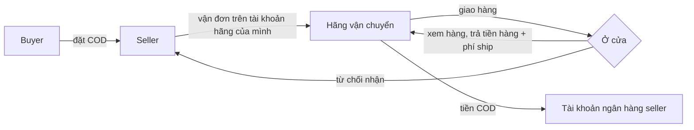

ShopNexus là sàn C2C để pass nhanh đồ cũ ở Việt Nam. Sàn chạy trên hai ràng buộc: không cầm tiền của ai, và không phân xử từng vụ. Các quy tắc khác đều đi ra từ hai điều này.

## Hệ quả

- Trong app chỉ có một đường giao dịch: <Term id="cod-inspection">COD đồng kiểm</Term>. Buyer xem hàng ở cửa rồi mới trả tiền cho shipper.
- Buyer không trả gì trong app. Không cọc, không ví, không credit, nên không có khoản nào phải hoàn.
- Refund thực chất là từ chối nhận. Buyer trả tiền rồi thì sàn không đòi lại được, và app nói rõ điều đó trước khi buyer trả.
- Sự cố sau khi nhận được ghi nhận trong chat, seller tự quyết cách trả lời. Không ai ra phán quyết.
- Uy tín là thống kê, và chế tài là mất quyền.
- Người thật chỉ xử lý ba nhóm việc, và khối lượng không tăng theo số đơn.
- Doanh thu đến từ đẩy tin và gói seller. Không thu phí theo đơn.

## Đường COD

Seller gửi hàng bằng tài khoản hãng đứng tên mình (GHTK, GHN, SPX, J&T, Viettel Post…), rồi nhập hãng, mã vận đơn và phí ship vào ShopNexus. Hãng chuyển tiền COD vào tài khoản ngân hàng seller đã khai với hãng. Hãng đã xác minh danh tính seller lúc mở tài khoản, nên đăng tin trên ShopNexus chỉ cần số điện thoại xác minh qua Firebase.

App chưa tích hợp API của hãng nào. Mô hình đơn vẫn giữ chỗ cho việc tích hợp.

## Để dành: thanh toán tạm giữ

Sau này có thể bật thanh toán tạm giữ qua đơn vị có giấy phép cho nhóm hàng giá cao. Giao dịch đã đi theo khái niệm "đường giao dịch" từ đầu, nên tạm giữ chỉ là thêm một đường cạnh COD, không phải làm lại hệ.
