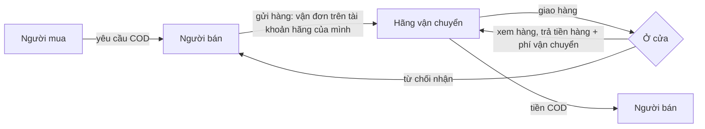

ShopNexus là hệ thống mua bán C2C ở Việt Nam, nơi mọi người mua bán với nhau. Hệ thống chạy trên hai ràng buộc: không giữ tiền của ai, và không phân xử từng vụ. Mọi quy tắc khác trong hệ thống đều đi ra từ hai điều này.

## Hệ quả

- Chỉ có một cách mua: <Term id="cod-inspection">COD đồng kiểm</Term>. Người mua xem món hàng trước khi trả tiền cho shipper.
- Người mua không trả gì trong ứng dụng, nên hệ thống không bao giờ có khoản nào phải hoàn.
- Từ chối nhận bưu kiện thay cho việc hoàn tiền. Khi người mua đã trả tiền, hệ thống không đòi lại được, và ứng dụng nói rõ điều đó trước khi họ trả.
- Sau khi giao, người mua và người bán đánh giá nhau. Không ai ra phán quyết.
- Uy tín là một bộ dữ kiện mà mọi người thấy trước khi vào deal, và chế tài là lấy đi quyền.
- Nhân viên xử lý bốn loại việc: hàng cấm hoặc hàng giả, lừa đảo có tổ chức, yêu cầu từ cơ quan chức năng và phiếu hỗ trợ. Số việc này không tăng theo số đơn.
- Không có phí theo đơn. Người bán có thể trả tiền để đẩy tin lên đầu danh sách tin mới; khoản đó là ShopNexus bán dịch vụ, không bao giờ là tiền của giao dịch.

## Đường COD

Người bán liên kết tài khoản GHTK hoặc GHN của chính mình một lần, trong phần thiết lập COD. Khi người bán gửi hàng, hệ thống tạo vận đơn trên tài khoản đó và theo dõi bưu kiện qua các cập nhật của hãng. Hãng trả tiền COD cho người bán theo điều khoản trên tài khoản của chính người bán. Hãng đã xác minh danh tính người bán lúc mở tài khoản, nên bán trên ShopNexus chỉ cần một số điện thoại đã xác minh.

Các bước, trạng thái và thời hạn của một đơn nằm ở trang [Giao dịch COD](/vi/marketplace/cod-deal).
