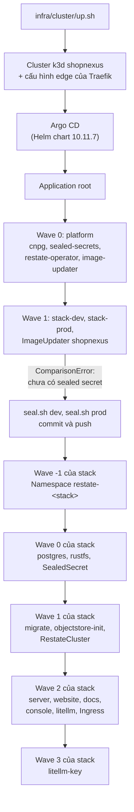

Bài hướng dẫn này đưa một bản fork của repo umbrella thành một cluster k3d tên `shopnexus` chạy hai stack: dev trong `shopnexus-dev` và prod trong `shopnexus-prod`. Bạn chạy ba script: `infra/cluster/up.sh` tạo cluster và cài Argo CD, `infra/cluster/seal.sh` ghi các secret, còn `infra/smoke.sh` kiểm tra kết quả. Argo CD cài và đồng bộ mọi thứ còn lại từ bản fork của bạn.

<Prereqs time="1 giờ" who="Quản trị viên và lập trình viên">
- Một máy Linux có địa chỉ IP công khai và đủ bộ nhớ trống cho hai stack. Kế hoạch dựng hệ thống của tác giả dừng lại để cân nhắc khi còn dưới 6 GB khả dụng.
- Docker. `seal.sh` cũng dùng Docker để chạy image server sinh khóa.
- k3d. Cluster được dựng bằng k3d v5.9.0; server của tác giả chạy v5.8.3. `infra/cluster/k3d.yaml` ghim image node `rancher/k3s:v1.37.1-k3s1`.
- kubectl (đã thử với v1.37.2), Helm (v4.3.1) và kubeseal (0.41.2).
- openssl, `seal.sh` dùng nó để sinh mật khẩu ngẫu nhiên.
- yq (v4.54.1), chỉ `infra/check.sh` cần, để kiểm tra chart trước khi bạn push một thay đổi.
- Một tên miền mà bạn quản lý được DNS, và một tài khoản GitHub để chứa bản fork.
</Prereqs>

## Thứ tự khởi động



Application `root` đồng bộ `infra/platform` và `infra/argocd` từ bản fork của bạn. Wave 0 của nó cài bốn operator của platform, wave 1 tạo mỗi stack một Application. Mỗi Application của stack render Helm chart trong `infra/stack` và áp dụng nó theo các wave riêng.

## Các bước

<Steps>
<Step title="Fork repo và trỏ cấu hình về bản fork">
Fork `shopnexus/shopnexus` trên GitHub rồi clone bản fork về máy. Argo CD đọc bản fork mà không dùng thông tin đăng nhập, nên bản fork phải ở chế độ public.

Đặt `repoURL` thành URL clone của bản fork trong hai file:

- `infra/argocd/root.yaml`, có hai chỗ, một cho `infra/platform` và một cho `infra/argocd`;
- `infra/argocd/stacks.yaml`, một chỗ trong `stack-dev` và một chỗ trong `stack-prod`.

Đặt `domain` trong `infra/stack/values-dev.yaml` và `infra/stack/values-prod.yaml`. Giá trị gốc là `dev.shopnexus.id.vn` và `shopnexus.id.vn`; giữ nguyên cấu trúc đó, với dev nằm dưới prod một nhãn.

Mỗi stack chạy LiteLLM, nó gửi truy vấn tìm kiếm đến `litellm.model` tại `litellm.apiBase` trong `infra/stack/values.yaml`. Mặc định là `claude-haiku-5-5` và `http://host.k3d.internal:8317/v1`, một cli-proxy-api chạy trên máy host. Trỏ `apiBase` về bất kỳ API tương thích OpenAI nào mà bạn có khóa. Nếu bạn tự build image, đổi các tên `ghcr.io/shopnexus/*` trong `infra/stack/values.yaml` và `infra/argocd/stacks.yaml`, và đặt các package GHCR ở chế độ public.

Commit và push lên `main`.

Bạn sẽ thấy URL clone của mình trên mọi dòng `repoURL`:

```bash title="Terminal"
grep -n repoURL infra/argocd/*.yaml
```
</Step>

<Step title="Tạo bản ghi DNS">
Tạo bốn bản ghi A trỏ về IP công khai của máy. Lấy `example.com` làm tên miền prod:

| Bản ghi | Phủ |
|---|---|
| `@` | `example.com`, website prod |
| `*` | `api.`, `media.`, `docs.` và `console.example.com` |
| `*.dev` | `api.dev.`, `media.dev.`, `docs.dev.` và `console.dev.example.com` |
| `dev` | `dev.example.com`, website dev |

Khi đã có `*.dev`, bản ghi `*` không còn phủ `dev.example.com`, nên website dev cần bản ghi `dev` riêng (trang [Biên và mạng](/vi/operations/cluster/networking#bản-ghi-dns) giải thích lý do).

Bạn sẽ thấy IP của máy cho cả website dev lẫn một host bên dưới nó:

```bash title="Terminal"
dig +short dev.example.com
dig +short api.dev.example.com
```
</Step>

<Step title="Tạo cluster bằng up.sh">
Chọn chế độ biên. `direct` để Traefik trong cluster giữ cổng 80 và 443 và lấy chứng chỉ từ Let's Encrypt. `behind-proxy` dành cho máy đã có một proxy khác giữ các cổng đó; khi ấy Traefik nghe ở `127.0.0.1:18080` và proxy lo phần TLS. Máy mới dùng `direct`. Server của tác giả dùng `behind-proxy`, đứng sau một Caddy dùng chung.

<Tabs labels={["direct", "behind-proxy"]}>
<Tab>
`ACME_EMAIL` là bắt buộc. `ACME_SERVER` mặc định là môi trường staging của Let's Encrypt, có chứng chỉ mà trình duyệt không tin nhưng giới hạn tần suất thoáng hơn. Bắt đầu với staging và chuyển sang production sau khi smoke test qua.

```bash title="Terminal"
ACME_EMAIL=you@example.com infra/cluster/up.sh direct
```

Traefik trả lời thử thách TLS-ALPN-01 trên cổng 443, nên cổng 443 phải mở ra internet. Cổng 80 chuyển hướng sang HTTPS bằng mã 301. Trang [Biên và mạng](/vi/operations/cluster/networking#chế-độ-biên) có ánh xạ cổng và các thiết lập Traefik của chế độ này.
</Tab>
<Tab>
```bash title="Terminal"
infra/cluster/up.sh behind-proxy
```

Proxy trên máy host kết thúc TLS và chuyển HTTP thường đến `127.0.0.1:18080`. Traefik tin các header `X-Forwarded-*` đến từ địa chỉ private. Khối Caddy trên server của tác giả liệt kê mọi host của cả hai stack:

```text title="/etc/caddy/conf.d/shopnexus.caddy"
shopnexus.id.vn, api.shopnexus.id.vn, console.shopnexus.id.vn, media.shopnexus.id.vn, docs.shopnexus.id.vn,
dev.shopnexus.id.vn, api.dev.shopnexus.id.vn, console.dev.shopnexus.id.vn, media.dev.shopnexus.id.vn, docs.dev.shopnexus.id.vn {
	request_body {
		max_size 50MB
	}
	reverse_proxy 127.0.0.1:18080
}
```

Thay các tên bằng tên miền của bạn, chạy `caddy validate --adapter caddyfile --config <file>` rồi reload Caddy. Proxy phải giữ nguyên header `Host`, và `reverse_proxy` mặc định làm vậy: một lượt upload presigned lên `media.` được ký cho đúng host đó. Caddy chuyển hướng HTTP thường bằng mã 308.
</Tab>
</Tabs>

Sau đó up.sh làm lần lượt:

1. `k3d cluster create --config k3d.yaml` với ánh xạ cổng của chế độ biên. Cluster có một node server và ba agent. `agent-0` mang nhãn `role=stateful`, còn `agent-1` và `agent-2` mang `role=app`.
2. Điền `${ACME_EMAIL}` và `${ACME_SERVER}` vào `edge-<mode>.yaml` rồi áp dụng. File này là một `HelmChartConfig` cấu hình lại Traefik đi kèm k3s.
3. Cài Argo CD từ chart `argo/argo-cd`, phiên bản 10.11.7, vào namespace `argocd`, với `infra/cluster/argocd-values.yaml`. File đó thêm phần kiểm tra health cho Application; thiếu nó, `root` sẽ không chờ platform healthy rồi mới khởi động các stack.
4. Áp dụng `infra/argocd/root.yaml`. Từ đây Argo CD quản lý luôn file đó.

Bạn sẽ thấy hai dòng này ở cuối:

```text
Argo CD is syncing. Watch it with: kubectl -n argocd get applications -w
Then seal the secrets: infra/cluster/seal.sh dev && infra/cluster/seal.sh prod
```
</Step>

<Step title="Đọc những gì Argo CD hiển thị">
```bash title="Terminal"
kubectl -n argocd get applications
```

Sau vài phút, bốn Application của platform là `cnpg`, `sealed-secrets`, `restate-operator` và `image-updater` ở trạng thái Synced và Healthy. `stack-dev` và `stack-prod` hiện Unknown kèm một ComparisonError:

```text
infra/stack/secrets/dev/ holds no sealed secrets: run infra/cluster/seal.sh dev, commit and push
```

Lỗi này nằm trong dự tính. Chart trong `infra/stack/templates/secrets.yaml` từ chối render khi `infra/stack/secrets/<stack>/` chưa có SealedSecret nào, vì stack không thể chạy thiếu chúng. Lúc này các secret chưa thể có: `kubeseal` mã hóa bằng chứng chỉ của controller Sealed Secrets, và controller đó vừa lên ở wave 0 một phút trước. Cả hai Application của stack thử lại, với thời gian chờ tăng dần từ 30 giây đến 5 phút, cho đến khi các file đã niêm phong có mặt trong git.

Để vào giao diện web, chuyển tiếp một cổng và đọc mật khẩu admin ban đầu:

```bash title="Terminal"
kubectl -n argocd port-forward svc/argocd-server 8080:443
kubectl -n argocd get secret argocd-initial-admin-secret -o jsonpath='{.data.password}' | base64 -d
```
</Step>

<Step title="Niêm phong các secret">
Chạy `seal.sh` một lần cho mỗi stack. Script cần Docker và một context kubectl trỏ vào cluster này; k3d đã đặt nó làm context hiện tại.

```bash title="Terminal"
infra/cluster/seal.sh dev
```

Lần chạy đầu chép `infra/stack/secrets/example.env` thành `infra/stack/secrets/dev.env` với quyền 600, sinh mọi khóa stack cần rồi ghi thêm vào: khóa JWT, khóa staff và khóa ký của Restate (từ `/keygen` trong image server), khóa RustFS, master key và mật khẩu database của LiteLLM, và virtual key LiteLLM của server. Khóa riêng của Restate nằm ở `dev.restate.pem` bên cạnh. Rồi script dừng:

```text
.../infra/stack/secrets/dev.env: set LLM_UPSTREAM_API_KEY
```

Mở `dev.env` và điền các giá trị mà script không tự sinh được:

| Biến | dev | prod |
|---|---|---|
| `LLM_UPSTREAM_API_KEY` | bắt buộc | bắt buộc |
| `FCM_CREDENTIALS` | tùy chọn; để trống thì thông báo đẩy chỉ được ghi log thay vì gửi đi | bắt buộc; `APP_ENV=prod` không chấp nhận giá trị trống, và `seal.sh prod` cũng vậy |

`LLM_UPSTREAM_API_KEY` là khóa của API tại `litellm.apiBase`. `FCM_CREDENTIALS` là JSON của một service account Firebase, mã hóa base64.

Chạy lại script cho dev, rồi hai lần cho prod:

```bash title="Terminal"
infra/cluster/seal.sh dev
infra/cluster/seal.sh prod     # tạo prod.env rồi dừng
infra/cluster/seal.sh prod     # sau khi điền prod.env
```

Lần chạy thứ hai giữ các khóa đã có trong `<stack>.env`, nên niêm phong đúng những giá trị đó. Mỗi lần chạy thành công ghi bốn SealedSecret vào `infra/stack/secrets/<stack>/`: `server-secrets.yaml`, `restate-secrets.yaml`, `litellm-secrets.yaml` và `litellm-db.yaml`. Commit và push chúng:

```bash title="Terminal"
git add infra/stack/secrets/dev infra/stack/secrets/prod
git commit -m "infra: sealed secrets for dev and prod"
git push
```

Các file `.env` và `.pem` bị git bỏ qua và chỉ nằm trên máy.

Sau mỗi lần chạy thành công, bạn sẽ thấy `sealed into infra/stack/secrets/<stack>/; commit and push`.

<Callout type="warning" title="Sao lưu khóa ngay bây giờ">
Chép `dev.env`, `prod.env`, `dev.restate.pem` và `prod.restate.pem` vào một trình quản lý mật khẩu, cùng với khóa của controller:

```bash title="Terminal"
kubectl -n kube-system get secret -l sealedsecrets.bitnami.com/sealed-secrets-key -o yaml > sealed-secrets-key.yaml
```

Thiếu khóa của controller, các SealedSecret trong git không mở được trên một cluster mới. Thiếu các file `.env`, một lần niêm phong lại sẽ sinh khóa mới. `STAFF_KEY` mới làm mọi secret TOTP đã lưu không đọc được nữa, và không nhân viên nào đăng nhập được cho tới khi `/staff reset-totp` xóa TOTP của họ. Khóa JWT mới chỉ làm hỏng các access token ký trước nó, vốn sống 15 phút; refresh token nằm trong Postgres và vẫn dùng được. Bảng ghi mỗi file bảo vệ điều gì nằm ở trang [Secret](/vi/operations/cluster/secrets#các-file-cần-sao-lưu), cùng các lệnh xuất và khôi phục.
</Callout>
</Step>

<Step title="Theo dõi các sync wave">
Argo CD nhận bản push ở lần poll repo tiếp theo. Để nó xem ngay:

```bash title="Terminal"
kubectl -n argocd annotate application stack-dev argocd.argoproj.io/refresh=normal
kubectl -n argocd annotate application stack-prod argocd.argoproj.io/refresh=normal
```

Sau đó mỗi stack đồng bộ theo các wave từ -1 tới 3 như sơ đồ ở trên, và Argo CD chờ một wave healthy rồi mới bắt đầu wave sau. Trang [Postgres, Restate và RustFS](/vi/operations/cluster/data#sync-wave-và-job) liệt kê mọi resource của từng wave.

```bash title="Terminal"
kubectl -n argocd get applications -w
kubectl -n shopnexus-prod get pods -o wide
kubectl -n restate-prod get pods -o wide
```

Bạn sẽ thấy `stack-dev` và `stack-prod` ở trạng thái Synced và Healthy. Dev chạy mỗi thứ một bản. Prod chạy ba pod server trên `agent-1` và `agent-2`, hai pod Postgres trên hai node khác nhau và ba pod Restate trên ba node khác nhau.
</Step>

<Step title="Chạy smoke test">
`infra/smoke.sh` gửi request đến mọi host công khai của một stack. Thêm `-k` khi chứng chỉ còn đến từ staging của Let's Encrypt.

```bash title="Terminal"
infra/smoke.sh dev.example.com -k
infra/smoke.sh example.com -k
```

Script kiểm tra `https://<domain>/`, `https://api.<domain>/healthz` và `/readyz`, `https://docs.<domain>/` và `https://media.<domain>/health` trả 200, và `http://api.<domain>/healthz` trả về chuyển hướng (301 từ Traefik, 308 từ Caddy). Nó không gọi `console.`.

Bạn sẽ thấy sáu dòng `ok` và mã thoát 0. Một dòng `FAIL` ghi URL, mã trạng thái nhận được và mã trạng thái mong đợi.
</Step>

<Step title="Chuyển sang chứng chỉ production">
Bước này chỉ áp dụng cho `direct`; ở chế độ `behind-proxy`, proxy trên máy host tự lấy chứng chỉ.

Áp dụng lại cấu hình edge với thư mục ACME production:

```bash title="Terminal"
sed -e "s|\${ACME_EMAIL}|you@example.com|" \
    -e "s|\${ACME_SERVER}|https://acme-v02.api.letsencrypt.org/directory|" \
    infra/cluster/edge-direct.yaml | kubectl apply -f -
```

k3s triển khai lại Traefik với `caServer` mới. Traefik giữ chứng chỉ trong `/data/acme.json` trên một volume, và file đó vẫn chứa chứng chỉ staging. Xóa nó và khởi động lại Traefik để Traefik xin chứng chỉ mới:

```bash title="Terminal"
kubectl -n kube-system exec deploy/traefik -- rm /data/acme.json
kubectl -n kube-system rollout restart deploy/traefik
```

Bạn sẽ thấy `infra/smoke.sh example.com` qua mà không cần `-k`.
</Step>

<Step title="Mở console">
Console nhân viên ở `console.<domain>` cần một tài khoản nhân viên, và cluster mới chưa có tài khoản nào. API và console chỉ tạo được moderator; admin đầu tiên được tạo bằng lệnh `staff` trong một pod server:

```bash title="Terminal"
kubectl -n shopnexus-prod exec -it $(kubectl -n shopnexus-prod get pod -l app.kubernetes.io/name=server -o name | head -1) -- \
  /staff create-admin --email you@example.com --name "Your Name"
```

Lệnh in ra `created admin you@example.com (<id>)` và một mật khẩu tạm. Mở `https://console.example.com` và đăng nhập bằng mật khẩu đó. Console yêu cầu đặt mật khẩu mới, rồi đăng ký một ứng dụng xác thực TOTP. Chạy cùng lệnh đó trong `shopnexus-dev` cho console của dev.

Bạn sẽ thấy trang chính của console. Trang [Runbook](/vi/operations/cluster/runbook#tài-khoản-admin) có các lệnh `staff` còn lại.
</Step>
</Steps>

## Gỡ bỏ

```bash title="Terminal"
k3d cluster delete shopnexus
```

Lệnh này xóa mọi node, volume và database trong cluster, kể cả khóa của controller Sealed Secrets. Các SealedSecret trong git chỉ mở được trên một cluster mới nếu bạn khôi phục khóa đó từ bản sao lưu trước khi niêm phong lại; trang [Secret](/vi/operations/cluster/secrets) có quy trình. Nếu không có khóa, chạy `seal.sh` với cluster mới, script dùng lại các khóa trong `<stack>.env`, rồi commit các SealedSecret mới.

<Cards>
<Card title="Tổng quan cluster" href="/vi/operations/cluster">Những gì chạy trong cluster và lý do.</Card>
<Card title="Biên và mạng" href="/vi/operations/cluster/networking">Hai chế độ biên, Traefik và các network policy.</Card>
<Card title="Secret" href="/vi/operations/cluster/secrets">Niêm phong, niêm phong lại và khôi phục khóa controller.</Card>
<Card title="Runbook" href="/vi/operations/cluster/runbook">Cần làm gì khi một bước ở trên thất bại.</Card>
</Cards>
