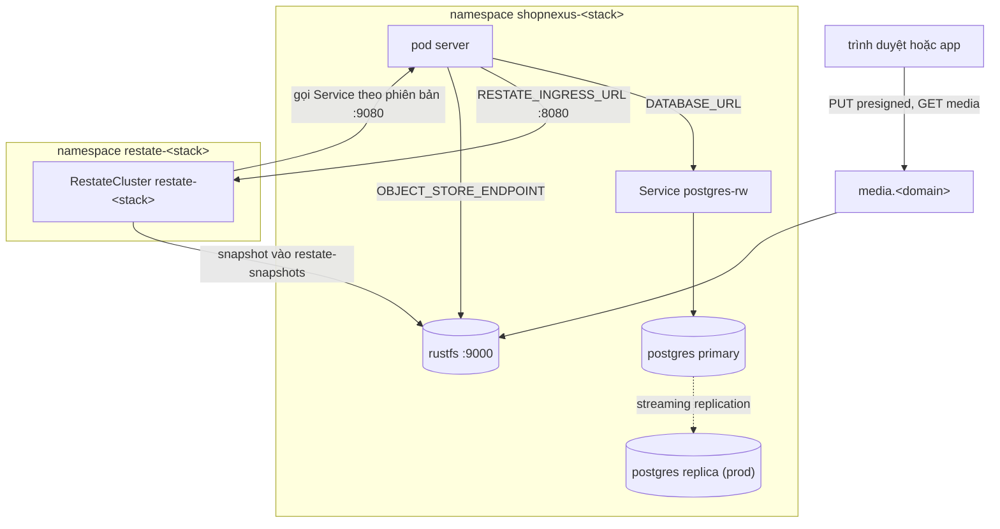
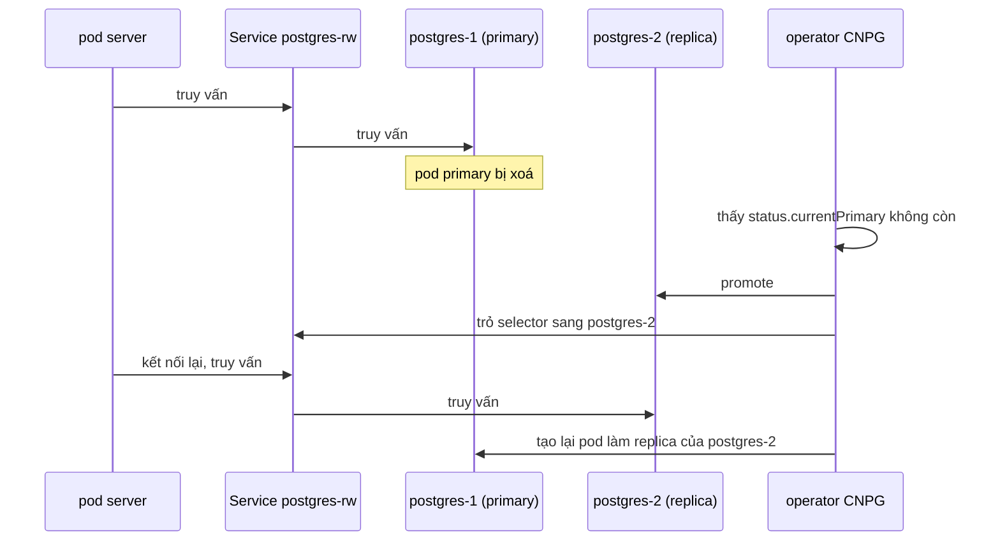
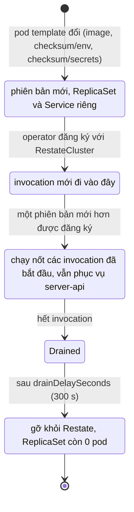

Mỗi stack (`shopnexus-dev` và `shopnexus-prod`) có Postgres riêng, cluster Restate riêng và RustFS riêng. Hai stack dùng chung các operator và không dùng chung dữ liệu. Chart khai báo chúng là `infra/stack/`; các template là `postgres.yaml`, `restate.yaml`, `rustfs.yaml`, `server.yaml` và `jobs.yaml`.



| | dev | prod |
|---|---|---|
| Số instance Postgres | 1 | 2 |
| Dung lượng Postgres | 5Gi | 10Gi |
| Số node Restate | 1 | 3 |
| `default-replication` của Restate | 1 | 2 |
| Dung lượng mỗi node Restate | 2 GiB | 4 GiB |
| Số replica RustFS | 1 | 1 |
| Dung lượng RustFS | 10Gi | 10Gi |
| Số replica server | 1 | 3 |

Các giá trị lấy từ `infra/stack/values.yaml`, được `values-prod.yaml` ghi đè.

## Postgres trên CloudNativePG

Operator CloudNativePG (CNPG, trong namespace `cnpg-system`) chạy một `Cluster` tên `postgres` trong namespace của mỗi stack. dev có 1 instance, prod có 2: một primary và một replica streaming.

### Image và user

Image là `paradedb/paradedb:0.26.4-pg18`, tức Postgres 18 kèm extension `pg_search` của ParadeDB. CNPG đọc major version của Postgres từ tag image và không parse được `0.26.4-pg18`. Vì vậy chart khai báo một `ImageCatalog` tên `postgres` ánh xạ `major: 18` sang image này, và `Cluster` trỏ tới catalog qua `imageCatalogRef`.

Image ParadeDB chạy `postgres` với uid 999. CNPG mặc định uid 26, uid trong image của chính CNPG, nên `Cluster` đặt `postgresUID: 999` và `postgresGID: 999`. Cả hai lỗi này được phát hiện trên một cluster k3d cục bộ trước khi bản sửa được đưa vào.

### pg_search

`shared_preload_libraries: [pg_search]` nạp extension vào mọi instance. Phần bootstrap tạo database `app` do role `app` sở hữu, và chạy `CREATE EXTENSION IF NOT EXISTS pg_search CASCADE` trong đó qua `postInitApplicationSQL`. CNPG chạy câu lệnh này bằng superuser. Migration `0019_search.sql` của server chạy cùng câu lệnh bằng `app`, role không có quyền tạo extension, và vẫn qua vì extension đã có sẵn.

### Kết nối và secret

CNPG tạo Secret `postgres-app`. Server và các job của nó đọc `DATABASE_URL` từ key `uri`. URI đó chỉ tới Service `postgres-rw`, được CNPG giữ trỏ vào primary hiện tại, nên cấu hình của stack không nêu tên pod Postgres nào.

### Database của LiteLLM

`Cluster` còn quản lý role `litellm` (`ensure: present`, `login: true`); CNPG đọc mật khẩu của role từ Secret basic-auth `litellm-db`, do lệnh seal, `infra/cmd/seal`, niêm phong. Một resource `Database` riêng tên `litellm`, chủ sở hữu `litellm`, tạo database trên cùng cluster ở wave 1. LiteLLM lưu virtual key và mức chi tiêu ở đó, như mô tả trong [Cổng mô hình ngôn ngữ](/vi/operations/cluster/llm-gateway).

### Bố trí pod

`enablePodAntiAffinity: true` cùng `podAntiAffinityType: preferred` và `topologyKey: kubernetes.io/hostname` yêu cầu scheduler đặt hai instance của prod trên hai node khác nhau. Quy tắc này là preferred, nên khi chỉ còn một agent thì cả hai instance vẫn được xếp lịch.

### Failover

Khi pod primary mất, CNPG promote replica và chuyển `postgres-rw` sang nó. Server kết nối lại qua cùng tên Service. dev chỉ có một instance, nên trên dev mất primary là mất dịch vụ cho tới khi pod chạy lại.



Bài diễn tập cho tình huống này đã được viết (plan Task 17, bước 1) nhưng chưa chạy. Kết quả mong đợi là `currentPrimary` đổi sang instance còn lại trong vòng một phút và `infra/smoke.hurl` qua. Để theo dõi:

```bash
kubectl -n shopnexus-prod get cluster postgres \
  -o jsonpath='{.status.currentPrimary} {.status.phase}{"\n"}'
```

## Restate trên restate-operator

restate-operator 3.2.0 chạy hai resource cho mỗi stack: một `RestateCluster` là Restate server, và một `RestateDeployment` chạy `server` làm endpoint dịch vụ Restate.

### RestateCluster

`RestateCluster` tên là `restate-<stack>`, và operator đặt nó trong namespace cùng tên. Chart tự tạo namespace này ở wave -1, để `restate-secrets` đã niêm phong vào được namespace trước khi cluster tồn tại.

| Thiết lập | Giá trị |
|---|---|
| Image | `restatedev/restate:1.8.1` |
| Số node (`compute.replicas`) | dev 1, prod 3 |
| Role trên mọi node | `worker`, `admin`, `log-server`, `metadata-server`, `http-ingress` |
| Metadata | `[metadata-client] type = "replicated"`, địa chỉ `http://restate-cluster:5122/` |
| Partition | `default-num-partitions = 24` |
| Replication | `default-replication` = số nhỏ hơn giữa 2 và số node: dev 1, prod 2 |
| Provision | `spec.cluster.autoProvision: true`: operator gọi ProvisionCluster khi các pod đã chạy; các node có `auto-provision = false` |
| Snapshot | `s3://restate-snapshots/<stack>` trên `http://rustfs.shopnexus-<stack>:9000`, cứ 10000 record một lần |
| Ký request | `requestSigningPrivateKey` phiên bản `v1`, key `private.pem` của `restate-secrets` |
| Phân tán | `topologySpreadConstraints`, `maxSkew: 1` theo `kubernetes.io/hostname`, `ScheduleAnyway` |

Snapshot được ghi vào RustFS của stack bằng access key lưu trong `restate-secrets` dưới tên `AWS_ACCESS_KEY_ID` và `AWS_SECRET_ACCESS_KEY`. Đó cũng là cặp key mà RustFS dùng để chạy. README của operator khuyên không chạy cluster phân tán mà thiếu snapshot, vì node bị tụt lại sẽ bắt kịp từ snapshot.

Restate ký mọi request gửi tới server bằng `private.pem`. Server giữ public key trong `RESTATE_IDENTITY_KEY` và từ chối request không có chữ ký. Lệnh seal giữ private key trong `infra/stack/secrets/<stack>.restate.pem` và dừng lại nếu file này mất trong khi `.env` vẫn còn public key; xem [Secret](/vi/operations/cluster/secrets).

`spec.security.networkPeers` chỉ cho traffic vào cổng ingress và admin từ các pod server của stack. Ở chiều ngược lại, Restate chỉ được tới các pod mang nhãn `allow.restate.dev/restate-<stack>: "true"`, nhãn mà chart gắn cho pod server và pod RustFS.

Ràng buộc phân tán `ScheduleAnyway` đặt ba node của prod lên ba agent và vẫn xếp lịch được khi một agent dừng. Với `default-replication = 2`, prod được thiết kế để vẫn nhận invocation khi mất một node; bài diễn tập dừng một agent (plan Task 17, bước 2) chưa chạy.

### RestateDeployment cho server

Server chạy dưới dạng `RestateDeployment` tên `server` (`restate.dev/v1beta1`), ở wave 2. Nó giống một Deployment, có điều mỗi pod template khác nhau trở thành một phiên bản với ReplicaSet riêng và Service riêng, và operator giữ phiên bản cũ chạy tới khi Restate không còn invocation nào trên đó.

- Operator đăng ký từng phiên bản với cluster nêu trong `restate.register.cluster` (`restate-<stack>`), kèm `useHttp11: true`. Khi đó mỗi invocation là một HTTP request riêng, nên Service chia invocation đều cho các pod.
- Invocation bắt đầu trên phiên bản nào thì kết thúc trên phiên bản đó và không bao giờ replay trên phiên bản khác.
- Khi một phiên bản đã drain xong, operator chờ `drainDelaySeconds` (mặc định 300 s; chart không đặt giá trị này) rồi gỡ phiên bản và scale ReplicaSet của nó về 0. Operator giữ lại `revisionHistoryLimit` (mặc định 10) ReplicaSet cũ.
- Traffic API đi qua Service `server-api` ở cổng 8080, Service này chọn mọi pod server của mọi phiên bản, nên phiên bản cũ vẫn phục vụ request API cho tới khi bị scale về 0.

Khi chạy bằng `make run`, server tự đăng ký với Restate lúc khởi động, kèm `force: true`. Dưới operator, lần đăng ký đó sẽ ghi đè lần đăng ký của operator, nên stack đặt `RESTATE_REGISTER: "false"` trong ConfigMap `server-env`. Khi đó server chỉ phục vụ endpoint ở `0.0.0.0:9080` và ghi log rằng việc đăng ký để cho restate-operator.

Operator chỉ tạo phiên bản mới khi pod template đổi. Tag image mới làm template đổi. Thay đổi ở ConfigMap `server-env` hay ở một SealedSecret thì không, nên template mang hai annotation:

| Annotation | Băm của |
|---|---|
| `checksum/env` | dữ liệu đã render của ConfigMap `server-env` (sha256, 16 ký tự đầu) |
| `checksum/secrets` | mọi file trong `infra/stack/secrets/<stack>/` |

StatefulSet của RustFS mang cùng `checksum/secrets`, nên niêm phong lại access key sẽ khởi động lại RustFS với key mới.



Trên một cluster k3d cục bộ, operator đã đăng ký phiên bản đầu tiên với 13 service của nó, và một thay đổi cấu hình đã tạo phiên bản thứ hai trong khi phiên bản đầu vẫn được đăng ký. Bài diễn tập phát hành trong lúc có invocation dài (plan Task 17, bước 3) chưa chạy.

Để xem các phiên bản của một stack:

```bash
kubectl -n shopnexus-dev get restatedeployment server
kubectl -n shopnexus-dev get replicasets
```

Trang [Phát hành](/vi/operations/cluster/releases) mô tả cách một image mới tới được stack.

## RustFS

RustFS là object store tương thích S3. Mỗi stack chạy một StatefulSet `rustfs` với một replica (`rustfs/rustfs:1.0.4`), một volume 10Gi gắn ở `/data`, và một Service `rustfs` ở cổng 9000. Console của nó tắt (`RUSTFS_CONSOLE_ENABLE=false`). Pod ưu tiên node có nhãn `role=stateful`, tức `agent-0`. Nó đọc access key từ `server-secrets` (`OBJECT_STORE_ACCESS_KEY`, `OBJECT_STORE_SECRET_KEY`).

| Bucket | Dùng cho | Quyền truy cập |
|---|---|---|
| `shopnexus` | `OBJECT_STORE_BUCKET` của server | key dưới `media/` ai cũng đọc được |
| `restate-snapshots` | snapshot của Restate, dưới prefix `<stack>/` | quy tắc đọc `media/` cũng có ở đây; prefix đó không chứa gì |

### Tạo bucket

Image server có sẵn `/objectstore-init`. Lệnh này tạo `OBJECT_STORE_BUCKET` nếu bucket chưa có và đặt policy cho phép bất kỳ ai `s3:GetObject` trên `<bucket>/media/*`. Chart chạy nó hai lần ở wave 1: job `objectstore-init` với môi trường của server, chuẩn bị `shopnexus`, và job `objectstore-init-snapshots` với `OBJECT_STORE_BUCKET=restate-snapshots`. Chạy lại trên bucket đã có thì chỉ đặt lại policy.

### Upload

Trình duyệt và app upload thẳng vào RustFS bằng URL PUT presigned. Server ký URL cho `OBJECT_STORE_PUBLIC_ENDPOINT=https://media.<domain>` và nói chuyện với RustFS trong cluster qua `OBJECT_STORE_ENDPOINT=http://rustfs:9000`. Một PUT presigned cố định `Content-Type` và `Content-Length`. File công khai được đọc từ `MEDIA_PUBLIC_URL=https://media.<domain>/shopnexus`. Ingress chuyển `media.<domain>` tới `rustfs:9000`.

<Callout type="warning" title="Header Host">
Chữ ký bao gồm host `media.<domain>`. Một proxy đứng trước Traefik mà viết lại header `Host` sẽ làm mọi lần upload hỏng với lỗi chữ ký. Trên server của tác giả, Caddy dùng chung phải chuyển `Host` nguyên vẹn; xem [Biên và mạng](/vi/operations/cluster/networking).
</Callout>

Bất kỳ dịch vụ S3 nào cũng thay được RustFS bằng cách đổi các giá trị `OBJECT_STORE_*`.

## Sync wave và job

Argo CD áp một stack theo từng wave. Nó chỉ bắt đầu một wave khi mọi resource của wave trước đã healthy, và một job Sync hook được tính là healthy khi đã chạy xong.

| Wave | Resource |
|---|---|
| -1 | Namespace `restate-<stack>` |
| 0 | `ImageCatalog` và `Cluster` `postgres`, StatefulSet `rustfs`, các SealedSecret; resource không có annotation wave (ConfigMap `server-env`, Service, NetworkPolicy) |
| 1 | `RestateCluster`, `Database` `litellm`, các job Sync hook `migrate`, `objectstore-init`, `objectstore-init-snapshots` |
| 2 | `RestateDeployment` `server`, Deployment `website`, `docs`, `console`, `litellm`, Ingress `shopnexus` |
| 3 | Job Sync hook `litellm-key` |

Ba job ở wave 1 chạy image server với đầy đủ môi trường của server. Mỗi job có `backoffLimit: 6`, `restartPolicy: OnFailure` và `hook-delete-policy: BeforeHookCreation`, nên mỗi lần sync sẽ xoá lần chạy trước và chạy lại job.

`migrate` phải xong trước wave 2. Khi khởi động, server so database với các migration nhúng sẵn và từ chối chạy nếu còn migration chưa áp, với thông báo `migrations pending: <names>; run go run ./cmd/migrate or make run`. Server khởi động trước `migrate` sẽ crash-loop cho tới khi job xong.

<KeyRules>
- `DATABASE_URL` luôn lấy từ `postgres-app`, key `uri`, và trỏ tới `postgres-rw`.
- `RESTATE_REGISTER` luôn là `"false"` trong cluster; restate-operator đăng ký các phiên bản.
- Thay đổi ở `server-env` hay ở một SealedSecret chỉ tới được server qua annotation `checksum/env` và `checksum/secrets`.
- Không bao giờ tạo lại `infra/stack/secrets/<stack>.restate.pem` cho một stack đang chạy.
</KeyRules>

## Bảo vệ dữ liệu

<Callout type="danger" title="Chưa có backup">
Không có gì trong `infra/` backup Postgres, Restate hay RustFS. CNPG chưa cấu hình backup hay lưu trữ WAL, và RustFS giữ đúng một bản của mỗi object. Trên k3d mọi volume là một thư mục trên ổ đĩa duy nhất của host, nên instance Postgres thứ hai và ba node Restate của prod chỉ bảo vệ trước việc mất một pod hay dừng một agent. Ổ đĩa hỏng hay đầy thì mất mọi bản cùng lúc. Mất host là mất dữ liệu của cả hai stack.
</Callout>

Những gì được bảo vệ:

- Pod primary Postgres của prod bị xoá: CNPG promote replica.
- Một agent của prod dừng: Restate giữ hai bản dữ liệu (`default-replication = 2`) và tiếp tục chạy trên các node còn lại.
- Pod RustFS hay Restate bị crash: StatefulSet tạo lại pod trên cùng volume.

Những gì không được bảo vệ:

- Ổ đĩa của host. Mọi volume dùng storage class mặc định của k3s, `local-path`, đặt volume trên filesystem của một node, và mọi node là một container trên cùng host.
- Node dừng, với các pod có volume nằm trên node đó. Volume `local-path` gắn pod vào node của nó, nên RustFS trên `agent-0` phải chờ `agent-0` chạy lại.
- Dòng dữ liệu bị xoá hay hỏng trong Postgres. Replica chép lại lần ghi sai gần như ngay lập tức.
- Postgres và Restate của dev, mỗi thứ chạy một instance.
- RustFS ở mọi stack: một replica, một volume.
- Key của controller SealedSecrets và các file mà lệnh seal giữ. Trang [Secret](/vi/operations/cluster/secrets#các-file-cần-sao-lưu) liệt kê chúng; hãy sao lưu chúng bằng tay.

<AccordionGroup>
<Accordion title='Pod server crash-loop với "migrations pending"'>
Job `migrate` chưa chạy xong. Xem log của nó bằng `kubectl -n shopnexus-<stack> logs job/migrate`. Lỗi kết nối thường có nghĩa là `Cluster` `postgres` chưa healthy; kiểm tra bằng `kubectl -n shopnexus-<stack> get cluster postgres`.
</Accordion>
<Accordion title="Pod postgres không khởi động sau khi đổi image">
CNPG cần major version từ `ImageCatalog`, còn image ParadeDB cần `postgresUID`/`postgresGID` 999. Một tag ParadeDB mới chạy major Postgres khác thì cần `major` mới ở cả catalog lẫn `imageCatalogRef`.
</Accordion>
<Accordion title="Thay đổi cấu hình không tới được server">
Kiểm tra annotation của pod template mới có khác bản cũ không: `kubectl -n shopnexus-<stack> get replicasets -o yaml | grep checksum/`. Một phiên bản cũ đang drain mà khởi động lại sẽ đọc `server-env` hiện tại, vì hai phiên bản dùng chung một ConfigMap.
</Accordion>
<Accordion title="Argo CD báo server Healthy trong khi nó crash-loop">
Argo CD không có health check cho `RestateCluster` và `RestateDeployment`, nên báo chúng Healthy ngay khi chúng tồn tại. Xem trực tiếp các pod: `kubectl -n shopnexus-<stack> get pods -l app.kubernetes.io/name=server`.
</Accordion>
</AccordionGroup>
