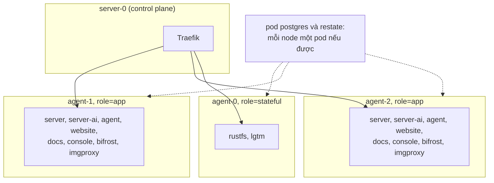
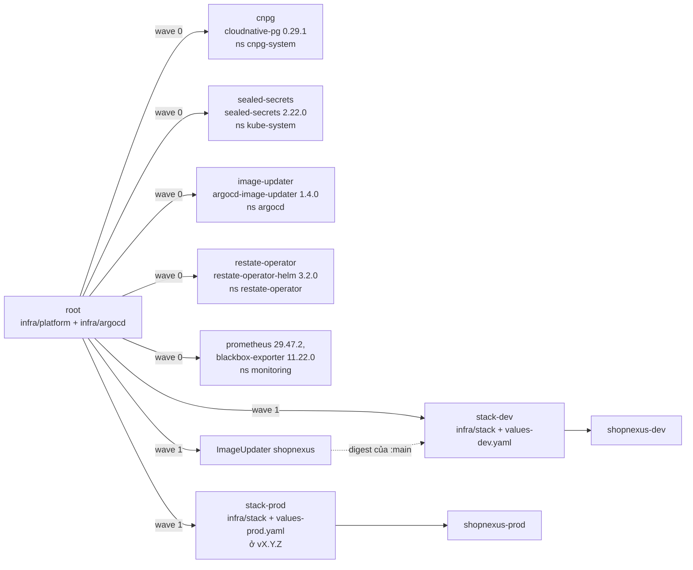

Một cluster k3d tên `shopnexus` chạy hai stack ShopNexus là dev và prod. Mỗi stack nằm trong namespace riêng và có database, cluster Restate, object store, cổng mô hình (Bifrost) và Grafana của riêng nó. Argo CD giữ cả hai stack khớp với repo umbrella.

## Các node

Cả hai file cấu hình k3d, `infra/cluster/k3d-direct.yaml` và `infra/cluster/k3d-behind-proxy.yaml`, tạo một server node và ba agent từ image `rancher/k3s:v1.37.1-k3s1`. Mỗi agent đóng vai một máy và mang một nhãn `role` mà các workload của chart ưu tiên.

| Node | Nhãn | Ưu tiên chạy |
|---|---|---|
| `server-0` | control plane | Traefik (cả hai cấu hình biên ghim nó ở đây bằng `nodeSelector`) |
| `agent-0` | `role=stateful` | `rustfs`, `lgtm` |
| `agent-1` | `role=app` | `server`, `server-ai`, `agent`, `website`, `docs`, `console`, `bifrost`, `imgproxy`, `pgweb` |
| `agent-2` | `role=app` | giống `agent-1` |



Mọi quy tắc xếp chỗ đều là ưu tiên. Node affinity theo `role` và pod anti-affinity của `server`, `website`, `docs`, `console` dùng `preferredDuringSchedulingIgnoredDuringExecution`. CloudNativePG dùng `podAntiAffinityType: preferred`, còn `RestateCluster` rải pod bằng `topologySpreadConstraints` với `whenUnsatisfiable: ScheduleAnyway`. Vì vậy pod vẫn được xếp lịch khi một agent bị dừng.

k3d chạy mỗi node thành một container Docker trên cùng một host, nên các agent dùng chung một kernel và một ổ đĩa. Với Kubernetes, dừng một agent bằng `docker stop` vẫn giống mất một máy, và các bài diễn tập failover cần đúng điều đó. Không file nào ngoài `infra/cluster/` nhắc tới k3d, nên chuyển sang k3s trên máy thật chỉ đổi `infra/cluster/`.

## Các stack

| | dev | prod |
|---|---|---|
| Tên miền | `dev.shopnexus.id.vn` | `shopnexus.id.vn` |
| Namespace | `shopnexus-dev` | `shopnexus-prod` |
| Namespace Restate | `restate-dev` | `restate-prod` |
| Application Argo CD | `stack-dev` | `stack-prod` |
| File values | `values-dev.yaml` | `values-prod.yaml` |
| `APP_ENV` | `dev` | `prod` |
| Image | `:main`, theo digest | các digest mà một bản phát hành của repo umbrella đã ghim, `vX.Y.Z` |
| Hãng vận chuyển | GHTK và GHN giả | tắt cho tới khi có hợp đồng đối tác |

<Callout type="note" title="Trước bản phát hành prod đầu tiên">
Khi prod chưa có bản phát hành nào, `values-dev.yaml` cho dev tên miền `shopnexus.id.vn`, được index, và phục vụ các host `dev.shopnexus.id.vn` như alias kèm `noindex`. Một alias phục vụ cùng website, API, media và tài liệu, còn host trang điều hành và host dashboard của nó chuyển hướng về tên miền chính.
</Callout>

`RestateCluster` của một stack tên là `restate-<stack>`, và restate-operator đặt nó vào namespace cùng tên. Chart tạo namespace đó ở sync wave -1 để `restate-secrets` đã seal có mặt trước khi cluster khởi động. NetworkPolicy chặn mọi ingress trong namespace của stack và chỉ mở những đường stack cần ([Biên và mạng](/vi/operations/cluster/networking) liệt kê chúng). Không policy nào mở đường giữa `shopnexus-dev` và `shopnexus-prod`.

## Các thành phần

Mỗi dòng là một workload mà chart trong `infra/stack` render vào namespace của stack. Số lượng lấy từ `values.yaml` (dev) và `values-prod.yaml` (prod).

| Thành phần | Kind | Cổng | dev | prod |
|---|---|---|---|---|
| `server` | `RestateDeployment` | 8080 HTTP, 9080 Restate, 9090 MCP | 1 | 3 |
| `server-ai` | `RestateDeployment` | 9080 Restate | 1, 2Gi, không có SigLIP 2 | 1, 6Gi |
| `agent` | `Deployment` | 3000 | 1 | 1 |
| `website` | `Deployment` | 3000 | 1 | 2 |
| `docs` | `Deployment` | 80 | 1 | 1 |
| `console` | `Deployment` | 80 | 1 | 2 |
| `postgres` | `Cluster` của CloudNativePG | 5432 | 1 instance, 5Gi | 2 instance, 10Gi |
| `restate-<stack>` | `RestateCluster` | 8080 ingress, 9070 admin | 1 node, 2 GiB | 3 node, 4 GiB |
| `rustfs` | `StatefulSet` | 9000 S3, 9001 web console | 1, 10Gi | 1, 10Gi |
| `bifrost` | `Deployment` | 8080 | 1 | 1 |
| `imgproxy`, `imgproxy-cache` | `Deployment` | 8080, 80 | mỗi cái 1 | mỗi cái 1 |
| `lgtm` | `Deployment` | 3000 Grafana, 4318 OTLP | 1, 5Gi | 1, 5Gi |
| `pgweb` | `Deployment` | 8081 | 1 | 1 |

- `server` chạy với `SERVER_ROLE=api`. Giọng nói, vector ảnh và khung hình video chạy trong `server-ai`, cùng image đó với `SERVER_ROLE=ai`, mà các pod khác gọi qua Restate. File mô hình của nó nằm trên volume `models`.
- `agent` là agent của trang điều hành, build từ repository agent thành `ghcr.io/shopnexus/agent`. Nó không có host: chỉ server gọi tới nó, và nó chỉ gọi cổng MCP của server.
- `bifrost` là cổng của stack tới các mô hình ở xa ([Cổng Bifrost](/vi/operations/cluster/llm-gateway)).
- `imgproxy` đổi kích thước ảnh từ RustFS, và `imgproxy-cache` (nginx) giữ lại mỗi câu trả lời. Host của website gửi `/_img` tới cache.
- `lgtm` là Grafana cùng Loki, Tempo và Prometheus, nhận telemetry của server. `pgweb` đọc database của stack. Cả hai nằm sau bước đăng nhập của trang điều hành ([Giám sát](/vi/operations/monitoring)).

Restate nhân bản mỗi partition ra `min(2, replicas)` node, tức 1 bản ở dev và 2 bản ở prod. Postgres chạy image `paradedb/paradedb:0.26.4-pg18`; Bifrost có database riêng `bifrost` trên cùng cluster CloudNativePG. Các Service `server-api` (8080) và `server-mcp` (9090) chỉ chọn phiên bản server hiện tại, còn restate-operator tạo cho mỗi phiên bản server một Service ở cổng 9080.

Ba Job chạy dưới dạng Sync hook của Argo CD ở wave 1:

| Job | Việc làm |
|---|---|
| `migrate` | chạy migration của server |
| `objectstore-init` | tạo bucket `shopnexus` và user RustFS riêng của server cho bucket đó |
| `objectstore-init-snapshots` | tạo bucket `restate-snapshots` và user của Restate cho bucket đó |

Argo CD áp dụng một stack theo các sync wave từ -1 tới 3. Bảng ghi mỗi wave gồm những gì, cùng các workload có trạng thái, nằm ở trang [Postgres, Restate và RustFS](/vi/operations/cluster/data#sync-wave-và-job).

## App-of-apps

Ở lần khởi động đầu, k3s cài Argo CD (chart `argo-cd` 10.11.7, namespace `argocd`) từ `infra/cluster/argocd.yaml` và apply một Application duy nhất là `root`; cả hai file đến từ danh sách `files:` trong file cấu hình k3d. Từ đó Argo CD quản lý mọi thứ còn lại, kể cả `root`. Khi server node khởi động lại, k3s apply lại bản `root.yaml` nó nhận lúc tạo cluster, và self-heal của Argo CD đưa bản trong git trở lại trong vòng vài phút.



`root` có hai nguồn trong repo umbrella: `infra/platform`, chứa một Application cho mỗi chart nền tảng, và `infra/argocd`, chứa chính `root.yaml`, `stack-dev`, `stack-prod` và `ImageUpdater`. Các chart nền tảng lấy từ Helm repository gốc của chúng, không được vendor vào repo. Chart của restate-operator được đọc từ GHCR dưới dạng OCI repository qua Secret `repo-restatedev-oci`. Prometheus của cluster scrape Postgres, Restate, Bifrost và các probe blackbox, giữ dữ liệu 3 ngày.

Phần values trong `infra/cluster/argocd.yaml` thêm hai health check. Một cho `argoproj.io/Application`, nhờ đó `root` chờ các Application nền tảng ở wave 0 Healthy rồi mới tạo các stack ở wave 1. Một cho `RestateDeployment`, Healthy khi phiên bản hiện tại của nó có đủ pod sẵn sàng, nên các Service của server ở wave 3 chỉ chuyển khi đó. Argo CD chạy không TLS và không có bước đăng nhập riêng, nằm sau bước đăng nhập của trang điều hành ở `argocd.<tên miền prod>`. Mọi Application tự sync với `prune` và `selfHeal`, và retry không giới hạn, mỗi lần retry trên commit mới nhất. `root` bỏ qua `/spec/source/helm/parameters` trên các Application, vì Image Updater ghi tag image của `stack-dev` vào đó và self-heal sẽ đặt lại giá trị cũ nếu không bỏ qua.

## Cấu trúc thư mục

```text title="infra/"
infra/
├── check.sh                      # lint chart, chạy test của chart, kiểm Argo CD, biên và compose; CI chạy file này
├── release-plan.sh               # một bản phát hành prod sẽ đưa ra những gì, từng image một
├── RELEASING.md                  # quy trình phát hành
├── smoke.hurl                    # hurl --test --variable domain=<domain>: gọi mọi host của một stack
├── go.mod                        # module Go cho cmd/
├── cmd/seal/                     # go -C infra run ./cmd/seal dev|prod [-dry-run]: seal secret của một stack
├── host/                         # giới hạn chống flood của host (cài đặt máy chủ Linux)
├── cluster/                      # dùng một lần cho mỗi máy; phần duy nhất gắn với k3d
│   ├── k3d-direct.yaml           # Traefik trên 80/443 với ACME, Argo CD, root
│   ├── k3d-behind-proxy.yaml     # Traefik sau một proxy, tại 127.0.0.1:18080, Argo CD, root
│   └── argocd.yaml               # HelmChart của k3s: Argo CD và các health check của nó
├── argocd/
│   ├── root.yaml                 # app-of-apps
│   └── stacks.yaml               # stack-dev, stack-prod và ImageUpdater
├── platform/                     # mỗi chart gốc một Application
└── stack/                        # Helm chart "shopnexus": một stack
    ├── values.yaml               # giá trị mặc định, cũng là giá trị của dev
    ├── values-dev.yaml           # tên miền, hãng vận chuyển, vector và mức log của dev
    ├── values-prod.yaml          # của prod, thêm replica, storage và digest image của bản phát hành
    ├── env/                      # thiết lập dùng chung với docker-compose.yml ở gốc
    ├── bifrost/, grafana/, imgproxy/   # file cấu hình mà cả chart và compose đều đọc
    ├── secrets/
    │   ├── example.env           # mẫu mà cmd/seal chép thành <stack>.env
    │   ├── dev/, prod/           # SealedSecret của từng stack, có commit
    ├── templates/
    └── tests/                    # các suite helm-unittest, và SealedSecret mẫu mà chúng render cùng
```

Lệnh seal giữ các khóa nó sinh ra trong `infra/stack/secrets/<stack>.env` và `<stack>.restate.pem`. Git bỏ qua các file này, và chúng cần được sao lưu cùng khóa của controller ([Secret](/vi/operations/cluster/secrets)).

## Nguyên tắc thiết kế

<KeyRules>
- Một Helm chart, `infra/stack`, render cả hai stack. `values-dev.yaml` và `values-prod.yaml` chứa mọi khác biệt giữa chúng.
- Mọi host suy ra từ một giá trị `domain`: `<domain>`, cùng `api.`, `media.`, `docs.`, `console.` và các host dashboard bên dưới nó.
- Thiết lập nào giống nhau trong `docker-compose.yml` ở gốc và trong cả hai stack thì chỉ nằm một lần trong `infra/stack/env/`; `infra/check.sh` báo lỗi khi một key được đặt ở cả hai nơi.
- Mọi thứ riêng của một môi trường đều nằm trong `infra/`. Ngoại lệ duy nhất là file proxy trên host `conf.d/shopnexus.caddy` trong `linux-server-setup`, dùng cho chế độ `behind-proxy`.
- Chỉ `infra/cluster/` biết đến k3d.
- CI build image và không bao giờ kết nối tới cluster; Argo CD kéo mọi thay đổi từ git.
</KeyRules>

Một bản fork, theo trang [Dựng một cluster](/vi/operations/cluster/bootstrap), đổi `repoURL` trong `infra/argocd/root.yaml` và `infra/argocd/stacks.yaml`, và `domain` trong hai file values. Image thuộc owner khác `ghcr.io/shopnexus` thì cần thêm tên mới trong các file values và `stacks.yaml`. Image website đặt `API_URL=http://server-api:8080`, tên một Service trong cluster, phân giải được trong bất kỳ namespace stack nào website đang chạy, nên một image dùng được cho cả hai stack.

## Giới hạn

- Không có gì sao lưu Postgres, RustFS hay Restate. Khóa của controller Sealed Secrets và các file lệnh seal ghi ra phải được lưu bằng tay.
- Các agent là container trên cùng một host và dùng chung ổ đĩa của nó, nên hỏng ổ đĩa là mất mọi node.
- Bộ nhớ là tài nguyên eo hẹp nhất. `server-ai` giữ SigLIP 2 ở prod (xin 6Gi); bản ở dev không nạp SigLIP 2 và không có vector ảnh. Vector chữ lấy từ OpenRouter qua Bifrost. Phương án dự phòng là scale dev về 0 khi không dùng, hoặc giảm cluster xuống hai agent.
