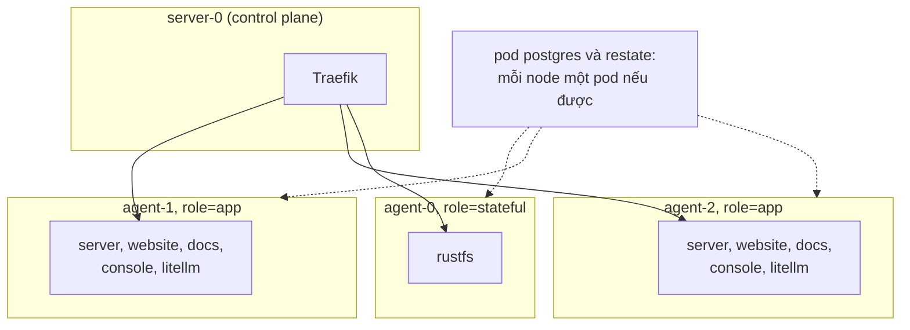
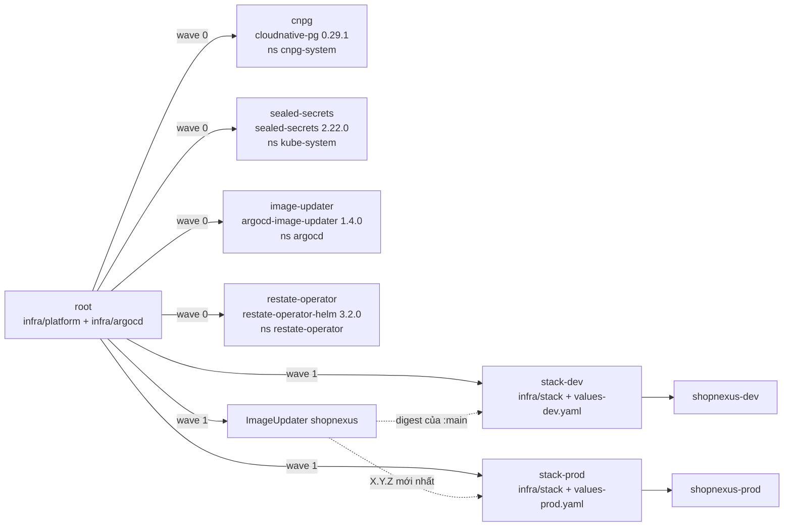

Một cluster k3d tên `shopnexus` chạy hai stack ShopNexus là dev và prod. Mỗi stack nằm trong namespace riêng và có database, cluster Restate, object store và cổng mô hình ngôn ngữ của riêng nó. Argo CD giữ cả hai stack khớp với repo tổng; bản thiết kế nằm ở `docs/superpowers/specs/2026-11-04-infra-k3d-stacks-design.md`.

## Các node

Cả hai file cấu hình k3d, `infra/cluster/k3d-direct.yaml` và `infra/cluster/k3d-behind-proxy.yaml`, tạo một server node và ba agent từ image `rancher/k3s:v1.37.1-k3s1`. Mỗi agent đóng vai một máy và mang một nhãn `role` mà các workload của chart ưu tiên.

| Node | Nhãn | Ưu tiên chạy |
|---|---|---|
| `server-0` | control plane | Traefik (cả hai cấu hình biên ghim nó ở đây bằng `nodeSelector`) |
| `agent-0` | `role=stateful` | RustFS |
| `agent-1` | `role=app` | `server`, `website`, `docs`, `console`, LiteLLM |
| `agent-2` | `role=app` | giống `agent-1` |



Mọi quy tắc xếp chỗ đều là ưu tiên. Node affinity theo `role` và pod anti-affinity của `server`, `website`, `docs`, `console` dùng `preferredDuringSchedulingIgnoredDuringExecution`. CloudNativePG dùng `podAntiAffinityType: preferred`, còn `RestateCluster` rải pod bằng `topologySpreadConstraints` với `whenUnsatisfiable: ScheduleAnyway`. Vì vậy pod vẫn được xếp lịch khi một agent bị dừng; khi cả ba agent chạy, ba pod Restate của prod nằm trên ba agent.

k3d chạy mỗi node thành một container Docker trên cùng một host, nên các agent dùng chung một kernel và một ổ đĩa. Với Kubernetes, dừng một agent bằng `docker stop` vẫn giống mất một máy, và các bài diễn tập failover cần đúng điều đó. Đây là dự án để học, và k3d giữ chi phí ở mức một máy. Ngoài `infra/cluster/`, tên k3d chỉ xuất hiện ở `litellm.apiBase` trong `infra/stack/values.yaml`, giá trị trỏ tới cli-proxy-api trên host tại `host.k3d.internal:8317`. Chuyển sang k3s trên máy thật thì đổi `infra/cluster/` và giá trị đó.

## Các stack

| | dev | prod |
|---|---|---|
| Tên miền | `dev.shopnexus.id.vn` | `shopnexus.id.vn` |
| Namespace | `shopnexus-dev` | `shopnexus-prod` |
| Namespace Restate | `restate-dev` | `restate-prod` |
| Application Argo CD | `stack-dev` | `stack-prod` |
| File values | `values-dev.yaml` | `values-prod.yaml` |
| `APP_ENV` | `dev` | `prod` |
| Image | `:main`, theo digest | `X.Y.Z` mới nhất, theo semver |

`RestateCluster` của một stack tên là `restate-<stack>`, và restate-operator đặt nó vào namespace cùng tên. Chart tạo namespace đó ở sync wave -1 để `restate-secrets` đã seal có mặt trước khi cluster khởi động. NetworkPolicy chặn mọi ingress trong namespace của stack và chỉ mở những đường stack cần ([Biên và mạng](/vi/operations/cluster/networking) liệt kê chúng). Không policy nào mở đường giữa `shopnexus-dev` và `shopnexus-prod`.

## Các thành phần

Mỗi dòng là một resource mà chart trong `infra/stack` render vào namespace của stack. Số lượng lấy từ `values.yaml` (dev) và `values-prod.yaml` (prod).

| Thành phần | Kind | Cổng | dev | prod |
|---|---|---|---|---|
| `server` | `RestateDeployment` | 8080 HTTP, 9080 Restate | 1 | 3 |
| `website` | `Deployment` | 3000 | 1 | 2 |
| `docs` | `Deployment` | 80 | 1 | 1 |
| `console` | `Deployment` | 80 | 1 | 2 |
| `litellm` | `Deployment` | 4000 | 1 | 1 |
| `postgres` | `Cluster` của CloudNativePG | 5432 | 1 instance, 5Gi | 2 instance, 10Gi |
| `restate-<stack>` | `RestateCluster` | 8080 ingress, 9070 admin | 1 node, 2 GiB | 3 node, 4 GiB |
| `rustfs` | `StatefulSet` | 9000 | 1, 10Gi | 1, 10Gi |

Restate nhân bản mỗi partition ra `min(2, replicas)` node, tức 1 bản ở dev và 2 bản ở prod. Postgres chạy image `paradedb/paradedb:0.26.4-pg18`; LiteLLM có database riêng `litellm` trên cùng cluster CloudNativePG. Service `server-api` ở cổng 8080 chọn mọi pod server thuộc mọi phiên bản, còn restate-operator tạo cho mỗi phiên bản server một Service ở cổng 9080.

Bốn Job chạy dưới dạng Sync hook của Argo CD:

| Job | Wave | Việc làm |
|---|---|---|
| `migrate` | 1 | chạy migration của server (`cmd/migrate`) |
| `objectstore-init` | 1 | tạo bucket `shopnexus` |
| `objectstore-init-snapshots` | 1 | tạo bucket `restate-snapshots` |
| `litellm-key` | 3 | tạo hoặc cập nhật virtual key LiteLLM của server |

Argo CD áp dụng một stack theo các sync wave từ -1 tới 3. Bảng ghi mỗi wave gồm những gì, cùng các workload có trạng thái, nằm ở trang [Postgres, Restate và RustFS](/vi/operations/cluster/data#sync-wave-và-job).

## App-of-apps

Ở lần khởi động đầu, k3s cài Argo CD (chart `argo-cd` 10.11.7, namespace `argocd`) từ `infra/cluster/argocd.yaml` và apply một Application duy nhất là `root`; cả hai file đến từ danh sách `files:` trong file cấu hình k3d. Từ đó Argo CD quản lý mọi thứ còn lại, kể cả `root`. Khi server node khởi động lại, k3s apply lại bản `root.yaml` nó nhận lúc tạo cluster, và self-heal của Argo CD đưa bản trong git trở lại trong vòng vài phút.



`root` có hai nguồn trong repo tổng: `infra/platform`, chứa một Application cho mỗi chart nền tảng, và `infra/argocd`, chứa chính `root.yaml`, `stack-dev`, `stack-prod` và `ImageUpdater`. Các chart nền tảng lấy từ Helm repository gốc của chúng, không được vendor vào repo. Chart của restate-operator được đọc từ GHCR dưới dạng OCI repository qua Secret `repo-restatedev-oci`.

Từ bản 1.8, Argo CD không còn tự đánh giá health của một Application. Phần values trong `infra/cluster/argocd.yaml` thêm một health check cho `argoproj.io/Application`, nhờ đó `root` chờ các Application nền tảng ở wave 0 Healthy rồi mới tạo các stack ở wave 1. Mọi Application tự sync với `prune` và `selfHeal`, và retry không giới hạn. `root` bỏ qua `/spec/source/helm/parameters` trên các Application của stack, vì Image Updater ghi tag image vào đó và self-heal sẽ đặt lại giá trị cũ nếu không bỏ qua.

## Cấu trúc thư mục

```text title="infra/"
infra/
├── check.sh                      # lint chart, chạy test của chart, kiểm Argo CD và biên; CI chạy file này
├── smoke.hurl                    # hurl --test --variable domain=<domain>: gọi mọi host của một stack
├── go.mod                        # module Go cho cmd/
├── cmd/
│   └── seal/                     # go -C infra run ./cmd/seal dev|prod [-dry-run]: seal secret của một stack
│       ├── main.go
│       └── main_test.go          # go -C infra test ./...; cần Docker
├── cluster/                      # dùng một lần cho mỗi máy; phần duy nhất gắn với k3d
│   ├── k3d-direct.yaml           # cấu hình k3d: Traefik trên 80/443 với ACME, Argo CD, root
│   ├── k3d-behind-proxy.yaml     # cấu hình k3d: Traefik sau một proxy, tại 127.0.0.1:18080, Argo CD, root
│   └── argocd.yaml               # HelmChart của k3s: Argo CD, kèm health check cho Application
├── argocd/
│   ├── root.yaml                 # app-of-apps
│   └── stacks.yaml               # stack-dev, stack-prod và ImageUpdater
├── platform/                     # mỗi chart gốc một Application
│   ├── cnpg.yaml
│   ├── image-updater.yaml
│   ├── restate-operator.yaml
│   └── sealed-secrets.yaml
└── stack/                        # Helm chart "shopnexus": một stack
    ├── Chart.yaml
    ├── values.yaml               # giá trị mặc định, cũng là giá trị của dev
    ├── values-dev.yaml           # stack, domain, appEnv, ngân sách LiteLLM
    ├── values-prod.yaml          # như trên, thêm replica, storage và tag 0.1.0
    ├── secrets/
    │   ├── example.env           # mẫu mà cmd/seal chép thành <stack>.env
    │   ├── dev/                  # SealedSecret của stack-dev, có commit
    │   └── prod/                 # SealedSecret của stack-prod, có commit
    ├── templates/                # server, web, postgres, restate, rustfs, litellm,
    │                             # jobs, ingress, networkpolicy, secrets, validate
    └── tests/                    # các suite helm-unittest, và SealedSecret mẫu mà chúng render cùng
```

Lệnh seal giữ các khóa nó sinh ra trong `infra/stack/secrets/<stack>.env` và `<stack>.restate.pem`. Git bỏ qua các file này, và chúng cần được sao lưu cùng khóa của controller ([Secret](/vi/operations/cluster/secrets)).

## Nguyên tắc thiết kế

<KeyRules>
- Một Helm chart, `infra/stack`, render cả hai stack. `values-dev.yaml` và `values-prod.yaml` chứa mọi khác biệt giữa chúng.
- Mọi host suy ra từ một giá trị `domain`: `<domain>`, `api.<domain>`, `media.<domain>`, `docs.<domain>` và `console.<domain>`.
- Mọi thứ riêng của một môi trường đều nằm trong `infra/`. Ngoại lệ duy nhất là file proxy trên host `conf.d/shopnexus.caddy` trong `linux-server-setup`, dùng cho chế độ `behind-proxy`.
- Chỉ `infra/cluster/` và `litellm.apiBase` biết đến k3d.
- CI build image và không bao giờ kết nối tới cluster; Argo CD kéo mọi thay đổi từ git.
</KeyRules>

Một bản fork, theo trang [Dựng một cluster](/vi/operations/cluster/bootstrap), đổi `repoURL` trong `infra/argocd/root.yaml` và `infra/argocd/stacks.yaml`, và `domain` trong hai file values. Image thuộc owner khác `ghcr.io/shopnexus` thì cần thêm tên mới trong `values.yaml` và `stacks.yaml`. Image website đặt `API_URL=http://server-api:8080/v1`, tên một Service trong cluster, phân giải được trong bất kỳ namespace stack nào website đang chạy, nên một image dùng được cho cả hai stack.

## Việc để sau

Bản thiết kế để sao lưu, quan sát hệ thống, máy thật và file `docker-compose.yml` ở gốc repo ra ngoài phạm vi.

- Không có gì sao lưu Postgres, RustFS hay Restate. Khóa của controller Sealed Secrets và các file lệnh seal ghi ra phải được lưu bằng tay.
- Chart đặt `OTEL_EXPORTER_OTLP_ENDPOINT` là chuỗi rỗng, nên server không gửi gì qua OTLP và chỉ ghi log JSON ra stdout. Cluster không chạy collector nào.
- Các agent là container trên cùng một host và dùng chung ổ đĩa của nó, nên hỏng ổ đĩa là mất mọi node. Chuyển sang k3s trên các máy riêng thì đổi `infra/cluster/` và `litellm.apiBase`.
- File `docker-compose.yml` ở gốc repo giờ có hai profile. `dev` chạy dev server của docs, website và console với Compose Watch. `prod` build mọi thành phần từ Dockerfile của nó và chạy chúng cùng Postgres, Restate và RustFS riêng, sau Caddy ở cổng 56480. `infra/check.sh` báo lỗi khi tag image của Postgres, Restate và RustFS trong file đó khác với `infra/stack/values.yaml`.
- Bản thiết kế ước tính hai stack dùng 6 đến 8 GB bộ nhớ; con số này chưa được đo trên server của tác giả. Phương án dự phòng là scale dev về 0 khi không dùng, hoặc giảm cluster xuống hai agent.
